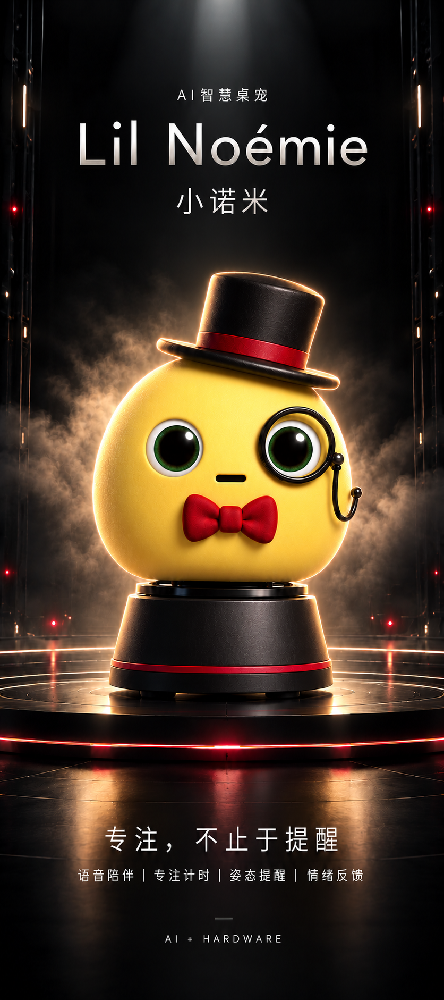
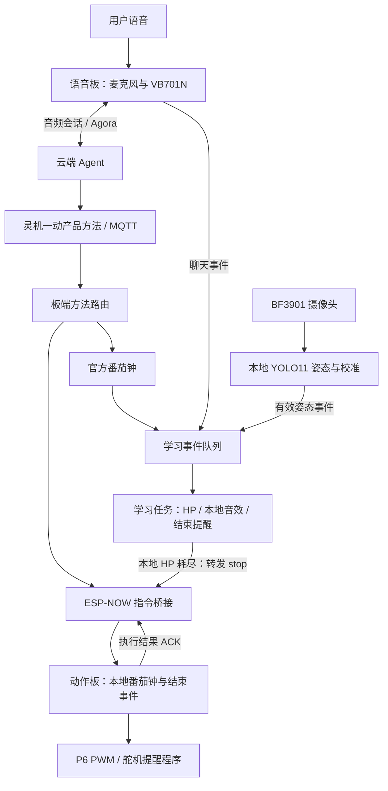

# 小诺米 · Lil Noémie

**专注，不止于提醒。**

基于灵机一动 XJWB03 / ESP32-S3 的桌面 AI 陪伴机器人，将云端语音对话、番茄钟、专注血条、坐姿检测与动作反馈连接成一套学习陪伴体验。

<p align="center">
  
</p>
<p align="center"><em>项目概念海报 · 外观视觉设定，实物效果以装配版本为准</em></p>

[项目概览](#overview) · [功能与进度](#features) · [系统架构](#architecture) · [快速开始](#quickstart) · [测试与验证](#validation) · [工程实践](docs/PROJECT_CASE_STUDY.md)

<a id="overview"></a>
## 项目概览

小诺米面向学习、办公和日常陪伴场景。设计目标是让桌宠能够听懂用户的需求，并通过计时、声音和转头动作反馈学习状态：平时可以对话，专注时协助维持节奏，一轮学习结束后主动提醒。

项目由最初的 MorphCube 学习伙伴方案迭代而来，当前以“小诺米 / Lil Noémie”为产品名称，部分目录保留 `morphcube` 工程代号。外观采用礼帽、领结和单片眼镜的绅士蛋形象；机械结构、供电和整机装配仍在迭代。

- **项目类型**：AI + 硬件 / 桌面陪伴机器人 / 团队原型项目。
- **核心平台**：ESP32-S3、ESP-IDF 5.4.1、QUMIOS、灵机一动云平台、Agora。
- **交互方向**：语音陪伴、专注管理、姿态提醒和拟人化反馈。
- **当前阶段**：业务固件与双板控制链路已接入，持续进行视觉、音频和执行机构的整机验收。

<a id="features"></a>
## 功能与当前进度

| 能力 | 当前实现 | 验证与边界 |
| --- | --- | --- |
| 语音陪伴 | VB701N 音频链路、Agora Agent 会话、云连接后唤醒和 `wake` 调试入口 | 曾完成实板对话；云端人设、回答质量及最新音频改动仍需联调 |
| 番茄钟 | 25 分钟专注、5 分钟短休、15 分钟长休；开始、暂停、继续、停止 | 已接入官方计时器；双板开始/停止指令和执行回执有实机验证 |
| 专注血条 | 100 HP，聊天、暂停和有效姿态事件触发扣血；受伤与耗尽音效接口 | 状态机已实现；HP 灯板和控制面板可视化待完成 |
| 坐姿检测 | BF3901 取图、YOLO11 姿态关键点、相对基准校准、有效/未知状态区分 | 校准与分类主机测试通过；真人准确率和长期稳定性未验收 |
| 结束提醒 | 自然结束、手动结束、HP 耗尽统一请求左右摆头；P6 / GPIO6 控制 | 结束事件与控制输出已验证；舵机实际转动、供电和装配仍待排查与验收 |
| 双板协作 | 语音板转发 `start / pause / resume / stop`，动作板本地执行并返回 ACK | 加密 ESP-NOW、有限重试、去重已实现；两板同信道互通有实测记录 |
| 扩展业务 | 闹钟、课程表、资源播放、音量控制等 SDK 应用模块 | 代码入口保留，各模块在整机上的效果需分别验收 |

**规划中的体验**：分场景口语练习、基于真实学习记录的总结、控制面板、可见血条和学习记录持久化。当前的聊天/姿态规则是事件启发式，不代表已经具备通用的“分心识别”或情绪识别能力。

## 一轮专注如何工作

1. 用户通过语音请求开始专注，云平台下发 `pomodoro` 方法，设备进入 FOCUS。
2. 官方番茄钟提供唯一计时来源；学习任务消费计时、聊天和姿态事件，维护 HP。
3. 当前规则为：有效非计时聊天扣 10 HP；暂停期间每秒扣 0.2 HP；满足时长与冷却条件的姿态提醒扣 5 HP。
4. HP 耗尽时结束本轮，并请求本地反馈；下一次成功开始新一轮时恢复 100 HP。
5. 自然结束、手动停止和 HP 耗尽均进入同一套结束提醒逻辑，同一专注阶段成功提交后去重。

舵机名义动作是 **60° → 120° → 60° → 120° → 90°**，围绕 90° 左右各摆 30°；后台每 40ms 渐变约 5°，每个目标预留 720ms，整套约 4.4 秒后停止 PWM。角度表示控制目标，当前没有轴位置反馈。

详细规则见[学习状态机](docs/STUDY_RUNTIME.md)和[结束提醒](docs/FOCUS_SERVO_REMINDER.md)。

<a id="architecture"></a>
## 系统架构



两条 AI 工作流分别是 **云端语音理解与对话**、**设备端视觉推理与姿态规则**。设备动作经产品方法和板端状态机触发，当前采用 Agora 语音传输与 ESP-NOW 板间指令协作。

| 层次 | 实现与职责 |
| --- | --- |
| 应用业务 | C / C++；番茄钟、HP、音效和结束提醒 |
| 并发与状态 | FreeRTOS 任务、消息队列、单调时钟；学习状态由专用任务修改 |
| 云端连接 | BLE 配网、Wi-Fi、MQTT 方法路由、Agora Agent 音频 |
| 板间控制 | 加密 ESP-NOW 单播、session / seq、执行 ACK、最多 3 次发送 |
| 本地视觉 | BF3901、ESP-DL / YOLO11、相对姿态校准和关键点有效性检查 |
| 执行机构 | 50Hz PWM、角度范围约束、渐变动作、忙时拒绝及停止命令 |
| 工程保障 | Git / Pull Request、Python 主机测试、产品身份与配对密钥本地配置 |

### 双板分工与边界

- **语音板（voice）**：负责听、说和云端方法接入，将专注命令转发给动作板。
- **动作板（action）**：接收指令并在本机执行番茄钟与舵机提醒。
- 两板按 Wi-Fi STA MAC 识别角色，可以使用各自的产品 PID；都需连接同一 2.4GHz Wi-Fi 信道。
- 接收端通过 session / seq 抑制重复执行，旧序号会被拒绝；新意图可以替换尚未确认的旧指令。
- ACK 表示设备执行接口的返回结果。断电后的去重记录、精确时钟同步和舵机轴反馈未实现；语音回复也尚未集成远端执行结果确认。

详见[双板通信协议与配置](docs/BOARD_BRIDGE.md)。

## 硬件与接线

| 部件 | 用途 | 当前接入说明 |
| --- | --- | --- |
| XJWB03 主控板 | 运行固件、云连接与控制 | ESP32-S3；历史板卡为 16MB Flash、8MB PSRAM |
| VB701N 语音板、麦克风、扬声器 | 音频输入输出 | 由板端语音模块与 Agent 链路管理 |
| BF3901 摄像头板与模组 | 图像采集与坐姿实验 | VCC 为 3.3V；当前按 1-bit SPI 方式接收 |
| Micro Servo / SG90 类舵机 | 左右摆头提醒 | 黄线接 P6 / GPIO6，红线接符合舵机规格的稳压 5V，棕线接电源负极并与主控 GND 共地 |
| WS2812 灯板 | 预留灯光与状态反馈 | 驱动入口保留；HP 可视化待集成 |
| MPU6050 六轴传感器 | 预留机身姿态感知 | 默认 GPIO8 与摄像头 DATA0 冲突，当前主入口未启用 |

摄像头当前引脚定义：SDA=P21、SCL=P47、VSYNC/CS=P4、PCLK/SCLK=P13、D0=P8、PWDN=P41。HREF、D1 在当前 1-bit 接法下悬空；以 [bsp_camera.h](sdk/apps/main/peripheral/bsp_camera.h) 为准。舵机参数见 [bsp_servo.h](sdk/apps/main/peripheral/bsp_servo.h)。

舵机供电应按实际器件和负载验证；主板 5V 接线下仍有“程序执行但舵机不动”的反馈。使用独立舵机电源时保持共地；PC USB 给主板供电期间，外部正极不直接并到主板 5V，以免在电源路径未确认时反向供电。电池、充电与外壳集成尚未完成整机验收。

<a id="quickstart"></a>
## 快速开始

### 1. 获取源码并准备环境

建议使用 Windows PowerShell，以及英文、无空格的项目和工具路径。仓库包含 SDK 源码与模型，仍需安装编译工具和 Python 环境。

```powershell
git clone --depth 1 https://github.com/Keli111015/xiaonuomi.git D:\dev\xiaonuomi
Set-Location D:\dev\xiaonuomi

$env:IDF_TOOLS_PATH = 'D:\esp-tools'
.\sdk\esp-idf\install.bat esp32s3
. .\sdk\export.ps1

python -c "import sys, click; print(sys.executable)"
```

当前内置 ESP-IDF 为 5.4.1。每个新终端都需重新导出环境；如果 Python 仍指向 Conda 或缺少 IDF 依赖，先检查环境导出。详细说明见[完整工程使用说明](docs/FULL_REPOSITORY.md)。

### 2. 配置自己的产品身份

```powershell
$cloudLocal = 'sdk\apps\main\cloud\ljyd_cloud_local.h'
if (-not (Test-Path -LiteralPath $cloudLocal)) {
    Copy-Item 'sdk\apps\main\cloud\ljyd_cloud_local.example.h' $cloudLocal
}
```

编辑本地文件，填写自己在灵机一动平台的产品 PID 与密钥。`CONFIG_XJIANG_CLOUD_SECERT` 是 SDK 既有拼写。克隆仓库不会获得平台 Agent 配置、账号权限或设备绑定；不同产品的板卡分别使用自己的身份构建。

**可选：启用双板桥接。** 将 [board_bridge_local.example.h](sdk/apps/main/lj_components/pomodoro/board_bridge_local.example.h) 复制为同目录的 `board_bridge_local.h`，填写两块实板的 Wi-Fi STA MAC 和两组随机 16 字节 PMK / LMK；两板使用相同配对信息。完成配置后删除模板中的占位 `#error`。未提供此私有文件时，桥接功能保持关闭；MAC 不匹配时也不会启用。步骤与约束见[双板说明](docs/BOARD_BRIDGE.md)。

### 3. 构建与上板

```powershell
.\build_full_sdk.ps1

# 查询实际端口，再将 COMx 替换为对应板卡的端口
python -m serial.tools.list_ports
python sdk\esp-idf\tools\idf.py -C sdk\apps -p COMx flash monitor
```

`build_full_sdk.ps1` 只构建，产物位于 `sdk/apps/build/`，应用镜像名为 `vb701n.bin`。首次上板需按构建结果写入分区和姿态模型；只更新应用时也应先确认板上分区、模型与固件匹配。配网使用平台支持的 BLE 流程，手机热点需提供兼容的 2.4GHz 网络。

### 4. 串口调试与演示

默认串口波特率为 115200。串口助手、IDE 监视器和烧录器需要依次使用同一个端口。

| 命令 | 用途 |
| --- | --- |
| `wake` | 请求唤醒语音会话 |
| `cam status` / `cam snap` | 查看相机状态 / 请求串口抓拍 |
| `cam calibrate 90` / `cam pose 90` | 请求重校准 / 姿态检测；方向可选 0、90、180、270 |
| `servo status` | 查看名义角度序列、控制范围和 PWM 状态 |
| `servo angle 90` / `servo stop` | 设置角度目标 / 取消动作并关闭 PWM |
| `servo probe` | 对 GPIO6 电平采样并停止 PWM，用于排查控制输出 |
| `link status` | 查看当前板卡角色、信道、发送和 ACK 序号 |
| `link start` / `link pause` / `link resume` / `link stop` | 从 voice 板测试跨板专注命令 |

演示双板结束提醒时，先检查两板 `link ready=1` 且信道相同，再在 voice 板发送 `link start`，等待数秒后发送 `link stop`。动作板应记录执行结果与结束提醒请求；实物是否摆动需同时观察。闲置状态直接 stop、暂停/继续、停止休息或跳过阶段均不触发这套结束提醒。

<a id="validation"></a>
## 测试与验证

**2026-11-01，在同步最新团队代码后重跑以下四组主机测试，均通过。** 这些测试使用生产逻辑或生产代码的模拟环境，覆盖软件规则，尚不能替代整机验收。

```powershell
# 需要 Python 以及可在 PATH 中访问的 GCC / G++
python tools/tests/test_pose_host.py --cxx g++
python tools/tests/test_servo_host.py --cc gcc
python tools/tests/test_board_bridge.py --cc gcc
python -m unittest discover -s tools/tests -p "test_study_voice_guard.py"
```

| 测试组 | 已覆盖的主要边界 |
| --- | --- |
| 姿态 | 三个独立帧校准、基准冻结、低分/缺失关键点拒绝、相对倾斜及重置 |
| 舵机与结束事件 | 完整动作、忙时拒绝、角度边界、手动覆盖、PWM 错误路径；70 种事件组合及 HP 耗尽转发 |
| 板间通信 | 加密 peer 配置、重复执行抑制、有限重试、新意图覆盖与过期序号拒绝 |
| 语音指令 | 番茄钟命令、普通聊天及状态 TTS 的分类规则 |

历史实板记录已验证双板同信道下的指令转发与执行 ACK，以及 GPIO6 的 PWM 跳变。舵机曾反馈完全不动，因此目前不将这些日志视为实际机械运动通过。当前最新整机固件、坐姿真人精度、复杂音频并发、断电恢复与供电负载仍需继续验证。更多入口见[测试说明](tools/tests/README.md)。

## 项目经历与工程实践

这个项目覆盖了从交互设计到板端联调的完整原型开发过程。主要工程工作包括：

- **事件驱动的专注系统**：将番茄钟作为唯一时钟，通过专用学习任务统一处理 HP、音效和生命周期，减少模块各自维护状态带来的偏差。
- **双板任务协作**：把语音交互与动作接收按角色组织，用加密 ESP-NOW、执行回执和有界重试形成可诊断的控制链路。
- **视觉识别接入**：将现有姿态模型输出转为相对基准规则，引入有效性检查、UNKNOWN 和异常样本累计，避免把单帧结果直接当作持续坐姿。
- **执行机构集成**：梳理摄像头与舵机的引脚复用；为结束提醒增加角度约束、渐变、去重、停止与错误处理。
- **团队工程化**：整理产品源码与依赖，采用本地私有配置、功能分支和 Pull Request，并补充主机回归测试与交接文档。

设计取舍、问题定位与团队项目经历概述见[项目实践复盘](docs/PROJECT_CASE_STUDY.md)。个人分工可通过仓库[提交记录](https://github.com/Keli111015/xiaonuomi/commits/main/)与 [Pull Requests](https://github.com/Keli111015/xiaonuomi/pulls)对应查看。

## 仓库结构与开发入口

```text
xiaonuomi/
├─ README.md
├─ build_full_sdk.ps1               # 完整应用构建入口
├─ docs/
│  ├─ assets/lil-noemie-poster.png  # 项目概念海报
│  ├─ PROJECT_CASE_STUDY.md         # 工程实践与项目经历
│  ├─ FULL_REPOSITORY.md            # 环境、构建与烧录
│  ├─ STUDY_RUNTIME.md              # 学习规则
│  ├─ BOARD_BRIDGE.md               # 双板通信
│  └─ FOCUS_SERVO_REMINDER.md        # 结束提醒
├─ sdk/
│  ├─ apps/main/
│  │  ├─ agent/                    # Agent 与语音指令分类
│  │  ├─ cloud/                    # 配网、云连接、方法路由
│  │  ├─ voice/                    # 语音硬件与本地声音
│  │  ├─ peripheral/               # 摄像头、舵机等外设
│  │  ├─ pose/                     # 本地视觉推理与服务
│  │  ├─ qm_config/                # 功能配置
│  │  └─ lj_components/            # 学习、计时与扩展业务
│  ├─ esp-idf/
│  ├─ qumios-dev/
│  └─ components/
└─ tools/tests/                    # 主机回归测试
```

日常业务开发以 `sdk/apps/main/` 为准。完整文档入口：[文档导航](docs/README.md)。

## 后续迭代

- [ ] 完成舵机供电、接线和实际摆动的闭环验收，补充实物演示视频。
- [ ] 稳定摄像头取帧和校准，采集多使用者、多光照下的坐姿样本并量化误报。
- [ ] 验证语音、取图、音效和计时并发时的资源释放与长时间运行。
- [ ] 打通 HP 灯板/控制面板展示及学习记录持久化。
- [ ] 完成分场景口语、基于真实记录的学习总结和陪伴人设调优。
- [ ] 验证外壳装配、电池与充电方案，形成可复现的整机交付资料。

## 贡献与许可

欢迎通过 Issue 记录复现条件，通过功能分支和 Pull Request 提交修改。硬件问题请注明板卡、接线、固件版本与实际现象；敏感配置使用占位值。

产品密钥、`ljyd_cloud_local.h`、`board_bridge_local.h`、已配置身份的个人固件、Flash 备份及原始设备日志保留在本地。公开展示素材统一放入 `docs/assets/`。

项目基于灵机一动官方 SDK 扩展，ESP-IDF、QUMIOS、模型及其他组件保留各自的来源和许可；本仓库未统一重新授权为 MIT。详见[第三方来源与许可证](THIRD_PARTY_NOTICES.md)及 [SDK 来源记录](docs/SDK_PROVENANCE.json)。
