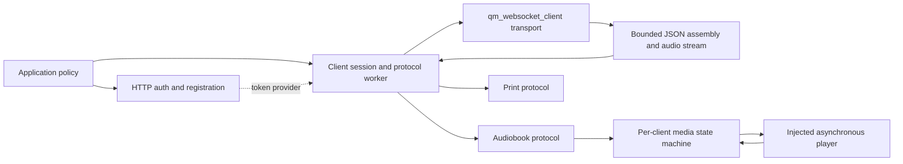
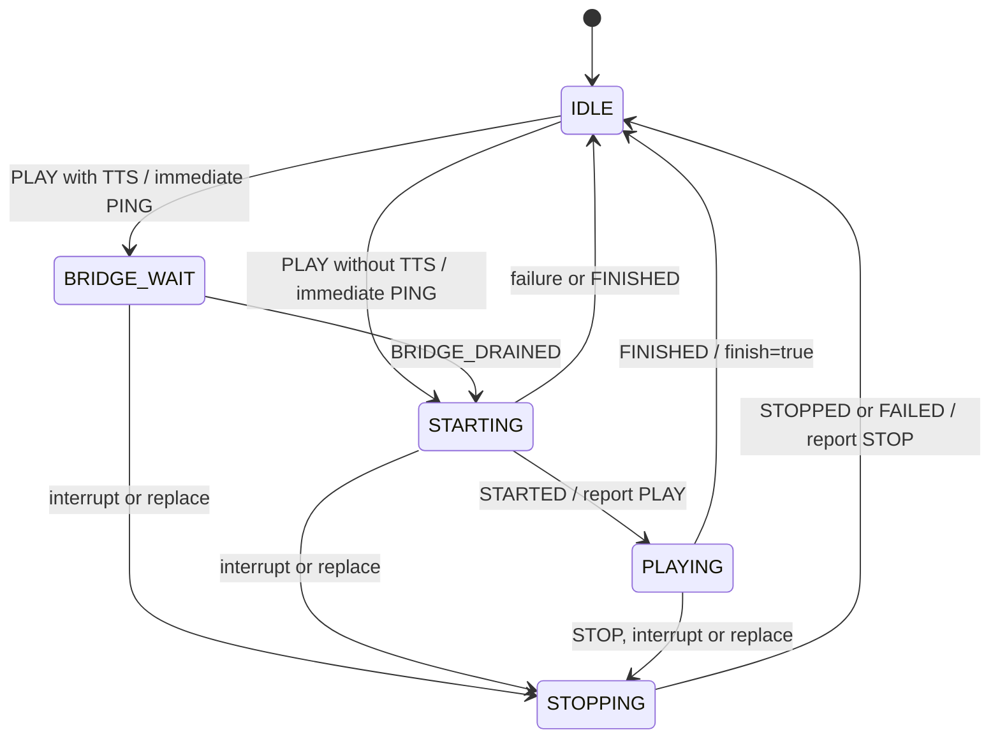

# JoyInside client

[中文](README_CN.md)

A QUMI component for JoyInside protocol and session management. HTTP authentication, voice, JPEG reporting, audiobook control and printing have separate interfaces. Applications own credential persistence, user binding policy, playback and device arbitration. Protocol references were checked against the [official handbook](https://joyinside.com/handbook/) on 2026-09-17.

## Architecture



| Files | Responsibility |
| --- | --- |
| `joyinside_client.h/.c` | Connection identity, voice negotiation, receive assembly, audio queue, reconnect and protocol deadlines |
| `joyinside_client_auth.h/.c` | HMAC-MD5 V2, tokens and refresh, productId registration, bind/query/unbind |
| `joyinside_client_audiobook.h/.c` | AUDIO_BOOK validation, callbacks, status messages and keepalive |
| `joyinside_client_media.h/.c` | Optional per-client playback controller with an injected backend |
| `joyinside_client_print.h/.c` | PRINT validation, callbacks including response metadata, and uplink |
| `joyinside_client_vision.h/.c` | Optional session-bound HTTP JPEG reporting with streamed Base64 |
| `priv_include/joyinside_client_internal.h` | Per-client extension storage and internal scheduling |

The core worker owns reconnect, audio encoding/sending and deadline dispatch. Heartbeat, voice ACK timeout, context renewal and audiobook PING use the same worker; none retains the client through an independent OS timer callback. The WebSocket worker receives messages and negotiates voice. The optional media worker serializes player transitions. Application callbacks may arrive on the core or WebSocket worker; synchronize application state and return promptly.

## Connection lifecycle

1. `joyinside_client_init()` copies configuration, including `voice.chat_role_code`.
2. Register audiobook/print handlers, or create the media controller, while the client is stopped.
3. `joyinside_client_start()` copies session parameters and starts asynchronously. `QM_EOK` means accepted.
4. Before each connection, the core worker calls `token_provider` and generates a fresh `requestId`. Reconnects preserve `sessionId`; an application may supply a reusable session ID.
5. Each connection starts with `CLIENT_VOICE_CHAT_UPDATE`. Only a matching `SERVER_VOICE_CHAT_UPDATED` enables audio and emits `EVENT_CONNECTED`. The client checks both wire formats, codecs, sample rates, VAD/stream/CBR flags and explicitly requested frame/timbre/role parameters.
6. ACK failure/timeout rebuilds the connection. `CFG_BOT_EVENT` remains informational. A replaced session stops automatic reconnect until an application restart.

`token_provider(context, force_refresh, token, token_len)` runs without client locks. Use bounded I/O and never stop/destroy from it. Input length is capacity; successful output length excludes NUL. A rejected HTTP Authorization (401/403) sets `force_refresh` on the next attempt. The application owns token caching, expiry and refresh and may use the auth helpers. A static `access_token` is also supported; the application must replace it and restart after expiry.

```c
joyinside_client_config_t config = {0};
config.on_event = on_joyinside_event;
config.voice.input_codec = JOYINSIDE_CLIENT_AUDIO_CODEC_PCM;
config.voice.output_codec = JOYINSIDE_CLIENT_AUDIO_CODEC_PCM;
config.voice.input_sample_rate = 16000;
config.voice.output_sample_rate = 16000;
config.include_uid_in_messages = QM_TRUE;
joyinside_client_handle_t client = joyinside_client_init(&config);

joyinside_client_start_params_t params = {0};
params.bot_id = application_bot_id;
params.uid = application_bound_uid;
params.token_provider = application_get_valid_token;
params.token_context = application_token_cache;
params.feature = "AUDIO_BOOK_V2"; /* When using media V2; arrange user binding. */
int ret = joyinside_client_start(client, &params);
/* Check ret, then wait for EVENT_CONNECTED before sending. */
```

`joyinside_client_network_update()` suspends connection attempts and token acquisition while offline. `AUTO_RECONNECT` enables bounded jitter using the existing backoff component. Every retry prepares fresh connection identity. Send APIs return `QM_EOK` for accepted data, not byte counts or proof of delivery; transport failures remain asynchronous events.

## Messages and audio

`buffer.ws_rx_size` and `buffer.max_text_size` independently bound transport chunks and complete JSON messages (defaults: 4096 and 65536 bytes). Text is assembled across RX chunks and continuation frames until FIN. Invalid offsets, oversized messages and malformed JSON report errors; oversized messages are discarded through FIN so the next message can recover. Text callbacks have offset zero and a total equal to the complete message length.

Binary audio remains streamed. Base64 TTS is decoded after complete JSON assembly, including 3840-byte, 120ms PCM chunks at 16kHz/16bit/mono. All callback payloads, strings and JSON pointers are borrowed only for the callback duration.

`joyinside_client_send_audio()` copies into preallocated slots without waiting. `AUDIO_QUEUE_LEN` and `AUDIO_PACKET_BYTES` bound storage. Contention returns `-QM_EBUSY`; exhausted capacity returns `-QM_EFULL`. Admission fixes the JSON sequence number and VAD round; the core worker encodes and sends that snapshot. Manual finish follows previously accepted audio. Disconnect drops stale frames instead of replaying them on a new session.

`send_text_input()` sends user text; `send_text()` sends raw protocol JSON. Other APIs cover TTS, interruption, manual audio finish, activities, chat context and coordinates. Successfully updated chat context is retained and reported again after reconnect and before expiry; a failed update preserves the previous snapshot.

## Voice updates and device extensions

Use `voice.input_transport` and `voice.output_transport` independently. `DEFAULT` follows `CONFIG_JOYINSIDE_CLIENT_AUDIO_BINARY`; both wire formats are always built. With `vad=true`, default input becomes Base64 so `content.mid` can identify a round; explicit binary input with VAD is rejected. Call `joyinside_client_vad_round_begin()` before the first frame of each detected segment. Already queued frames keep their original round even when a newer segment starts or an older response finishes.

`joyinside_client_update_voice(client, &voice)` accepts one complete target configuration, copies role text, pauses input and discards queued old audio. Wait for `EVENT_VOICE_UPDATED` (or `EVENT_CONNECTED` after recovery) before resuming. Failed negotiation reconnects using the accepted target. Optional zero/NULL values omit fields; use explicit values when changing them. Speed is 0.8–1.2 and volume 0.5–10; zero means omitted. MP3 alone permits `output_stream`.

`joyinside_client_skill_instruction()` returns one borrowed `joyinside_client_instruction_t`: ordinary `action/args` and alarm V2 `type/operation/params` share the same accessor. The application executes instructions in order, owns persistence/scheduling, and reports the full alarm list through chat context. Chinese TTS emotion descriptions are parsed separately from visual codes; unknown values retain their original strings.

Enable `CONFIG_JOYINSIDE_CLIENT_VISION_SUPPORT` and call `joyinside_client_report_image()` from an application worker after an ASR start or timer trigger. It snapshots the current WS token, bot and session, then streams JPEG Base64 to HTTP without allocating a complete encoded frame. Image memory remains borrowed until return. Registration optionally accepts `resource_authed_list` and `resource_authed_count`.

See [device extension examples](examples/device_extensions.md) for alarm, image, media and print integration. These protocol interfaces do not implement camera capture, alarm scheduling, URL playback or printer drivers.

## Media backend contract

Enable `CONFIG_JOYINSIDE_CLIENT_MEDIA_SUPPORT` and call `joyinside_client_media_create()` with a stopped client. One controller attaches to one client. Alternatively, use audiobook callbacks directly with an application-owned playback policy.



- `backend.start(context, generation, play)` receives the complete URL, absolute start position in seconds and total length. Success means accepted; notify STARTED when playback actually begins.
- `backend.wait_bridge()` waits for both server TTS completion and local speaker drain before BRIDGE_DRAINED. An empty queue alone is insufficient.
- `backend.stop()` requests asynchronous cancellation, including bridge subscriptions. Terminal STOPPED/FAILED/FINISHED notifications guarantee the backend will no longer access that generation. Failed start/wait_bridge calls must also leave no asynchronous work active.
- Report observations through `joyinside_client_media_notify()` with the generation. Stale generations are rejected. `-QM_EFULL` requires retrying terminal notifications.
- Keepalive starts on PLAY receipt and continues during bridge wait, at intervals no greater than two seconds. PLAY status follows STARTED. STOP uses absolute progress; natural completion reports totalLength and `finish=true`.
- Replacement waits for the old backend to stop. STOP for an unrelated book/chapter is ignored. Wake word/alarm preemption uses `media_interrupt()`.

The controller does not bind qm_audio automatically. The application backend must actually implement URL playback, seeking, progress and stop acknowledgement. Forwarding a start position to an incapable backend does not implement resume. Media is not wired into the current alarm_app; host tests do not validate physical playback.

## Ownership and migration

Serialize lifecycle calls, stop external senders before stop, and never stop/destroy from component callbacks. Timeouts retain valid objects for retry. With media attached, use `client_stop()` → `media_destroy(media, timeout_ms)` → `client_destroy()`. Client destroy returns `-QM_EBUSY` while media remains attached. Stopping the client requests media cancellation; freeing media still requires backend quiescence. Extension registrations survive stop and can only be changed on a stopped client.

| Previous API/behavior | Current design |
| --- | --- |
| Old multi-output `skill_instruction()` | One `joyinside_client_instruction_t` output; update callers |
| Build-time-only audio wire format | Per-direction runtime transport; Kconfig supplies defaults |
| `voice_updated.audio_binary` | `input_binary` and `output_binary` |
| `credentials.app_id` | `credentials.product_id`; registration sends productId |
| `query_bot_bind(request)` | `query_bot_bind(request, uid, uid_len)` returns the bound UID |
| `skip_voice_update_on_connect` | Removed; voice negotiation is required |
| `ack_retry_count` / `ACK_RETRY_COUNT` | Removed; ACK failure rebuilds the connection |
| Singleton media and direct audio dependency | Per-client controller with an asynchronous backend |
| Void extension unregister | Status return; `-QM_EBUSY` while running |
| Positive successful text send result | Uniform `QM_EOK` |

Unbind serializes `deleteMemory` and requires `data=true`. Bind validates the returned UID, and query exposes it. Each getToken HTTP retry generates its own nonce and signature. Custom refresh endpoints use `endpoint.refresh_url`. String lengths exclude NUL; `-QM_EFULL` reports required content length, so reserve one additional byte.

## Build and verification

Link core, audiobook and print sources with the existing WebSocket, backoff, cJSON, string, UUID, timer utility and QMOS capabilities. Base64 is always required. Auth additionally needs HTTP, HMAC/MD5 and time services; vision additionally needs HTTP. Link the vision source (disabled builds provide an ENOSYS stub); media is optional. `qm_kconfig` exposes settings. The current alarm_app Makefile already includes these sources and backoff. Deadline utilities do not require OS timer callbacks.

`LOG_CONFIG` and `joyinside_client_set_log_flags()` control logging. Defaults retain errors and lifecycle information. Full payload logging may contain business content.

From qumios-dev:

```sh
cmake -S components/joyinside_client/tests -B /tmp/joyinside-tests
cmake --build /tmp/joyinside-tests -j 4
ctest --test-dir /tmp/joyinside-tests --output-on-failure
```

Tests enable AddressSanitizer, UndefinedBehaviorSanitizer and warnings as errors. Coverage includes binary/Base64, manual/free ingress, media enabled/disabled, fragmented JSON, HTTP contracts, connection identity, initial/runtime negotiation, VAD queue ordering, independent wire formats, alarm V2, streamed image upload, stopping during token acquisition, multiple extension instances and media lifetime/ordering. HTTP, WebSocket and player substitutes avoid external business requests.

Target-toolchain builds and device tests remain necessary for WSS, actual audio, weak-network recovery, token expiry, bridge drain and seek. Resolve handbook UID/TTL differences against the deployment environment and returned service values.
