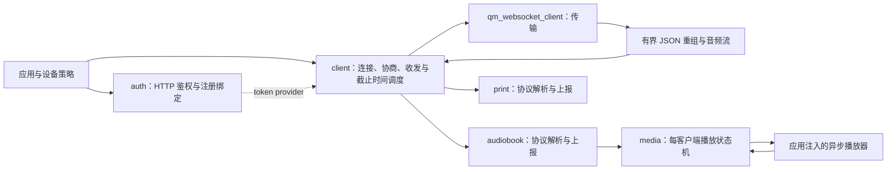
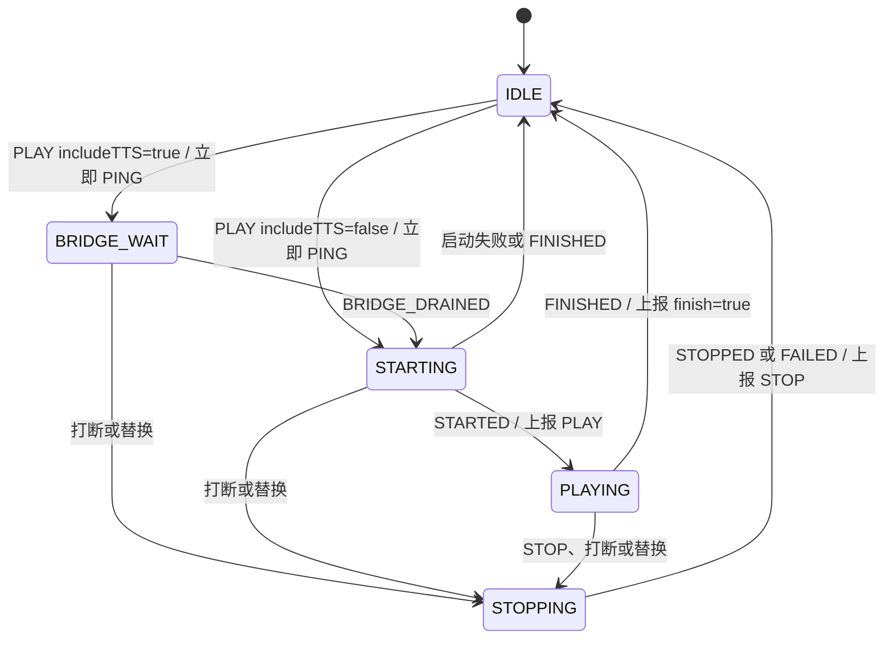

# JoyInside 客户端

[English](README.md)

组件负责 JoyInside 接入协议和会话生命周期。HTTP 鉴权、实时语音、媒体控制和打印解析分别提供接口；应用负责凭据保存、用户绑定策略、播放器和设备资源调度。协议依据为 2026-09-17 核对的[官方接入手册](https://joyinside.com/handbook/)。

## 结构与职责



| 文件 | 职责 |
| --- | --- |
| `joyinside_client.h/.c` | 连接身份、语音协商、消息重组、音频队列、心跳、重连及上下文恢复 |
| `joyinside_client_auth.h/.c` | HMAC-MD5 V2、Token/刷新、productId 注册、绑定/查询/解绑 |
| `joyinside_client_audiobook.h/.c` | AUDIO_BOOK 字段校验、事件分发、状态上报与保活 |
| `joyinside_client_media.h/.c` | 可选播放状态机；调用应用注入的播放器，不拥有解码器或音频设备 |
| `joyinside_client_print.h/.c` | PRINT 字段校验、包含公共元数据的回调及上行事件 |
| `joyinside_client_vision.h/.c` | 可选的会话关联 JPEG HTTP 上传，流式 Base64 编码 |
| `priv_include/joyinside_client_internal.h` | 每客户端扩展存储及内部调度接口 |

客户端核心线程统一执行重连、音频编码发送及协议截止时间任务。心跳、ACK 看门狗、上下文续期和媒体 PING 均不创建独立 OS 定时器。WebSocket 线程处理下行与语音协商；可选媒体线程串行执行播放器状态转换。应用事件可能来自核心或 WebSocket 线程，应同步共享状态并快速返回。

## 连接与就绪

1. `joyinside_client_init()` 复制配置及 `voice.chat_role_code` 字符串。
2. 在客户端停止时注册 audiobook/print，或创建可选 media 控制器。
3. `joyinside_client_start()` 复制会话参数并异步启动。返回 `QM_EOK` 表示启动请求已接收。
4. 每次建连前，核心线程调用 `token_provider` 取得有效 Token，并生成新的 `requestId`。同一启动周期复用 `sessionId`，也可显式传入可复用的 session ID。
5. 每次建连先发送 `CLIENT_VOICE_CHAT_UPDATE`。收到并校验 `SERVER_VOICE_CHAT_UPDATED` 的上下行格式、编解码器、采样率、VAD/stream/CBR 及指定的帧参数、音色和角色后，才通知 `EVENT_CONNECTED` 并开放音频上行。
6. ACK 失败/超时重建连接。`CFG_BOT_EVENT` 是参考配置，不代表协商成功。会话被替换时停止自动争抢连接，由应用决定何时重新 start。

`token_provider(context, force_refresh, token, token_len)` 不持有客户端锁；必须使用有界 I/O，不得在回调中 stop/destroy。输入长度是缓冲容量，成功输出长度不含 NUL。401/403 后下一次请求的 `force_refresh` 为真。Token 缓存、TTL 和刷新策略由应用实现，可组合 auth helper；组件不保存业务密钥。只传 `access_token` 时使用复制的静态 Token，应用需在失效后更新并重新启动。

```c
joyinside_client_config_t config = {0};
config.on_event = on_joyinside_event;
config.voice.input_codec = JOYINSIDE_CLIENT_AUDIO_CODEC_PCM;
config.voice.output_codec = JOYINSIDE_CLIENT_AUDIO_CODEC_PCM;
config.voice.input_sample_rate = 16000;
config.voice.output_sample_rate = 16000;
config.include_uid_in_messages = QM_TRUE;
joyinside_client_handle_t client = joyinside_client_init(&config);

joyinside_client_start_params_t params = {0};
params.bot_id = application_bot_id;
params.uid = application_bound_uid;
params.token_provider = application_get_valid_token;
params.token_context = application_token_cache;
/* 媒体 V2 接入时设置，并按业务要求完成用户绑定。 */
params.feature = "AUDIO_BOOK_V2";
int ret = joyinside_client_start(client, &params);
/* 检查 ret，等待 EVENT_CONNECTED 后发送。 */
```

网络状态用 `joyinside_client_network_update()` 通知；DOWN 时延后鉴权和建连。启用 `AUTO_RECONNECT` 时复用 backoff 组件进行有界随机退避，每次重试都重新准备连接身份。业务发送成功统一返回 `QM_EOK`，只表示已入队；异步传输失败仍通过错误事件通知。

## 报文与音频

WebSocket RX 缓冲大小与完整 JSON 上限分别由 `buffer.ws_rx_size` 和 `buffer.max_text_size` 控制，默认 4096/65536 字节。文本跨 RX 分块和 continuation frame 有界重组，收到 FIN 才解析完整对象；非法偏移、超限或非法 JSON 派发错误。超限消息丢弃到 FIN，下一条消息可恢复。文本回调的 offset 为 0，total 等于完整消息长度。

二进制音频维持流式回调。Base64 模式在完整 TTS JSON 重组后解码，支持 16kHz/16bit/单声道、120ms 的 3840 字节 PCM 分片。回调里的 chunk、字符串和 cJSON 指针均为借用，只在当前回调期间有效。

`joyinside_client_send_audio()` 非阻塞复制到预分配槽位，容量由 `AUDIO_QUEUE_LEN` 和 `AUDIO_PACKET_BYTES` 限定。锁竞争返回 `-QM_EBUSY`，容量不足返回 `-QM_EFULL`。音频入队时固定 JSON 序号和 VAD 轮次，核心线程按此快照编码发送；手动结束命令排在此前音频之后。断线丢弃旧连接帧，不在新连接重放。

`send_text_input()` 表达用户文本；`send_text()` 是原始协议 JSON 发送接口。其它公开接口覆盖 TTS 请求、打断、手动音频结束、Activity、聊天上下文和坐标。保存的聊天上下文会在重连后及有效期前重新上报；失败的更新不覆盖已有快照。

## 配置更新与设备扩展

`voice.input_transport`、`voice.output_transport` 独立指定传输格式；`DEFAULT` 使用 `CONFIG_JOYINSIDE_CLIENT_AUDIO_BINARY` 默认值，二进制与 Base64 路径均保留。`vad=true` 且上行采用默认值时自动选择 Base64，以携带轮次 `content.mid`；显式指定二进制上行和 VAD 时拒绝配置。每段语音的首帧前调用 `joyinside_client_vad_round_begin()`；已入队帧固定原轮次，下一段开始或旧回复完成均不会改写它。

`joyinside_client_update_voice(client, &voice)` 提交完整目标配置，复制角色字符串，同一时刻只允许一个待确认更新。受理后暂停发送，丢弃旧配置排队音频；收到 `EVENT_VOICE_UPDATED`，或异常重连后的 `EVENT_CONNECTED`，再恢复发送。失败重连仍使用已受理目标配置。可选数值 0/指针 NULL 表示省略，更改时需明确赋值。语速范围 0.8～1.2，音量 0.5～10；0 表示省略。`output_stream` 仅允许 MP3。

`joyinside_client_skill_instruction()` 返回借用的 `joyinside_client_instruction_t`，同一入口支持普通 `action/args` 和闹钟 V2 `type/operation/params`。应用按顺序执行，负责持久化、调度及通过上下文报告全量闹钟列表。中文 `TTS_EMOTION` 与视觉编码分开解析，未知值继续保留原文。

启用 `CONFIG_JOYINSIDE_CLIENT_VISION_SUPPORT` 后，从应用工作线程调用 `joyinside_client_report_image()`。可由 ASR 开始或应用定时器触发；组件快照当前 WS Token、botId、sessionId，通过 HTTP 流式发送 JPEG Base64，不保存整份编码副本。图片内存在调用返回前保持有效。设备注册另支持可选 `resource_authed_list` 和 `resource_authed_count`。

[设备扩展示例](examples/device_extensions.md) 包含闹钟、视觉、媒体和打印接线。摄像头采集、闹钟调度、URL 播放及打印机驱动由应用提供。

## 媒体状态与播放器契约

启用 `CONFIG_JOYINSIDE_CLIENT_MEDIA_SUPPORT`，通过 `joyinside_client_media_create()` 为一个停止的客户端创建一个控制器。也可只使用 audiobook 解析回调，自行实现播放策略。



- `backend.start(context, generation, play)` 接收完整 URL、绝对起播秒数 `progress_sec` 和总时长。返回成功只表示接受；真正开始播放后通知 STARTED。
- `backend.wait_bridge()` 必须等待服务端 TTS 完成和本地扬声器排空，再通知 BRIDGE_DRAINED；瞬时空队列不能代替播放完成。
- `backend.stop()` 非阻塞请求停止，包含取消桥接等待。STOPPED/FAILED/FINISHED 是该 generation 不再发生后端访问的最终确认。start/wait_bridge 返回失败时也必须已经静止。
- 通过 `joyinside_client_media_notify()` 上报带 generation 的观察。旧 generation 被拒绝；队列满时返回 `-QM_EFULL`，后端必须重试终结通知。
- 收到 PLAY 就保活，桥接等待期间持续 PING，周期最多 2 秒；STARTED 才上报 PLAY。STOP 使用绝对进度，自然完成以 totalLength 上报 `finish=true`。
- 替换资源要等旧后端停止；不相关 book/chapter 的 STOP 不影响当前播放。唤醒词或闹钟抢占调用 `media_interrupt()`。

控制器不自动绑定 qm_audio。应用后端必须真正支持 URL 播放、seek、进度和停止确认；不能把只支持从头播放的后端当作续播实现。媒体扩展未在当前 alarm_app 中接线，宿主测试也不替代硬件验证。

## 生命周期与迁移

生命周期调用由应用串行执行，stop 前停止外部发送；不得在组件回调内 stop/destroy。超时保留对象，完成在途操作后重试。附带媒体时顺序为 `client_stop()` → `media_destroy(media, timeout_ms)` → `client_destroy()`；客户端 destroy 在媒体仍挂载时返回 `-QM_EBUSY`。stop 会取消媒体，但释放媒体必须等后端最终确认。audiobook/print 注册在 stop 后保留，只能在停止状态注册/注销。

| 原接口/行为 | 当前设计 |
| --- | --- |
| 原多输出参数 `skill_instruction()` | 改为单个 `joyinside_client_instruction_t` 输出，调用方需迁移 |
| 仅编译期选择音频传输格式 | 上下行运行时独立选择，Kconfig 仅提供默认值 |
| `voice_updated.audio_binary` | `input_binary`、`output_binary` |
| `credentials.app_id` | `credentials.product_id`，注册发送 productId |
| `query_bot_bind(request)` | `query_bot_bind(request, uid, uid_len)` 输出绑定 UID；长度不含 NUL |
| `skip_voice_update_on_connect` | 删除；连接必须完成语音协商 |
| `ack_retry_count` / `ACK_RETRY_COUNT` | 删除；ACK 失败重建连接 |
| media 单例、直接绑定音频组件 | 每客户端控制器 + 显式异步播放器后端 |
| 扩展 unregister 返回 void | 返回状态，运行时返回 `-QM_EBUSY` |
| 文本发送成功返回字节数 | 统一 `QM_EOK` |

HTTP 解绑携带 `deleteMemory` 且要求 `data=true`；绑定返回 UID 需匹配请求，查询返回 UID。每次 getToken 重试独立生成 nonce 和签名。自定义刷新地址使用 `endpoint.refresh_url`。HTTP helper 的字符串容量/长度语义见头文件；`-QM_EFULL` 返回所需长度，不含终止符，分配时再加 1。

## 配置与验证

编译核心时链接 client、audiobook、print，以及既有 WebSocket、backoff、cJSON、string、UUID、timer utility 和 QMOS 能力；Base64 始终启用。auth 另需 HTTP、HMAC/MD5、时间服务；vision 另需 HTTP，其源文件应参与构建（关闭时提供 ENOSYS 实现）；media 是可选源文件。`qm_kconfig` 定义配置入口，现有 alarm_app Makefile 已包含源文件和 backoff。核心使用的是 deadline utility，不依赖 OS 定时器回调。

日志由 `LOG_CONFIG` 分类开关与 `joyinside_client_set_log_flags()` 控制。默认保留错误与生命周期；调试完整 payload 可能包含业务内容，应按环境选择。

从 qumios-dev 目录运行：

```sh
cmake -S components/joyinside_client/tests -B /tmp/joyinside-tests
cmake --build /tmp/joyinside-tests -j 4
ctest --test-dir /tmp/joyinside-tests --output-on-failure
```

测试默认开启 AddressSanitizer、UndefinedBehaviorSanitizer 和编译警告作为错误。覆盖 binary/Base64、manual/free 入口、媒体开关、JSON 分片、鉴权契约、连接身份、初始/运行时协商、VAD 队列顺序、上下行独立格式、闹钟 V2、流式图片上传、停止中的 Token 回调、多个扩展实例及媒体生命周期。HTTP/WS/播放器使用可控替身，没有向云端发出注册、绑定或解绑请求。

仍需目标工具链构建和实机验证 WSS、真实音频格式、弱网恢复、Token 失效刷新、桥接排空及 seek。手册章节之间的 uid/TTL 差异应以目标环境和服务端返回值确定。
