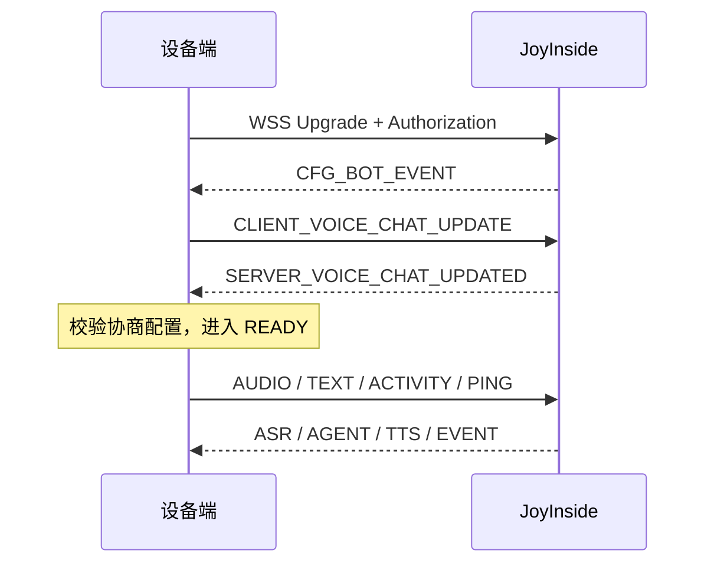
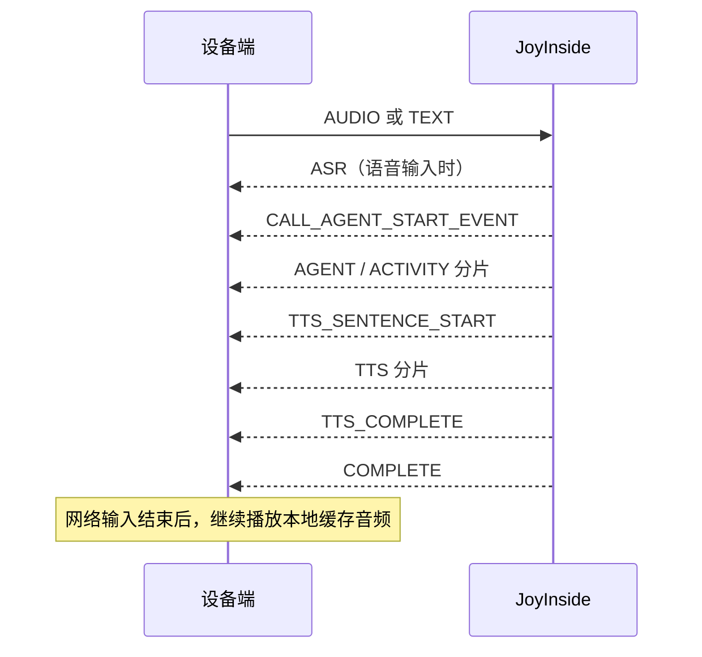

# JoyInside 端侧 WebSocket 接入协议

**适用对象**：设备固件、端侧 SDK、设备联调与测试人员  
**更新日期**：2026-09-17

**协议来源**：[JoyInside 接入手册](https://joyinside.com/handbook/) 与 [WebSocket 协议参考](https://joyinside.com/handbook/part5-%E9%99%84%E5%BD%95/b-protocol-fields.html)

本文只描述设备端接入所需的 WebSocket 语音通道，以及直接依赖该通道的设备注册、用户绑定、媒体、打印、视觉和闹钟能力。平台运营、小程序、外部智能体、第三方资源、量产、OTA 和云端实现不在本文范围内。

## 1. 接入边界

| 用途 | 设备端职责 | 传输 |
| --- | --- | --- |
| 获取访问令牌 | 从受控业务后端或安全凭据模块获取短期 Token | HTTPS |
| 注册、绑定设备用户 | 保存 `botId`，按产品策略绑定或解绑用户 | HTTPS |
| 语音、文本、事件、指令 | 建立并维护一条语音会话连接 | WSS |
| 媒体正文、图片 | 按下行 URL 拉取媒体或上传视觉帧 | HTTPS |

语音通道地址：

```text
wss://ws.joyinside.com/soulmate/voiceChat/v1
```

设备必须使用 TLS，并校验证书。一个 `botId` 同时只保持一条活跃 WebSocket 连接；收到 `REPEAT_CLIENT_SESSION` 后停止当前会话，不得立即以相同 `botId` 进入高频重连循环。

## 2. 设备身份与凭据

| 标识 | 设备端用途 | 约束 |
| --- | --- | --- |
| `vendorId` | 企业身份 | 用于注册和 Token 获取 |
| `productId` | 产品身份 | 用于注册设备 |
| `deviceId` | 厂商设备序列号 | 每台设备唯一，建议使用 SN |
| `botId` | JoyInside 设备身份 | 注册返回，WebSocket 建连必填 |
| `uid` | 用户身份和长期记忆关联 | WebSocket 建连必填；使用稳定且唯一的用户标识，禁止多设备共用固定值 |
| `sessionId` | 多轮会话上下文 | 多轮对话中复用同一值 |
| `requestId` | 一次连接的追踪标识 | 每次新建 WebSocket 生成新的 UUID |
| `roundId` | 一轮对话关联标识 | 下行事件和音频关联键 |
| `mid` | 单条协议消息标识 | 每条上行消息唯一 |

### 2.1 注册与绑定

设备首次接入需要完成以下 HTTPS 管理动作：

| 动作 | 路径 | 关键字段 | 设备端结果 |
| --- | --- | --- | --- |
| 注册设备 | `POST /device/register` | `vendorId`、`productId`、`deviceId`、`type`、`name`，可选 `resourceAuthedList[]` | 保存返回的 `botId` |
| 绑定用户 | `POST /device/bindUser` | `botId`、`uid`、`requestId` | 用户记忆关联到设备 |
| 查询绑定 | `POST /device/queryBotBind` | `botId`、`requestId` | 获取当前绑定关系 |
| 解绑用户 | `POST /device/unbindUser` | `botId`、`uid`、`requestId`、`deleteMemory` | 解除绑定；按产品决定是否删除记忆 |

`accessKeySecret` 不应写入固件、日志或前端资源。设备应通过受控后端、安全芯片或等效机制获得 `accessToken`；WebSocket 断线重连前检查 Token 有效性并刷新。

用户身份等建连参数变更时重新启动会话。运行中角色和语音配置使用 `CLIENT_VOICE_CHAT_UPDATE` 更新，等待 `SERVER_VOICE_CHAT_UPDATED` 确认；组件入口为 `joyinside_client_update_voice()`，更新会打断当前轮次，并保存目标配置供重连恢复。

## 3. WebSocket 建连

### 3.1 URL 与 Header

```text
wss://ws.joyinside.com/soulmate/voiceChat/v1
  ?botId={botId}
  &sessionId={sessionId}
  &requestId={requestId}
  &uid={uid}
  [&needManualCall=true]
  [&feature=AUDIO_BOOK_V2]
  [&location={location}]
```

```http
Authorization: Bearer <accessToken>
```

`botId`、`sessionId`、`requestId`、`uid` 必填。所有查询参数必须按 URL 编码处理。

| 可选参数 | 用途 |
| --- | --- |
| `needManualCall=true` | 按键/手动对话模式；不传为连续对话模式 |
| `feature=AUDIO_BOOK_V2` | 连续对话媒体资源能力 |
| `location` | 位置信息 |
| `needAsrPartial=true` | 视觉对话需要监听 ASR 开始事件时使用 |

### 3.2 建连与配置时序

设备连接建立后发送一次 `CLIENT_VOICE_CHAT_UPDATE`，并以 `SERVER_VOICE_CHAT_UPDATED` 确认音频协商结果。确认成功前不发送业务音频。



`CFG_BOT_EVENT` 提供默认音色和 TTS 信息，可用于诊断和默认配置展示。实际音频收发以 `SERVER_VOICE_CHAT_UPDATED` 回显的协商结果为准。配置确认超时、协议字段不匹配或连接断开时，停止业务上行，按退避策略重建连接。

## 4. 语音配置

`CLIENT_VOICE_CHAT_UPDATE` 使用 `contentType: "EVENT"`，`content.eventType` 固定为 `CLIENT_VOICE_CHAT_UPDATE`。

```json
{
  "mid": "<uuid>",
  "contentType": "EVENT",
  "content": {
    "eventType": "CLIENT_VOICE_CHAT_UPDATE",
    "eventData": {
      "audio": {
        "binary": true,
        "vad": false,
        "input": {"codec": "pcm", "sampleRate": "16000"},
        "output": {
          "codec": "opus",
          "sampleRate": "16000",
          "frameSizeMs": "60",
          "enableOpusCbr": false
        }
      }
    }
  }
}
```

| 字段 | 端侧规则 |
| --- | --- |
| `audio.binary` | 上下行统一二进制开关；`true` 为 WS binary 音频帧，`false` 为 Base64 JSON 音频帧 |
| `audio.input.binary` / `audio.output.binary` | 上下行需要不同传输方式时分别设置；此时不设置 `audio.binary` |
| `audio.vad` | 端侧 VAD 开关；开启时，端侧为一段连续说话生成稳定的 `content.mid`，下行以此关联 `roundId` |
| `audio.input.codec` | 上行只支持 `pcm` 或 `opus` |
| `audio.output.codec` | 下行支持 `pcm`、`opus`、`mp3` |
| `sampleRate` | `16000`、`24000` 或 `32000` |
| `audio.input.frameSize` | 多个定长 Opus 包拼接时填写单个 Opus 包字节数 |
| `audio.output.frameSizeMs` | PCM 为 60-120 ms；Opus 为 10/20/40/60 ms；MP3 不使用此字段 |
| `audio.output.stream` | MP3 流式下发开关 |
| `audio.output.enableOpusCbr` | Opus 下行 CBR 开关 |
| `audio.timbre.voiceSpeed` / `voiceVolume` | 输出语速和音量 |

设备应对服务端回显中的数值与字符串数值兼容解析。协商的编解码、采样率、二进制方式和帧长与本地能力不一致时，不进入 READY。

## 5. 通用消息结构

### 5.1 上行

```json
{
  "mid": "<message-uuid>",
  "contentType": "EVENT|AUDIO|TEXT|ACTIVITY|PING",
  "content": {}
}
```

场景专用 `AUDIO_BOOK`、`PRINT` 报文使用各自定义的外层字段和事件字段。

### 5.2 下行

```json
{
  "code": 200,
  "msg": "",
  "requestId": "<request-id>",
  "mid": "<message-id>",
  "t": 1710000000000,
  "contentType": "EVENT|ASR|AGENT|ACTIVITY|TTS|PONG",
  "content": {}
}
```

处理规则：

1. 将数字和数字字符串形式的 `code` 归一化；业务成功码为 `200`。
2. 未识别的 `contentType` 或 `eventType` 记录类型与脱敏原文后忽略，不猜测语义。
3. 已识别消息缺少该事件的必填字段时，丢弃并记录协议错误。
4. 回调中得到的 JSON 字符串和对象只在本次回调有效；异步使用前必须复制。
5. 日志至少关联 `botId`、`requestId`、`roundId`、`mid`、事件类型和服务端 `code`。

## 6. 上行协议

| `contentType` | 事件或字段 | 设备端触发时机 |
| --- | --- | --- |
| `AUDIO` | `content.audioBase64`、`content.index`，或 binary 音频帧 | 实时上传麦克风音频 |
| `EVENT` | `CLIENT_AUDIO_FINISH` | 手动模式最后一个音频包之后 |
| `TEXT` | `content.input` | 文本与智能体对话 |
| `EVENT` | `CLIENT_INPUT_TEXT_TO_SPEECH` | 主动请求文本合成，不触发智能体对话 |
| `EVENT` | `CLIENT_INTERRUPT` | 用户打断当前回复 |
| `ACTIVITY` | `VOICE_CHAT_TRIGGER` | 主动触发对话 |
| `ACTIVITY` | `CLIENT_UPDATE_CHAT_CONTEXT` | 注入短期上下文 |
| `ACTIVITY` | `CLIENT_UPDATE_COORDINATES_CONTEXT` | 上报经纬度 |
| `PING` | 无业务载荷 | 连接保活，建议 30 秒间隔 |

### 6.1 音频上行

- PCM 为 16 bit、单声道；采样率与协商配置一致。
- Opus 使用实时发送节奏，避免积攒后突发上传。单个 Opus 包超过默认上限或进行拼包时，显式填写 `audio.input.frameSize`。
- `audio.binary=false` 时，将音频放入 `content.audioBase64`；`index` 随上传片段递增；组件在显式 VAD 新轮次或手动轮次结束后重新计数（官方示例起点不一致，需联调确认）。
- `audio.binary=true` 时，音频以 WebSocket binary frame 发送；收发方向必须与协商结果一致。
- 手动模式下先完成已接受音频的发送，再发送 `CLIENT_AUDIO_FINISH`。
- `vad=true` 时，一段连续说话共享同一个业务 `mid`；新一轮语音开始时生成新的 `mid`。

### 6.2 文本、打断和活动

文本输入：

```json
{
  "mid": "<uuid>",
  "contentType": "TEXT",
  "content": {"input": "讲个故事吧"}
}
```

上下文更新：

```json
{
  "mid": "<uuid>",
  "contentType": "ACTIVITY",
  "content": {
    "activityType": "CLIENT_UPDATE_CHAT_CONTEXT",
    "effectiveTimeMinutes": 5,
    "kvData": {"deviceMode": "reading"}
  }
}
```

坐标更新使用 `content.activityType: "CLIENT_UPDATE_COORDINATES_CONTEXT"` 和字符串字段 `coordinates.lat`、`coordinates.lng`。这些活动能力需要在目标产品中开通。

## 7. 下行协议与端侧动作

| `contentType` / 事件 | 关键字段 | 设备端动作 |
| --- | --- | --- |
| `EVENT` / `CFG_BOT_EVENT` | `eventData.timbre`、`eventData.tts` | 记录默认音色和音频信息 |
| `EVENT` / `SERVER_VOICE_CHAT_UPDATED` | `eventData.audio` | 校验协商配置，开放音频上行 |
| `ASR` | `text`、`textType`、`lang` | 向 UI 或业务层输出识别结果 |
| `EVENT` / `CALL_AGENT_START_EVENT` | `roundId`、`eventData.input`、`startTime` | 创建本轮回复和播放上下文 |
| `AGENT` | `roundId`、`content`、`finishReason` | 流式显示智能体文本 |
| `ACTIVITY` | 与 `AGENT` 相同 | 流式显示主动回复文本 |
| `EVENT` / `EMPTY_CONTENT` | `startTime` | 结束本次输入，回到待命态 |
| `EVENT` / `COMPLETE` | `time` | 标记对话轮次结束；不等同于本地音频播放完毕 |
| `EVENT` / `TTS_SENTENCE_START` | `text`、`time` | 输出句子字幕，准备对应音频 |
| `TTS` | `audioBase64`、`audioAue`、`audioDuration`、`finish` | 解码并按顺序加入播放队列 |
| `EVENT` / `TTS_COMPLETE` | `time` | 关闭本轮网络音频输入，等待本地播放队列排空 |
| `EVENT` / `CALL_AGENT_INTERRUPTED` | `roundId`、`startTime` | 立即停止 TTS，清空播放队列，等待新音频 |
| `EVENT` / `CALL_SKILL_EVENT` | `eventData.data` | 执行设备指令或更新设备表情/动作 |
| `EVENT` / `CLIENT_CHAT_CONTEXT_RECEIVED` | `activityType`、`activityData` | 确认上下文更新成功 |
| `PONG` | `mid` | 确认心跳存活 |
| `EVENT` / `USER_AUDIT_FAIL` | `roundId` | 向业务层报告审核命中，结束相关输入轮次 |
| `EVENT` / `REPEAT_CLIENT_SESSION` | 无固定业务数据 | 停止当前会话并禁止抢占式重连 |

### 7.1 文本与音频顺序

`AGENT` 和 `ACTIVITY` 为流式消息。空 `finishReason` 表示中间分片；非空值表示本流结束。端侧至少区分：

| `finishReason` | 含义 |
| --- | --- |
| `stop` | 正常结束 |
| `error` | 服务端生成错误 |
| `audit` | `AGENT` 安全审核结束 |
| `content_filter` | `ACTIVITY` 内容过滤结束 |

`TTS_SENTENCE_START` 早于对应 TTS 音频到达，适合直接作为字幕。`audioDuration` 是参考值，不能作为扬声器实际播放完成的依据；播放完成必须由本地解码队列和音频设备的实际排空事件判断。

### 7.2 一轮对话时序



打断到来时，`CALL_AGENT_INTERRUPTED` 的处理优先级高于当前播放、字幕和等待状态：停止播放器，清空未播 PCM/编码帧，作废被打断 `roundId` 的剩余数据。

## 8. CALL_SKILL_EVENT：设备指令、表情与动作

`CALL_SKILL_EVENT` 是设备控制和情绪事件的统一下行通道。设备无需再次进行自然语言理解，应根据约定的 `intentCode`、`instructions` 和参数执行本地功能。

```json
{
  "content": {
    "roundId": "<round-id>",
    "eventType": "CALL_SKILL_EVENT",
    "eventData": {
      "msg": "端侧事件下发",
      "data": {
        "intentCode": "ACTION_SLIDE_FORWARD",
        "intentClassify": "前进",
        "args": {},
        "instructions": [
          {"action": "ACTION_SLIDE_FORWARD", "desc": "前进", "args": {}}
        ]
      }
    }
  }
}
```

| 字段 | 说明 |
| --- | --- |
| `eventData.data.intentCode` | 指令编码 |
| `eventData.data.intentClassify` | 指令分类 |
| `eventData.data.args` | 指令参数 |
| `eventData.data.instructions[]` | 有序指令列表；普通指令为 `action`、`desc`、`args`，闹钟 V2 见 9.4 |
| `eventData.msg` | 指令或情绪事件描述 |

### 8.1 表情和动作事件

表情和动作事件复用 `CALL_SKILL_EVENT`，需要在 JoyInside 产品配置中启用情绪策略。

| 字段 | 说明 |
| --- | --- |
| `eventData.data.intentClassify` | 表情和动作事件为 `闲聊` |
| `eventData.data.args.EMOTION` | 必填表情或动作编码 |
| `eventData.data.args.TTS_EMOTION` | 可选语音情绪描述，如 `高兴`，不能仅按视觉编码解析 |

当前协议定义的 `EMOTION` 值：`angry_1`、`anxious_1`、`blamed_1`、`confused_1`、`coquetry_1`、`disappoint_1`、`disdainful_1`、`exciting_1`、`expect_1`、`fear_1`、`happy_1`、`hate_1`、`hesitate_1`、`inquisitive_1`、`peace_1`、`sad_1`、`shock_1`、`shy_1`、`sick_1`、`sorrowful_1`、`wronged_1`、`disagree_1`、`nod_1`。

协议字段名为 `EMOTION`，但它实际承载面部状态、情感、社交信号、生理状态和动作。设备应保留原始编码，并分别映射为本地表情、动作或灯效；未知编码安全忽略并记录，不应导致会话中断。

通过 `qm_agent` 接入时，transport 将原始码映射为供应商无关的一级分类、可选具体表情/动作和原始码：

| 一级分类 | 二级语义 | JoyInside 原码 |
| --- | --- | --- |
| `FACIAL_STATE` 面部基线 | 中性、平静 | `peace_1` |
| `AFFECT` 基础情感 | 积极 | `happy_1`、`exciting_1` |
| `AFFECT` 基础情感 | 消极 | `angry_1`、`sad_1`、`fear_1`、`hate_1`、`anxious_1`、`disappoint_1`、`sorrowful_1` |
| `AFFECT` 基础情感 | 惊讶 | `shock_1` |
| `SOCIAL_COGNITIVE` 社会认知 | 认知交互 | `inquisitive_1`、`confused_1`、`hesitate_1`、`expect_1` |
| `SOCIAL_COGNITIVE` 社会认知 | 社交态度 | `disdainful_1` |
| `SOCIAL_COGNITIVE` 社会认知 | 社交反应 | `shy_1`、`coquetry_1`、`blamed_1`、`wronged_1` |
| `AFFECT` 基础情感 | 厌倦 | `sick_1` |
| `PHYSICAL_STATE` 生理状态 | 病痛、困倦等扩展 | 当前 23 码无明确对应 |
| `GESTURE` 姿态动作 | 头部动作 | `nod_1`、`disagree_1` |
| `UNKNOWN` 无法判定 | 未知或格式错误 | 未识别的原始码 |

按 2026-09-17 官方 B.4.8 表格：`disagree_1` 为摇头，`nod_1` 为点头，`sick_1` 为厌倦，`blamed_1` 为谴责。适配层依次映射摇头、点头、BORED、ANGRY 视觉回退；谴责仍归社会认知分类，原码均保留。`UNKNOWN` 仅表示协议表达码无法识别，不表示视觉检测中的遮挡、无人脸或置信度不足。

应用以一级分类选择默认动画组；存在具体表情或手势枚举时选择精确动画。新平台出现尚未穷举的码时，可发送具体枚举为 `UNKNOWN`、一级分类为已知类别并保留 `provider_code`，因此无需等待 `qm_agent` 扩展具体枚举。

## 9. 设备场景扩展

### 9.1 有声书和音乐

建连使用 `feature=AUDIO_BOOK_V2`。媒体控制事件使用 `contentType: "AUDIO_BOOK"`：

| 方向 | 事件 | 关键字段 | 设备端动作 |
| --- | --- | --- | --- |
| 下行 | `AUDIO_BOOK_PLAY` | `bookId`、`chapterId`、`audioURL`、`totalLength`、`progress`、`includeTTS` | 建立正文播放任务，按 URL 拉流 |
| 下行 | `AUDIO_BOOK_STOP` | `bookId`、`chapterId` | 停止正文播放并上报真实进度 |
| 上行 | `AUDIO_BOOK_PLAY` | `bookId`、`chapterId` | 正文实际开始播放后回传 |
| 上行 | `AUDIO_BOOK_STOP` | `bookId`、`chapterId`、`progress`、`finish` | 停止、切换或自然播放结束后回传 |
| 上行 | `AUDIO_BOOK_PING` | `{}` | 播放期间保活 |

服务端可能先下发串场词 TTS，再下发 `AUDIO_BOOK_PLAY`。`includeTTS=true` 时，先播放同轮串场词，待本地 TTS 队列排空后开始正文；`includeTTS=false` 时可以直接开始正文。媒体心跳与普通 WSS `PING` 独立，播放期间按产品协议周期发送。

### 9.2 魔法打印

打印使用 `contentType: "PRINT"`，打印场景消息携带稳定的 `uid`。设备应至少处理：

| 方向 | 事件 | 关键字段 |
| --- | --- | --- |
| 下行 | `PRINT_START` | `printTaskId`、`printThickness`、`paperType`、`printDirection`、`imgUrlList` |
| 下行 | `IMAGE_DISPLAY` | `printTaskId`、`imgUrl`、`imageId` |
| 下行 | `PRINT_STOP` | `printTaskId` |
| 下行 | `PRINT_CONFIG` | `printMode`、`printThickness`、`paperType`、`printDirection` |
| 下行 | `PRINT_STATUS_QUERY` | 无业务载荷 |
| 上行 | `PRINT_STATUS` | `battery`、`printerStatus[]` |
| 上行 | `PRINT_SUCCESS` | `printTaskId`、`printSuccess` |
| 上行 | `PRINT_IMAGE` | `printTaskId`、`imageId` |

收到 `PRINT_STATUS_QUERY` 立即回传硬件状态。缺纸、过热、开盖和低电量等异常上报实际状态，不与 `normal` 同时报送。

### 9.3 视觉对话

视觉能力需要产品开通。建连时增加 `needAsrPartial=true`；设备收到 ASR `textType: "IS_START"` 后可上传当前 JPEG 帧。图片通过 HTTP 上报，不走 WebSocket 音频帧，且必须使用当前 WebSocket 的同一 `sessionId` 关联对话。

```json
{
  "requestId": "<uuid>",
  "botId": "<bot-id>",
  "appId": "<vision-app-id>",
  "sessionId": "<same-as-ws>",
  "imgBase64": "<jpeg-base64>",
  "frameTimestamp": 1710000000000
}
```

通过 `POST https://api.joyinside.com/vision/client/image/report` 上报，Authorization 为当前 WS 使用的 Bearer Token；业务成功要求 `state=SUCCESS`、`code="0000"`。组件提供 `joyinside_client_report_image()`，在应用工作线程调用。

图像分辨率、大小、上传频率和接口权限以目标产品联调配置为准。设备应限制并发上传，避免占满语音通道可用带宽。

### 9.4 闹钟与提醒

闹钟能力通过 `CALL_SKILL_EVENT` 下发。设备负责本地持久化、RTC 触发、响铃、停止和状态回报；云端负责自然语言解析。V2 的 `domain=alarm`，每条 `instructions[]` 使用 `type`、`operation`、`params`：type 为 `normal_alarm` 或 `interval_reminder`，operation 为 `create`、`delete` 或 `delete_all`；不可按通用 `action/args` 结构读取。组件统一通过 `joyinside_client_skill_instruction()` 返回借用视图，应用按列表顺序执行，再通过 `CLIENT_UPDATE_CHAT_CONTEXT` 上报全量本地闹钟列表。

本地实现必须校验本机容量、时间合法性和硬件状态。执行失败时保留失败原因供业务层上报，不伪造成功状态。

## 10. 端侧实现要求

### 10.1 并发与队列

- 网络收包、JSON 解析、音频解码和扬声器播放分离；WebSocket 回调中不执行阻塞 I/O。
- 为上行采集音频、下行编码音频和 PCM 播放分别设置有界队列。
- 发生 `CALL_AGENT_INTERRUPTED`、断线或新轮次替代旧轮次时，原子地作废旧轮队列数据。
- 高频音频数据不进入低频 UI/事件队列；文本、字幕、状态和情绪走低频事件通道。

### 10.2 音频链路

```text
麦克风 -> AEC -> ANS -> AGC -> PCM/Opus 编码 -> WSS
WSS -> Base64 解码或二进制收包 -> PCM/Opus/MP3 解码 -> 播放队列 -> 扬声器
```

全双工设备需要 AEC，避免设备自身扬声器音频进入上行。端侧 VAD 模式要在静音结束后结束当前采集轮次，并在下一段语音开始时生成新的业务 `mid`。

### 10.3 重连与错误处理

- Upgrade 失败、鉴权失败、配置确认失败、PING 超时或网络断开时停止音频上行。
- 重连采用有上限的指数退避和抖动；每次重连生成新的 `requestId`，复用当前 `sessionId` 和稳定 `uid`。
- 连接恢复后重新发送语音配置，重新等待 `SERVER_VOICE_CHAT_UPDATED`。
- Token、AccessKey、`uid` 和完整音频内容不得写入普通日志。

## 11. 设备端验收清单

- [ ] 已注册设备并持久化唯一 `botId`。
- [ ] 每次建连都带 `botId`、`sessionId`、新的 `requestId` 和非空 `uid`。
- [ ] Bearer Token 由安全边界提供，断线重连前可刷新。
- [ ] 只维护一条同 `botId` 的连接，并正确处理 `REPEAT_CLIENT_SESSION`。
- [ ] `CLIENT_VOICE_CHAT_UPDATE` 与 `SERVER_VOICE_CHAT_UPDATED` 的编解码、采样率、二进制模式完全匹配。
- [ ] 支持连续语音、手动结束、文本输入、主动 TTS、打断、上下文更新和 PING/PONG。
- [ ] 正确处理流式 `AGENT`/`ACTIVITY`、字幕、TTS、`TTS_COMPLETE` 和本地播放排空。
- [ ] `CALL_AGENT_INTERRUPTED` 能停止解码和清空播放队列。
- [ ] `CALL_SKILL_EVENT` 能安全分发指令、情绪和未知扩展字段。
- [ ] 已按产品实际启用并回归媒体、打印、视觉或闹钟能力。

## 12. 相关资料

- [WebSocket 协议参考](https://joyinside.com/handbook/part5-%E9%99%84%E5%BD%95/b-protocol-fields.html)
- [Token 鉴权](https://joyinside.com/handbook/part2-%E8%AF%AD%E9%9F%B3%E5%AF%B9%E8%AF%9D%E6%8E%A5%E5%85%A5/04-protocol/auth.html)
- [设备注册与绑定](https://joyinside.com/handbook/part2-%E8%AF%AD%E9%9F%B3%E5%AF%B9%E8%AF%9D%E6%8E%A5%E5%85%A5/04-protocol/device-identity.html)
- [WebSocket 语音通道](https://joyinside.com/handbook/part2-%E8%AF%AD%E9%9F%B3%E5%AF%B9%E8%AF%9D%E6%8E%A5%E5%85%A5/04-protocol/websocket.html)
- [音频格式与分片](https://joyinside.com/handbook/part2-%E8%AF%AD%E9%9F%B3%E5%AF%B9%E8%AF%9D%E6%8E%A5%E5%85%A5/04-protocol/audio-format.html)
- [设备端适配](https://joyinside.com/handbook/part2-%E8%AF%AD%E9%9F%B3%E5%AF%B9%E8%AF%9D%E6%8E%A5%E5%85%A5/05-hardware-and-audio.html)
- [设备场景接入](https://joyinside.com/handbook/part2-%E8%AF%AD%E9%9F%B3%E5%AF%B9%E8%AF%9D%E6%8E%A5%E5%85%A5/06-scenarios/README.html)
