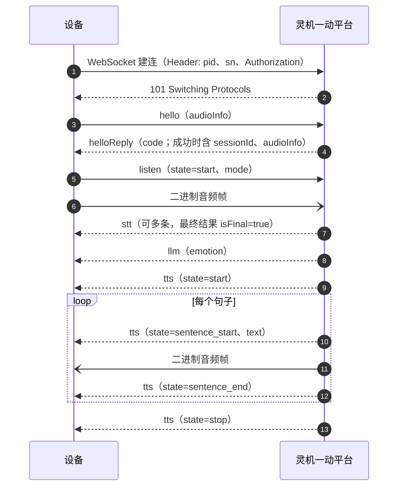
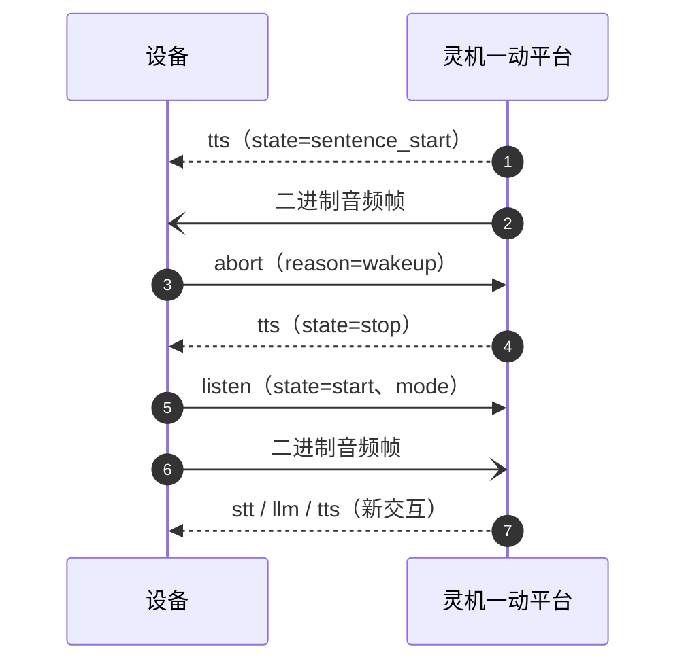
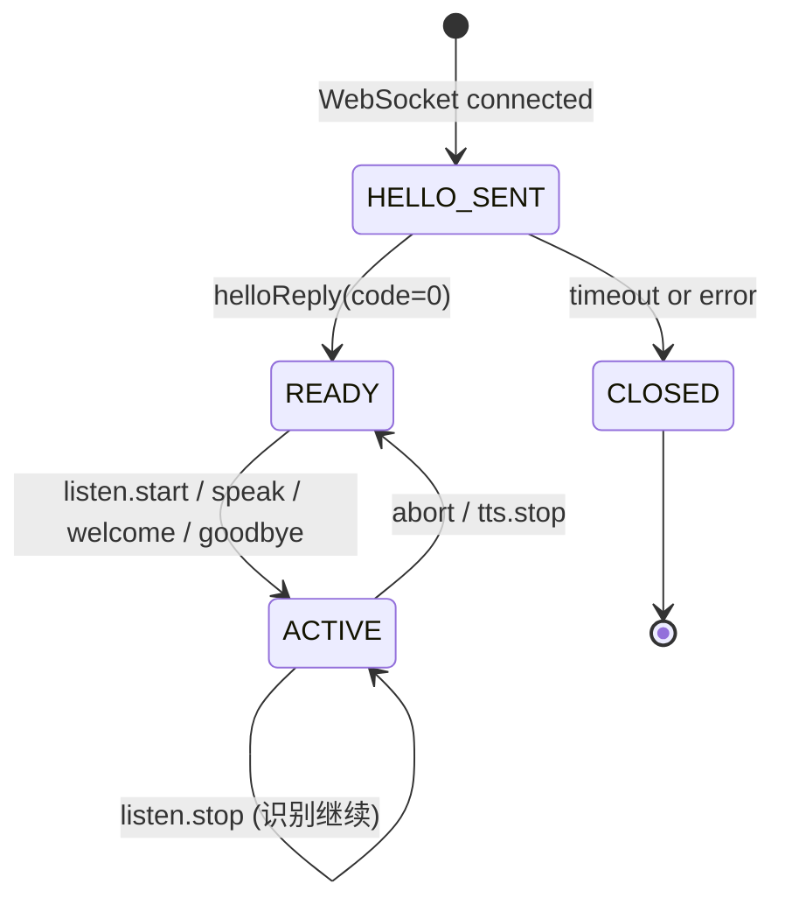

# 灵机一动语音 WebSocket 通讯协议

| 项目 | 定义 |
| --- | --- |
| 协议版本 | `2` |
| 传输协议 | WebSocket over TLS (`wss://`) |
| 文本编码 | UTF-8 JSON |
| 二进制数据 | 协商后的 PCM 或 Opus 音频帧 |
| 角色 | 设备（Device）、灵机一动平台（Server） |

## 1. 目标与边界

本协议规定设备与灵机一动语音服务之间的 UTF-8 JSON 控制消息、PCM/Opus 二进制音频
帧及语音交互、TTS/STT、会话控制流程。

### 1.1 通讯流程

#### 1.1.1 建连与语音交互



#### 1.1.2 播放打断



#### 1.1.3 流程约束

- 收到成功的 `helloReply` 后才能发送业务请求或音频；连接断开后必须重新握手。
- 一个 session 只能有一个进行中的 `listen`、`speak` 或备注播放；启动新交互的有效请求会结束旧交互。
- TTS 顺序为 `start -> sentence_start -> 音频帧 -> sentence_end -> stop`。

## 2. 传输、编码与安全

### 2.1 WebSocket 约束

- 使用 `wss://`。
- 每个文本 message 包含一个完整 JSON 对象。
- JSON 使用 UTF-8；二进制 message 仅用于音频。
- 同一方向的消息按发送顺序到达；两方向相互独立。服务端不得发送已取消交互的事件。
- 使用 WebSocket ping/pong 保活；连续两个周期未收到 pong 时断开重连。

### 2.2 服务地址

| 环境 | WebSocket 地址 |
| --- | --- |
| `dev` | `wss://voice-dev.ljyd.cn/agent-voicechat/ljyd/v1` |
| `test` | `wss://voice-test.ljyd.cn/agent-voicechat/ljyd/v1` |
| `prod` | `wss://voice.ljyd.cn/agent-voicechat/ljyd/v1` |

未指定环境时使用 `prod` 地址。

建连 Header：

| Header | 要求 |
| --- | --- |
| `pid` | 必选，产品 ID，1-64 个 ASCII 字符 |
| `sn` | 必选，设备序列号，1-64 个 ASCII 字符 |
| `Authorization` | 必选，`Bearer <access-token>` |

### 2.3 Token 鉴权

WebSocket 建连时必须携带短期 `Bearer <access-token>`。服务端校验 token 的有效期、
签发方、目标服务、权限及设备绑定：

| 校验项 | 要求 |
| --- | --- |
| 设备绑定 | token 必须绑定当前 `pid` 和 `sn` |
| 目标服务 | token 仅用于灵机一动语音 WebSocket |
| 权限 | 至少具备 `voice.connect` |
| 有效期 | 必须有明确过期时间，最长 24 小时 |
| 撤销 | 支持按设备、用户或 token 标识撤销 |

设备应在 token 过期前至少 5 分钟刷新；token 过期或撤销后必须刷新、重连并重新 `hello`。

## 3. 公共 JSON 信封

### 3.1 字段

除 `hello` 和失败的 `helloReply` 外，所有 JSON 消息都必须带 `sessionId`。

| 字段 | 类型 | 要求 | 说明 |
| --- | --- | --- | --- |
| `method` | String | 必选 | 消息类型，区分大小写 |
| `sessionId` | String | hello 后必选 | 服务端生成的 UUID 会话标识 |

`sessionId` 由服务端为每个 WebSocket 连接生成 UUIDv4；设备原样保存和回传。

`hello` 不携带 `sessionId`。服务端通过 `helloReply` 返回结果；成功时包含 `sessionId`
和 `audioInfo`，失败时仅返回错误码和消息。

#### 3.1.1 消息类型总览

| method | 发送方 | 是否需要 `sessionId` | 处理方式 |
| --- | --- | --- | --- |
| `hello` | 设备 | 否 | 平台返回 `helloReply` |
| `helloReply` | 平台 | 成功时是 | `code=0` 就绪；非 `0` 关闭连接 |
| `listen` | 设备 | 是 | 按 `state` 处理 |
| `speak` | 设备 | 是 | 随后下发 `tts` |
| `abort` | 设备/平台 | 是 | 停止当前交互 |
| `welcome` | 设备 | 是 | 播放欢迎语 |
| `goodbye` | 设备 | 是 | 播放结束语 |
| `stt` | 平台 | 是 | `isFinal=true` 表示识别结束 |
| `llm` | 平台 | 是 | 消息结束 |
| `tts` | 平台 | 是 | `state=stop` 表示播放结束 |

`helloReply` 必须在发送 `hello` 后 10 秒内到达；超时关闭 WebSocket。

`helloReply` 错误码：

| code | 含义 |
| ---: | --- |
| 0 | 成功 |
| 4001 | JSON、字段或编码非法 |
| 4002 | 音频格式不支持 |
| 5000 | 服务端内部错误 |

握手成功后，非法业务消息直接忽略，不返回错误，不关闭 WebSocket。

### 3.2 状态机与断线



- 只有收到成功的 `helloReply` 后才进入 `READY`。
- 一个 session 同时最多一个进行中的 `listen`、`speak` 或备注播放；启动新交互的有效请求会结束旧交互。
- 设备只处理当前状态允许的事件；收到 `abort` 或启动新交互的请求后，旧交互的后续事件必须丢弃。
  同一 session 不支持多轮交互并发。
- WebSocket 断开后，session 必须视为失效。重连必须重新认证、重新
  `hello` 并获取新的 `sessionId`；不得重放已失效会话的原始音频。

## 4. 音频协商

### 4.1 hello

`hello` 由设备在 WebSocket connected 后立即发送。

`hello` 不携带 `sessionId`。成功响应返回 `sessionId` 和平台音频格式；
`hello.audioInfo` 为设备音频格式。

```json
{
  "method": "hello",
  "audioInfo": {
    "format": "opus",
    "rate": 16000,
    "bits": 16,
    "channel": 1,
    "frameDuration": 60
  }
}
```

| 字段 | 说明 |
| --- | --- |
| `audioInfo` | 在 `hello` 中表示设备发送给平台的格式；在 `helloReply` 中表示平台发送给设备的格式 |

音频字段含义：

| 字段 | 取值 | 说明 |
| --- | --- | --- |
| `format` | `"opus"`、`"pcm"` | 音频编码格式 |
| `rate` | 正整数 | 采样率，单位 Hz |
| `bits` | 正整数 | PCM 采样位数；Opus 填源 PCM 位数 |
| `channel` | `1`、`2` | 单声道或双声道 |
| `frameDuration` | 正整数 | 单帧时长，单位 ms |

### 4.2 helloReply

服务端使用 `helloReply` 确认 session 和最终音频格式。

| 字段 | 类型 | 必选 | 说明 |
| --- | --- | --- | --- |
| `method` | String | 是 | 固定为 `helloReply` |
| `sessionId` | String | `code=0` 时必选 | 新建会话的 UUIDv4 |
| `audioInfo` | Object | `code=0` 时必选 | 平台发送给设备的音频格式 |
| `code` | Int | 是 | `0` 表示成功，非 `0` 表示失败 |
| `message` | String | 失败时可选 | 错误文本，无固定枚举 |

```json
{
  "method": "helloReply",
  "sessionId": "550e8400-e29b-41d4-a716-446655440000",
  "code": 0,
  "audioInfo": {
    "format": "opus",
    "rate": 16000,
    "bits": 16,
    "channel": 1,
    "frameDuration": 60
  }
}
```

- `code=0` 时必须返回 `sessionId` 和平台音频 `audioInfo`；设备在收到前不得发送或播放音频。
- 平台音频格式可与设备格式不同，设备必须支持该格式。
- 若服务端不能接受任一格式，应发送 `code=4002` 的 `helloReply`，可带 `message`，
  不得返回 `sessionId` 或 `audioInfo`；随后以 WebSocket close code `1008` 关闭。

握手失败示例：

```json
{
  "method": "helloReply",
  "code": 4002,
  "message": "no compatible audio format"
}
```

### 4.3 二进制音频边界

- 一个 WebSocket binary message 对应一个完整编码音频帧。
- 设备发送的 PCM/Opus 帧使用 `hello.audioInfo`；平台发送的 PCM/Opus 帧使用
  `helloReply.audioInfo`。
- PCM 帧字节数必须为
  `rate * bits / 8 * channel * frameDuration / 1000`，其中 `channel` 只能为 1 或 2。
- Opus 帧长度由编码器决定，不要求固定字节数；接收端按实际帧长度解码。
- 零长度帧、超出接收端可接受范围的帧及未协商格式的帧直接丢弃。
- 设备发送的二进制帧属于当前 `listen` 交互；平台发送的二进制帧属于当前
  `tts.sentence_start` 到 `tts.sentence_end` 之间的句子。双方均使用已协商的
  `audioInfo`，平台不得交叉发送两个句子的音频帧。

## 5. 客户端请求

除 `hello` 外，客户端业务请求均必须包含 `sessionId`；平台按请求直接处理。

### 5.1 listen

```json
{
  "method": "listen",
  "sessionId": "550e8400-e29b-41d4-a716-446655440000",
  "state": "start",
  "mode": "realtime"
}
```

| 字段 | 取值 | 说明 |
| --- | --- | --- |
| `state` | `"start"` | 开始录音并上传音频 |
|  | `"stop"` | 停止录音；服务端可继续完成识别 |
|  | `"detect"` | 上报唤醒词，不发送音频 |
| `mode` | `"auto"` | 设备通过 VAD 或超时自动结束录音，通常返回最终识别结果 |
|  | `"manual"` | 设备通过 `state="start"`、`state="stop"` 显式控制录音起止 |
|  | `"realtime"` | 录音期间持续返回中间 ASR；录音起止仍由 `state` 控制 |
| `text` | UTF-8 字符串 | 仅 `state="detect"` 可出现，表示唤醒词 |

`state="start"` 时设备开始录音并上传音频；`state="stop"` 时停止录音；`state="detect"`
仅上报唤醒词，不发送音频。`start` 和 `detect` 可触发平台返回 `stt`、`llm`、`tts`。

`auto` 和 `manual` 的区别是录音结束方式；`realtime` 的区别是 ASR 返回方式。`realtime`
下也必须按 `state` 发送录音控制消息。

| 模式 | 录音结束方式 | ASR 返回方式 |
| --- | --- | --- |
| `auto` | VAD、静音检测或超时自动结束 | 通常只返回最终结果 |
| `manual` | 设备通过 `state="stop"` 手动结束 | 通常只返回最终结果 |
| `realtime` | 仍由 `state` 控制 | 录音期间持续返回中间结果，结束后返回最终结果 |

### 5.2 speak

设备发送文本，请求平台生成并播放 TTS。平台随后按 6.3 节发送 `tts` 事件和音频帧。
`speak` 与 `listen` 不能同时进行。

```json
{
  "method": "speak",
  "sessionId": "550e8400-e29b-41d4-a716-446655440000",
  "text": "欢迎使用灵机一动"
}
```

| 字段 | 取值 | 说明 |
| --- | --- | --- |
| `text` | UTF-8 字符串 | 必选 |

### 5.3 abort

```json
{
  "method": "abort",
  "sessionId": "550e8400-e29b-41d4-a716-446655440000",
  "reason": "wakeup"
}
```

| 字段 | 取值 | 说明 |
| --- | --- | --- |
| `reason` | `"user_stop"` | 用户或应用主动停止当前交互 |
|  | `"wakeup"` | 设备本地再次唤醒，要求停止当前播放 |

`abort` 停止当前 `listen`、`speak` 或备注播放，包括录音、识别、LLM、TTS 和播放队列，
但不关闭 WebSocket session。

`reason="wakeup"` 时，平台按当前策略决定是否下发唤醒响应音频。

### 5.4 welcome

设备发送 `welcome`，请求平台播放预设的欢迎语。消息只包含公共信封字段，
不带文本内容，不需要回复。

```json
{
  "method": "welcome",
  "sessionId": "550e8400-e29b-41d4-a716-446655440000"
}
```

| 字段 | 取值 | 说明 |
| --- | --- | --- |
| `method` | `"welcome"` | 请求播放欢迎语 |
| `sessionId` | UUIDv4 | 当前 WebSocket 会话标识 |

平台收到请求后按 6.3 节发送 `tts`，其中 `type="welcome"`。请求会终止当前正在进行的
回复。

### 5.5 goodbye

设备发送 `goodbye`，请求平台播放预设的结束语。消息只包含公共信封字段，
不带文本内容，不需要回复。

```json
{
  "method": "goodbye",
  "sessionId": "550e8400-e29b-41d4-a716-446655440000"
}
```

| 字段 | 取值 | 说明 |
| --- | --- | --- |
| `method` | `"goodbye"` | 请求播放结束语 |
| `sessionId` | UUIDv4 | 当前 WebSocket 会话标识 |

平台收到请求后按 6.3 节发送 `tts`，其中 `type="goodbye"`。请求会终止当前正在进行的
回复。

## 6. 服务端事件

除握手阶段的 `helloReply` 外，下列事件必须带 `sessionId`。

### 6.1 stt

`mode="realtime"` 和需要实时字幕的产品必须支持流式 ASR。在当前进行中的 `listen`
交互内，服务端可以发送多条 `stt`：前面的消息是中间识别结果，最后一条是最终识别结果。
这些消息使用相同的 `sessionId`。

下表中的“消息顺序”表示同一 WebSocket 方向上的到达顺序，不是报文中的字段；协议不
额外增加 `sequence` 或消息序号。

| 消息顺序 | `text` | `isFinal` | 说明 |
| ---: | --- | :---: | --- |
| 1 | `今` | `false` | 中间结果 |
| 2 | `今天天气` | `false` | 更新后的中间结果 |
| 3 | `今天天气怎么样？` | `true` | 最终结果 |

每条消息为完整 JSON。最终结果示例：

```json
{
  "method": "stt",
  "sessionId": "550e8400-e29b-41d4-a716-446655440000",
  "text": "今天天气怎么样？",
  "isFinal": true
}
```

| 字段 | 取值 | 说明 |
| --- | --- | --- |
| `text` | UTF-8 字符串 | 必选；当前完整识别假设，不是上一次结果的增量后缀 |
| `isFinal` | `true`、`false` | 必选；`false` = 中间结果，`true` = 最终结果 |

约束：

- 当前进行中的 `listen` 交互可以有零条或多条 `isFinal=false`，最多一条 `isFinal=true`。
- 中间结果是“完整假设文本”，设备收到后应替换上一条同一交互的字幕，不能
  直接拼接字符串。
- `isFinal=true` 表示服务端已完成该轮识别；之后不再发送该交互的 `stt`。
- `listen.stop`、VAD 结束或服务端决定结束识别时产生最终结果；无识别内容时，
  允许发送 `text` 为空字符串的最终结果。
- 收到 `abort` 或新的 `listen.start` 后，设备应丢弃旧交互的后续中间结果；被取消的
  交互不要求补发最终结果。
- 文本必须为 UTF-8；服务端不得返回其他字符编码。

### 6.2 llm

```json
{
  "method": "llm",
  "sessionId": "550e8400-e29b-41d4-a716-446655440000",
  "emotion": "happy"
}
```

`emotion` 必选。设备不认识的 emotion 只能作为展示文本处理，不得使会话失败。

### 6.3 tts

```json
{
  "method": "tts",
  "sessionId": "550e8400-e29b-41d4-a716-446655440000",
  "state": "sentence_start",
  "type": "chat",
  "text": "今天天气很不错呢"
}
```

| 字段 | 取值 | 说明 |
| --- | --- | --- |
| `state` | `"start"` | 开始一段 TTS，清理上一段播放队列 |
|  | `"sentence_start"` | 开始当前句子，必须带 `text` |
|  | `"sentence_end"` | 当前句子的音频帧已发送完 |
|  | `"stop"` | 整段 TTS 播放结束 |
| `type` | `"chat"` | 普通对话回复 |
|  | `"welcome"` | 欢迎语 |
|  | `"goodbye"` | 结束语 |
|  | `"music"` | 音乐或其他非对话音频 |
| `text` | UTF-8 字符串 | 仅 `state="sentence_start"` 时必选，为当前句子字幕 |

顺序必须严格为：`start` -> (`sentence_start` -> binary audio frames ->
`sentence_end`)+ -> `stop`。收到新的 `start` 前，设备必须清理上一段 TTS 的播放队列。

### 6.4 abort

服务端下发的 `abort` 要求设备立刻停止当前 `listen`、`speak` 或备注播放。
平台使用下表中的 `reason`；未知 reason 按非法业务消息忽略。

```json
{
  "method": "abort",
  "sessionId": "550e8400-e29b-41d4-a716-446655440000",
  "reason": "server_policy"
}
```

| `reason` | 含义 |
| --- | --- |
| `"server_policy"` | 服务端策略要求停止 |
| `"session_end"` | 当前 session 即将结束 |

`reason="session_end"` 时，设备停止当前交互后关闭 WebSocket。
