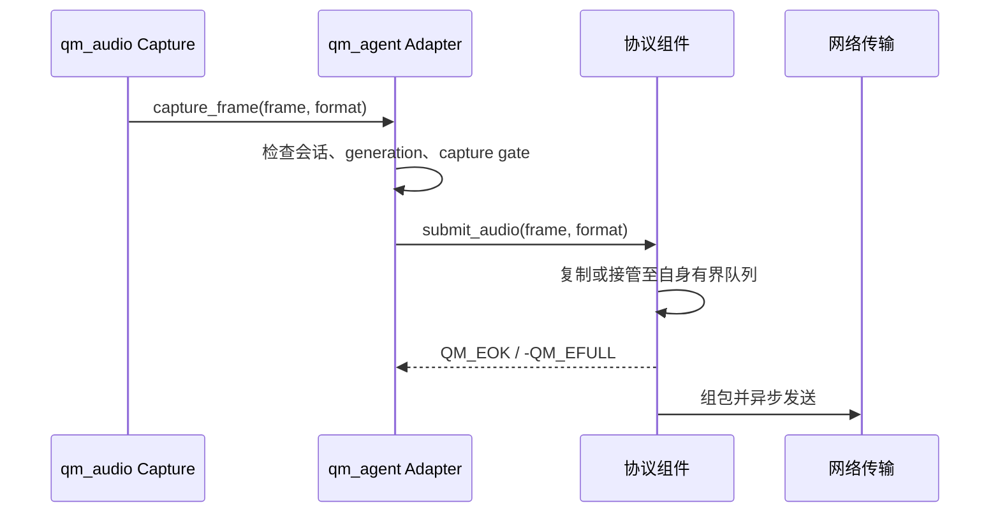
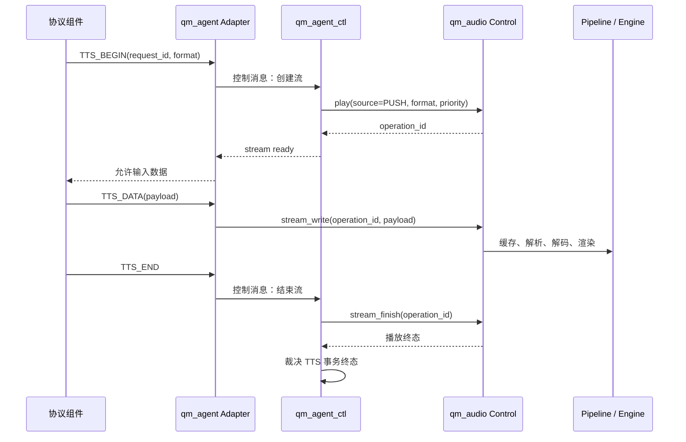

# qm_agent 目标架构设计

状态：目标架构基线。本文定义后续改造的边界和接口契约，不表示当前代码已经完成迁移。

日期：2026-09-14。

范围：`qm_agent`、`qm_audio`、云端协议组件、网络传输组件和视频组件之间的职责与协作关系。

相关实施顺序见 [AGENT_IMPLEMENTATION_PLAN.md](AGENT_IMPLEMENTATION_PLAN.md)。跨组件实施必须在开始前单独确认；本轮仅整理设计文档。

## 1. 架构结论

长期架构以控制面和数据面分离为基础。

| 项目 | 目标设计 |
| --- | --- |
| `qm_agent` 自有任务 | 仅一个 `qm_agent_ctl` 控制任务 |
| 音频采集 | 由 `qm_audio` 的采集链路负责 |
| 上行音频发送 | 由对应云端协议组件负责缓存、组包、发送和网络背压 |
| TTS 下行媒体 | 数据一经 `qm_audio` 接收，即由 `qm_audio` 负责缓存、解码、格式转换、渲染、结束和取消 |
| 视频采集 | 由视频驱动或视频服务负责，以推送方式提交帧 |
| 生命周期事件 | 通过默认 `qm_event` loop 投递；应用直接注册 `qm_event_handler_register` |
| 高频媒体数据 | 不进入 `qm_event`，不进入 `qm_agent_ctl` 队列 |
| `qm_agent` 职责 | 会话、认证、连接、业务请求、事务关联、状态和事件 |

`qm_agent` 不是播放器、音频硬件管理器、网络发送器或视频采集器。它只管理 AI 会话的业务控制和跨组件关联。

“每个 Agent 一个任务”只表示 Agent 自己创建一个控制任务。整条链路仍有音频、协议、网络和视频组件各自的执行上下文；这些任务由其资源所有者创建和管理。

## 2. 总体结构

```mermaid
flowchart LR
    app[应用 / 产品策略]

    subgraph agent[qm_agent]
        ctl[qm_agent_ctl\n会话控制与状态机]
        adapter[协议适配\n类型转换与事务关联]
    end

    event[qm_event 默认 loop\n控制事件]

    subgraph audio[qm_audio]
        capture[Capture\n采集]
        service[Audio Service\n准入、会话与策略]
        pipeline[Pipeline\n输入、缓存、解码、转换]
        engine[Engine / Backend\n渲染与硬件]
    end

    protocol[云端协议组件\n例如 joyinside_client]
    network[网络传输组件\n例如 qm_websocket_client]
    video[视频驱动 / 视频服务]

    app -->|会话命令| ctl
    ctl -->|控制事件| event
    event -->|应用注册 handler| app

    ctl <--> adapter
    adapter <--> protocol
    protocol <--> network

    capture -->|借用的采集帧| adapter
    adapter -->|非阻塞提交| protocol

    protocol -->|TTS begin / data / end| adapter
    adapter -->|play(PUSH) / write / finish| service
    service --> pipeline
    pipeline --> engine

    video -->|借用的视频帧| adapter
    adapter -->|非阻塞提交| protocol
```

实线表示命令或媒体交付，图中每条媒体线均有明确的所有权规则。`qm_event` 仅承载状态和控制通知，不能承载 PCM、编码音频帧或视频帧。

## 3. 组件边界

### 3.1 应用

应用负责产品策略和资源装配：创建 `qm_audio`、创建 `qm_agent`、配置协议后端、选择播放优先级和处理公开事件。应用不维护 Agent 的媒体缓存，不直接管理协议组件内部发送队列。

应用通过 `qm_event_handler_register` 订阅 Agent 公开事件。事件处理函数可以发起新的异步 API 请求，但不得假设事件投递前后同步完成了状态切换。

### 3.2 qm_agent

`qm_agent` 的内部结构分为两部分：

| 子模块 | 职责 | 不承担的职责 |
| --- | --- | --- |
| Core / Control | 创建、启动、停止、认证、连接、打断、请求超时、会话状态机和资源释放顺序 | 搬运音频或视频数据 |
| Transport Adapter | 将云端协议事件转换为类型化控制请求或 `qm_audio` 流操作；维护请求 ID、generation 和协议侧关联 | 协议组包、网络重连、媒体缓存和解码 |

`qm_agent_ctl` 是 Agent 内唯一的状态写入者。应用 API、协议连接事件、认证结果、TTS begin/end、停止和销毁意图都转换为有界的控制消息，由该任务串行处理。

采集帧、TTS 数据块和视频帧不是控制消息。它们只能经过薄适配入口直接交给数据所有者。

### 3.3 qm_audio

`qm_audio` 是音频数据面和设备面的唯一所有者。

| 能力 | 责任 |
| --- | --- |
| Capture | 打开输入设备、采集 PCM、按订阅契约回调帧、停止采集并确认回调退出 |
| Audio Service | 音频会话、资源准入、优先级、抢占、取消和 PCM 输出会话 |
| Control / Pipeline | `PUSH` 输入缓冲、背压、解析、解码、PCM 转换和播放结束判定 |
| Engine / Backend | PCM 渲染、排空、时间线、功放和芯片/板级输出 |

TTS 可以是 PCM，也可以是支持的编码流。编码格式、容器、采样率和声道数由流描述传入 `qm_audio`；解析、解码和转换始终留在 Pipeline 内，不回流到 `qm_agent`。

`qm_audio` 不解析云端报文、不理解云端请求参数、不上报云端业务字段，也不依赖具体 AI 协议组件。

### 3.4 云端协议组件和网络传输组件

云端协议组件负责云端报文、认证后的协议状态、音频上行编码或组包、TTS 下行拆包、协议级流控和重试策略。其媒体提交入口必须是有界、非阻塞的。

网络传输组件负责连接、发送队列、接收、TLS/WebSocket 等通用传输能力。它不理解 Agent 会话、TTS 请求或音频格式。

协议组件将控制结果通知 `qm_agent` 适配层；它不直接修改 Agent 会话状态。

### 3.5 视频驱动或视频服务

视频帧由已有的视频驱动或视频服务任务推送。`qm_agent` 只在会话允许时把借用帧提交给协议组件。不得在 Agent 中再创建轮询 `read_frame` 的视频任务。

## 4. 执行上下文与任务模型

| 执行上下文 | 所属组件 | 处理内容 | Agent 是否创建 |
| --- | --- | --- | --- |
| `qm_agent_ctl` | `qm_agent` | 会话状态机、认证、连接、请求事务、停止和销毁 | 是，且仅此一个 |
| 默认 `qm_event` loop | 系统事件服务 | 生命周期、连接、TTS 和错误等低频公开事件 | 否 |
| Capture worker | `qm_audio` | PCM 采集与订阅回调 | 否 |
| Pipeline / render worker | `qm_audio` | 输入缓冲、解码、转换、渲染与排空 | 否 |
| 协议 core task | 云端协议组件 | 协议收发、媒体组包、入站拆包和协议状态 | 否 |
| 网络 I/O task | 网络传输组件 | 网络接收、发送、连接和重连 | 否 |
| 视频采集 worker | 视频驱动或视频服务 | 摄像头采集和帧回调 | 否 |

目标中不保留 `qm_agent_up`、`qm_agent_tts`、`qm_agent_vid`、`qm_agent_auth` 或 `qm_agent_event` 等自有任务。也不以 `qm_work` 作为 Agent 生命周期的额外执行器。

## 5. 控制面和事件模型

### 5.1 控制消息

控制队列只容纳低频、小型、可复制的消息，例如：

- 应用的 start、stop、interrupt、文本请求和 TTS 请求。
- 认证完成或失败。
- 协议连接、断开、服务端错误和 TTS begin/end。
- 音频流终态、播放终态和超时。
- 销毁请求和资源回收确认。

控制消息包含固定大小的 ID、结果码和必要状态，不携带媒体负载。请求 ID、会话 generation、时间戳毫秒值均使用 `uint32_t`；`0` 为无效 ID。只有资源 ID、文件大小或寻址偏移等确实超过 32 位范围的字段才使用 `uint64_t`，且不在 Agent 控制协议中引入无必要的 64 位字段。

### 5.2 公开事件

公开事件通过默认 `qm_event` loop 以异步方式投递。目标 API 形式为：

```c
qm_event_handler_register(QM_AGENT_EVENT_BASE, event_id, handler, user_ctx);
```

事件载荷采用可复制的值类型，至少携带：

- `agent_id`：用于识别实例，不暴露可能已失效的内部指针。
- `generation`：用于过滤 stop/destroy 之后到达的旧事件。
- `request_id`：关联文本、TTS 或打断事务；没有关联时为 `0`。
- `result` 与规范化状态：使用 QUMI 错误码和公开枚举。

事件内不保存临时文本、媒体数据或协议私有指针。需要附带文本时，使用固定上限的事件副本或只给出可查询的事务结果，不允许事件接收者持有组件内部缓冲区。

所有 Agent 公开事件都在任务上下文调用 `qm_event_post`，不使用 `qm_event_isr_post`。组件状态机和资源释放不依赖公开事件是否成功投递；投递失败只记录统计和日志，应用可通过快照查询当前状态。

### 5.3 音频状态桥

`qm_audio` 的 operation 状态应通过默认事件服务以可复制的 `operation_id`、generation、状态和结果发布。`qm_agent` 注册内部 handler；handler 只向 `qm_agent_ctl` 投递小型控制消息，不在默认事件任务中停止播放、释放 operation 或调用协议 SDK。

应用若需要独立观察音频状态，也直接注册 `qm_audio` 的事件 base。Agent 的公开 TTS 终态仍由 `qm_agent_ctl` 裁决后发布，避免同一业务请求同时暴露 Pipeline、Service 和 Agent 三组终态。

### 5.4 数据回调

Capture、TTS 数据和视频帧维持数据回调语义。回调参数只在回调期间有效；接收方若要异步使用，必须在自己的有界存储中复制或取得明确的 buffer 所有权。

数据回调不得调用会等待网络、等待播放结束、等待控制任务处理或执行大块内存分配的 API。

## 6. 上行音频链路



上行约束：

1. `qm_audio` 持有采集设备和采集帧生命周期。
2. `qm_agent` 只做常量时间的会话门控和格式检查，然后调用协议组件的提交接口。
3. 协议组件在 `submit_audio()` 成功返回前完成复制或所有权接收；调用返回后，采集帧仍属于 `qm_audio`。
4. 协议组件满载时返回 `-QM_EFULL` 或等价的可恢复错误。Agent 记录统计并丢弃该帧，不创建中转队列，不阻塞 Capture worker。
5. 协议组件负责组包、序号、缓存、发送顺序、网络重试和连接隔离。
6. `qm_agent_ctl` 不处理采集帧，也不参与每帧发送确认。

对实时上行音频，过期帧比阻塞采集链路更危险。默认策略是有限容量下丢弃最新无法接收的帧并计数；若协议要求无丢帧，应由协议组件提供明确流控和容量预算，不能将责任转移给 Agent。

## 7. 下行 TTS 链路



### 7.1 流接口要求

现有 `qm_audio_control` 已经负责把一个 Pipeline run 绑定到一个 Service session。目标不另建平行的 `qm_audio_stream_*` 服务，而是在这条既有控制路径上增加由 `qm_audio` 自己拥有的 `QM_AUDIO_SOURCE_PUSH`：

| 操作 | 目标语义 | 失败语义 |
| --- | --- | --- |
| `qm_audio_control_play(... source=PUSH, ...)` | 创建 Control operation 并返回非零 `operation_id`；Control 内部创建输入缓冲和 Pipeline 运行 | 未准入时返回明确错误，不产生半初始化 operation |
| `qm_audio_control_stream_write(operation_id, data, len)` | 在返回前复制数据到 `PUSH` source 的有界缓冲；返回后输入缓冲仍归调用方 | 缓冲不足返回可恢复错误，不阻塞协议回调 |
| `qm_audio_control_stream_finish(operation_id)` | 标记 `PUSH` source 不再接收数据，Pipeline 排空已接收数据后产生终态 | 重复结束幂等或返回明确状态错误 |
| 既有 `qm_audio_control_stop()` | 取消输入、唤醒等待者、停止播放并产生唯一取消终态 | 已终态时不重复产生事件 |

Pipeline 通过 Control 绑定的输出句柄直接向 Engine 提交媒体；Service 负责准入和输出授权。协议适配器使用 Control 的 PUSH 输入接口，Agent 不负责 PCM 解码或输出排空。

输入格式结构至少包含 codec、container、sample rate、channels、bit depth 和媒体类型。PCM 只是其中一种 codec；编码 TTS 必须在 Pipeline 选择对应的解析与解码后端。

### 7.2 入站顺序与背压

`TTS_BEGIN` 是控制消息，必须先由 `qm_agent_ctl` 完成 `PUSH` operation 创建和映射。协议组件在收到“stream ready”前不得向 Agent 适配层交付该流的媒体数据；必要的网络收包暂存属于协议组件，不属于 Agent。

`TTS_DATA` 不经过控制队列。适配层仅查找已建立且 generation 匹配的 `operation_id`，直接调用 Control 的 `stream_write` 接口。

当 `qm_audio` 返回可恢复的容量不足错误时，协议组件应使用自身的流控、暂停读取或有界接收缓存处理。Agent 不保存“稍后再写”的 TTS 数据。超过协议组件预算时，协议组件终止该流并通知控制面，最终由 Agent 产生一个失败或取消终态。

`TTS_END`、远端取消和播放终态回到控制面，由 `qm_agent_ctl` 统一裁决。每个 `request_id` 最终只能有一次成功、失败、取消或打断事件。

## 8. 视频链路

视频采用推送模型：视频驱动或视频服务在自己的采集上下文中调用协议提交入口，Agent 适配层只做会话和格式门控。提交接口的复制、缓存和网络发送语义与上行音频相同。

禁止以下实现：

- 在 `qm_agent_ctl` 中轮询视频帧。
- 建立 `qm_agent_vid` 任务读取驱动帧后再转发。
- 让视频驱动持有 Agent 内部队列指针。

视频开始、停止、错误和统计属于控制事件；帧负载不进入默认事件总线。

## 9. 会话状态、停止和销毁

### 9.1 单写者规则

`qm_agent_ctl` 是会话状态、连接状态、认证状态和 TTS 事务状态的唯一写入者。协议、音频和视频回调只提交控制意图或读取已发布的只读快照。

适配层为数据回调保留的 stream 映射必须具有明确并发规则：控制任务建立或撤销映射，数据路径以锁、原子快照或引用计数安全读取。停止开始后先撤销数据入口，再释放映射和会话对象。

### 9.2 生命周期顺序

1. `create`：校验配置，分配实例 ID 和 generation，初始化控制队列与唯一控制任务。借用的 `qm_audio`、协议组件和配置字符串必须在 Agent 生命周期内有效。
2. `start`：向控制任务提交启动意图。控制任务执行认证、启动协议连接、订阅 Capture，并在成功后发布运行状态。
3. `stop`：首先关闭 Capture/video 数据门和协议侧入站媒体入口；随后取消活动音频流和未完成事务；再停止协议连接和认证活动；最后发布停止终态。
4. `destroy`：拒绝新 API，等待所有已入队控制消息、已进入的数据回调和公开事件引用完成；停止控制任务后释放内部对象。

停止或销毁失败时，不得释放仍可能被回调访问的对象。对象保持可重试状态并返回失败原因。

### 9.3 generation

每次启动或重新建立会话增加 `generation`。协议、音频和默认事件回来的异步结果必须匹配当前 generation；旧 generation 的结果仅记录诊断信息，不得改变当前状态或结束新请求。

## 10. 所有权与错误契约

| 边界 | 数据所有权 | 满载或错误处理 |
| --- | --- | --- |
| Capture -> Agent adapter | 采集帧始终归 `qm_audio`，仅在回调内借用 | Agent 不缓存；协议拒绝时丢帧并计数 |
| Agent adapter -> 协议组件 | 成功返回前由协议组件复制或接管 | `-QM_EFULL` 必须快速返回，不阻塞 Capture |
| 协议组件 -> Agent adapter | 协议 payload 仅在回调内有效 | 适配层立即写入 `qm_audio`，不保留副本 |
| Agent adapter -> `qm_audio` stream | 成功返回前由 `qm_audio` 复制到自身缓冲 | 容量不足由协议组件流控或终止流 |
| `qm_audio` -> 硬件 | PCM 和设备状态归 `qm_audio` | 音频服务报告终态，Agent 更新事务 |
| Video driver -> 协议组件 | 视频帧归视频服务，协议组件按提交契约复制或接管 | 满载快速返回，由视频服务或策略丢帧 |

公开错误统一为负 `qm_errno`。协议 SDK 自有错误只在协议组件内部保留，并映射为 Agent 可理解的连接、认证、远端、格式、容量或取消错误。

## 11. 资源、优先级和可观测性

播放优先级由 `qm_audio` 的 Audio Service 决策。Agent 发起 TTS 流时提供业务优先级和可打断策略，但不直接抢占设备或停止渲染任务。提示音、本地音乐、云端 TTS 等所有播放请求通过同一 Audio Service 仲裁。

每个缓冲区必须有归属、容量、满载策略和统计项。至少记录：

- Capture 帧提交次数、被会话门控丢弃次数、协议组件满载丢弃次数。
- 每个 TTS 流的打开、写入、完成、取消、解码失败和容量不足次数。
- 协议组件入站和出站队列水位、丢弃和重连次数。
- 音频准入、抢占、渲染失败和排空超时。

日志仅记录 ID、格式、长度、结果和状态变化，不记录令牌、签名 URL、密钥或完整云端载荷。

## 12. 当前迁移缺口

当前代码中仍存在旧的 Agent 媒体任务和同步播放路径，不能视为目标架构已经落地。主要缺口如下：

| 目标 | 当前需完成的迁移 |
| --- | --- |
| 单一 Agent 控制任务 | 将应用 API、协议事件和停止流程收敛到控制队列，消除多处直接写状态 |
| TTS 数据归 `qm_audio` | 删除 Agent 的下行缓存、自定义 Source 和等待播放任务，建立通用流输入接口 |
| TTS 事务 | 由控制面关联请求与音频终态，数据回调不负责事务裁决 |
| 视频推送 | 删除 Agent 主动拉帧任务，改为视频服务推送和安全退订 |
| 默认事件总线 | 统一公开事件为 `qm_event_post`，应用通过事件服务注册 handler |
| 协议背压 | 每个启用后端满足复制/接管、有界、非阻塞和停止屏障契约 |

这些缺口的实施顺序和跨组件确认点见 [AGENT_IMPLEMENTATION_PLAN.md](AGENT_IMPLEMENTATION_PLAN.md)。

## 13. 验收标准

完成迁移后，以下条件必须同时满足：

1. 每个 `qm_agent` 实例仅创建一个 `qm_agent_ctl`；不存在上传、TTS、视频、认证或事件专用任务。
2. 任意播放次数不会创建新的 Agent 播放任务；TTS 字节在 `qm_audio` 接收后不再由 Agent 缓存或搬运。
3. PCM 和受支持的编码 TTS 都经 `qm_audio` Pipeline 处理，格式不兼容时在流创建阶段失败。
4. Capture 回调在协议发送慢、网络断开或队列满时不会等待；背压有可观察的丢弃或流控结果。
5. 每个 TTS 请求只有一个终态，stop/destroy 后迟到回调不能访问已释放对象或污染新 generation。
6. 应用只通过默认 `qm_event` loop 接收公开控制事件；高频媒体不会进入该 loop。
7. 视频不由 Agent 轮询采集，停止时可确认驱动回调和协议提交入口已经退订。
8. 启用的每个协议后端、音频后端和目标板构建均通过相应测试与资源上限验证。
