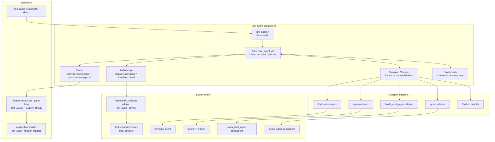
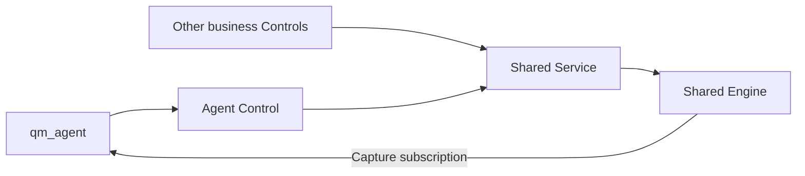
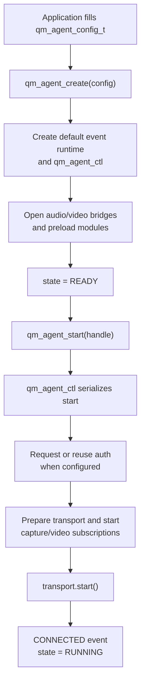
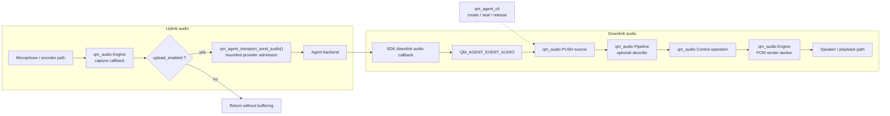

# qm_agent

中文文档：[README_CN.md](README_CN.md)

`qm_agent` is the QUMI agent session framework component. It connects cloud or
local agent transports, board-level audio/video drivers, and the `qm_agent_auth`
authentication flow behind one session API. Application code should normally
only depend on `qm_agent.h` to create a session, start or stop it, send text,
request TTS, and receive normalized events. Transport SDK
details, platform details, OS primitives, memory allocation, logging, and network
transport are kept behind QUMI component boundaries.

## Current Status

- Public session APIs are available: `qm_agent_create()`, `qm_agent_start()`,
  `qm_agent_stop()`, `qm_agent_send_text()`, `qm_agent_send_audio()`,
  `qm_agent_send_video()`, `qm_agent_tts_request()` / `qm_agent_tts_cancel()`,
  `qm_agent_asr_start_longform_recognition()`,
  `qm_agent_asr_stop_longform_recognition()`,
  `qm_agent_asr_set_realtime_enabled()`, `qm_agent_interrupt()`,
  `qm_agent_set_upload_enabled()`, `qm_agent_get_state()`,
  `qm_agent_get_id()`, and `qm_agent_network_update()`.
- A unified event model is available for connected, disconnected, audio, video,
  DOA, ASR, TTS, agent text, agent state, interrupt, and error events.
- Transport is pluggable. Built-in adapters are provided for JoyInside, Agora,
  `baidu_chat_agent`, and lgeine.
- Application code injects a dedicated `qm_audio_control_t` through
  `qm_agent_audio_config_t`. The application owns the Control and its parent
  audio instance; qm_agent never destroys them. Capture uses that same instance.
- Each session's Core owns one resident `qm_agent_ctl` task. It serializes lifecycle,
  authentication, TTS control, and low-rate transport events; it is not an
  audio-upload or TTS-playback worker.
- With `audio.capture_enabled`, the shared Engine invokes a capture callback.
  The callback makes a bounded transport admission call for its borrowed frame;
  Agent owns neither an upload task nor an intermediate capture buffer. Stop
  first removes that subscription before transport teardown.
- Transport downlink is stored and rendered by `qm_audio`. The control task only
  creates, seals, stops, and releases the corresponding PUSH operation;
  it owns no TTS queue or playback worker.
- qm_agent subscribes to normalized `qm_audio` lifecycle events through
  `qm_audio_control_subscribe()`. It publishes pointer-free public notices through
  `QM_AGENT_EVENT_BASE` on the process-shared default `qm_event` loop.
- `qm_agent_auth` is a private implementation module. Applications configure
  automatic authentication through the public session configuration; they do
  not include or call the helper directly.
- `examples/qm_agent` provides standalone examples. OpenCPU demos are also
  wired through `apps/opencpu/app/qm_agent_example.c`. Real projects still need
  to provide backend tokens/licenses, network configuration, and board audio
  configuration.

## Directory Layout

```text
components/qm_agent/
├── CMakeLists.txt
├── README.md
├── README_CN.md
├── qm_kconfig
├── include/
│   ├── qm_agent.h
│   ├── qm_agent_log.h
│   ├── qm_agent_event.h
│   ├── qm_agent_transport.h
│   ├── qm_agent_video_driver.h
│   └── qm_agent_types.h
├── priv_include/
│   ├── qm_agent_auth.h
│   └── qm_agent_internal.h
└── src/
    ├── audio/
    │   └── qm_agent_audio_engine.c
    ├── auth/
    │   └── qm_agent_auth.c
    ├── core/
    │   ├── qm_agent_control.c
    │   ├── qm_agent_core.c
    │   ├── qm_agent_event.c
    │   └── qm_agent_module.c
    ├── transport/
    │   ├── qm_agent_agora_stream.c
    │   ├── qm_agent_transport.c
    │   ├── qm_agent_transport_agora.c
    │   ├── qm_agent_transport_baidu_chat_agent.c
    │   ├── qm_agent_transport_joyinside.c
    │   └── qm_agent_transport_lgeine.c
    └── video/
        └── qm_agent_video_engine.c
```

## Layering

| Layer | Files | Responsibility |
| --- | --- | --- |
| Core | `src/core/*` | Session lifecycle, default configuration, state transitions, event dispatch, and core policies |
| Audio | `src/audio/*` | Bridge shared `qm_audio` capture callbacks to bounded transport admission; create and manage downlink PUSH operations and audio lifecycle events |
| Transport | `src/transport/*` | Adapt JoyInside, Agora, `baidu_chat_agent`, lgeine, or a custom backend and normalize SDK events into `qm_agent_event_t` |
| Auth | `priv_include/qm_agent_auth.h`, `src/auth/*` | Private credential request, reply parsing, caching, and transport credential injection through the selected `getAgentToken` channel |

## Architecture



## Execution Model

Each session's Core has one resident control task, `qm_agent_ctl`. Public
session APIs synchronously submit lifecycle and request-control commands to that
task. Low-rate transport events are cloned, queued, and processed there; auth
retries and TTS deadlines use the same task's deadline scheduler.

Audio capture/downlink and board-video uplink are separate bounded data paths.
The shared `qm_audio` Engine invokes the capture callback, which immediately
offers the borrowed frame to the transport. Downlink audio bytes are copied to
an active `qm_audio` PUSH operation by a nonblocking `QM_AGENT_EVENT_AUDIO`
callback; the bytes never enter the control queue or public event loop. A
spontaneous stream without a prior TTS request posts only a small admission
command, and frames received before the PUSH operation is active are dropped.
Board/video drivers and transport SDKs may own their own tasks, and the Agora
adapter has an optional parser task; none are a second Agent Core control task.

Public low-rate notices are value snapshots posted to the default `qm_event`
loop. Applications register `QM_AGENT_EVENT_BASE` handlers on that loop. The
handler is asynchronous relative to the session transition and must pass any
new lifecycle action back to the application's owning task.

## Agent Behavior on Shared Audio

Each Agent borrows a dedicated Control. Other business Controls share its Service
and Engine. Agent owns its PUSH operation and subscriptions, while shared Audio
handles keep their external lifetime.



The optional `audio.playback` points to a `qm_agent_audio_playback_config_t` that
is copied during create; the descriptor may be released when create returns.
NULL selects `HIGH + PREEMPT_LOWER` and
`CONFIG_QM_AGENT_AUDIO_ACQUIRE_TIMEOUT_MS` (1000 ms by default). An explicit
admission timeout must be positive and below `UINT32_MAX / 2`, or
`QM_WAIT_FOREVER`. This bounds queue admission, not the duration of the reply.
Explicit `PREEMPT_CURRENT` still ignores relative priority.

```c
qm_agent_audio_playback_config_t playback = {
    .priority = QM_AUDIO_PRIORITY_HIGH,
    .policy = QM_AUDIO_ADMISSION_PREEMPT_LOWER,
    .acquire_timeout_ms = 1000U,
};
config.audio.playback = &playback;
/* qm_agent_create(&config) copies the playback values. */
```

- STARTED, terminal facts, and input errors have reserved value slots. Queue
  saturation cannot discard them; `qm_agent_ctl` drains them after each turn.
  Audio callbacks never wait for control work or stop/release an operation.
- Incomplete stop/wait/release retains the operation and terminal result. The
  existing backoff helper and control deadline scheduler retry cleanup. The
  operation ID becomes invalid only after release succeeds; its playback
  terminal is emitted once.
  Explicit cancellation or interruption still cancels the TTS request and
  notifies the provider while local cleanup is pending.
- Preemption, cancellation, and failure close old input admission. Preemption
  and input errors attempt a transport interrupt. Ordered EOF, interrupt
  acknowledgement, or an explicit new reply permits new input. Queued stale
  admission commands are filtered by the Agent generation. Adapters must drop
  old packets after these boundaries; raw bytes without a reply identifier
  cannot identify themselves as belonging to a previous reply.
- `QM_AGENT_EVENT_TTS_INPUT_BEGIN` carries `data.audio.format` and no media
  pointer. JoyInside conversation start, lgeine TTS START, and Baidu TTS BEGIN
  map to this event to request early admission. A preadmitted live PUSH is
  preserved; a new boundary arriving during cleanup permits admission after
  the old operation is released. The notice is asynchronous,
  so frames can still arrive before PUSH is ready. Explicit TTS callers that
  need the first packet should use `qm_agent_tts_request()`, which creates PUSH
  before invoking the provider. Continuous RTC retains first-frame admission.
- `qm_agent_set_upload_enabled()` stores user intent, enabled by default.
  Effective upload also requires transport readiness, an open session, and
  compatible remote/local playback state. Internal transitions, reconnect, and
  stop/start preserve a user-disabled setting. Capture enable/unsubscribe is
  serialized on the control task.

The component integration test links real Control, Service, Pipeline, Engine,
and event workers, with only PCM device and transport fakes. It covers another
Control preempting Agent, cleanup while a callback remains active, late audio
rejection, higher-priority output preservation, and shared resources surviving
Agent destruction. Unit tests cover full control queues, retryable cleanup,
policy copying, and persistent user upload settings.

## Dependency Boundary

The public API and internal adapter interfaces use QUMI components as their
boundary:

- Base types and error codes come from `qm_types.h` and `qm_errno.h`.
- Session lifecycle, tasks, and delays use QUMI OS capabilities.
- Memory allocation and event payload clone/free use QUMI memory APIs.
- Logs use the QUMI logging component.
- Platform audio adapters implement the named `qm_audio_device` boundary; they
  do not expose vendor SDK or OS-specific audio types to the application.
- JoyInside, Agora, `baidu_chat_agent`, lgeine, and custom transports are connected through QUMI
  network transport capabilities or matching QUMI components.
- Application code should use public headers such as `qm_agent.h` instead of
  depending on TCP/TLS/WebSocket/RTC SDK internals.

Core currently applies these policies:

- Transport downlink audio is written to its active `qm_audio` PUSH operation.
- Video payloads are never published to the public default event loop. Board
  video capture uses direct driver-to-transport admission; transport-specific
  downlink video remains an internal adapter concern. Shared `qm_audio` state
  events are normalized into `QM_AGENT_EVENT_AGENT_STATE`.
- `transport_capture_policy` determines microphone upload while the remote
  agent reports `SPEAKING` or `THINKING`; it does not configure hardware AEC.

## Session Flow

### Create and Start



### Audio Uplink and Downlink



Transport adapters normalize protocol data; they do not own the Agent playback
queue. SDK-specific parser queues remain inside the relevant adapter. The Agent
opens one bounded `qm_audio` PUSH operation for a downlink stream and copies
each accepted block into it with a nonblocking write. The Pipeline decodes
encoded input when a decoder backend is configured; PCM input passes through
directly. `QM_AGENT_EVENT_TTS_PLAYBACK_COMPLETE` is emitted only after the PUSH
input, Pipeline, and device have drained.

For `qm_agent_tts_request()`, the control task opens the PUSH operation before
calling the transport's `request_tts()` method, so a synchronous first audio
callback can only make a bounded write. A spontaneous transport stream uses an
asynchronous admission command; frames delivered before admission finishes are
not buffered by Agent and must not be treated as retained.

`QM_AGENT_EVENT_TTS_INPUT_COMPLETE` means the backend has finished sending the
stream, not that it is audible-complete. A wake/interrupt increments the local
generation, clears old TTS, and drops delayed audio bytes until the transport
confirms the interrupt. Non-TTS sessions such as resource playback retain their
own pause/resume policy.

## Playback Ownership

`qm_agent` manages only transport downlink. It creates one `qm_audio` PUSH
operation for an active transport stream; local resource playback is submitted
by the application directly to `qm_audio_control_t`, using the product's own
priority and admission policy.

`transport_capture_policy` controls automatic microphone upload while the
transport reports a dialog state:

- `QM_AGENT_CAPTURE_POLICY_KEEP` keeps upload enabled while `SPEAKING`.
- `QM_AGENT_CAPTURE_POLICY_AUTO` and `QM_AGENT_CAPTURE_POLICY_PAUSE` gate
  upload while `SPEAKING`.
- `THINKING` gates upload for every policy; other dialog states re-enable it.

Stopping a transport downlink stream uses `qm_audio_control_stop()` and the
platform device adapter's bounded render-stop path. It is not a driver-specific
control command.

TTS lifecycle notices are distinct from the public TTS request callback:

| Event | Meaning |
| --- | --- |
| `QM_AGENT_EVENT_TTS_INPUT_COMPLETE` | The backend finished sending the current stream. |
| `QM_AGENT_EVENT_TTS_PLAYBACK_COMPLETE` | PUSH input, Pipeline, and the output device drained. |
| `QM_AGENT_EVENT_AGENT_ABORTED` | The backend confirmed interruption of the current turn. |

## Build Configuration

`qm_kconfig` provides the main configuration entries below:

| Config | Default | Description |
| --- | --- | --- |
| `QM_AGENT_SUPPORT` | `n` | Enable `qm_agent`; depends on `QM_OS_SUPPORT` and `QM_OS_TASK_SUPPORT` |
| `QM_AGENT_MAX_MODULES` | `8` | Maximum number of managed modules stored in one `qm_agent_config_t` |
| `QM_AGENT_CONTROL_TASK_STACK_SIZE` | `3072` | Resident `qm_agent_ctl` stack size |
| `QM_AGENT_CONTROL_TASK_PRIORITY` | `20` | Resident `qm_agent_ctl` priority |
| `QM_AGENT_CONTROL_QUEUE_LEN` | `16` | Bounded low-rate control command/event queue; audio payload bytes never enter it |
| `QM_AGENT_CONTROL_STOP_TIMEOUT_MS` | `1000` | Control-task shutdown wait time in milliseconds |
| `QM_AGENT_EVENT_TEXT_BYTES` | `192` | Fixed copied text capacity, including NUL, in one public Agent event notice |
| `QM_AGENT_TRANSPORT_AGORA` | `n` | Build the Agora SDK adapter |
| `QM_AGENT_TRANSPORT_BAIDU` | `n` | Build the `baidu_chat_agent` WebSocket adapter; selecting it also enables `BAIDU_CHAT_AGENT_SUPPORT` |
| `QM_AGENT_TRANSPORT_JOYINSIDE` | `n` | Build the JoyInside adapter; depends on `JOYINSIDE_CLIENT_SUPPORT` |
| `QM_AGENT_TRANSPORT_LGEINE` | `n` | Build the lgeine WebSocket adapter; depends on `LGEINE_AGENT_SUPPORT` |
| `QM_AGENT_AGORA_STREAM_QUEUE_LEN` | `16` | Agora stream-message parser queue length |
| `QM_AGENT_AGORA_STREAM_TASK_STACK_SIZE` | `4096` | Agora stream-message parser task stack size |
| `QM_AGENT_AGORA_STREAM_TASK_PRIORITY` | `20` | Agora stream-message parser task priority |

Set `QM_AGENT_LOG_CONFIG` to `y` to expose the category switches
`QM_AGENT_LOG_ERROR`, `QM_AGENT_LOG_LIFECYCLE`, `QM_AGENT_LOG_CONTROL`,
`QM_AGENT_LOG_UPLINK`, `QM_AGENT_LOG_DOWNLINK`, `QM_AGENT_LOG_PAYLOAD`, and
`QM_AGENT_LOG_STATS`. With the master switch disabled, error and lifecycle
logs are enabled by default. The component-wide runtime mask can override
these defaults:

```c
qm_agent_set_log_flags(QM_AGENT_LOG_ERROR |
                       QM_AGENT_LOG_LIFECYCLE |
                       QM_AGENT_LOG_UPLINK |
                       QM_AGENT_LOG_DOWNLINK |
                       QM_AGENT_LOG_STATS);
```

`qm_agent_set_log_flags(QM_AGENT_LOG_NONE)` disables all logs emitted by
`qm_agent`. The mask does not change the global QUMI log
level or the independent logging configuration of `qm_audio`,
`qm_websocket_client`, `joyinside_client`, `baidu_chat_agent`, or the Agora SDK.

The four built-in transport configs above are modeled as one optional Kconfig
`choice`, so at most one built-in transport can be selected at a time.

JoyInside is controlled by `CONFIG_QM_AGENT_TRANSPORT_JOYINSIDE`, which depends
on `JOYINSIDE_CLIENT_SUPPORT`. When enabled, the adapter includes
`components/joyinside_client/include` and calls the `joyinside_client`
component.

`baidu_chat_agent` is controlled by `CONFIG_QM_AGENT_TRANSPORT_BAIDU`.
When enabled, it automatically selects `BAIDU_CHAT_AGENT_SUPPORT` and builds
against the `components/baidu_chat_agent` WebSocket component.

lgeine is controlled by `CONFIG_QM_AGENT_TRANSPORT_LGEINE` and depends on
`LGEINE_AGENT_SUPPORT`. Configure `config.transport.data.lgeine` with the
`wss://` endpoint, product `pid`, device `sn`, and bearer `access_token`. The
optional `env` field is an integer matching the lgeine environment enum
(0 = default resolved to production, 1 = dev, 2 = test, 3 = prod); values
outside 0..3 are rejected by the adapter before start. The adapter maps
`qm_agent` audio formats to lgeine `hello` audioInfo and starts a realtime
`listen` interaction after a successful handshake.

## Transport Adapter Status

The JoyInside configuration forwards `session_id`, `feature`, `client_type`, `location`, `need_asr_partial`, `output_stream`, and an optional token provider. ASR is final only for `IS_FINAL`. `disagree_1` maps to SHAKE_HEAD, `sick_1` to BORED, and `blamed_1` keeps its social category with an ANGRY visual fallback.

Device skills emit `QM_AGENT_EVENT_COMMAND`. Modules receive `QM_AGENT_MODULE_EVENT_COMMAND` on the control task; its borrowed `data` is a complete `qm_agent_event_t`, including the full provider JSON. Copy before asynchronous execution. The public notice contains bounded domain/JSON snapshots: check `truncated` and never execute incomplete JSON. Native JoyInside VAD segmentation, dynamic voice updates, JPEG upload, media and printing remain client extension APIs; the generic Agent transport does not expose these operations.

| Transport | Current capability | Dependency | Notes |
| --- | --- | --- | --- |
| JoyInside | start/stop, audio uplink, text input, TTS request, interrupt, connected/disconnected/audio/text/error events | `joyinside_client` | Video and ASR-mode control are not supported; related APIs return `-QM_ENOSYS` |
| `baidu_chat_agent` | start/stop, audio uplink, text input, TTS request, interrupt, long-form ASR start/stop, realtime ASR mode control, connected/disconnected/ASR/agent text/audio/state/error events | `baidu_chat_agent` component | Uses the WebSocket realtime agent component; audio codec must match the configured qm_agent input format |
| lgeine | start/stop, audio uplink, text/TTS requests, interrupt, ASR start/stop and realtime mode, connected/disconnected/ASR/TTS/audio/state/error events | `lgeine_agent` component | Supports PCM/Opus; starts `listen.start` after hello and uses negotiated downlink audio format |
| Agora | init, connection, channel join, custom encoded audio uplink/downlink, stream-message parsing, video uplink, connection events | Agora RTC SDK | Audio codec and data type are mapped through qm_agent audio format |
| Custom | Injected through `qm_agent_config_t.transport_if` | Application-provided | Useful for private backends, tests, or temporary bring-up |

If a built-in transport is selected but the matching SDK support macro is not
enabled, operations return `-QM_ENOSYS`.

## OpenCPU Demo

The OpenCPU demo is in `apps/opencpu/app/qm_agent_example.c` and is included by
`apps/opencpu/main/CMakeLists.txt` only when `QM_AGENT_SUPPORT` is enabled.
`apps/opencpu/app/qm_app.c` also contains branches for qm_agent demos.

The local custom demo can simulate connected, ASR, TTS, agent text, and agent
state events without cloud tokens. To connect JoyInside or Agora, configure the
matching example and provide credentials from your project or from
`qm_agent_auth`.

The OpenCPU Baidu demo is in `apps/opencpu/app/baidu_chat_agent_example.c`.
That demo now uses the IoT auto-auth flow: after `config.iot_handle` is
provided and cloud connection succeeds, `qm_agent_core` requests
`getAgentToken` automatically and injects the returned Baidu auth fields into
the built-in `baidu_chat_agent` transport before startup. Its local knobs are
defined in `apps/opencpu/qm_kconfig.projbuild`.

## Basic Usage

```c
#include "qm_agent.h"
#include "qm_event.h"

static void agent_event_handler(void *user_ctx,
                                qm_event_base_t event_base,
                                int32_t event_id,
                                void *event_data,
                                size_t event_data_size)
{
    const qm_agent_event_notice_t *notice = event_data;

    (void)user_ctx;
    if (event_base != QM_AGENT_EVENT_BASE || notice == NULL ||
        event_data_size != sizeof(*notice)) {
        return;
    }

    switch ((qm_agent_event_id_t)event_id) {
        case QM_AGENT_EVENT_CONNECTED:
            /* transport ready */
            break;
        case QM_AGENT_EVENT_ASR:
            /* notice->data.text.text and notice->data.text.final */
            break;
        case QM_AGENT_EVENT_AGENT_TEXT:
            /* notice->data.text.text and notice->data.text.truncated */
            break;
        case QM_AGENT_EVENT_DOA:
            /* notice->data.doa.azimuth / elevation / confidence */
            break;
        case QM_AGENT_EVENT_ERROR:
            /* notice->code and notice->data.text.text */
            break;
        default:
            break;
    }
}

void app_agent_start(void)
{
    qm_agent_config_t config = {0};
    qm_agent_handle_t handle;
    int ret;

    ret = qm_event_default_create();
    if (ret != QM_EOK && ret != -QM_EINIT) {
        return;
    }
    if (qm_event_handler_register(QM_AGENT_EVENT_BASE,
                                  QM_EVENT_ANY_ID,
                                  agent_event_handler,
                                  NULL) != QM_EOK) {
        return;
    }

    qm_agent_config_init_defaults(&config);

    config.transport.type = QM_AGENT_TRANSPORT_JOYINSIDE;
    config.transport.data.joyinside.bot_id = "your-bot-id";
    config.transport.data.joyinside.access_token = "your-access-token";
    /* Optional for static credentials; auto auth overwrites this with ljyd.userId. */
    config.transport.data.joyinside.uid = "device-or-user-id";
    config.transport.data.joyinside.chat_role_code = NULL;
    config.transport.data.joyinside.timeout_ms = 5000;

    /* Required shared qm_audio interfaces created earlier. */
    config.audio.control = shared_audio_control;
    config.audio.capture_enabled = QM_TRUE;

    handle = qm_agent_create(&config);
    if (handle == NULL) {
        (void)qm_event_handler_unregister(QM_AGENT_EVENT_BASE,
                                          QM_EVENT_ANY_ID,
                                          agent_event_handler,
                                          NULL);
        return;
    }

    if (qm_agent_start(handle) != QM_EOK) {
        qm_agent_destroy(handle);
        (void)qm_event_handler_unregister(QM_AGENT_EVENT_BASE,
                                          QM_EVENT_ANY_ID,
                                          agent_event_handler,
                                          NULL);
        return;
    }

    qm_agent_send_text(handle, "hello");
}
```

For lgeine, select `QM_AGENT_TRANSPORT_LGEINE` and provide the WebSocket
credentials directly in the transport config:

```c
config.transport.type = QM_AGENT_TRANSPORT_LGEINE;
config.transport.data.lgeine.uri = "wss://platform.example/voice";
config.transport.data.lgeine.pid = "YOUR_PRODUCT_ID";
config.transport.data.lgeine.sn = "DEVICE_UNIQUE_ID";
config.transport.data.lgeine.access_token = "short-lived-token";
config.audio.control = shared_audio_control;
config.audio.capture_enabled = QM_TRUE;
```

`pid`, `sn`, and `access_token` are required. When `uri` is NULL the endpoint is
derived from `env`; leave `env` unset (`LGEINE_AGENT_ENV_DEFAULT`) to target the
production endpoint, or pass `LGEINE_AGENT_ENV_DEV` / `LGEINE_AGENT_ENV_TEST` to
select a non-production environment. Transport buffers, timeouts, and the
WebSocket task parameters are not part of this struct — they follow the
`lgeine_agent` component's `CONFIG_LGEINE_AGENT_*` Kconfig defaults.

The adapter converts the shared `qm_audio` input format to lgeine `hello`,
starts `listen.start` after the handshake, and converts negotiated downlink
audio and ASR/TTS events into the common `qm_agent_event_t` model.

RTC video uplink frames are pushed by the application or camera path. They do
not use the audio path:

```c
qm_agent_video_format_t video = {
    .codec = QM_AGENT_VIDEO_CODEC_JPEG,
    .width = 320,
    .height = 240,
    .frame_rate = 15,
    .rotation = 0,
};

qm_agent_send_video(handle, frame_data, frame_len, &video);
```

When a board video driver is configured, it receives a frame callback from
`qm_agent_video_driver_if_t::open` and pushes frames from its own capture
worker. The frame storage is borrowed only for the callback duration; the
driver may recycle it after the callback returns. `stop()` and `close()` must
quiesce in-flight callbacks before returning. `qm_agent` does not create a
video polling task or retain frame buffers.

## Audio Driver Integration

Product bootstrap calls `qm_audio_init()` once. A dedicated Control for Agent
binds that default instance automatically; pass only that Control. Capture
uses the same parent instance. Check every return value (omitted below), and
clean up Agent, then Control, then the shared instance:

```c
qm_audio_config_t audio_cfg = {
    .input_format = input_format,
    .output_format = output_format,
    .capture_frame_bytes = 640,
};
qm_audio_control_t *control;
qm_audio_init(&audio_cfg);
qm_audio_control_create(&control);
config.audio.control = control;
config.audio.capture_enabled = QM_TRUE;
```

The platform adapter (`adapter/qm_audio_device.h`) should implement:

- `render_write()` receives PCM blocks from the Engine render worker;
  `render_drain()` confirms hardware queue completion.
- `capture_read()` provides PCM capture blocks to the Engine capture worker.
- `set_volume()` and `set_mute()` implement the shared output controls.
- The codec adapter (`adapter/qm_audio_codec.h`) is the unified platform
  implementation. It accepts encoded bytes and emits PCM to the Pipeline. It is
  required for Opus, G.711, G.722, MP3, or custom encoded downlink formats.

`qm_agent` never sends encoded bytes to the device adapter. If
`CONFIG_QM_AUDIO_DECODER_SUPPORT` is disabled, encoded downlink is rejected with
`-QM_ENOSYS`; PCM playback remains available.

`qm_agent_config_init_defaults()` keeps any transport type, custom transport, or
shared audio handles selected by the caller. If transport or video settings are
not set, it derives reasonable defaults from the enabled capabilities in
`qm_config.h`. Shared audio creation and stream-format selection remain
explicit in `qm_audio`.

On AC7911BX, the current device adapter is
`platform/mcu/ac7911bx/hal/qm_audio/qm_audio_device.c`. Its render path accepts
PCM through `render_write()` and confirms completion with `render_drain()`.
When input capture is configured, the product capture producer feeds the
adapter's bounded capture mirror; the Engine reads it through `capture_read()`.
The adapter owns no Agent or transport behavior.

## Event and Memory Rules

- Applications subscribe with `qm_event_handler_register(QM_AGENT_EVENT_BASE, ...)`.
  The handler receives a `qm_agent_event_notice_t`; its `event_id` is a
  `qm_agent_event_id_t` value. Handlers execute on the default `qm_event` task.
- `qm_event` copies the pointer-free notice before queuing it. Its callback
  argument is valid only during the handler, but applications may copy the
  complete notice without retaining any Agent-owned memory.
- Text is a bounded snapshot in `qm_agent_event_text_notice_t`. Check
  `text_length` and `truncated`; configure its capacity with
  `QM_AGENT_EVENT_TEXT_BYTES`.
- `QM_AGENT_EVENT_AUDIO` and `QM_AGENT_EVENT_VIDEO` are never posted to the
  default event loop. They remain internal borrowed data-plane callbacks. Audio
  must be accepted or rejected in bounded time; asynchronous transport work
  must copy an accepted buffer before the callback returns. Video follows the
  selected driver's or transport adapter's ownership contract.
- Low-rate transport events are cloned before they are queued to `qm_agent_ctl`.
  `QM_AGENT_EVENT_AUDIO` payload bytes stay on the direct path: an active stream
  uses a bounded PUSH write, while a not-yet-admitted spontaneous stream only
  queues its small admission request and drops the frame. An adapter must not
  retain the original pointer after the callback returns.
- The default event loop is process-shared. `qm_agent_create()` creates it only
  when absent and `qm_agent_destroy()` never deletes it. Applications own their
  handler registrations and should unregister before releasing handler context.
  Create the default loop before registering application handlers when the
  application initializes it first.
- Failed public-notice delivery never changes session state or resource release.
  Query the session state through `qm_agent_get_state()` when reconciliation is
  required.
- Strings and custom contexts in `qm_agent_config_t` are owned by the caller by
  default and must remain valid for the session lifetime unless a specific SDK
  documents that it copies them.

## qm_agent_auth

`qm_agent_auth` is an internal authentication module owned by `qm_agent`. Its
header is under `priv_include/qm_agent_auth.h` and is not an application API.
The built-in auth path is selected by `QM_AGENT_AUTH_CHANNEL_CHOICE` in
`qm_agent/qm_kconfig`; request, retry, reply parsing, and credential injection
are scheduled on `qm_agent_ctl`:

- `QM_AGENT_AUTH_CHANNEL_MQTT`
- Publish `getAgentToken` to `/$pid/$did/device/up`.
- Listen for `getAgentTokenReply` from `/$pid/$did/device/down`.
- Core requests credentials after qm_cloud reports `QM_IOT_EVENT_CLOUD_CONN`.

- `QM_AGENT_AUTH_CHANNEL_HTTP`
- Call `POST /agent-device/device/getAgentToken`.
- Select the default base URL by environment:
  `https://api-dev.ljyd.cn`, `https://api-test.ljyd.cn`,
  `https://api.ljyd.cn`.
- Reuse the dynreg-style signing fields: `pid`, `sn`, `timestamp`, `nonce`,
  and `signature`.
- Only the auth fields inside `result` are consumed; wrapper fields such as
  `timestamp` are not used by business logic.

Both channels parse and cache credentials privately. Before the selected
transport is initialized, Core injects the supported credential fields into its
private transport configuration. For JoyInside automatic authentication, the
reply's `ljyd.userId` becomes the transport `uid`; applications do not need to
read or manage the cached response.

In MQTT mode, the private helper registers the `getAgentTokenReply` downlink
handler and uses `config.iot_handle` for automatic auth. In HTTP mode, HTTP-only
builds expose `qm_agent_config_t.auth_http`, and `qm_agent_start()` requests auth
directly without waiting for qm_cloud connection events.

Applications do not initialize, poll, or include `qm_agent_auth`. They provide
the public `iot_handle` for MQTT mode, or the public `auth_http` configuration
when the HTTP channel is enabled; `qm_agent` owns the rest of the sequence.

When the current build selects the HTTP channel, the recommended integration is
to pass auth parameters through the HTTP-only `qm_agent_config_t.auth_http`
field:

```c
qm_agent_config_t config = {0};

config.transport.type = QM_AGENT_TRANSPORT_JOYINSIDE;
qm_agent_config_init_defaults(&config);
config.auth_http.env = QM_AGENT_AUTH_ENV_TEST;
config.auth_http.product_id = product_id;
config.auth_http.product_secret = product_secret;
config.auth_http.sn = sn;
config.auth_http.timeout_ms = 5000;
config.auth_http.retry_num = 5;
/* config.auth_http.base_url = "https://api-test.ljyd.cn"; */
```

`base_url` may be left unset. The component picks the development, test, or
production endpoint from `env` unless an explicit override is required for a
special gateway or integration environment.

For the Baidu transport, Core validates the cached `audiocodec` against the
local input format before startup and injects the supported token-mode fields.
Applications provide only public non-auth business fields such as `headers`,
`user_id`, `device_id`, or `packet_max_len` alongside `iot_handle`.

## Custom Transport

When a built-in backend is not enough, implement `qm_agent_transport_if_t` and
inject it through `config.transport_if`:

```c
static const qm_agent_transport_if_t my_transport = {
    .name = "my-agent",
    .init = my_agent_init,
    .deinit = my_agent_deinit,
    .start = my_agent_start,
    .stop = my_agent_stop,
    .send_audio = my_agent_send_audio,
    .send_video = my_agent_send_video,
    .send_text = my_agent_send_text,
    .request_tts = my_agent_request_tts,
    .interrupt = my_agent_interrupt,
};

qm_agent_config_init_defaults(&config);
config.transport.type = QM_AGENT_TRANSPORT_CUSTOM;
config.transport.data.custom = my_backend_config;
config.transport_if = &my_transport;
```

The adapter converts backend signals into `qm_agent_event_t` and reports them
through the callback supplied to `init()`. Low-rate events may be reported from
any provider context and are cloned for `qm_agent_ctl`. `QM_AGENT_EVENT_AUDIO`
is the direct data path: its buffer is borrowed only for the callback and must
be accepted or rejected in bounded time. An asynchronous transport copies an
accepted buffer before returning; it never retains the borrowed pointer or
sends it through the public event loop.

## Next Work

- Continue validating real JoyInside and Agora examples against cloud behavior.
- Improve Agora multi-instance behavior as SDK callback support evolves.
- Add focused tests for core state transitions, event clone/free, audio upload
  gating, downlink stream completion, and transport fallback behavior.
