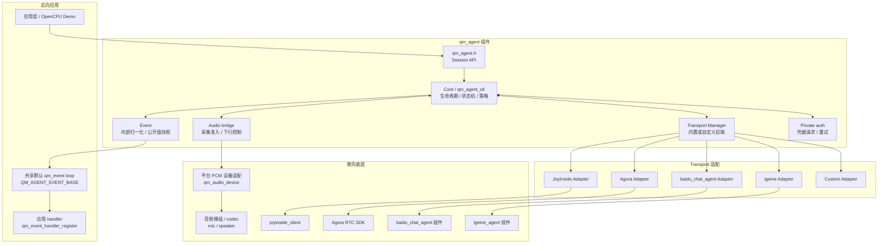
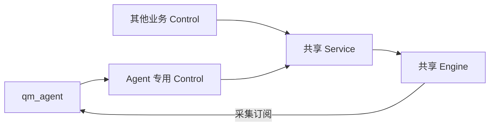
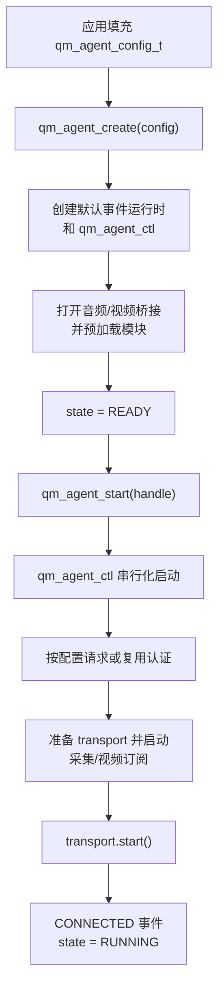
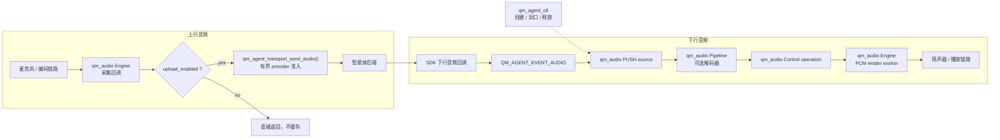

# qm_agent

英文文档：[README.md](README.md)

`qm_agent` 是 QUMI 的智能体会话框架组件，用统一的 session API 把云端/本地智能体
transport、板级音频/视频驱动和 qm_agent_auth 认证链路串起来。组件当前重点是建立稳定边界：
业务只面向 `qm_agent.h` 创建会话、启动/停止、发送文本或 TTS 请求；不同后端 SDK 由
transport 适配层转换成统一事件。组件接口统一依赖 QUMI 基础组件，OS、内存、日志
和网络传输能力由 QUMI 提供，不向业务层直接暴露底层平台或第三方 SDK 细节。

## 当前状态

- 已有公共会话 API：`qm_agent_create()`、`qm_agent_start()`、`qm_agent_stop()`、
  `qm_agent_send_text()`、`qm_agent_send_audio()`、`qm_agent_send_video()`、
  `qm_agent_tts_request()`、`qm_agent_tts_cancel()`、`qm_agent_asr_start_longform_recognition()`、
  `qm_agent_asr_stop_longform_recognition()`、
  `qm_agent_asr_set_realtime_enabled()`、`qm_agent_interrupt()`、
  `qm_agent_set_upload_enabled()`、`qm_agent_get_state()`、
  `qm_agent_get_id()`、`qm_agent_network_update()`。
- 已有统一事件模型：连接、断开、音频、视频、DOA、ASR、TTS、智能体文本、
  智能体状态、打断和错误。
- 已有可插拔 transport 接口，并提供 JoyInside、Agora、`baidu_chat_agent`、lgeine 四个内置适配入口。
- 应用通过 `qm_agent_audio_config_t` 注入当前 Agent 专用的
  `qm_audio_control_t`。Control 及其父音频实例由应用创建和销毁，qm_agent 不接管
  其生命周期；采集自动使用 Control 所属的音频实例。
- 每个会话的 Core 只有一个常驻的 `qm_agent_ctl` 控制任务，用于串行化生命周期、认证、
  TTS 控制和低频 transport 事件；它不是音频上传或 TTS 播放任务。
- 设置 `audio.capture_enabled` 后，共享 Engine 会调用采集回调。该回调对借用帧发起
  有界的 transport 准入调用；Agent 不创建上传任务，也不保存中转采集缓存。停止时先
  解除订阅，再释放传输资源。
- 下行音频的缓存和渲染由 `qm_audio` 负责。控制任务仅创建、封口、停止和释放
  相应的 PUSH 操作，不持有 TTS 队列或播放任务。
- qm_agent 通过 `qm_audio_control_subscribe()` 订阅归一化的 `qm_audio` 生命周期事件，并将
  无指针的公开通知投递到进程共享的默认 `qm_event` loop（`QM_AGENT_EVENT_BASE`）。
- `qm_agent_auth` 是私有实现模块。应用只通过公开会话配置启用自动认证，不直接包含或
  调用该 helper。
- 已提供 `examples/qm_agent` 独立 example，并已接入
  `apps/opencpu/app/qm_agent_example.c` OpenCPU demo；真实项目仍需要在应用层补齐
  后端 token/license、网络和板级音频配置。

## 目录结构

```text
components/qm_agent/
├── CMakeLists.txt
├── qm_kconfig
├── include/
│   ├── qm_agent.h
│   ├── qm_agent_log.h
│   ├── qm_agent_event.h
│   ├── qm_agent_transport.h
│   ├── qm_agent_video_driver.h
│   └── qm_agent_types.h
├── priv_include/
│   ├── qm_agent_auth.h
│   └── qm_agent_internal.h
└── src/
    ├── audio/
    │   └── qm_agent_audio_engine.c
    ├── auth/
    │   └── qm_agent_auth.c
    ├── core/
    │   ├── qm_agent_control.c
    │   ├── qm_agent_core.c
    │   ├── qm_agent_event.c
    │   └── qm_agent_module.c
    ├── transport/
    │   ├── qm_agent_agora_stream.c
    │   ├── qm_agent_transport.c
    │   ├── qm_agent_transport_agora.c
    │   ├── qm_agent_transport_baidu_chat_agent.c
    │   ├── qm_agent_transport_joyinside.c
    │   └── qm_agent_transport_lgeine.c
    └── video/
        └── qm_agent_video_engine.c
```

## 分层设计

| 层级 | 文件 | 职责 |
| --- | --- | --- |
| Core | `src/core/*` | 会话生命周期、默认配置、状态切换、事件派发和核心策略 |
| Audio | `src/audio/*` | 将共享 `qm_audio` 采集回调桥接到有界 transport 准入；创建和管理下行 PUSH 操作及音频生命周期事件 |
| Transport | `src/transport/*` | 适配 JoyInside、Agora、`baidu_chat_agent`、lgeine 或自定义后端，并把 SDK 事件归一化为 `qm_agent_event_t` |
| Auth | `priv_include/qm_agent_auth.h`、`src/auth/*` | 私有凭据请求、回包解析、缓存以及通过所选 `getAgentToken` 通道注入 transport 凭据 |

## 整体框架图



## 执行模型

每个会话的 Core 只有一个常驻控制任务 `qm_agent_ctl`。生命周期和低频请求 API
会同步提交命令给该任务；低频 transport 事件会复制后入队并在此处理，认证重试和 TTS
超时也由同一任务的 deadline 调度器处理。

音频采集/下行和板级视频上行走独立的有界数据路径。共享 `qm_audio` Engine 调用采集回调，
回调立即将借用帧交给 transport 准入。下行 `QM_AGENT_EVENT_AUDIO` 回调会把音频字节以非阻塞
方式复制到已激活的 `qm_audio` PUSH 操作；音频字节既不进入控制队列，也不进入公开事件 loop。
没有预先 TTS 请求的自发流只会投递一个小的准入命令，PUSH 操作激活前到达的帧会被丢弃。板级/
video driver 和 transport SDK 可以有自己的任务，Agora 适配器也可以启用独立解析任务；这些都
不是第二个 Agent Core 控制任务。

公开低频通知以值快照方式投递到默认 `qm_event` loop。应用在该 loop 上注册
`QM_AGENT_EVENT_BASE` handler；该 handler 相对于会话状态切换是异步的，新的生命周期
操作应回交给应用自己的管理任务。

## 共享音频下的 Agent 行为

每个 Agent 借用一个专用 Control。多个业务的 Control 共享同一 Service 和 Engine；
Agent 只管理自己的 PUSH 操作和采集订阅，不拥有共享音频资源的生命周期。



`audio.playback` 可选指向 `qm_agent_audio_playback_config_t`。创建 Agent 时复制配置，
描述符在创建返回后即可释放；NULL 默认使用 `HIGH + PREEMPT_LOWER`，准入超时取
`CONFIG_QM_AGENT_AUDIO_ACQUIRE_TIMEOUT_MS`（默认 1000 ms）。显式配置的超时必须
大于零、小于 `UINT32_MAX / 2`，或使用 `QM_WAIT_FOREVER`。准入超时限制排队等待，
不是整个回复的播放时长。`PREEMPT_CURRENT` 仍可显式选择，其语义会忽略相对优先级。

```c
qm_agent_audio_playback_config_t playback = {
    .priority = QM_AUDIO_PRIORITY_HIGH,
    .policy = QM_AUDIO_ADMISSION_PREEMPT_LOWER,
    .acquire_timeout_ms = 1000U,
};
config.audio.playback = &playback;
/* qm_agent_create(&config) 会复制 playback 的值。 */
```

- STARTED、终态和输入错误使用固定的待处理槽位，控制队列满时仍保留事实；
  `qm_agent_ctl` 在每轮命令后处理它们。回调不等待控制任务，不执行停止或释放。
- 停止、等待或释放失败时保留操作及终态结果，使用已有 backoff 和控制任务的 deadline
  调度重试；释放成功才失效 operation_id，并且播放终态仅报告一次。
  主动取消或打断仍会立即取消 TTS 请求并通知远端，不受本地释放重试影响。
- 被抢占、取消或失败后关闭旧流入口。抢占和输入错误会尝试打断 transport；到有序的
  输入结束、打断确认或明确的新轮次才开放入口。排队的旧准入命令通过 Agent 代次过滤。
  transport 必须在这些边界后丢弃旧轮次数据，因为无轮次标识的原始音频无法自行区分。
- `QM_AGENT_EVENT_TTS_INPUT_BEGIN` 携带 `data.audio.format`，不携带媒体指针。
  JoyInside 对话开始、lgeine TTS START、Baidu TTS BEGIN 会映射此事件，提前请求准入。
  已预建的活动 PUSH 会继续使用；旧操作仍待释放时保留新轮次边界，释放后可再次准入。
  该通知是异步的；PUSH 就绪前仍可能丢帧。要求保留首包的显式 TTS 请求应使用
  `qm_agent_tts_request()`，它在调用 provider 前建立 PUSH。连续 RTC 保留首帧触发准入的路径。
- `qm_agent_set_upload_enabled()` 表示持久的用户意愿，默认开启。实际上传还取决于
  transport 就绪、会话未关闭、远端对话状态和本地播放状态。内部状态更新、重连以及
  stop/start 不会重新打开用户关闭的上传。采集订阅 enable/unsubscribe 由控制任务串行执行。

组件测试新增了真实 Control、Service、Pipeline、Engine 和事件任务之间的集成场景，
只模拟 PCM 设备与 transport。覆盖其他 Control 抢占、回调未退出时的清理、迟到音频隔离、
更高优先级输出保持活动，以及 Agent 销毁后的共享资源可用性。单元测试还覆盖关键事件
队列满、释放重试、策略复制和用户采集开关。

## 依赖边界

`qm_agent` 的公共接口和内部适配接口都以 QUMI 基础组件为边界：

- 基础类型和错误码依赖 `qm_types.h`、`qm_errno.h`。
- 会话生命周期、任务和延时依赖 QUMI OS 能力。
- 内存分配、事件 payload 拷贝和释放依赖 QUMI 内存接口。
- 日志输出依赖 QUMI 日志组件。
- 平台音频适配实现具名的 `qm_audio_device` 边界，不向应用暴露厂商 SDK 或 OS 专用音频类型。
- JoyInside、Agora、`baidu_chat_agent`、lgeine 等 transport 适配通过 QUMI 网络传输能力或对应 QUMI 组件接入。
- 北向业务只使用 `qm_agent.h` 及相关 public header，不直接依赖 TCP/TLS/WebSocket/RTC SDK 细节。

Core 当前包含三条明确策略：

- 收到 transport 下行音频事件时，写入对应的活动 `qm_audio` PUSH 操作。
- 视频 payload 不会投递到公开默认事件 loop。板级视频采集通过 driver 到 transport 的直接
  准入路径上行，transport 特有的下行视频仍属于内部适配器职责；共享 `qm_audio` 状态事件会
  归一化成 `QM_AGENT_EVENT_AGENT_STATE`。
- `transport_capture_policy` 决定远端处于 `SPEAKING` 或 `THINKING` 时的麦克风上传行为；
  它不配置硬件 AEC。

## 会话流程图

### 创建和启动



### 音频上行和下行



Transport 只适配协议，不拥有 Agent 的播放队列；SDK 专用解析队列仍由对应适配器内部维护。
Agent 为每条下行流创建一个有界 `qm_audio` PUSH 操作，并以非阻塞方式复制已接收的数据；
配置了解码器时由 Pipeline 完成压缩数据解码，PCM 则直接通过。PUSH 输入、Pipeline 和硬件
全部排空后才发出 `QM_AGENT_EVENT_TTS_PLAYBACK_COMPLETE`。

对于 `qm_agent_tts_request()`，控制任务会在调用 transport 的 `request_tts()` 前创建
PUSH 操作，因此同步到达的首个音频回调只会执行一次有界写入。自发的 transport 下行流
通过异步准入命令建立操作；准入完成前到达的帧不会被 Agent 缓存，不能视为已保留。

`QM_AGENT_EVENT_TTS_INPUT_COMPLETE` 的语义仅为“云端已发送完当前 TTS”，不是“声音已
播放完”。用户唤醒/打断会递增本地 generation、停止并清空旧 TTS、在后端打断确认前
丢弃迟到音频字节；资源播放等非 TTS 会话仍由它们自己的暂停/恢复策略管理。

## 播放归属

`qm_agent` 只管理 transport 下行。活动 transport 流对应一个 `qm_audio` PUSH 操作；
本地资源播放由应用直接提交给 `qm_audio_control_t`，其优先级和准入策略由产品定义。

`transport_capture_policy` 控制 transport 上报对话状态时的自动麦克风上传行为：

- `QM_AGENT_CAPTURE_POLICY_KEEP` 在 `SPEAKING` 时保持上传开启。
- `QM_AGENT_CAPTURE_POLICY_AUTO` 和 `QM_AGENT_CAPTURE_POLICY_PAUSE` 在
  `SPEAKING` 时关闭上传。
- 无论策略为何，`THINKING` 都会关闭上传；其它对话状态会重新开启上传。

停止 transport 下行流使用 `qm_audio_control_stop()` 和平台设备适配器的有界 render-stop
路径，不依赖某个特定驱动的控制命令。

TTS 生命周期通知与公开 TTS 请求回调是不同机制：

| 事件 | 语义 |
| --- | --- |
| `QM_AGENT_EVENT_TTS_INPUT_COMPLETE` | 后端已发送完当前流。 |
| `QM_AGENT_EVENT_TTS_PLAYBACK_COMPLETE` | PUSH 输入、Pipeline 和输出设备已排空。 |
| `QM_AGENT_EVENT_AGENT_ABORTED` | 后端已确认打断当前回合。 |

## 编译配置

`qm_kconfig` 当前提供以下配置项：

| 配置项 | 默认值 | 说明 |
| --- | --- | --- |
| `QM_AGENT_SUPPORT` | `n` | 启用 `qm_agent`，依赖 `QM_OS_SUPPORT` 和 `QM_OS_TASK_SUPPORT` |
| `QM_AGENT_CONTROL_TASK_STACK_SIZE` | `3072` | 常驻 `qm_agent_ctl` 的栈大小 |
| `QM_AGENT_CONTROL_TASK_PRIORITY` | `20` | 常驻 `qm_agent_ctl` 的优先级 |
| `QM_AGENT_CONTROL_QUEUE_LEN` | `16` | 有界低频控制命令/事件队列；音频 payload 字节不会进入该队列 |
| `QM_AGENT_CONTROL_STOP_TIMEOUT_MS` | `1000` | 控制任务关闭等待时间，单位毫秒 |
| `QM_AGENT_EVENT_TEXT_BYTES` | `192` | 每个公开 Agent 事件中定长文本快照的容量，包含结尾 NUL |
| `QM_AGENT_TRANSPORT_AGORA` | `n` | 编译 Agora SDK 适配，需要 `apps/agora-iot-sdk-ex71x/include` |
| `QM_AGENT_TRANSPORT_BAIDU` | `n` | 编译 `baidu_chat_agent` WebSocket 适配；选中后会自动使能 `BAIDU_CHAT_AGENT_SUPPORT` |
| `QM_AGENT_TRANSPORT_JOYINSIDE` | `n` | 编译 JoyInside 适配，依赖 `JOYINSIDE_CLIENT_SUPPORT` |
| `QM_AGENT_TRANSPORT_LGEINE` | `n` | 编译 lgeine WebSocket 适配，依赖 `LGEINE_AGENT_SUPPORT` |
| `QM_AGENT_AGORA_STREAM_QUEUE_LEN` | `16` | Agora 流消息解析队列长度 |
| `QM_AGENT_AGORA_STREAM_TASK_STACK_SIZE` | `4096` | Agora 流消息解析任务栈大小 |
| `QM_AGENT_AGORA_STREAM_TASK_PRIORITY` | `20` | Agora 流消息解析任务优先级 |

将 `QM_AGENT_LOG_CONFIG` 设置为 `y` 后，Kconfig 会显示以下日志分类：
`QM_AGENT_LOG_ERROR`、`QM_AGENT_LOG_LIFECYCLE`、`QM_AGENT_LOG_CONTROL`、
`QM_AGENT_LOG_UPLINK`、`QM_AGENT_LOG_DOWNLINK`、`QM_AGENT_LOG_PAYLOAD` 和
`QM_AGENT_LOG_STATS`。总开关关闭时，默认只保留错误和生命周期日志。
运行时也可以通过组件级全局掩码覆盖默认值：

```c
qm_agent_set_log_flags(QM_AGENT_LOG_ERROR |
                       QM_AGENT_LOG_LIFECYCLE |
                       QM_AGENT_LOG_UPLINK |
                       QM_AGENT_LOG_DOWNLINK |
                       QM_AGENT_LOG_STATS);
```

调用 `qm_agent_set_log_flags(QM_AGENT_LOG_NONE)` 可以关闭全部 `qm_agent`
日志。这个掩码不会改变 QUMI 全局日志级别，也不会联动修改
`qm_audio`、`qm_websocket_client`、`joyinside_client`、`baidu_chat_agent` 或 Agora SDK
自己的日志配置；这些组件需要分别设置。

上面四个内置 transport 配置项在 Kconfig 中被组织成一个可选 `choice`，
因此四种内置 transport 最多只能同时选中一个。

JoyInside 适配器由 `CONFIG_QM_AGENT_TRANSPORT_JOYINSIDE` 控制，并依赖
`JOYINSIDE_CLIENT_SUPPORT`；开启后会包含
`components/joyinside_client/include` 并调用 `joyinside_client` 组件。

`baidu_chat_agent` 适配器由 `CONFIG_QM_AGENT_TRANSPORT_BAIDU`
控制；开启后会自动选择 `BAIDU_CHAT_AGENT_SUPPORT`，并复用
`components/baidu_chat_agent` WebSocket 组件。

lgeine 适配器由 `CONFIG_QM_AGENT_TRANSPORT_LGEINE` 控制，依赖
`LGEINE_AGENT_SUPPORT`。应用通过 `config.transport.data.lgeine` 配置
`wss://` 地址、产品 `pid`、设备 `sn` 和 Bearer `access_token`。可选 `env`
字段为整数，取值与 lgeine 环境枚举一致（0 = 默认、内部解析为生产环境，
1 = dev，2 = test，3 = prod）；超出 0..3 的取值会在 start 前被适配器拒绝。
握手成功后，适配器自动发送
实时 `listen.start`，并使用 `helloReply` 协商后的下行音频格式。

## Transport 适配状态

JoyInside 配置透传 `session_id`、`feature`、`client_type`、`location`、`need_asr_partial`、`output_stream` 及可选 Token provider；ASR 仅 `IS_FINAL` 标为完成。`disagree_1` 映射摇头，`sick_1` 映射 BORED，`blamed_1` 保留社会认知分类并以 ANGRY 作为视觉回退。

设备技能产生 `QM_AGENT_EVENT_COMMAND`。模块在控制任务收到 `QM_AGENT_MODULE_EVENT_COMMAND`，其借用 `data` 为完整 `qm_agent_event_t`，内含供应商完整 JSON；异步执行前须复制。公共通知仅保留有界 domain/JSON 快照，必须检查 `truncated`，禁止执行不完整 JSON。JoyInside 原生 VAD 分段、动态语音配置、JPEG 上传、媒体和打印仍由客户端扩展 API 提供，通用 Agent transport 尚未暴露这些操作。

| Transport | 当前能力 | 依赖 | 备注 |
| --- | --- | --- | --- |
| JoyInside | start/stop、音频上行、文本输入、TTS 请求、打断、连接/断开/音频/文本/错误事件映射 | `joyinside_client` | 当前不支持视频和 ASR 模式控制，相关 API 返回 `-QM_ENOSYS` |
| `baidu_chat_agent` | start/stop、音频上行、文本输入、TTS 请求、打断、长时 ASR 启停、实时 ASR 模式控制、连接/断开、ASR/智能体文本/音频/状态/错误事件映射 | `baidu_chat_agent` 组件 | 复用 WebSocket 实时智能体组件；音频 codec 需要与 qm_agent 输入格式一致 |
| lgeine | start/stop、音频上行、文本/TTS 请求、打断、ASR 启停和实时模式、连接/断开、ASR/TTS/音频/状态/错误事件映射 | `lgeine_agent` 组件 | 支持 PCM/Opus；hello 成功后自动发送 `listen.start`，下行使用协商格式 |
| Agora | 初始化、建连入会、PCM 上行、视频上行、连接事件 | Agora RTC SDK | 下行音频、下行视频和消息事件映射待补齐 |
| Custom | 可通过 `qm_agent_config_t.transport_if` 注入 | 应用自带 | 用于临时后端、单测或项目私有 SDK |

如果选择了某个内置 transport，但对应 SDK 支持宏没有开启，相关操作会返回
`-QM_ENOSYS`。

## OpenCPU Demo

OpenCPU 示例位于 `apps/opencpu/app/qm_agent_example.c`，并会在
`QM_AGENT_SUPPORT` 打开时加入 `apps/opencpu/main/CMakeLists.txt`。
`apps/opencpu/app/qm_app.c` 中新增
`APP_DEMO_QM_AGENT` 分支，默认 `APP_DEMO_SELECT` 会启动该 demo。

示例默认使用本地 custom transport，会在启动后模拟 connected、ASR、TTS 和
agent text/state 事件，便于不配置云端 token 时验证 `qm_agent` 会话链路。若要连真实
JoyInside 后端，可关闭 `CONFIG_QM_AGENT_EXAMPLE_USE_CUSTOM_TRANSPORT` 并填入
JoyInside bot/access token/uid 等配置；如需接入音频驱动，请在 OpenCPU app 侧
显式选择对应的 `qm_audio` 驱动适配。

OpenCPU 的百度示例位于 `apps/opencpu/app/baidu_chat_agent_example.c`。该示例现在
统一走 IoT 自动鉴权链路：应用提供 `config.iot_handle` 后，待云端连通成功，
`qm_agent_core` 会自动请求 `getAgentToken`，并在启动前把回包中的百度鉴权字段
注入内置 `baidu_chat_agent` transport。本地示例配置入口已经收口到
`apps/opencpu/qm_kconfig.projbuild`。

## 基本使用

```c
#include "qm_agent.h"
#include "qm_event.h"

static void agent_event_handler(void *user_ctx,
                                qm_event_base_t event_base,
                                int32_t event_id,
                                void *event_data,
                                size_t event_data_size)
{
    const qm_agent_event_notice_t *notice = event_data;

    (void)user_ctx;
    if (event_base != QM_AGENT_EVENT_BASE || notice == NULL ||
        event_data_size != sizeof(*notice)) {
        return;
    }

    switch ((qm_agent_event_id_t)event_id) {
        case QM_AGENT_EVENT_CONNECTED:
            /* transport ready */
            break;
        case QM_AGENT_EVENT_ASR:
            /* notice->data.text.text and notice->data.text.final */
            break;
        case QM_AGENT_EVENT_AGENT_TEXT:
            /* notice->data.text.text and notice->data.text.truncated */
            break;
        case QM_AGENT_EVENT_DOA:
            /* notice->data.doa.azimuth / elevation / confidence */
            break;
        case QM_AGENT_EVENT_ERROR:
            /* notice->code and notice->data.text.text */
            break;
        default:
            break;
    }
}

void app_agent_start(void)
{
    qm_agent_config_t config = {0};
    qm_agent_handle_t handle;
    int ret;

    ret = qm_event_default_create();
    if (ret != QM_EOK && ret != -QM_EINIT) {
        return;
    }
    if (qm_event_handler_register(QM_AGENT_EVENT_BASE,
                                  QM_EVENT_ANY_ID,
                                  agent_event_handler,
                                  NULL) != QM_EOK) {
        return;
    }

    qm_agent_config_init_defaults(&config);

    config.transport.type = QM_AGENT_TRANSPORT_JOYINSIDE;
    config.transport.data.joyinside.bot_id = "your-bot-id";
    config.transport.data.joyinside.access_token = "your-access-token";
    /* 静态凭据模式可选；自动鉴权模式会使用回包中的 ljyd.userId 覆盖该值。 */
    config.transport.data.joyinside.uid = "device-or-user-id";
    config.transport.data.joyinside.chat_role_code = NULL;
    config.transport.data.joyinside.timeout_ms = 5000;

    /* 必填：提前创建好的共享 qm_audio 接口。 */
    config.audio.control = shared_audio_control;
    config.audio.capture_enabled = QM_TRUE;

    handle = qm_agent_create(&config);
    if (handle == NULL) {
        (void)qm_event_handler_unregister(QM_AGENT_EVENT_BASE,
                                          QM_EVENT_ANY_ID,
                                          agent_event_handler,
                                          NULL);
        return;
    }

    if (qm_agent_start(handle) != QM_EOK) {
        qm_agent_destroy(handle);
        (void)qm_event_handler_unregister(QM_AGENT_EVENT_BASE,
                                          QM_EVENT_ANY_ID,
                                          agent_event_handler,
                                          NULL);
        return;
    }

    qm_agent_send_text(handle, "hello");
}
```

使用 lgeine 时，选择 `QM_AGENT_TRANSPORT_LGEINE`，并在 transport 配置中填写 WebSocket
认证信息：

```c
config.transport.type = QM_AGENT_TRANSPORT_LGEINE;
config.transport.data.lgeine.uri = "wss://platform.example/voice";
config.transport.data.lgeine.pid = "YOUR_PRODUCT_ID";
config.transport.data.lgeine.sn = "DEVICE_UNIQUE_ID";
config.transport.data.lgeine.access_token = "short-lived-token";
config.audio.control = shared_audio_control;
config.audio.capture_enabled = QM_TRUE;
```

必填项为 `pid`、`sn` 和 `access_token`；`uri` 缺省时按 `env` 推导端点，`env` 未设置
（`LGEINE_AGENT_ENV_DEFAULT`）时指向生产环境，要连开发/测试环境请显式传
`LGEINE_AGENT_ENV_DEV` / `LGEINE_AGENT_ENV_TEST`。传输缓冲、超时和 WebSocket
任务参数不属于本结构体，统一走 `lgeine_agent` 组件的 `CONFIG_LGEINE_AGENT_*`
Kconfig 默认值。

适配器会把共享 `qm_audio` 输入格式转换到 lgeine `hello`，握手成功后自动发送
`listen.start`，再把协商后的下行音频和 ASR/TTS 事件转换成统一的
`qm_agent_event_t`。

上行 RTC 视频帧由应用或摄像头链路主动调用，不经过音频链路：

```c
qm_agent_video_format_t video = {
    .codec = QM_AGENT_VIDEO_CODEC_JPEG,
    .width = 320,
    .height = 240,
    .frame_rate = 15,
    .rotation = 0,
};

qm_agent_send_video(handle, frame_data, frame_len, &video);
```

配置板级视频驱动时，驱动从 `qm_agent_video_driver_if_t::open` 获取帧回调，
由自身采集任务主动推送。帧内存只在回调期间借用，回调返回后驱动即可回收；
`stop()` 和 `close()` 返回前必须等待在途回调结束。`qm_agent` 不创建视频轮询
任务，也不保存帧缓冲。

## 音频驱动接入

产品启动层调用 `qm_audio_init()`，组件内部拥有默认实例、Service 和 Engine。应用
为 Agent 创建默认绑定的专用 Control，只把 Control 填入 `config.audio`；采集从同一
实例订阅。示例省略错误
处理，实际代码须逐步检查返回值，并按业务、Control、音频实例的顺序清理：

```c
qm_audio_config_t audio_cfg = {
    .input_format = input_format,
    .output_format = output_format,
    .capture_frame_bytes = 640,
};
qm_audio_control_t *control;
qm_audio_init(&audio_cfg);
qm_audio_control_create(&control);
config.audio.control = control;
config.audio.capture_enabled = QM_TRUE;
```

平台适配器（`adapter/qm_audio_device.h`）需要实现：

- `render_write()`：接收 Engine render worker 输出的 PCM；`render_drain()` 确认硬件队列排空。
- `capture_read()`：向 Engine capture worker 提供 PCM 采集块。
- `set_volume()`、`set_mute()`：实现共享输出控制。
- `adapter/qm_audio_codec.h`：统一的平台编解码适配契约，解码接收编码字节并向 Pipeline 输出
  PCM；Opus、G.711、G.722、MP3 或自定义编码下行都需要它。

`qm_agent` 不会把编码字节直接送到设备适配器。关闭
`CONFIG_QM_AUDIO_DECODER_SUPPORT` 时，编码下行明确返回 `-QM_ENOSYS`，PCM 播放仍可用。

`qm_agent_config_init_defaults()` 会优先保留调用方预先选择的 transport type、自定义
transport_if 和共享音频句柄；如果 transport 或视频配置未设置，再从当前
`qm_config.h` 中启用的能力推内部默认值。共享音频的创建和输入/输出流格式选择
仍由 `qm_audio` 负责，需要项目侧显式完成。

AC7911BX 当前设备适配位于
`platform/mcu/ac7911bx/hal/qm_audio/qm_audio_device.c`。其 render 路径通过
`render_write()` 接收 PCM，并通过 `render_drain()` 确认完成。配置输入采集后，产品侧
采集生产者向适配器的有界采集镜像写入数据，Engine 再通过 `capture_read()` 读取。该适配器
不持有 Agent 或 transport 逻辑。

## 事件与内存规则

- 应用通过 `qm_event_handler_register(QM_AGENT_EVENT_BASE, ...)` 订阅事件；
  handler 的 `event_id` 为 `qm_agent_event_id_t`，`event_data` 为
  `qm_agent_event_notice_t`，handler 运行在默认 `qm_event` 任务中。
- `qm_event` 会在入队前复制无指针的 notice。handler 参数只在回调期间有效，
  但应用可以复制完整 notice，不会保留 Agent 内部内存。
- 文本使用 `qm_agent_event_text_notice_t` 中的定长快照；应检查
  `text_length` 和 `truncated`，容量由 `QM_AGENT_EVENT_TEXT_BYTES` 配置。
- `QM_AGENT_EVENT_AUDIO` 和 `QM_AGENT_EVENT_VIDEO` 不会投递到默认事件 loop。
  它们仍是内部借用的数据面回调。音频必须在有界时间内接受或拒绝；异步 transport 对已接受的
  buffer 必须在回调返回前复制。视频按所选 driver 或 transport adapter 的所有权约定处理。
- 低频 transport 事件会复制后进入 `qm_agent_ctl` 队列。对于
  `QM_AGENT_EVENT_AUDIO`，payload 字节保留在直接路径：已激活流使用有界 PUSH 写入；尚未
  准入的自发流只排入小的准入请求并丢弃当前帧。适配器不得在回调返回后保留原始指针。
- 默认事件 loop 是进程共享资源。`qm_agent_create()` 只会在其不存在时创建，
  `qm_agent_destroy()` 不会删除它；应用持有自己的 handler 注册，应在释放 handler
  上下文前注销。若由应用先初始化，应在注册 handler 前创建默认 loop。
- 公开事件投递失败不会改变会话状态或资源释放；需要对账时可查询
  `qm_agent_get_state()`。
- `qm_agent_config_t` 中的字符串和自定义上下文默认由调用方持有，需在 session 生命周期内保持有效，
  除非具体后端 SDK 明确会复制字段。

## qm_agent_auth 认证接入

`qm_agent_auth` 是由 `qm_agent` 持有的内部认证模块，头文件位于
`priv_include/qm_agent_auth.h`，不是应用 API。当前内置两条通道，具体由
`qm_agent/qm_kconfig` 的 `QM_AGENT_AUTH_CHANNEL_CHOICE` 宏选择；请求、重试、
回包解析和凭据注入均由 `qm_agent_ctl` 调度：

- `QM_AGENT_AUTH_CHANNEL_MQTT`
- 向 `/$pid/$did/device/up` 上报 `getAgentToken`
- 监听 `/$pid/$did/device/down` 的 `getAgentTokenReply`
- Core 会在 qm_cloud 上报 `QM_IOT_EVENT_CLOUD_CONN` 后请求凭据

- `QM_AGENT_AUTH_CHANNEL_HTTP`
- 调用 `POST /agent-device/device/getAgentToken`
- 默认按环境选择 base URL：
  `https://api-dev.ljyd.cn`、`https://api-test.ljyd.cn`、`https://api.ljyd.cn`
- 入参沿用 dynreg 的签名字段：`pid`、`sn`、`timestamp`、`nonce`、`signature`
- 返回包只消费 `result` 里的认证字段；`timestamp` 等外围字段不参与业务解析

两条通道都会在内部解析并缓存认证信息。选定 transport 初始化前，Core 会把支持的
凭据字段注入私有 transport 配置。JoyInside 自动认证时，回包的 `ljyd.userId` 会成为
transport `uid`，应用无需读取或管理缓存回包。

MQTT 模式下，私有 helper 会注册 `getAgentTokenReply` 下行处理，并使用
`config.iot_handle` 自动认证。HTTP 模式下，只有 HTTP 构建会暴露
`qm_agent_config_t.auth_http` 字段；`qm_agent_start()` 会直接按所选环境发起 HTTP 请求，
不依赖 qm_cloud 连接事件。

应用不初始化、轮询或包含 `qm_agent_auth`。MQTT 模式只提供公开的 `iot_handle`，HTTP
模式提供公开的 `auth_http` 配置，剩余流程均由 `qm_agent` 统一完成。

如果当前构建选择的是 HTTP 通道，则推荐直接把参数放进仅在 HTTP 构建可见的
`qm_agent_config_t.auth_http`：

```c
qm_agent_config_t config = {0};

config.transport.type = QM_AGENT_TRANSPORT_JOYINSIDE;
qm_agent_config_init_defaults(&config);
config.auth_http.env = QM_AGENT_AUTH_ENV_TEST;
config.auth_http.product_id = product_id;
config.auth_http.product_secret = product_secret;
config.auth_http.sn = sn;
config.auth_http.timeout_ms = 5000;
config.auth_http.retry_num = 5;
/* config.auth_http.base_url = "https://api-test.ljyd.cn"; */
```

其中 `base_url` 可以留空，组件会按 `env` 自动选择开发、测试、生产地址；只有在网关特殊化
或联调时才需要显式覆盖。

对于百度 transport，Core 会在启动前校验缓存的 `audiocodec` 与本地输入格式是否一致，
并注入支持的 token-mode 凭据字段。应用只需结合 `iot_handle` 提供 `headers`、`user_id`、
`device_id`、`packet_max_len` 等公开的非鉴权业务字段。

## 自定义 Transport

当内置后端不满足项目需求时，可以实现 `qm_agent_transport_if_t` 并通过
`config.transport_if` 注入：

```c
static const qm_agent_transport_if_t my_transport = {
    .name = "my-agent",
    .init = my_agent_init,
    .deinit = my_agent_deinit,
    .start = my_agent_start,
    .stop = my_agent_stop,
    .send_audio = my_agent_send_audio,
    .send_video = my_agent_send_video,
    .send_text = my_agent_send_text,
    .request_tts = my_agent_request_tts,
    .interrupt = my_agent_interrupt,
};

qm_agent_config_init_defaults(&config);
config.transport.type = QM_AGENT_TRANSPORT_CUSTOM;
config.transport.data.custom = my_backend_config;
config.transport_if = &my_transport;
```

自定义适配器应把后端信号转换为 `qm_agent_event_t`，并通过 init 阶段获得的回调
上报给 Core。低频事件可以来自任意 provider 上下文，会复制后交给 `qm_agent_ctl`。
`QM_AGENT_EVENT_AUDIO` 是直接数据路径：buffer 仅在回调期间借用，必须在有界时间内
接受或拒绝。异步 transport 对已接受的 buffer 必须在返回前复制，不能保留借用指针，也不能
投递到公开事件 loop。

## 后续重点

- 补独立 example，覆盖文本链路、音频链路和至少一个真实 transport。
- 完善 Agora 下行音频、消息和错误事件映射。
- 为 core 状态机、事件 clone/free、audio upload gating 和 transport fallback 增加单元测试。
