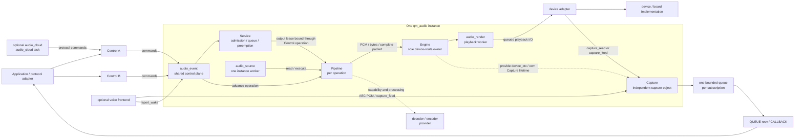
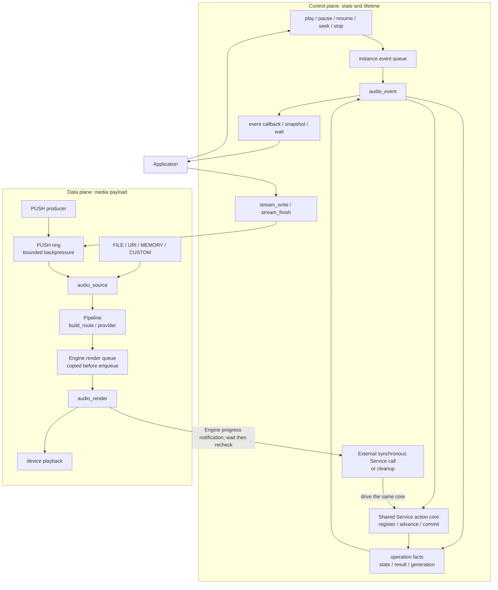
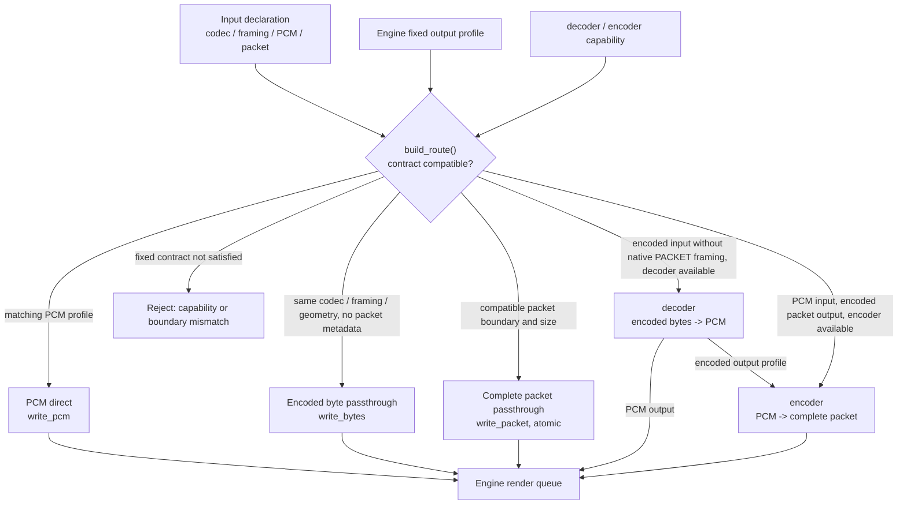
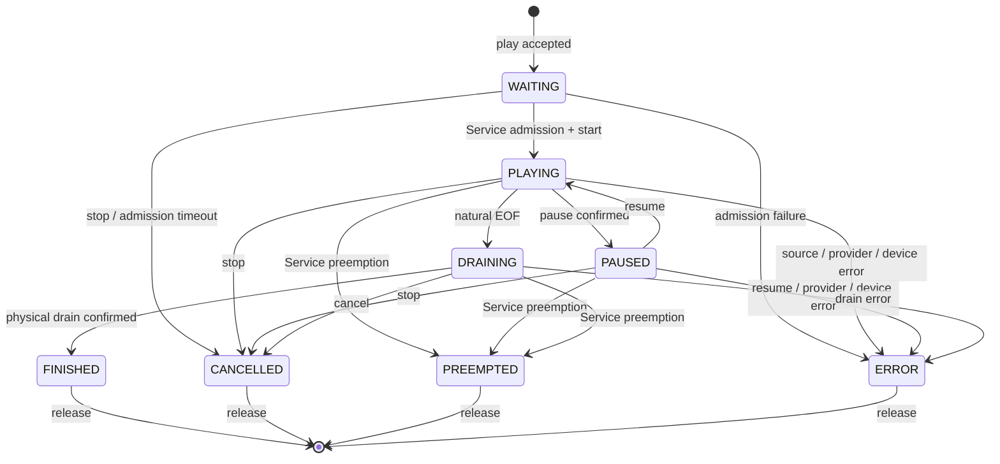
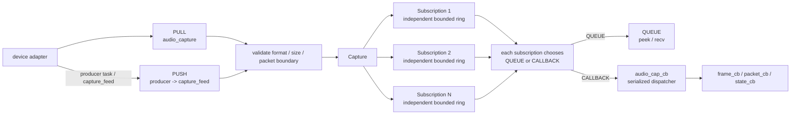

# qm_audio Architecture Atlas

Chinese version: [ARCHITECTURE_CN.md](ARCHITECTURE_CN.md).

The public contracts remain defined by [README.md](README.md) and the public
headers. This document reorganizes the component into views that are easier to
review: runtime ownership, control and data planes, route selection, lifecycle,
and capture fan-out.

## Reading Order

1. Runtime objects and tasks: who creates, shares, and owns the device.
2. Control and data planes: where commands, events, and media payloads travel.
3. Media routing: when an input can reach the fixed output profile.
4. Lifecycle: initialization, completion, stop, and cleanup retry barriers.
5. Capture fan-out: how PULL/PUSH reaches independent subscribers.

Legend: solid arrows mean runtime flow or calls, with labels distinguishing
commands, payloads, and tasks; dashed arrows mean capability, borrowed ownership,
or lifetime relationships. `audio_*` names are runtime task names, not public
APIs. Control, Service, Pipeline, and Engine are logical boundaries; they are
not four separate RTOS tasks.

## 1. Core Runtime Objects and Tasks

One `qm_audio` instance owns one fixed device route, one shared `audio_event`
runtime, one shared `audio_source`, and an `audio_render` worker when playback is
enabled. Controls are created per business domain and share the same Service and
Engine. Each playback operation owns one Pipeline.



Source anchors:

| Fact | Source |
| --- | --- |
| The instance owns Engine, Service, event/source tasks, and the Pipeline registry | `priv_include/qm_audio_priv.h`, `struct qm_audio` |
| Creation is Engine -> Service -> event -> source | `src/audio/qm_audio.c`, `qm_audio_create()` |
| `audio_event` serializes commands, lower-layer facts, and Service ticks | `src/event/qm_audio_event.c`, `dispatch_command()` and `event_task()` |
| `audio_source` is the shared source worker | `src/audio/qm_audio.c`, `source_task()` |
| `audio_render` is the sole playback writer | `src/engine/qm_audio_engine.c`, `render_task()` |
| Capture creates mode-dependent reader and dispatcher tasks | `src/capture/qm_audio_capture.c` |

`audio_render` serializes queued playback writes and control actions. The source
worker calls physical drain; a requesting task may call abort. Both still obey
Engine device-access barriers.

## 2. Control and Data Planes

The control plane carries commands, state, and facts. Media payload stays in the
source ring, codec, render queue, or Capture subscription queues; it does not
travel through the `audio_event` queue.



Service retains its public synchronous APIs. Runtime `audio_event` and external
synchronous callers share the action core shown above without adding a task or
action queue. Synchronous callers wait for per-session Engine progress
notifications, recheck, and advance from their own context; cleanup can therefore
complete after the event task exits.

`release_pending` rejects new external actions while private STOP cleanup can
continue. An action pin is released only after state commit and delivery of its
notice. A wait timeout retains the handle, pending action, and required
references for retry. Execution failure of an admitted resume commits ERROR and
notifies in both paths; the synchronous call also returns the execution error.

On normal completion, `audio_source` reaches natural EOF, performs decoder flush
or encoder finish when required, and waits for Engine drain on the source worker.
Control then submits FINISH; the Service action core stops and closes the output
lease before `FINISHED` is projected. Synchronous Service `finish()` also retains
physical drain. `stream_finish` only closes a PUSH input; it does not confirm
physical playback completion.

## 3. Media Route Selection

`build_route()` checks declarations and capabilities before Service admission. It
does not open the source or create codec instances at that point. The input
codec/framing/packet contract, the fixed Engine output profile, and compiled
provider capabilities choose the route.



| Route | Required condition | Output boundary |
| --- | --- | --- |
| PCM direct | Input and output PCM geometry match | Complete sample-frame-aligned block |
| Encoded byte passthrough | Codec, framing, and PCM declaration match; packet fields are zero | Byte chunks, without packet boundaries |
| Complete packet passthrough | Codec, PCM declaration, duration, size, and boundaries match; native PACKET or fixed-length Opus CBR | One complete packet per call; never split |
| Decode to PCM | Decoder supports the input declaration and fixed PCM output | PCM blocks from the decoder |
| PCM encode | PCM input; encoder supports the fixed encoded-packet output profile | Complete packets from the encoder |
| Decode then encode | Encoded input without native PACKET framing; decoder, target PCM, and encoder all support the combination | `encoded -> PCM -> encoded` |

`QM_AUDIO_CODEC_FRAMING_PACKET` input is supported only for PUSH sources and a
matching native packet-passthrough route. An incompatible contract is rejected;
it cannot enter decoder/encoder conversion.

The component does not silently resample, change channels or sample width, infer
packet boundaries, or reinterpret encoded data as PCM. `QM_AUDIO_DELIVERY_REALTIME`
is currently a delivery-policy enum; the architecture does not interpret it as
automatic packet dropping.

## 4. Lifecycle and Quiescence Barriers

### 4.1 Instance initialization and shutdown

```mermaid
sequenceDiagram
    participant App as Application
    participant Audio as qm_audio
    participant Engine
    participant Service
    participant Event as audio_event
    participant Source as audio_source
    participant Device as device adapter

    App->>Audio: qm_audio_init(config)
    Audio->>Engine: create / open / get_caps / validate profile
    Engine->>Device: device_open
    Audio->>Service: create and claim Engine
    Audio->>Event: shared_init
    Audio->>Source: source_init
    Audio-->>App: initialized

    Note over App,Audio: Stop cloud/frontend; shutdown Controls, release operations, unsubscribe events, then destroy Controls; remove Capture subscriptions

    App->>Audio: qm_audio_deinit(timeout)
    Audio->>Source: source_shutdown
    Audio->>Event: event_shared_shutdown
    Audio->>Service: shutdown / destroy
    Audio->>Engine: shutdown
    Engine->>Device: stop capture / render / workers
    Engine->>Device: device_close
    Audio-->>App: deinit or retained-handle retry
```

Shutdown is a staged barrier. `shutdown` completes only after child tasks, device
access, and callbacks are quiescent; `destroy` deallocates objects. A timeout in
stop, close, unsubscribe, shutdown, or release retains the handle and borrowed
context so the failed stage can be retried.

### 4.2 Playback operation state



`drain` confirms that accepted media reached the physical output completion
point. `stop` ends the device run. `close` releases a stopped stream with no
in-flight access. These are separate barriers and cannot be represented by one
terminal flag.

## 5. Capture Fan-out

Capture uses the fixed input profile and delivers complete PCM blocks or complete
encoded packets. Engine owns Capture lifetime; Capture does not join Service
playback sessions or send media through `audio_event`.



| Mode | Task and data path | Quiescence barrier |
| --- | --- | --- |
| PULL | `audio_capture` loops over `capture_read` and copies into each subscription queue | Reader exits and completes `capture_stop` |
| PUSH | Device producer calls one `capture_feed`; the component creates no reader | Stop waits for all in-flight feed calls |
| QUEUE | Subscriber calls `peek_size` / `recv`; one subscription has one consumer | `unsubscribe` waits for receiver quiescence |
| CALLBACK | `audio_cap_cb` selects records and invokes callbacks outside the lock | `unsubscribe` waits for callback quiescence |

When a queue is full, only that subscription drops its oldest record and marks a
discontinuity. Encoded packets remain complete. A slow callback can delay other
callbacks, but it does not block the PULL reader or QUEUE consumers.

## 6. Ownership and Source Boundaries

| Boundary | Owner | Concurrency requirement | Release condition |
| --- | --- | --- | --- |
| Default instance | Application lifecycle | Serialize init/deinit; stop cloud/frontend and adapter-owned work before shutdown | Controls and Capture subscriptions are released and all access is quiescent |
| Engine backend context | Engine | Exclude new access during shutdown/destroy | Capture shutdown, render stop, workers and backend I/O are quiescent; device_close succeeds before context release, and Engine destroy later frees the Capture object |
| Service | Sole scheduler for one Engine | The lifecycle owner serializes external actions on one handle; event and synchronous callers share the action core | Session actions and notices must be quiescent and action pins released before reclaiming storage; release timeout retains the handle for private STOP cleanup retry; Service destroy also requires shutdown and release of every session |
| Pipeline/source context | Operation and application borrow contract | Serialize state changes for one operation; exclude new commands during release | Source/codec generation is quiescent and operation release succeeds |
| Capture subscription | Subscriber | Serialize enable/flush/unsubscribe; QUEUE permits one recv consumer | Unsubscribe waits for its receiver/callback; the last subscription also stops capture and waits for in-flight feed calls; success releases the handle |

The core component is `components/qm_audio`. Platform implementations live under
`platform/mcu/*/qm_audio`; protocol or Agent business bridges live under
`components/qm_agent/src/audio`. Platform adapters publish actual profiles and
I/O capabilities; they do not own Control/Service admission policy.

## 7. Source Navigation

| Topic | Files |
| --- | --- |
| Application entry and instance lifecycle | `include/qm_audio.h`, `src/audio/qm_audio.c` |
| Control commands, operations, and event projection | `include/qm_audio_control.h`, `src/control/qm_audio_control.c`, `src/event/qm_audio_event.c` |
| Session admission and preemption | `include/qm_audio_service.h`, `src/service/qm_audio_service.c` |
| Sources, routes, and provider output | `include/qm_audio_pipeline.h`, `src/pipeline/qm_audio_pipeline.c` |
| Render queue, device ownership, and drain | `include/qm_audio_engine.h`, `src/engine/qm_audio_engine.c` |
| Capture fan-out and subscription quiescence | `include/qm_audio_capture.h`, `src/capture/qm_audio_capture.c` |
| Device, codec, frontend, and cloud boundaries | `include/adapter/`, `include/cloud/`, `platform/mcu/*/qm_audio` |
