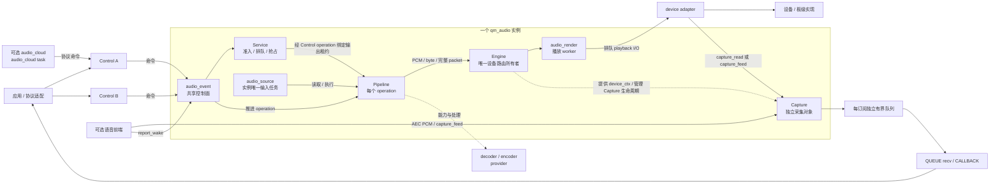
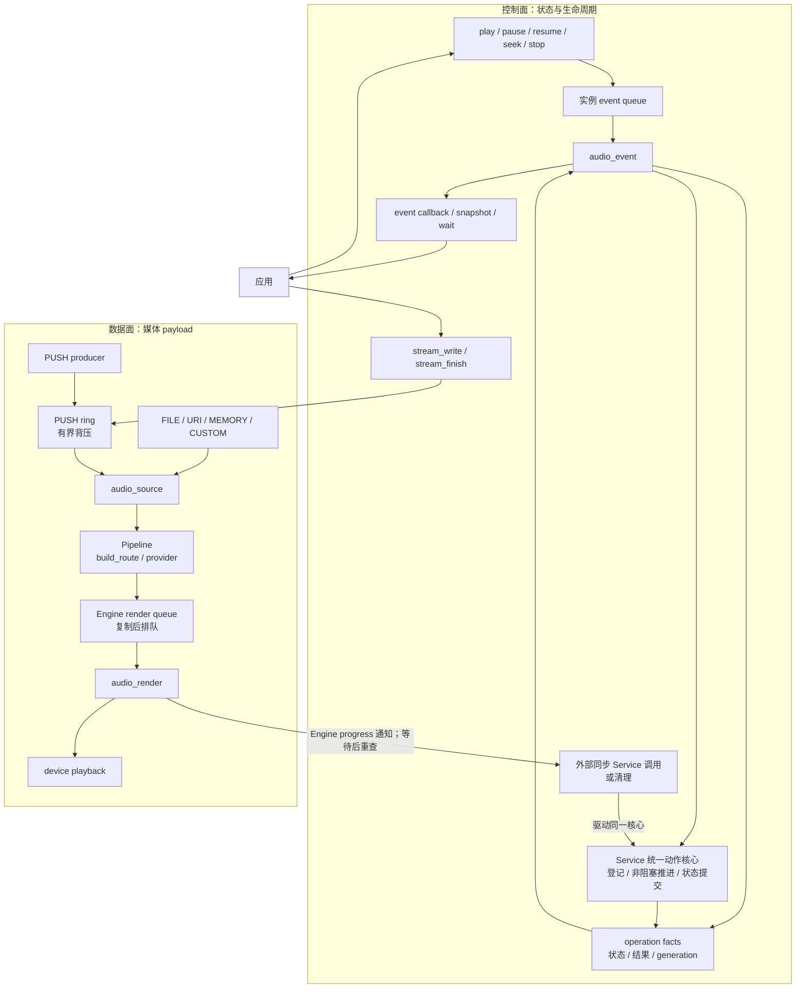
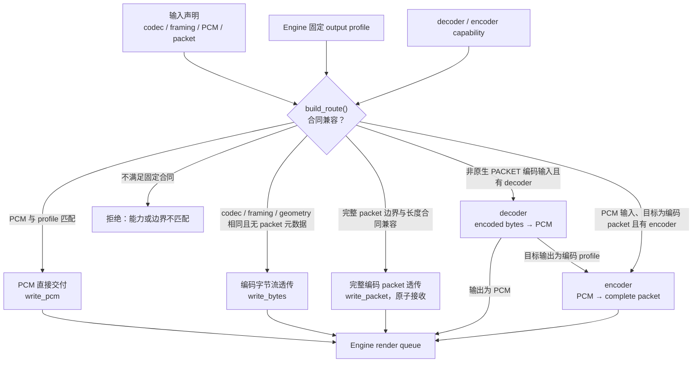
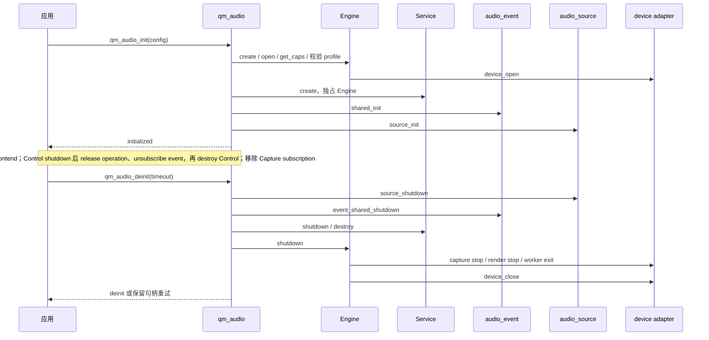
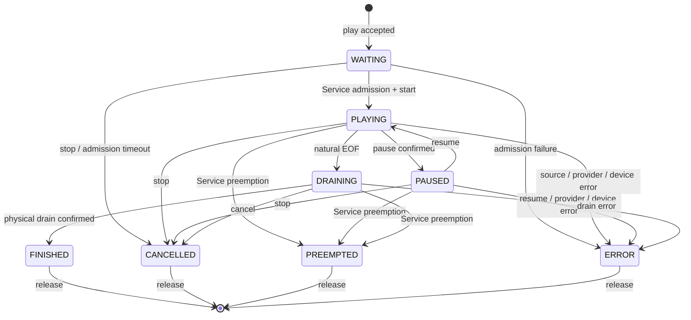
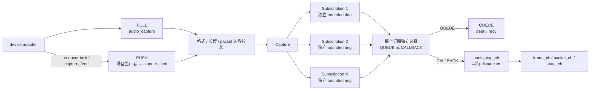

# qm_audio 架构图册

英文版本：[ARCHITECTURE.md](ARCHITECTURE.md)。接口、所有权和错误合同以
[README_CN.md](README_CN.md) 与公共头文件为准；本文只负责把组件结构和运行路径放在适合评审的图中。

## 如何阅读

按以下顺序阅读：

1. 运行时对象图：谁创建、谁共享、谁拥有设备。
2. 控制面与数据面：命令、事件和媒体 payload 分别经过哪里。
3. 媒体路由图：一类输入在什么条件下可以到达固定输出 profile。
4. 生命周期图：初始化、播放完成、停止和清理重试如何衔接。
5. Capture 扇出图：PULL/PUSH 如何交付给多个独立订阅者。

图例：实线表示运行时流或调用，箭头标签区分 command、payload 和 task；虚线表示能力、借用或生命周期关系；`audio_*` 是运行时任务名，不是公共 API。Control、Service、Pipeline、Engine 是逻辑边界，不对应四个独立 RTOS 任务。

## 1. 核心运行时对象与任务

一个 `qm_audio` 实例拥有一条固定设备路由、一个共享 `audio_event`、一个共享
`audio_source`，以及在启用播放时创建的 `audio_render`。多个 Control 按业务创建，
共享同一个 Service 和 Engine；每个播放 operation 有自己的 Pipeline。

运行时事实对应以下源码：

| 事实 | 源码锚点 |
| --- | --- |
| 实例拥有 Engine、Service、event/source 任务和 Pipeline 注册表 | `priv_include/qm_audio_priv.h` 的 `struct qm_audio` |
| 创建顺序为 Engine → Service → event → source | `src/audio/qm_audio.c` 的 `qm_audio_create()` |
| `audio_event` 串行处理命令、下层事实和 Service tick | `src/event/qm_audio_event.c` 的 `dispatch_command()` 与 `event_task()` |
| `audio_source` 是共享输入任务 | `src/audio/qm_audio.c` 的 `source_task()` |
| `audio_render` 是唯一播放写入任务 | `src/engine/qm_audio_engine.c` 的 `render_task()` |
| Capture 只由 Engine 持有生命周期，内部按模式创建任务 | `src/capture/qm_audio_capture.c` |

`audio_render` 串行执行排队的 playback write 和控制动作；物理 drain 由 source
worker 调用，abort 可由请求任务调用，二者仍遵守 Engine 的设备访问屏障。

## 2. 控制面与数据面

控制面只传递命令、状态和事实；媒体 payload 留在 source ring、codec、render queue
或 Capture subscription queue 中，不进入 `audio_event` 队列。

Service 保留公共同步 API；运行期 `audio_event` 与外部同步调用共用图中的动作核心，
不新增任务或动作队列。同步调用在调用方上下文等待会话独立的 Engine progress 通知后
重查并继续推进，所以 event 退出后仍可完成清理。

`release_pending` 拒绝新外部动作，私有 STOP 清理仍可推进；action pin 在状态提交
及对应 notice 交付后释放。等待超时保留句柄、未完成动作和必要引用供重试。
已受理 resume 的执行失败统一提交 ERROR 并通知；同步调用同时返回执行错误。

播放的一次正常结束是：`audio_source` 读到自然 EOF，完成必要的 decoder flush 或
encoder finish，在 source worker 中等待 Engine drain，随后 Control 提交 FINISH，
由 Service 动作核心停止并关闭输出租约后投影 `FINISHED`。Service 同步 `finish()`
也保留物理 drain。`stream_finish` 只表示 PUSH 输入结束，不确认物理播放完成。

## 3. 媒体路由选择

`build_route()` 在 Service 准入前只做声明和能力检查，不打开 source，也不创建 codec
实例。输入 codec/framing/packet 合同、Engine 固定输出 profile 和已编译 provider
能力共同决定路由。

| 路线 | 必要条件 | 输出边界 |
| --- | --- | --- |
| PCM 直通 | 输入与输出 PCM 几何匹配 | 完整 sample frame 对齐的 block |
| 编码字节流透传 | codec、framing、PCM 声明一致，packet 字段为零 | byte chunk，不代表 packet 边界 |
| 完整 packet 透传 | codec、PCM 声明、时长、长度和边界兼容；原生 PACKET 或固定长度 Opus CBR | 一次调用一个完整 packet，不能拆分 |
| 解码到 PCM | decoder 支持输入声明，输出 PCM 几何固定 | decoder 产生 PCM block |
| PCM 编码 | PCM 输入，encoder 支持固定编码 packet 输出 profile | encoder 产生完整 packet |
| 解码后编码 | 非原生 PACKET 编码输入，decoder、目标 PCM、encoder 三者能力都满足 | `encoded → PCM → encoded` |

`QM_AUDIO_CODEC_FRAMING_PACKET` 输入只允许 PUSH，并且只能走匹配的原生 packet
透传路线；合同不匹配即拒绝，不会进入 decoder/encoder 转换。

组件不隐式重采样、变更声道或采样位宽、猜测 packet 边界，也不把编码数据静默当成
PCM。`QM_AUDIO_DELIVERY_REALTIME` 当前只是交付策略枚举；架构图不把它解释为自动丢包。

## 4. 生命周期与清理屏障

### 4.1 实例初始化与关闭

关闭是分阶段的屏障。`shutdown` 只在子任务、设备访问和 callback 静止后完成；
`destroy` 负责释放对象。任一 stop、close、unsubscribe、shutdown 或 release 超时，
调用方必须保留句柄和借用 context，后续从失败阶段重试。

### 4.2 播放操作状态

`drain` 确认已接受媒体到达物理输出完成点；`stop` 结束设备运行；`close` 释放已停止
且没有在途访问的 stream。三者不能合并成一个 terminal 标志。

## 5. Capture 扇出

Capture 使用固定 input profile 交付完整 PCM block 或完整编码 packet。Engine 只管理
Capture 的生命周期；Capture 不参与 Service 播放会话，也不把媒体交给 `audio_event`。

| 模式 | 任务与数据路径 | 关键屏障 |
| --- | --- | --- |
| PULL | `audio_capture` 循环 `capture_read`，再复制到每个订阅队列 | reader 退出并完成 `capture_stop` |
| PUSH | 设备生产者调用单一 `capture_feed`，组件不创建 reader | stop 等待所有在途 feed 返回 |
| QUEUE | 订阅者任务调用 `peek_size` / `recv`，一个订阅只能有一个消费者 | `unsubscribe` 等待 receiver 静止 |
| CALLBACK | `audio_cap_cb` 从订阅队列取出记录，在锁外调用回调 | `unsubscribe` 等待 callback 静止 |

队列满时只丢弃当前订阅的最旧记录，并设置 discontinuity；编码 packet 保持完整，
不会按字节拆开。慢 callback 会延迟其他 callback，但不会阻塞 PULL reader 或 QUEUE
消费者。

## 6. 所有权与源码边界

| 边界 | 所有者 | 并发要求 | 释放前提 |
| --- | --- | --- | --- |
| 默认实例 | 应用生命周期 | 串行化 init/deinit；关闭前停止 cloud/frontend 和 adapter 自有工作 | Control 和 Capture subscription 已释放，所有访问静止 |
| Engine backend context | Engine | shutdown/destroy 期间排除新访问 | Capture shutdown、render stop、worker 与后端 I/O 静止；device_close 成功后释放 context，Capture 对象在 Engine destroy 时释放 |
| Service | 一个 Engine 的唯一调度者 | 同一句柄的外部动作由生命周期所有者串行化；event 与同步调用共用动作核心 | session 的动作和 notice 静止、action pin 释放后才可释放存储；release 超时保留句柄，私有 STOP 清理可重试；Service destroy 还要求 shutdown 且全部 session 已释放 |
| Pipeline/source context | operation 与应用共同遵守借用合同 | 同一 operation 的状态修改串行化；release 期间排除新命令 | source/codec generation 静止，operation release 成功 |
| Capture subscription | 订阅方 | enable/flush/unsubscribe 串行化；QUEUE 只允许一个 recv 消费者 | unsubscribe 等待自身 receiver/callback；最后一个订阅还需停止采集并等待在途 feed；成功后释放句柄 |

组件核心位于 `components/qm_audio`；平台实现位于
`platform/mcu/*/qm_audio`，协议或 Agent 业务桥接位于 `components/qm_agent/src/audio`。
平台 adapter 发布实际 profile 和 I/O 能力，不能承担 Control/Service 的业务准入。

## 7. 源码导航

| 主题 | 文件 |
| --- | --- |
| 应用入口和实例生命周期 | `include/qm_audio.h`, `src/audio/qm_audio.c` |
| Control 命令、operation、事件投影 | `include/qm_audio_control.h`, `src/control/qm_audio_control.c`, `src/event/qm_audio_event.c` |
| 会话准入和抢占 | `include/qm_audio_service.h`, `src/service/qm_audio_service.c` |
| source、route、provider 输出 | `include/qm_audio_pipeline.h`, `src/pipeline/qm_audio_pipeline.c` |
| render queue、设备所有权和 drain | `include/qm_audio_engine.h`, `src/engine/qm_audio_engine.c` |
| Capture 扇出和订阅静止 | `include/qm_audio_capture.h`, `src/capture/qm_audio_capture.c` |
| device / codec / frontend 边界 | `include/adapter/`, `include/cloud/`, `platform/mcu/*/qm_audio` |
