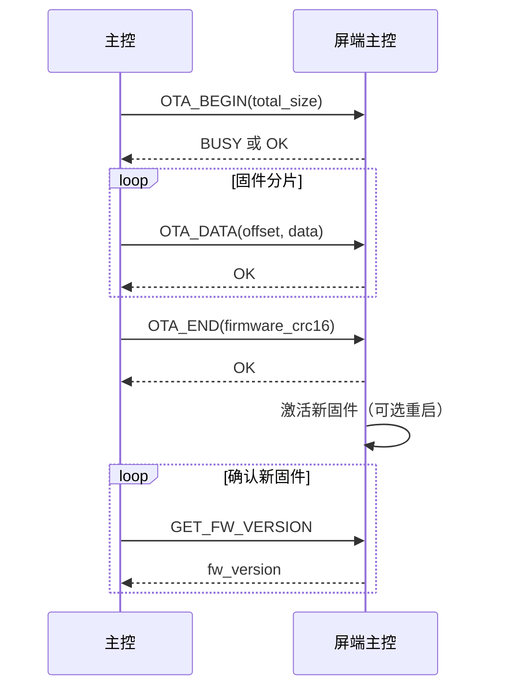
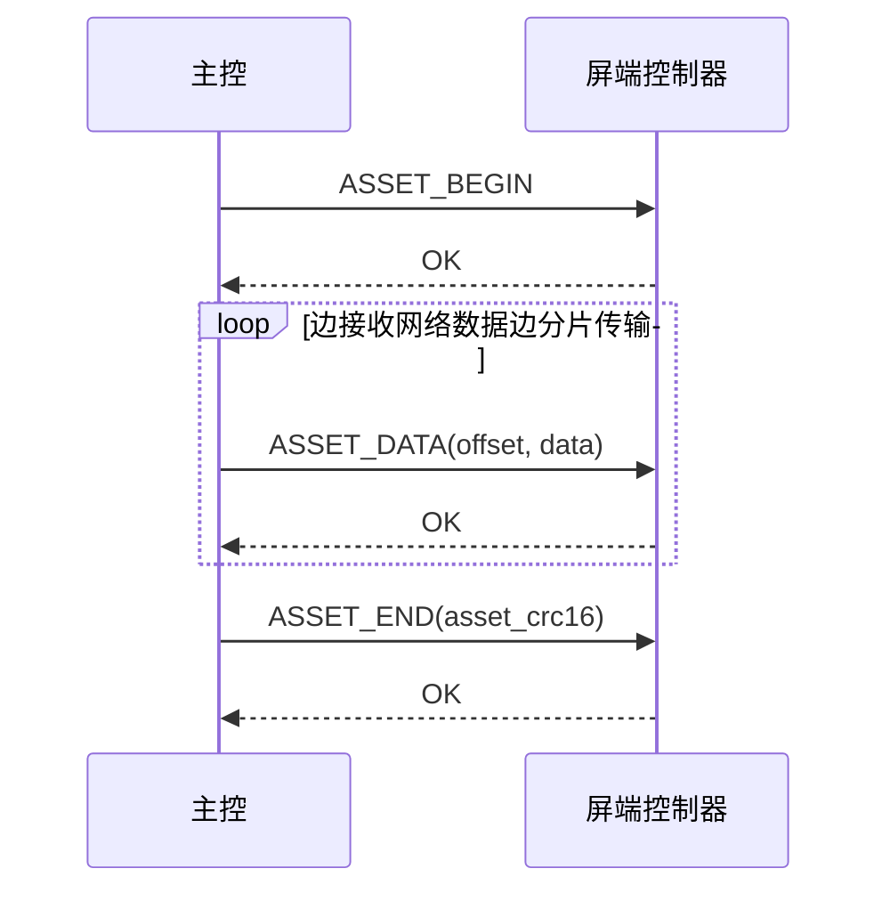
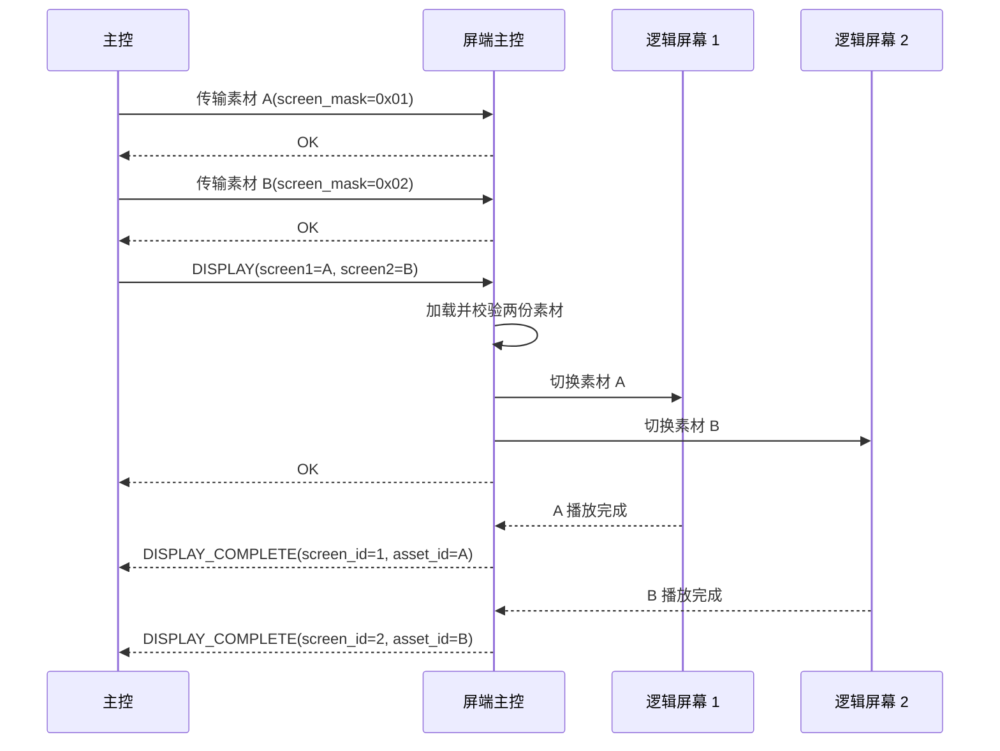
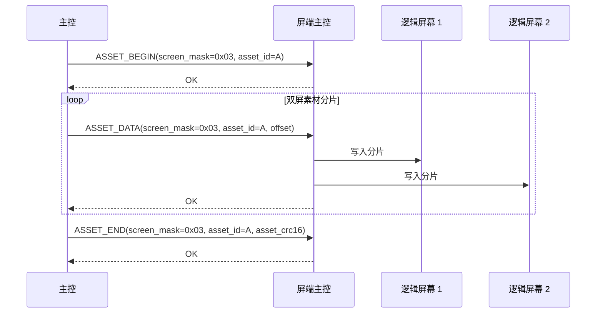

# 主控与屏幕显示控制器通信协议

**协议版本：1.0**

## 1. 目的和范围

本协议用于主控与屏端主控之间通信，由屏端主控统一管理两个逻辑屏幕，支持固件版本查询、屏端主控 OTA、素材传输、单屏显示、双屏同步切换以及屏幕开关和亮度调节。

屏端控制器负责素材解码、缓冲、屏幕驱动和固件升级安全切换。本协议不涉及硬件连线、接口参数、触摸事件、通用屏端主动上报、断电续传、流媒体、加密和鉴权。屏端仅按本协议定义上报播放完成事件。

## 2. 系统模型

### 2.1 屏幕选择

```text
主控
  `-- 一路通道 --> 屏端主控
                    |-- screen_id=1 逻辑屏幕 1
                    `-- screen_id=2 逻辑屏幕 2
```

通信对端始终是唯一的屏端主控，公共帧头不包含设备地址。需要选择屏幕的命令，在载荷中使用 `screen_mask` 或 `screen_id`。

| `screen_mask` | 含义 |
|---:|---|
| `0x01` | 屏幕 1 |
| `0x02` | 屏幕 2 |
| `0x03` | 屏幕 1 和屏幕 2 |

`screen_mask` 的其他位必须为 0；`screen_id` 只允许取 1 或 2。

### 2.2 交互关系

- 主控主动发起请求；屏端可在播放完成后主动发送 `DISPLAY_COMPLETE` 事件；
- 通道同一时刻只允许一个未完成请求；
- 屏端主控对每条有效请求只返回一条响应；
- 同时作用于两屏的请求，仅在两屏均满足该命令的成功条件时返回 `OK`。

## 3. 字节流承载

承载层提供有序的双向字节流，可使用 UART 或 USB，接口参数由硬件能力确定。接收端根据 `SOF`、`LENGTH` 和 `CRC16` 组帧，不依赖底层读取边界。

## 4. 数据与校验约定

- 所有多字节整数采用大端序，高字节在前；
- 字符串采用 UTF-8，不包含结尾 `\0`；
- 布尔值：`0x00` 表示否，`0x01` 表示是；
- 所有保留字段发送时必须置零，接收端暂时忽略；
- 长度和偏移量的单位均为字节；
- 校验算法为 CRC-16/CCITT-FALSE；
- 帧 CRC16 校验从 `VER` 到 `PAYLOAD` 的完整帧内容；
- 素材和固件 CRC16 分别校验对应文件的全部原始字节。

### 4.1 校验参数

| 校验 | Poly | Init | RefIn/RefOut | XorOut |
|---|---:|---:|---|---:|
| CRC-16/CCITT-FALSE | `0x1021` | `0xFFFF` | false/false | `0x0000` |

### 4.2 公共字段约定

| 字段 | 类型 | 取值 | 说明 |
|---|---|---|---|
| `asset_id` | `uint16` | `1～0xFFFF` | 主控分配的产品级唯一素材编号；同一逻辑素材在两屏使用相同编号 |
| `screen_mask` | `uint8` | `0x01/0x02/0x03` | 命令作用的屏幕集合，见 2.1 节 |
| `total_size` | `uint32` | byte | 完整素材或固件长度，不包含协议字段 |
| `offset` | `uint32` | byte | 当前分片首字节在原始素材或固件中的偏移 |
| `asset_crc16` | `uint16` | CRC16 | 主控和屏端对完整原始素材计算，在 `ASSET_END` 中提交，参数见 4.1 节 |
| `firmware_crc16` | `uint16` | CRC16 | 主控和屏端对完整固件计算，在 `OTA_END` 中提交，参数见 4.1 节 |

当前素材传输任务由 `screen_mask + asset_id` 标识，`total_size` 用于控制接收长度，`asset_crc16` 用于最终完整性校验。
OTA 同一时刻只有一个当前任务，不需要任务编号；`OTA_BEGIN` 建立任务，`firmware_crc16` 用于最终完整性校验。

## 5. 帧格式

### 5.1 基本帧

```text
+--------+------+-----+-------+-----+--------+---------+-------+
| SOF    | VER  | SEQ | FLAGS | CMD | LENGTH | PAYLOAD | CRC16 |
+--------+------+-----+-------+-----+--------+---------+-------+
| 2 byte | 1 B  | 2 B | 1 B   | 1 B | 2 B    | N byte  | 2 B   |
+--------+------+-----+-------+-----+--------+---------+-------+
```

| 字段 | 说明 |
|---|---|
| `SOF` | 固定为 `0x5A 0xA5`，不参与 CRC |
| `VER` | 高 4 位为主版本，低 4 位为次版本；V1.0 为 `0x10` |
| `SEQ` | 请求序号，`uint16`，范围 `0x0000`～`0xFFFF`，循环使用 |
| `FLAGS` | 报文类型和控制标志 |
| `CMD` | 命令码；请求和响应使用相同命令码 |
| `LENGTH` | `PAYLOAD` 长度，范围 `0`～`1024` |
| `PAYLOAD` | 命令数据 |
| `CRC16` | 从 `VER` 到 `PAYLOAD` 最后一个字节的 CRC16，结果按高字节在前发送 |

固定开销为 11 字节，最大完整帧长为 1035 字节。

完整帧按字节偏移排列如下（偏移从 0 开始；多字节整数均为大端序）：

| 字节偏移 | 长度 | 字段 |
|---:|---:|---|
| 0 | 2 | `SOF` |
| 2 | 1 | `VER` |
| 3 | 2 | `SEQ` |
| 5 | 1 | `FLAGS` |
| 6 | 1 | `CMD` |
| 7 | 2 | `LENGTH` |
| 9 | `LENGTH` | `PAYLOAD` |
| `9 + LENGTH` | 2 | `CRC16` |

命令章节中的偏移均以 `PAYLOAD` 第一个字节为 0；线路上的完整报文需在载荷前加上 9 字节帧头，在载荷后加上 2 字节 CRC16。

### 5.2 FLAGS

| Bit | 名称 | 定义 |
|---:|---|---|
| 0 | `RESPONSE` | `0` 请求，`1` 响应 |
| 1 | `ACK_REQUIRED` | 请求或事件要求对端确认；本协议的有效请求必须置 `1` |
| 2 | `EVENT` | `1` 表示屏端主动事件帧；事件帧不作为主控请求处理 |
| 3 | `RETRY` | 当前请求为同一事务重发 |
| 4～7 | Reserved | 必须为 `0` |

常用值：

```text
0x02  请求，需要响应
0x01  响应，执行结果由 status 判断
0x06  屏端事件，需要确认
0x0A  重发请求，需要响应
```

### 5.3 响应载荷

响应 `PAYLOAD` 以 `status:uint8` 开始。`0x00` 表示成功，非零值见“状态码”章节。普通命令无论成功还是失败，响应均只包含 `status`；`GET_FW_VERSION` 成功时在 `status` 后附加版本信息，失败时只返回 `status`。普通响应的 `SEQ` 和 `CMD` 必须与请求一致，`FLAGS` 统一为 `0x01`。事件应答也使用相同的 `SEQ` 和 `CMD`，载荷只包含 `status`。

### 5.4 接收同步

先搜索 `SOF`，再按 `LENGTH` 收取剩余字段并校验版本和 CRC。长度非法、接收超时或校验失败时重新搜索 `SOF`。帧内的 `0x5A 0xA5` 不作为新帧头。

## 6. 请求、响应与重试

### 6.1 请求规则

- 通道使用一个全局 16 位 `SEQ`，新请求递增；
- 重发使用原 `SEQ`、`CMD` 和载荷；
- 屏端以 `(SEQ, CMD)` 作为事务键：重复请求必须携带相同载荷，屏端直接返回原结果；同一事务键携带不同载荷时返回 `INVALID_PARAM`；
- 屏端至少缓存最近 32 个事务或 5 秒内的事务；
- 屏端重启后，主控重新执行 `GET_FW_VERSION`。

### 6.2 超时建议

| 命令类型 | 应答超时 | 最大重试次数 |
|---|---:|---:|
| `GET_FW_VERSION` | 300 ms | 2 |
| `DISPLAY` | `activate_delay_ms + 5000 ms` | 2 |
| `DISPLAY_COMPLETE` 事件应答 | 500 ms | 2 |
| `SET_SCREEN_POWER` | 500 ms | 2 |
| `SET_BRIGHTNESS` | 500 ms | 2 |
| `ASSET_BEGIN` | 1000 ms | 3 |
| `ASSET_DATA` | 1000 ms | 2 |
| `ASSET_END` | 5000 ms | 2 |
| `OTA_BEGIN` | 5000 ms | 2 |
| `OTA_DATA` | 1000 ms | 2 |
| `OTA_END` | 10000 ms | 2 |

收到 `BUSY` 后，主控按产品配置的固定间隔等待，并以新事务重试。

表中的最大重试次数不包含首次发送。例如 `ASSET_DATA` 最多发送 1 次并重发 2 次，共 3 次；单屏和双屏使用相同限制。未收到有效响应时使用原 `SEQ`、原载荷并置 `FLAGS.RETRY=1`；收到 `BUSY` 后按固定间隔等待，以新 `SEQ` 重试。其他错误响应不自动重试。

### 6.3 屏端事件

事件帧由屏端主动发送，`FLAGS` 置为 `0x06`（`EVENT=1` 且要求确认）。事件帧中的 `SEQ` 使用触发该播放的显示操作序号：`DISPLAY` 使用 `DISPLAY` 请求序号，单屏 `RAM_AUTO_PRESENT` 使用 `ASSET_END` 请求序号。主控通过 `CMD`、`SEQ`、`screen_id` 和 `asset_id` 去重。

`DISPLAY_COMPLETE` 事件发送后，屏端等待主控返回同 `CMD`、同 `SEQ` 的响应；响应载荷为 `status:uint8`。超时或未收到 `OK` 时，屏端使用相同的 `SEQ` 和载荷重发，并将 `FLAGS.RETRY` 置 1，最多重发 2 次。主控收到重复事件时仍返回 `OK`，但不得重复执行业务动作。

屏端应在当前请求的响应发送完成后再发送事件。主控收到事件后，应优先发送事件应答，再发送下一条请求。

事件确认失败不改变已经完成的显示结果。主控应记录未确认事件，并按产品需要处理；协议不提供播放完成状态查询命令。

## 7. 素材与显示对象

### 7.1 素材

素材由 `asset_id` 标识。每个逻辑屏幕对同一 `asset_id` 只保留一份正式内容，新素材通过 `ASSET_END` 校验成功后原子替换旧内容。

### 7.2 素材格式

`asset_format` 表示传输数据的编码格式：

| 值 | 名称 | 素材类别 | 说明 |
|---:|---|---|---|
| `0x01` | PNG | STATIC_IMAGE | 静态 PNG |
| `0x02` | APNG | ANIMATED_IMAGE | Animated PNG |
| `0x03` | JPEG | STATIC_IMAGE | JPEG/JFIF |
| `0x10` | RAW_RGB565_BE | STATIC_IMAGE | 大端 RGB565 原始像素 |
| `0x11` | RAW_ARGB8888 | STATIC_IMAGE | ARGB8888 原始像素 |

素材类别由 `asset_format` 确定；APNG 为动图，PNG、JPEG 和 RAW 为静态图。
产品启用的格式由固定配置确定，不在 `ASSET_BEGIN` 中重复发送。

### 7.3 显示引用

`DISPLAY` 中的 `asset_id:uint16` 直接引用已传输的静态图或动图。屏端根据素材元数据判断显示类型。

## 8. 命令总览

- `GET_FW_VERSION (0x01)`：查询屏端主控是否在线和固件版本。
- `DISPLAY (0x10)`：直接显示一个或两个屏幕的目标画面。
- `DISPLAY_COMPLETE (0x13)`：屏端主动通知指定屏幕的当前素材已播放完成。
- `SET_SCREEN_POWER (0x11)`：打开或关闭指定屏幕的显示输出。
- `SET_BRIGHTNESS (0x12)`：设置指定屏幕的亮度。
- `ASSET_BEGIN (0x20)`：建立素材传输任务。
- `ASSET_DATA (0x21)`：传输一个素材分片。
- `ASSET_END (0x22)`：对完整素材进行校验，并完成 RAM 或 Flash 处理。
- `OTA_BEGIN (0x30)`：准备升级区并建立固件升级任务。
- `OTA_DATA (0x31)`：传输一个固件分片。
- `OTA_END (0x32)`：校验并提交完整固件。

## 9. 系统命令

### 9.1 GET_FW_VERSION（0x01）

查询屏端主控是否在线，并返回固件版本。该命令不需要屏幕选择字段，也不暴露屏端内部是否使用 Bootloader。

请求 PAYLOAD 为空。

请求 PAYLOAD 组成：

| PAYLOAD 偏移 | 长度 | 字段 | 说明 |
|---:|---:|---|---|
| 无 | 0 | 空 PAYLOAD | 本命令无请求参数，`LENGTH=0` |

成功响应：

```text
status          : uint8
fw_version      : uint8[3]
```

响应 PAYLOAD 组成：

| PAYLOAD 偏移 | 长度 | 字段 | 说明 |
|---:|---:|---|---|
| 0 | 1 | `status` | 执行结果，`0x00` 表示成功，其他值见“状态码”章节 |
| 1 | 3 | `fw_version` | 已安装的应用固件版本；依次为 `major`、`minor`、`patch`，各占 1 字节，范围 `0～255`；`01 01 01` 表示 `1.1.1`，无有效应用时为 `00 00 00` |
| - | 4 | - | 响应 PAYLOAD 总长度，`LENGTH=4` |

屏端主控重启后，引导程序、升级接收程序或应用固件均可支持该命令。OTA 进行中返回当前有效应用固件的版本，新固件激活后才返回新版本。如果当前无有效应用固件，`fw_version` 返回 `00 00 00`。升级是否使用 Bootloader 不作为本命令的字段。

## 10. 显示控制命令

### 10.1 DISPLAY（0x10）

直接显示一个或两个屏幕的目标画面。屏端主控在内部完成素材检查、加载和解码，所有目标屏幕均就绪后再切换。

请求：

```text
screen_count     : uint8
items            : DisplayItem[screen_count]
activate_delay_ms: uint16

DisplayItem:
    screen_id    : uint8
    object_source: uint8
    asset_id     : uint16
```

请求 PAYLOAD 组成（偏移相对于 `PAYLOAD`）：

| PAYLOAD 偏移 | 长度 | 字段 | 说明 |
|---:|---:|---|---|
| 0 | 1 | `screen_count` | 本次显示的屏幕数量，只允许 `1` 或 `2` |
| `1 + i * 4` | 1 | 第 `i` 个 `screen_id` | 逻辑屏幕编号，只允许 `1` 或 `2`；同一请求中不得重复 |
| `2 + i * 4` | 1 | 第 `i` 个 `object_source` | 素材来源：Flash 或 RAM |
| `3 + i * 4` | 2 | 第 `i` 个 `asset_id` | 已传输素材的编号 |
| `1 + 4 * screen_count` | 2 | `activate_delay_ms` | 所有目标就绪后的切换延时，范围 `0～100 ms`；0 表示立即切换 |
| - | `3 + 4 * screen_count` | - | 请求 PAYLOAD 总长度，`LENGTH=7`（单屏）或 `11`（双屏） |

因此，单屏请求的载荷顺序为：

```text
[screen_count]
[screen_id]
[object_source]
[asset_id: 2 bytes]
[activate_delay_ms: 2 bytes]
```

双屏请求的载荷顺序为：

```text
[screen_count]
[screen1_id][screen1_source][screen1_asset_id: 2 bytes]
[screen2_id][screen2_source][screen2_asset_id: 2 bytes]
[activate_delay_ms: 2 bytes]
```

`object_source`：

| 值 | 名称 | 说明 |
|---:|---|---|
| `0x00` | PERSISTENT | 已提交的 Flash 素材 |
| `0x01` | RAM_READY | 已完成 `ASSET_END` 的 RAM 素材 |
| `0x02` | Reserved | 保留，必须置 0 |

成功响应：

```text
status : uint8
```

响应 PAYLOAD 组成：

| PAYLOAD 偏移 | 长度 | 字段 | 说明 |
|---:|---:|---|---|
| 0 | 1 | `status` | 执行结果；成功表示所有目标屏幕均已完成切换 |
| - | 1 | - | 响应 PAYLOAD 总长度，`LENGTH=1` |

规则：

- `RAM_READY` 对象必须已完成 `ASSET_END`，`PERSISTENT` 对象必须已提交；
- `screen_count=2` 时必须同时包含屏幕 1 和屏幕 2；
- 任一目标素材不存在、加载或解码失败时，所有目标屏幕保持原画面并返回错误；
- `screen_count=2` 时，两屏完成同步切换后才返回 `OK`。

### 10.2 SET_SCREEN_POWER（0x11）

打开或关闭指定屏幕的显示输出。关闭屏幕不会关闭屏端主控，通信和素材传输仍可正常进行。

请求：

```text
screen_mask: uint8
power_state: uint8
```

请求 PAYLOAD 组成：

| PAYLOAD 偏移 | 长度 | 字段 | 说明 |
|---:|---:|---|---|
| 0 | 1 | `screen_mask` | 目标屏幕，取值见 2.1 节 |
| 1 | 1 | `power_state` | `0x00=OFF`，`0x01=ON`，其他值非法 |
| - | 2 | - | 请求 PAYLOAD 总长度，`LENGTH=2` |

请求载荷顺序：

```text
[screen_mask][power_state]
```

响应 PAYLOAD 组成：

| PAYLOAD 偏移 | 长度 | 字段 | 说明 |
|---:|---:|---|---|
| 0 | 1 | `status` | 执行结果；成功表示所有目标屏幕均已完成开关操作 |
| - | 1 | - | 响应 PAYLOAD 总长度，`LENGTH=1` |

规则：

- `OFF` 只关闭屏幕显示输出，不删除当前画面和已传输素材；
- `ON` 恢复显示当前画面，并使用当前保存的运行时亮度；
- 屏幕关闭期间可执行 `DISPLAY` 和素材传输，下次打开时显示最新画面；
- 相同状态重复设置应直接返回 `OK`。

### 10.3 SET_BRIGHTNESS（0x12）

设置指定屏幕的亮度。

请求：

```text
screen_mask: uint8
brightness : uint8
```

请求 PAYLOAD 组成：

| PAYLOAD 偏移 | 长度 | 字段 | 说明 |
|---:|---:|---|---|
| 0 | 1 | `screen_mask` | 目标屏幕，取值见 2.1 节 |
| 1 | 1 | `brightness` | 亮度百分比，范围 `0～100`；`0` 为最暗，`100` 为最亮 |
| - | 2 | - | 请求 PAYLOAD 总长度，`LENGTH=2` |

请求载荷顺序：

```text
[screen_mask][brightness]
```

响应 PAYLOAD 组成：

| PAYLOAD 偏移 | 长度 | 字段 | 说明 |
|---:|---:|---|---|
| 0 | 1 | `status` | 执行结果；成功表示所有目标屏幕均已应用新亮度 |
| - | 1 | - | 响应 PAYLOAD 总长度，`LENGTH=1` |

规则：

- 亮度值是百分比级别，具体输出由屏端主控按产品参数换算；
- 屏幕处于 `OFF` 时仍可设置亮度，新值在下次 `ON` 时生效；
- 本命令不改变屏幕开关状态，`brightness=0` 不等同于 `SET_SCREEN_POWER(OFF)`。

### 10.4 DISPLAY_COMPLETE（0x13）

屏端主动发送的播放完成事件，不是主控请求。事件表示对应 APNG 已完成一次播放：有限循环 APNG 在最后一帧显示完成后发送事件；静态图没有播放过程，不发送该事件；无限循环 APNG 也不发送完成事件。事件适用于 `DISPLAY` 和单屏 `RAM_AUTO_PRESENT`。

事件帧的 `SEQ` 使用触发该播放的显示操作序号，`FLAGS=0x06`。双屏 `DISPLAY` 请求分别为每个屏幕发送一条事件，两个事件的 `SEQ` 相同但 `screen_id` 不同。

事件 PAYLOAD 组成：

| PAYLOAD 偏移 | 长度 | 字段 | 说明 |
|---:|---:|---|---|
| 0 | 1 | `screen_id` | 播放完成的逻辑屏幕编号，只允许 `1` 或 `2` |
| 1 | 2 | `asset_id` | 本次播放完成的素材编号 |
| - | 3 | - | 事件 PAYLOAD 总长度，`LENGTH=3` |

事件载荷顺序：

```text
[screen_id][asset_id: 2 bytes]
```

本命令没有主控请求包，只有屏端事件包和主控确认包：

| 报文 | 方向 | `FLAGS` | `PAYLOAD` | `LENGTH` |
|---|---|---:|---|---:|
| 播放完成事件 | 屏端 -> 主控 | `0x06` | `screen_id + asset_id` | 3 |
| 事件确认 | 主控 -> 屏端 | `0x01` | `status` | 1 |

`DISPLAY` 或 `RAM_AUTO_PRESENT` 的 `OK` 响应只表示目标画面已经完成切换，不表示 APNG 已经播放结束。`DISPLAY_COMPLETE` 事件到达后，主控才可判断该屏幕本次 APNG 播放完成。屏幕被关闭或被新的显示操作替换时，原播放不再上报完成事件。

### 10.5 参数生效范围

屏幕开关和亮度为运行时参数，不要求写入 Flash。屏端主控重启后恢复产品默认值，主控在 `GET_FW_VERSION` 成功后按需重新设置。`screen_mask=0x03` 时命令同时作用于两屏，两屏均完成后才返回 `OK`。

## 11. 素材传输命令

### 11.1 传输约束

- 一块屏同一时刻只允许一个素材传输任务；
- `RAM_DEFERRED` 和 `RAM_AUTO_PRESENT` 写入屏端后备 RAM，不写入 Flash；
- `FLASH_UPDATE` 写入 Flash 临时区，不得直接覆盖正式素材；
- 两种模式都必须在 `ASSET_END` 对完整素材执行 CRC16 和格式校验；
- 未完整接收或校验失败的素材不得显示，也不得影响当前画面和旧内容。

### 11.1.1 传输模式

| 值 | 名称 | 数据目标 | `ASSET_END` 成功后的动作 | 是否持久化 |
|---:|---|---|---|---|
| `0x00` | `RAM_DEFERRED` | 后备 RAM 缓冲区 | 进入 `RAM_READY`，等待 `DISPLAY` | 否 |
| `0x01` | `RAM_AUTO_PRESENT` | 后备 RAM 缓冲区 | 立即原子换帧，进入 `RAM_PRESENTED` | 否 |
| `0x02` | `FLASH_UPDATE` | Flash 临时区 | 校验并原子提交 | 是 |

双屏同步显示使用 `RAM_DEFERRED`；`RAM_AUTO_PRESENT` 仅用于单屏实时显示。未完成的 RAM 或 Flash 传输任务在任意一方重启后均从头开始。`ASSET_END` 对 Flash 素材执行原子提交且不切换当前画面。

### 11.1.2 分片大小

分片参数建议如下：

| 参数 | 推荐值 | 说明 |
|---|---:|---|
| 默认数据分片 | 512 byte | 主控按产品配置使用 |
| 低内存设备分片 | 256 byte | 屏幕接收缓冲区较小时使用 |
| 最小允许分片 | 128 byte | 小于该值时协议开销明显增加 |
| 单片数据上限 | 1017 byte | 帧载荷上限为 1024 byte，`ASSET_DATA` 有 7 byte 控制字段 |

主控可在 128～1017 byte 范围内选择分片大小，屏端不在协议中返回协商值。

### 11.1.3 分片算法

素材按原始文件字节流顺序分片，不按图片行、JPEG 块或文件内部结构切分，也不对最后一片补零。

```text
chunk_count = ceil(total_size / chunk_size)

offset(i) = i * chunk_size

data_length(i) = min(
    chunk_size,
    total_size - offset(i)
)
```

`i` 从 0 开始。素材 CRC16 按完整原始文件计算，不包含协议字段和填充数据。

### 11.1.4 发送和重传规则

分片采用停止等待：主控收到当前 `ASSET_DATA` 的 `OK` 响应后，将本地发送偏移增加本片数据长度，再发送下一片。数据长度由本帧 `LENGTH - 7` 得出。全部 `total_size` 字节发送成功后，发送 `ASSET_END`。

请求超时时，主控使用相同 `SEQ`、`asset_id`、`offset` 和数据重发。屏端识别到重复事务后，只返回已保存的结果，不得重复追加数据。

收到 `OFFSET_ERROR` 时，主控终止当前任务，重新发送 `ASSET_BEGIN` 并从偏移 0 开始。

上述重传仅适用于双方未重启的当前传输任务。任意一方重启或重新建立连接后，主控重新执行 `GET_FW_VERSION` 和 `ASSET_BEGIN`；屏端清除未完成的临时任务，素材从偏移 0 重新传输。已经通过 `ASSET_END` 原子提交的 Flash 素材不受影响。

### 11.2 ASSET_BEGIN（0x20）

请求：

```text
screen_mask   : uint8
asset_id      : uint16
asset_mode    : uint8
total_size    : uint32
```

请求 PAYLOAD 组成：

| PAYLOAD 偏移 | 长度 | 字段 | 说明 |
|---:|---:|---|---|
| 0 | 1 | `screen_mask` | 目标屏幕集合：`0x01` 屏幕1，`0x02` 屏幕2，`0x03` 两屏 |
| 1 | 2 | `asset_id` | 素材编号，不能为 0 |
| 3 | 1 | `asset_mode` | `RAM_DEFERRED`、`RAM_AUTO_PRESENT` 或 `FLASH_UPDATE` |
| 4 | 4 | `total_size` | 完整原始素材长度，单位 byte，必须大于 0 |
| - | 8 | - | 请求 PAYLOAD 总长度，`LENGTH=8` |

成功响应：

```text
status : uint8
```

响应 PAYLOAD 组成：

| PAYLOAD 偏移 | 长度 | 字段 | 说明 |
|---:|---:|---|---|
| 0 | 1 | `status` | 执行结果；成功为 `0x00` |
| - | 1 | - | 响应 PAYLOAD 总长度，`LENGTH=1` |

规则：

- 主控分片大小不得超过 1017 byte；
- `screen_mask=0x03` 表示同一素材同时作用于两屏，屏端主控为两屏建立一个共同传输任务；
- 素材格式由产品固定配置确定，不在本命令中重复传输；
- 主控必须在发送本命令前从网络响应头或素材元数据获得 `total_size`；
- 新任务可以复用已有 `asset_id`，`ASSET_END` 校验成功后原子替换旧内容；
- 收到 `ASSET_BEGIN` 时，屏端清除对应屏幕上未完成的临时任务，创建新任务并从偏移 0 开始；
- 主控可以在接收网络数据的同时增量计算 CRC16，并将数据连续发送给屏端。

### 11.3 ASSET_DATA（0x21）

请求：

```text
screen_mask : uint8
asset_id    : uint16
offset      : uint32
data        : uint8[LENGTH - 7]
```

其中 `data` 长度为 `LENGTH - 7`，不单独设置数据长度字段。

请求 PAYLOAD 组成：

| PAYLOAD 偏移 | 长度 | 字段 | 说明 |
|---:|---:|---|---|
| 0 | 1 | `screen_mask` | 必须与 `ASSET_BEGIN` 一致，指定素材写入的屏幕集合 |
| 1 | 2 | `asset_id` | 必须与 `ASSET_BEGIN` 一致 |
| 3 | 4 | `offset` | 本分片在完整素材中的起始字节偏移 |
| 7 | `N` | `data` | 原始素材的连续字节；`N=LENGTH-7`，不填充 |
| - | `LENGTH` | - | 请求 PAYLOAD 总长度；`LENGTH=7+N`，最大为 1024 |

因此单个分片最多携带 `1017` 字节素材数据。

成功响应：

```text
status : uint8
```

响应 PAYLOAD 组成：

| PAYLOAD 偏移 | 长度 | 字段 | 说明 |
|---:|---:|---|---|
| 0 | 1 | `status` | 分片写入结果；偏移错误时返回 `OFFSET_ERROR` |
| - | 1 | - | 响应 PAYLOAD 总长度，`LENGTH=1` |

规则：

- `offset` 必须等于屏端当前已接收的连续数据长度；
- 除最后一片外，建议使用产品约定的固定分片长度；
- 每帧 CRC16 通过且数据可靠写入临时区后才能应答 `OK`；
- 偏移不匹配时返回 `OFFSET_ERROR`，主控重新发送 `ASSET_BEGIN` 并从偏移 0 开始。

### 11.4 ASSET_END（0x22）

请求：

```text
screen_mask : uint8
asset_id    : uint16
asset_crc16 : uint16
```

请求 PAYLOAD 组成：

| PAYLOAD 偏移 | 长度 | 字段 | 说明 |
|---:|---:|---|---|
| 0 | 1 | `screen_mask` | 必须与 `ASSET_BEGIN` 建立的任务一致 |
| 1 | 2 | `asset_id` | 必须与 `ASSET_BEGIN` 建立的任务一致 |
| 3 | 2 | `asset_crc16` | 主控在接收和转发完整素材过程中计算的 CRC16 |
| - | 5 | - | 请求 PAYLOAD 总长度，`LENGTH=5` |

`screen_mask` 和 `asset_id` 必须与 `ASSET_BEGIN` 建立的任务一致。仅在屏端已接收的连续数据长度等于 `total_size` 后允许执行。主控在网络数据接收完成后，将增量计算得到的最终 CRC16 放入本命令。

屏端检查接收长度，将自身增量计算的完整素材 CRC16 与 `asset_crc16` 比较，并进行必要的格式验证。素材 CRC16 与帧 CRC16 使用相同的 CRC-16/CCITT-FALSE 参数，但校验范围不同。

成功响应：

```text
status : uint8
```

响应 PAYLOAD 组成：

| PAYLOAD 偏移 | 长度 | 字段 | 说明 |
|---:|---:|---|---|
| 0 | 1 | `status` | 整体校验和提交结果；成功为 `0x00` |
| - | 1 | - | 响应 PAYLOAD 总长度，`LENGTH=1` |

`FLASH_UPDATE` 在校验成功后原子更新素材索引，成功后删除临时任务，不改变当前显示。校验或提交失败时保留旧内容和当前画面。RAM 模式失败后释放无效后台缓冲区。

### 11.5 双屏同素材传输

两屏使用同一素材时，`ASSET_BEGIN`、`ASSET_DATA` 和 `ASSET_END` 全程使用 `screen_mask=0x03` 和相同的 `asset_id`，素材数据只传输一遍。

屏端主控内部完成共享或复制。两屏对当前分片均处理成功后才返回 `OK`；任一屏未完成时，两屏共同接收偏移均不得推进。

双屏分片未收到有效响应时，主控使用相同 `SEQ`、相同 `offset` 和相同数据重发，最多重发 2 次。收到 `BUSY` 时按固定间隔等待，并使用新 `SEQ` 重试当前分片；收到 `STORAGE_ERROR`、`INVALID_PARAM` 等其他错误时立即终止当前任务。重试耗尽后，主控将本次素材传输判定为失败；如需再次传输，重新发送 `ASSET_BEGIN` 并从偏移 0 开始。失败期间两屏保持原画面，Flash 正式素材不受影响。

双屏异显时，两份素材分别使用 `screen_mask=0x01` 和 `0x02` 传输。两份素材均就绪后，使用一条包含两个 `DisplayItem` 的 `DISPLAY` 命令同步切换。

## 12. 素材传输状态

| 模式 | 接收中 | `ASSET_END` 成功 | 失败处理 |
|---|---|---|---|
| `RAM_DEFERRED/RAM_AUTO_PRESENT` | `RECEIVING` | `RAM_READY` 或 `RAM_PRESENTED` | 释放无效缓冲，保持原画面 |
| `FLASH_UPDATE` | `RECEIVING` | 原子提交后回到 `IDLE` | 保留旧内容；下次从头传输 |

新的 `ASSET_BEGIN` 会覆盖对应屏幕上的未完成任务。

## 13. 固件升级命令

### 13.1 OTA 约束

- OTA 的目标是唯一的屏端主控，请求不包含 `screen_mask`；
- 升级接收程序可以运行在应用固件或引导程序中，协议不要求必须进入 Bootloader；
- 固件写入临时升级区，在 `OTA_END` 成功前不得覆盖当前可运行固件；
- OTA 任务期间仅处理 `GET_FW_VERSION` 和 OTA 命令，其他命令返回 `BUSY`；
- 固件分片采用停止等待，默认推荐 512 byte，单片最大 1020 byte；
- 存在未完成的素材传输任务时，`OTA_BEGIN` 返回 `BUSY`；
- 不支持断点续传。`OTA_BEGIN` 成功后如发生非预期重启或通道重建，重新执行 `OTA_BEGIN` 并从偏移 0 开始；
- 目标固件版本由主控从固件包元数据获得，不在 OTA 命令中重复传输。

### 13.2 OTA_BEGIN（0x30）

建立一次新的固件升级任务。`OTA_BEGIN` 的成功响应是升级接收程序已准备好的确认。

请求：

```text
total_size : uint32
```

请求 PAYLOAD 组成：

| PAYLOAD 偏移 | 长度 | 字段 | 说明 |
|---:|---:|---|---|
| 0 | 4 | `total_size` | 完整固件长度，单位 byte，必须大于 0 |
| - | 4 | - | 请求 PAYLOAD 总长度，`LENGTH=4` |

响应 PAYLOAD 组成：

| PAYLOAD 偏移 | 长度 | 字段 | 说明 |
|---:|---:|---|---|
| 0 | 1 | `status` | `OK` 表示升级区已准备完成，期望偏移为 0 |
| - | 1 | - | 响应 PAYLOAD 总长度，`LENGTH=1` |

规则：

- 升级接收程序尚未准备好时返回 `BUSY`，主控按产品配置的间隔等待，并使用新 `SEQ` 重试；
- `total_size` 超过升级区容量时返回 `STORAGE_ERROR`；
- 返回 `OK` 前屏端必须完成升级区准备；
- 使用新事务执行 `OTA_BEGIN` 会清除未完成的旧 OTA 任务，并从偏移 0 重新开始。

### 13.3 OTA_DATA（0x31）

传输一个固件分片。

请求：

```text
offset : uint32
data   : uint8[LENGTH - 4]
```

请求 PAYLOAD 组成：

| PAYLOAD 偏移 | 长度 | 字段 | 说明 |
|---:|---:|---|---|
| 0 | 4 | `offset` | 本分片在完整固件中的起始字节偏移 |
| 4 | `N` | `data` | 固件的连续原始字节；`N=LENGTH-4`，范围 `1～1020` |
| - | `4 + N` | - | 请求 PAYLOAD 总长度，最大为 1024 |

响应 PAYLOAD 组成：

| PAYLOAD 偏移 | 长度 | 字段 | 说明 |
|---:|---:|---|---|
| 0 | 1 | `status` | 分片写入结果；偏移错误时返回 `OFFSET_ERROR` |
| - | 1 | - | 响应 PAYLOAD 总长度，`LENGTH=1` |

规则：

- `offset` 必须等于屏端当前已接收的连续固件长度，第一片为 0；
- `offset + N` 不得超过 `OTA_BEGIN.total_size`，超出时返回 `INVALID_LENGTH`；
- 分片默认推荐 512 byte，最后一片按实际长度发送，不补零；
- 帧 CRC16 通过且分片已可靠写入升级区后才能返回 `OK`；
- 主控收到 `OK` 后将本地偏移增加 `N`，再发送下一片；
- 请求超时时使用原 `SEQ`、原 `offset` 和原数据重发；
- 收到 `OFFSET_ERROR` 时终止当前任务，重新执行 `OTA_BEGIN` 并从偏移 0 开始。

### 13.4 OTA_END（0x32）

结束固件传输，校验完整固件并设置为待启动固件。

请求：

```text
firmware_crc16 : uint16
```

请求 PAYLOAD 组成：

| PAYLOAD 偏移 | 长度 | 字段 | 说明 |
|---:|---:|---|---|
| 0 | 2 | `firmware_crc16` | 完整固件原始字节的 CRC16 |
| - | 2 | - | 请求 PAYLOAD 总长度，`LENGTH=2` |

响应 PAYLOAD 组成：

| PAYLOAD 偏移 | 长度 | 字段 | 说明 |
|---:|---:|---|---|
| 0 | 1 | `status` | 完整固件校验和提交结果 |
| - | 1 | - | 响应 PAYLOAD 总长度，`LENGTH=1` |

规则：

- 屏端已接收的连续数据长度必须等于 `OTA_BEGIN.total_size`；
- 数据尚未接收完成时返回 `OFFSET_ERROR`；
- 固件 CRC16 使用 4.1 节的 CRC-16/CCITT-FALSE 参数，校验范围是固件全部原始字节；
- 屏端还应检查固件格式和目标平台，校验失败返回 `VERIFY_FAILED`；
- 返回 `OK` 表示固件已通过校验并设置为可启动，不表示新固件已经开始运行；
- 屏端可以在应用内完成切换，也可以在返回 `OK` 后重启完成切换，协议不规定具体方式；
- 主控通过 `GET_FW_VERSION` 返回的版本与目标版本一致，确认升级成功。

### 13.5 OTA 交互流程



`OTA_END` 响应可能因屏端重启而丢失。主控按重试规则仍未得到有效响应时，应查询 `GET_FW_VERSION`；如果返回目标版本，仍判定升级成功。如果返回原版本，表示新固件未生效或已回滚。如需中止当前升级，重新执行 `OTA_BEGIN` 即可，无需单独发送取消命令。

## 14. 典型交互流程

### 14.1 上电初始化

```text
屏端主控：GET_FW_VERSION
```

### 14.2 单屏素材传输



`RAM_AUTO_PRESENT` 在 `ASSET_END` 成功时已显示；`FLASH_UPDATE` 只更新 Flash，不切换当前画面。

### 14.3 双屏异显同步切换



两份素材都完成 `ASSET_END` 后才发送 `DISPLAY`。任一目标加载失败时，两屏均保持原画面。播放完成事件分别确认每个屏幕的播放状态。
图中 A、B 假定为有限循环 APNG；静态图或无限循环 APNG 不发送 `DISPLAY_COMPLETE` 事件。

### 14.4 双屏同素材传输



双屏 `ASSET_DATA` 每片返回一条响应。失败时两屏的逻辑偏移均保持不变，主控重发当前分片即可。

## 15. 状态码

| 值 | 名称 | 含义 |
|---:|---|---|
| `0x00` | OK | 成功 |
| `0x01` | UNKNOWN_CMD | 未知命令 |
| `0x02` | UNSUPPORTED_PROTOCOL_VERSION | 协议版本不支持 |
| `0x03` | INVALID_LENGTH | 长度非法 |
| `0x04` | INVALID_PARAM | 参数或命令执行顺序非法 |
| `0x05` | BUSY | 设备忙 |
| `0x10` | ASSET_NOT_FOUND | 素材不存在 |
| `0x11` | VERIFY_FAILED | 素材或固件的 CRC、格式或目标平台校验失败 |
| `0x12` | OFFSET_ERROR | 素材或固件分片偏移错误 |
| `0x13` | STORAGE_ERROR | Flash/RAM 擦除、写入、提交失败或空间不足 |
| `0x20` | DISPLAY_FAILED | 素材加载、解码、显示切换或屏幕参数设置失败 |
| `0x30` | INTERNAL_ERROR | 内部错误 |

`UNSUPPORTED_PROTOCOL_VERSION` 仅表示帧中 `VER` 不受支持，不用于表示固件版本过旧或不允许降级。固件的版本策略、格式或目标平台不匹配时返回 `VERIFY_FAILED`。OTA 命令顺序错误，例如未执行 `OTA_BEGIN` 就发送 `OTA_DATA`，返回 `INVALID_PARAM`。


## 16. 示例报文

示例中的多字节值均为大端序，CRC16 也是高字节在前。素材 `data` 按原始文件字节顺序传输，不进行字节翻转。

### 16.1 查询屏端主控固件版本

请求：

```text
5A A5          SOF
10             VER=1.0
00 2A          SEQ=42
02             FLAGS=请求且需要应答
01             CMD=GET_FW_VERSION
00 00          LENGTH=0
52 F7          CRC16=0x52F7
```

紧凑形式：

```text
5A A5 10 00 2A 02 01 00 00 52 F7
```

成功响应（固件版本 `1.1.1`）：

```text
5A A5 10 00 2A 01 01 00 04
00 01 01 01
AB C2
```

### 16.2 屏幕 2 显示素材 20

请求载荷：

```text
01             screen_count=1
02             screen_id=2
00             object_source=PERSISTENT
00 14          asset_id=20
00 00          activate_delay_ms=0
```

完整报文：

```text
5A A5 10 00 35 02 10 00 07
01 02 00 00 14 00 00
67 73
```

成功响应：

```text
5A A5 10 00 35 01 10 00 01
00
E2 C0
```

### 16.3 素材分片

假设 `asset_id=20`、`offset=1024`，发送 4 字节 `DE AD BE EF`：

```text
5A A5 10 00 52 02 21 00 0B
01
00 14
00 00 04 00
DE AD BE EF
38 F1
```

### 16.4 双屏异显

假设屏幕 1 显示素材 20，屏幕 2 显示素材 21，延时切换时间为 20 ms：

```text
5A A5 10 00 60 02 10 00 0B
02
01 00 00 14
02 00 00 15
00 14
A0 5C
```

屏端主控在两屏均完成切换后，返回一条响应：

```text
5A A5 10 00 60 01 10 00 01
00
D1 55
```

该成功响应即表示两屏均已完成切换。

### 16.5 双屏同素材分片

假设 `screen_mask=0x03`、`asset_id=20`，向两屏发送 `offset=1024` 的 4 字节素材数据：

```text
5A A5 10 00 61 02 21 00 0B
03
00 14
00 00 04 00
DE AD BE EF
15 11
```

屏端主控在两屏都可靠写入后返回成功：

```text
5A A5 10 00 61 01 21 00 01
00
CE A8
```

## 17. 主控实现要求

- 分别维护两屏的显示状态、传输任务和最近错误；
- 通道维护一个 `SEQ` 和一个待响应请求；
- 超时重发不得改变 `SEQ`、`CMD` 和载荷；
- 响应必须匹配 `SEQ` 和 `CMD`；
- 接收 `DISPLAY_COMPLETE` 事件时，按 `CMD`、`SEQ`、`screen_id` 和 `asset_id` 去重，并返回同 `CMD`、同 `SEQ` 的 `OK` 应答；
- 发送 `DISPLAY` 前确保所有引用的 RAM 素材已完成 `ASSET_END`；
- 屏端主控重启后，按产品需求重新设置屏幕开关和亮度；
- OTA 前从固件包元数据获取 `total_size` 和目标固件版本；
- 传输固件时增量计算 CRC16，并在 `OTA_END` 中提交最终结果；
- `OTA_BEGIN` 返回 `OK` 后才能发送 `OTA_DATA`；
- `OTA_END` 后重新执行 `GET_FW_VERSION`，以返回版本作为升级结果。

## 18. 屏端控制器实现要求

- 当前画面、RAM 后备缓冲、素材 Flash 临时区和固件升级区相互隔离；
- 重复事务不得重复写入或提交；
- 写入、校验或提交失败时保留原画面和旧素材；
- 每条请求只返回一条响应；同时作用于两屏时，仅在两屏均满足成功条件时返回 `OK`；
- 双屏 `ASSET_DATA` 必须在两屏数据均可靠写入后才返回成功；
- 双屏 `ASSET_DATA` 失败时不提交任一屏的逻辑偏移，以便主控重发当前分片；
- `DISPLAY` 应在所有目标屏幕均完成切换后返回 `OK`；
- `DISPLAY_COMPLETE` 事件应在 `DISPLAY` 或单屏 `RAM_AUTO_PRESENT` 的有限循环 APNG 播放到最后一帧后发送；静态图和无限循环 APNG 不发送该事件；
- 事件重发不得重复触发播放完成处理；
- `SET_SCREEN_POWER` 和 `SET_BRIGHTNESS` 对同一状态的重复设置不得返回错误；
- 应用固件以及可能接管通道的独立升级接收程序均应识别 OTA 命令，但协议不要求一定使用 Bootloader；
- `OTA_BEGIN` 和重复事务必须幂等；
- 固件分片可靠写入临时升级区后才能响应 `OTA_DATA OK`；
- `OTA_END` 校验成功前不得改变当前可启动固件；
- 固件传输中断、校验失败或激活失败时，屏端必须保留或回滚到原可运行固件；
- 如需在 `OTA_END` 成功后重启，应先完成响应帧发送；
- 重启后主控通过 `GET_FW_VERSION` 确认屏端主控在线和当前固件版本。

## 19. 兼容性原则

- 主版本不同表示不兼容；
- 未识别的命令返回 `UNKNOWN_CMD`；
- 产品分辨率、素材格式、固件包格式和目标平台由主控与屏端固定配置；
- 已发布字段和命令码不得改变含义。
