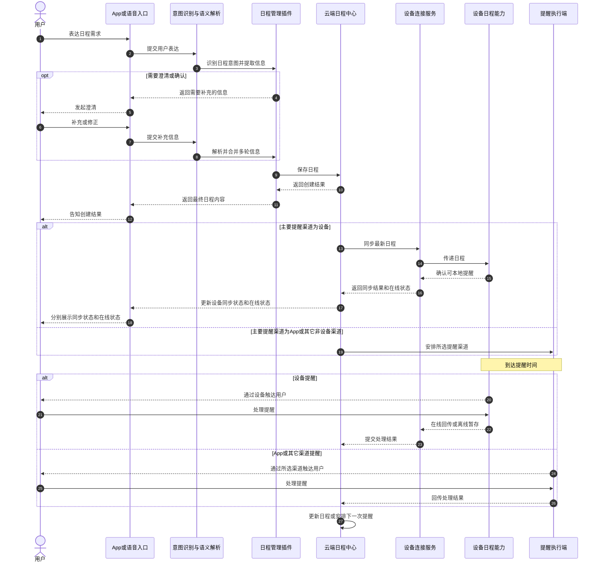
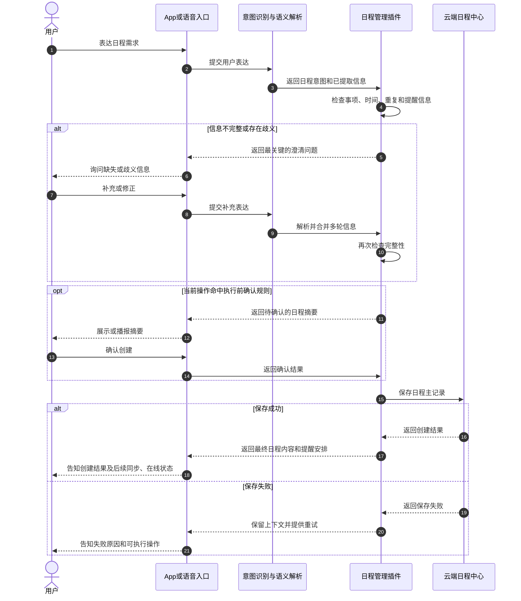
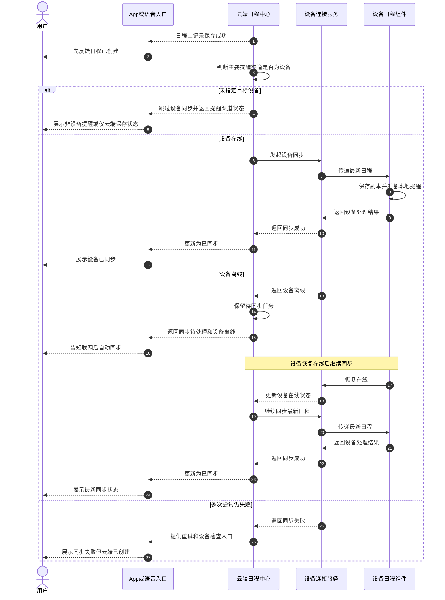
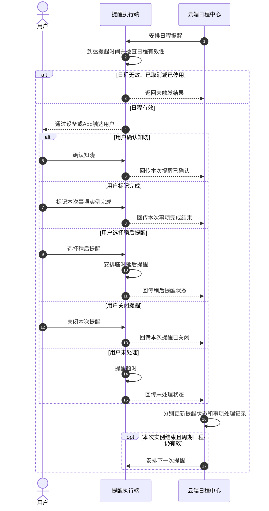
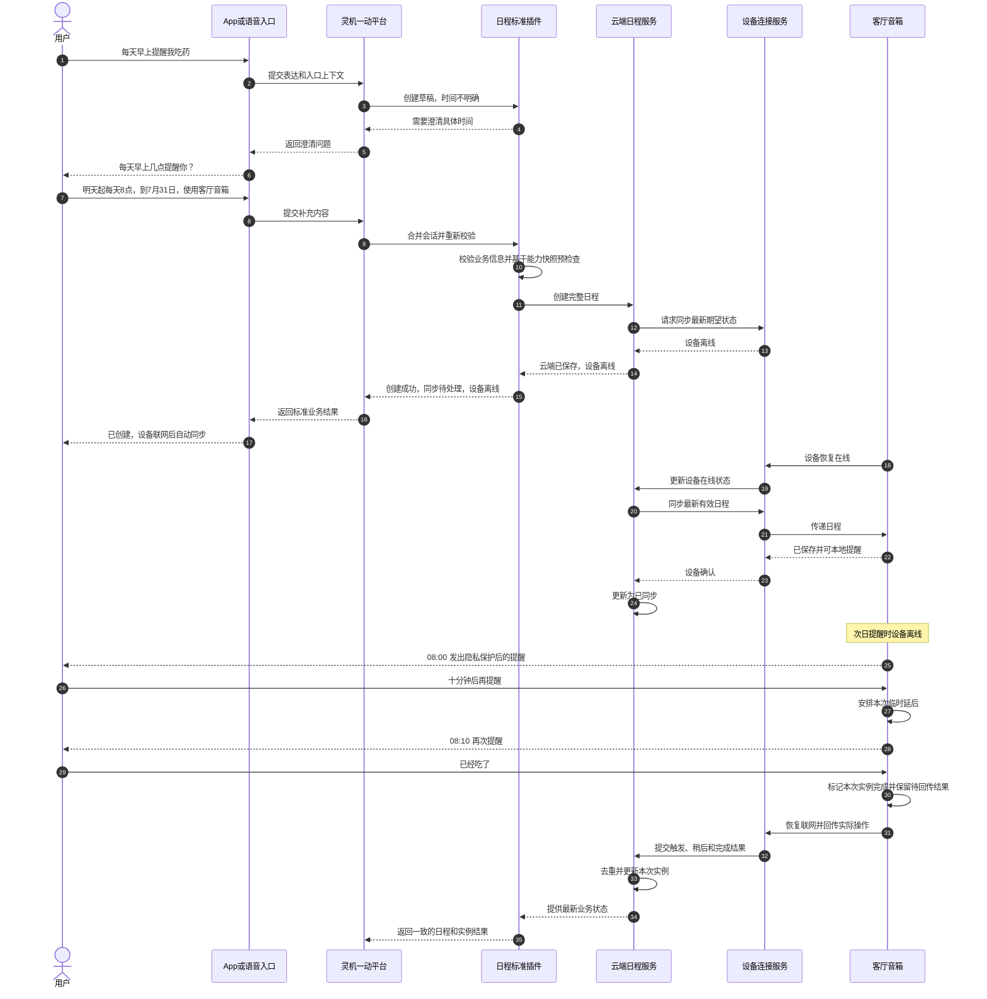

# 灵机一动平台日程管理标准插件 PRD

| 项目 | 内容 |
| --- | --- |
| 文档状态 | 草案 |
| 产品版本 | V1.0 |
| 更新日期 | 2026-07-22 |

## 1. 文档目的

本文定义灵机一动平台“日程管理”标准插件的用户场景、产品能力、交互规则、业务状态、
V1.0 范围和验收标准。

接口格式、通信协议、程序结构和设备实现见技术附件，不在本文展开。

## 2. 背景与用户问题

用户会通过语音、App 或平台内其它入口提出日程需求，但不同入口容易产生不一致体验：

- 同一句话在不同入口被理解成不同时间或不同事项。
- 用户不知道“创建成功”是否代表设备已经可以按时提醒。
- 缺少时间、目标不明确时，系统可能猜测执行或直接失败。
- 修改和删除已有日程时，用户很难确认系统操作的是哪一条。
- 日程、闹钟、倒计时、待办和设备控制之间容易发生意图冲突。
- 设备离线、重启或重新联网后，用户无法判断日程是否已经同步、是否还能在设备上提醒。

## 3. 产品定位

日程管理插件用于管理具有明确日期、时间或周期规则的事项，并在约定时间向用户提供提醒。

插件承接 App、语音和平台内其它入口的日程操作。信息不足时先向用户澄清，保存成功后返回最终的
日程内容和提醒渠道；用户选择设备渠道时，另外返回设备同步、在线和本地操作回传状态。

### 3.1 标准插件定位

日程管理插件是灵机一动平台中的标准业务插件。平台完成入口接入、基础意图识别和上下文整理后，
调用插件完成日程业务校验、澄清、确认、执行和结果整理。插件向 App、语音和平台内其它入口提供
一致的业务语义，不要求各入口分别实现日程规则。

标准插件遵循以下原则：

- 云端日程服务保存日程主记录，是内容、版本和有效状态的最终业务依据。
- 设备保存用于离线提醒的有效副本，不与云端分别维护互相冲突的主记录。
- App 和语音入口负责收集及呈现，不自行决定日程业务规则、同步结果或设备能力。
- 设备操作通过云端日程服务和设备连接服务完成，标准插件不直接控制设备。
- 同一操作从不同入口发起时，使用相同的校验、确认、执行和结果语义。

## 4. 产品目标

- 同一日程请求从语音、App 或其它入口进入时，得到一致的时间解释和操作结果。
- 支持创建、修改、删除、启停、查询、提醒确认、事项完成、稍后提醒和关闭提醒。
- 时间或目标不明确时先澄清；删除、批量影响和周期范围变更按规则确认。
- 明确区分云端保存状态、设备同步状态、设备在线状态和本地操作回传状态。
- 设备离线不影响云端保存，恢复联网后继续同步。
- 已同步日程在设备断网或重启后仍可本地提醒。

## 5. 非目标

V1.0 不包含：

- 课程表图片识别、表格解析和图片管理。
- 第三方日历账号授权与数据导入。
- 多人邀请、参会状态和共享日历协作。
- 没有时间约束的通用待办管理。
- 纯倒计时和起床闹钟。
- 设备自动化执行，例如自动升级固件、打开空调或校准传感器。
- 医疗诊断、服药剂量建议等专业决策。
- 研发接口、通信协议和设备内部实现方案。

## 6. 目标用户

| 用户类型 | 核心需求 |
| --- | --- |
| 学生 | 管理课程、考试、作业截止和学习计划 |
| 职场用户 | 管理会议、预约、项目节点、值班和出差 |
| 健康管理用户 | 管理服药、运动、喝水、休息和就医安排 |
| 家庭用户 | 管理家庭事务、缴费、纪念日、旅行和成员预约 |
| 设备拥有者或运维人员 | 管理耗材、清洁、巡检、保养和保修提醒 |

## 7. 用户与核心场景

日程插件按用户目的划分为学习、工作与项目、健康与运动、日常生活、设备运行与维护五类。
分类用于意图识别、展示和指标分析，不拆分成不同插件。

### 7.1 学习场景

| 场景 | 典型表达 | 用户需要的能力 | 阶段 |
| --- | --- | --- | --- |
| 单次课程或讲座 | “明天下午两点有人工智能讲座” | 时间、地点、提前提醒 | P0 |
| 固定学习计划 | “每周一晚上八点复习高数” | 每周重复、启停、提醒 | P0 |
| 考试安排 | “周五九点英语考试，提前半小时提醒” | 时间区间、地点、多次提醒 | P0 |
| 作业截止 | “周日晚上八点提醒我交数学作业” | 截止时间、优先级、事项完成记录 | P0 |
| 复习与备考计划 | “考试前一周每天晚上提醒我复习” | 日期范围、每日重复 | P0 |
| 结构化课程表 | 平台导入用户已确认的课程安排 | 批量创建、学期范围、单双周 | P1 |

课程表图片处理不属于日程插件。后续课程表能力只接收其它平台能力已经确认的标准日程。

### 7.2 工作与项目场景

| 场景 | 典型表达 | 用户需要的能力 | 阶段 |
| --- | --- | --- | --- |
| 会议 | “明天下午三点和产品开会” | 时间区间、地点、提前提醒 | P0 |
| 预约、面试 | “周三上午十点面试候选人” | 时间、地点、描述 | P0 |
| 项目里程碑 | “月底提醒我提交项目验收材料” | 截止时间、优先级、完成状态 | P0 |
| 周期例会 | “每周五下午四点开周会” | 每周重复、系列修改和删除 | P0 |
| 值班、轮班 | “下周一到周五每天九点提醒值班” | 日期范围、每日重复 | P0 |
| 出差行程 | 航班、酒店和客户拜访组成一组安排 | 关联日程、统一查看和管理 | P1 |

没有明确时间约束的项目任务属于待办能力；只有截止、预约和提醒部分进入日程管理。

### 7.3 健康与运动场景

| 场景 | 典型表达 | 用户需要的能力 | 阶段 |
| --- | --- | --- | --- |
| 服药提醒 | “每天早上八点提醒我吃药” | 每日重复、事项完成记录、稍后提醒 | P0 |
| 运动计划 | “每周二和周四晚上七点跑步” | 每周多日重复、启停 | P0 |
| 喝水提醒 | “每天上午十点提醒我喝水” | 每日固定时间 | P0 |
| 休息提醒 | “工作日每两小时提醒我休息” | 固定间隔、工作日范围 | P1 |
| 就医预约 | “下周二上午去医院复诊” | 时间区间、地点、多次提醒 | P0 |
| 健康随访 | “三个月后提醒我复查” | 长期日期、提前提醒 | P0 |

日程插件只负责时间和提醒，不提供诊断、剂量建议或其它医疗决策。健康类日程按照平台
敏感数据规范管理权限、日志和保留周期。

### 7.4 日常生活场景

| 场景 | 典型表达 | 用户需要的能力 | 阶段 |
| --- | --- | --- | --- |
| 家庭事务 | “周六上午提醒我打扫房间” | 时间、事项完成记录 | P0 |
| 缴费与续费 | “每月五号提醒我交物业费” | 每月重复、优先级 | P1 |
| 证件到期 | “护照到期前三个月提醒我换证” | 长期日期、多次提醒 | P1 |
| 生日、纪念日 | “每年六月十日是结婚纪念日” | 年度重复、全天日程 | P1 |
| 节假日安排 | “国庆第一天上午提醒我出发” | 指定日期、全天或定时安排 | P1 |
| 家庭成员预约 | “周日下午带孩子去看牙” | 时间、地点、描述 | P0 |
| 旅行安排 | 出发、入住、活动和返程组成一组安排 | 关联日程、统一查看和管理 | P1 |

“记一下买牛奶”等没有时间约束的事项不属于日程；用户补充提醒时间后才进入日程管理。

### 7.5 设备运行与维护场景

| 场景 | 典型表达 | 用户需要的能力 | 阶段 |
| --- | --- | --- | --- |
| 耗材更换 | “下个月一号提醒我更换滤芯” | 日期、周期提醒 | P0 |
| 清洁保养 | “每月最后一个周末提醒我清洁设备” | 月度规则 | P1 |
| 检查与校准 | “每季度提醒我检查传感器” | 长周期重复 | P1 |
| 固件检查 | “周日晚上提醒我检查固件更新” | 时间、提醒 | P0 |
| 保修与续保 | “保修到期前一个月提醒我” | 长期日期、提前提醒 | P1 |
| 运行巡检 | “每天九点提醒我查看设备运行状态” | 每日重复、事项完成记录 | P0 |

日程插件只产生维护提醒，不直接升级固件、校准传感器或控制设备。实际操作由对应业务能力
执行。

### 7.6 场景能力归纳

| 通用能力 | 覆盖场景 | 阶段 |
| --- | --- | --- |
| 单次绝对时间 | 会议、考试、预约、截止、就医、维护 | P0 |
| 每日重复 | 服药、学习、喝水、巡检 | P0 |
| 每周及多星期重复 | 课程、例会、运动 | P0 |
| 多次提前提醒 | 考试、会议、就医、证件到期 | P0 |
| 用户确认与稍后提醒 | 服药、任务完成、巡检 | P0 |
| 月度、年度和固定间隔 | 缴费、生日、休息、保养 | P1 |
| 批量及关联日程 | 课程表、出差、旅行、外部日历 | P1 |
| 全天日程和例外日期 | 节假日、生日、复杂课程 | P1 |

## 8. 意图识别与能力边界

### 8.1 标准意图描述

当用户希望在某个日期、时间或周期安排事项，设置与事项相关的提醒，修改或取消已有安排，
查询某天或下一项安排，或者处理当前正在触发的日程提醒时，应选择日程管理插件。

V1.0 典型事项包括会议、预约、考试、作业截止、服药、运动、休息和维护提醒。

### 8.2 不应进入日程插件

| 用户表达 | 应进入的能力 |
| --- | --- |
| “倒计时十分钟” | 倒计时 |
| “每天早上七点叫我起床” | 闹钟 |
| “打开空调” | 设备控制 |
| “记一下买牛奶” | 待办或笔记 |
| “今天有什么新闻” | 内容查询 |

“十分钟后提醒我喝水”包含具体事项和提醒时间，应进入日程；“倒计时十分钟”只表达计时，
不属于日程。

### 8.3 标准插件调用模型

标准插件以业务阶段组织一次请求，不约束具体传输协议。平台与插件之间至少包含以下协作阶段：

| 阶段 | 平台提供 | 插件返回 |
| --- | --- | --- |
| 意图判断 | 操作意图、已提取信息和用户上下文 | 是否属于日程能力，以及不属于时的推荐能力 |
| 业务校验 | 日程草稿、目标条件、作用范围和提醒选择 | 可执行、需要澄清、需要确认或不支持 |
| 澄清 | 用户补充内容和原会话上下文 | 更新后的日程草稿，或下一个最关键问题 |
| 确认 | 已冻结的操作摘要、目标和用户确认结果 | 执行、取消，或因内容变化重新确认 |
| 执行 | 完整业务参数、操作标识、提醒渠道和目标设备 | 云端结果、最终日程、提醒安排、设备同步和在线状态 |
| 查询 | 查询范围、用户权限和展示上下文 | 标准日程结果、空结果或需要缩小范围 |
| 状态更新 | 云端或设备状态变化 | 面向入口的最新业务结果和可执行后续动作 |

插件的业务结果统一分为：

- 成功：请求已经完成，云端主记录是最新有效结果；设备同步状态可以是待同步或同步失败，设备在线状态
  可以是离线，这些关联状态不改变操作结果。
- 部分成功：仅用于一次操作包含多个独立目标，且部分目标已经完成、部分目标最终失败的情况；P0 单设备
  场景不使用该结果。
- 需要澄清：缺少继续执行所需的信息，尚未改变主记录。
- 需要确认：操作内容已经形成摘要，等待用户确认，尚未改变主记录。
- 已取消：用户取消，或待确认操作明确终止，没有产生新的业务变更。
- 失败：权限、业务校验或云端保存未完成，预期的云端主记录变化没有发生。设备同步失败不回退已经成功
  的云端操作，也不把业务操作结果改成失败。

澄清和确认属于同一次业务会话。平台必须携带已经确认且仍然有效的上下文，不能要求插件根据一句
孤立的用户回复重新猜测完整操作。

## 9. 三个核心产品流程

本节包含创建与澄清、设备同步、提醒处理三条流程。9.1 展示整体顺序，9.2 至 9.4 分别说明
各流程的正常路径、异常处理和结束状态。

### 9.1 端到端主流程时序图

意图平台输出意图、时间和多轮上下文；日程管理插件校验信息并执行日程操作；云端日程中心保存主记录。
P0 中每条日程只选择一个主要提醒渠道：选择设备时，该设备同时是同步目标并保存用于离线提醒的副本；
选择 App 或其它非设备渠道时，不再为同一日程额外同步一台提醒设备。

修改、删除、启用和停用属于日程创建后的变更链路：云端日程中心保存最新结果，设备日程组件取消旧安排，
再根据最新状态重新安排或移除提醒。已同步设备最终应保留最新有效内容。

### 9.2 创建与澄清流程

#### 正常流程时序图

#### 判断与分支

| 判断 | 产品处理 |
| --- | --- |
| 表达属于纯倒计时、闹钟、待办或设备控制 | 转入对应能力，不创建日程 |
| 缺少事项 | 询问“需要安排什么？” |
| 缺少开始时间 | 询问具体日期和时间，不静默使用默认值 |
| 时间存在多种合理解释 | 给出简短选项，让用户选择 |
| 时间已经过去 | 询问是否改为下一个合理日期，不能自动顺延 |
| 周期规则不完整 | 询问频率、星期、结束范围等必要信息 |
| 用户在澄清中改变意图 | 放弃旧的待创建内容，按新意图重新判断 |
| 用户取消 | 不保存日程，并明确反馈已取消 |
| 保存失败 | 保留当前上下文，说明失败并提供重试 |

#### 结束状态

- 已创建：日程主记录保存成功，进入提醒安排；指定设备时同时进入设备同步流程。
- 待补充：仍缺少创建所需信息，对话可以继续。
- 已取消：用户主动取消，没有产生日程。
- 创建失败：未保存日程，用户可以重试或修改内容。

### 9.3 设备同步流程

#### 正常流程时序图

#### 离线与失败分支

| 情况 | 产品处理 | 用户反馈 |
| --- | --- | --- |
| 未绑定设备 | 跳过设备同步；按用户选择安排云端或 App 提醒，未选择时只保存日程 | 不显示设备异常 |
| 设备离线 | 同步状态保持待同步，在线状态记为离线；设备重连后自动继续 | “已创建，设备联网后自动同步” |
| 设备短暂无响应 | 自动重试，不重复创建日程 | 保持“正在同步” |
| 多次尝试仍失败 | 停止无休止重试，保留人工重试入口 | “同步失败，请检查设备” |
| 用户在同步完成前修改日程 | 以最新内容为准，旧内容不应最终生效 | 展示最新一次操作状态 |
| 用户在同步完成前删除日程 | 取消待同步创建，确保设备最终不提醒 | 展示“已删除”及设备同步、在线状态 |
| P1 多设备部分成功 | 分别记录每台设备结果 | 展示“部分设备已同步” |
| 设备重置或数据丢失 | 重新同步仍有效的日程 | 用户无需手动重新创建 |

#### 结束状态

- 未要求同步：日程保存在云端；由所选非设备渠道提醒，未选择渠道时仅保存。
- 待同步：设备尚未确认具备本地提醒条件；设备在线状态另行展示。
- 正在同步：设备在线且当前正在处理最新期望状态。
- 已同步：设备可以离线执行提醒。
- 同步失败：需要用户重试或检查设备。
- 部分同步：P1 多设备能力启用后，只有部分设备完成。

设备在线状态始终独立返回在线、离线或未知。设备离线不会覆盖“已同步”；只有云端出现尚未被设备
确认的新期望状态时，同步状态才进入“待同步”。

### 9.4 提醒处理流程

#### 正常流程时序图

#### 用户操作分支

| 用户操作 | 产品语义 | 后续行为 |
| --- | --- | --- |
| 确认知晓 | 用户已经看到或听到提醒 | 关闭本次提醒并记录已确认，不标记事项完成 |
| 标记完成 | 用户明确表示可完成事项已经处理 | 关闭本次提醒，并将任务、服药或维护等本次事项实例标记完成 |
| 稍后提醒 | 用户暂时无法处理，但仍希望再次提醒 | 按允许的时长延后，不改变原始日程时间 |
| 关闭提醒 | 用户只希望停止当前提醒 | 关闭本次提醒，不标记事项完成 |
| 不处理 | 用户没有进行任何操作 | 按产品策略继续提醒、自动停止或记录未处理 |

#### 异常与恢复分支

| 情况 | 产品处理 |
| --- | --- |
| 设备时间无效 | 暂停提醒，恢复可信时间后按错过提醒规则处理 |
| 设备在提醒时离线 | 本地提醒不受影响，处理结果待联网后回传 |
| 用户达到稍后提醒次数上限 | 不再允许延后，提示用户确认或关闭 |
| 日程在提醒中被修改 | 停止不再有效的提醒，并按最新日程重新安排 |
| 日程在提醒中被删除或停用 | 立即停止当前提醒，不再产生后续提醒 |
| 设备重启时存在未处理提醒 | 根据错过策略决定补提醒、跳过或进入下一周期 |
| 多个提醒同时到达 | 按提醒时间排队；同一时刻的提醒逐条呈现，不能覆盖或丢失 |

#### 结束状态

- 已确认：用户已知晓本次提醒，不代表事项完成。
- 已稍后提醒：等待临时延后时间到达。
- 已关闭：本次提醒结束，但不改变事项完成状态。
- 未处理：用户未响应，由产品策略决定后续。
- 已完成：可完成的本次事项实例由用户明确标记完成。
- 已结束：一次性日程已到达结束条件，不代表事项完成。
- 等待下一次：周期日程继续有效。

### 9.5 标准插件端到端案例：每日服药提醒

本案例使用一个真实的 P0 场景说明 App/语音入口、灵机一动平台、日程管理标准插件、云端日程服务、
设备连接服务和设备日程能力如何协作。案例日期假定为 `2026-07-22`，用户时区为
`GMT+08:00`，用户已登录并绑定“客厅音箱”。

用户希望从次日开始建立每日服药提醒，目标设备创建时离线；设备恢复在线后完成同步，随后在断网
状态下提醒，用户先选择稍后提醒，再标记本次事项完成。

#### 9.5.1 创建与澄清

用户通过语音入口表达：

> “每天早上提醒我吃药。”

语音入口和意图平台完成语音转写、日程意图识别和基础信息提取，向标准插件提供：

| 信息 | 当前内容 |
| --- | --- |
| 主要操作 | 创建日程 |
| 事项 | 吃药 |
| 重复 | 每日 |
| 时间 | 早上，尚未形成唯一时间 |
| 用户时区 | `GMT+08:00` |
| 目标设备 | 尚未选择 |

标准插件判断关键开始时间不明确，返回“需要澄清”，要求入口只询问一个问题：

> “每天早上几点提醒你？”

此时云端主记录没有变化。用户补充：

> “从明天开始，每天早上八点，到七月三十一日，在客厅音箱提醒，可以稍后十分钟。”

平台将补充信息与原会话中已经确认的事项和重复规则合并，再次调用标准插件。插件形成以下完整业务
内容：

| 信息 | 最终内容 |
| --- | --- |
| 标题 | 吃药 |
| 系列范围 | `2026-07-23` 至 `2026-07-31`，包含起止日期 |
| 重复规则 | 每天 `08:00` |
| 时区 | `GMT+08:00` |
| 目标设备 | 客厅音箱 |
| 稍后提醒 | 允许延后 10 分钟，次数受 P0 上限约束 |
| 业务分类 | 健康 |

标准插件继续检查当前用户权限和目标设备归属，并使用平台登记的设备能力快照预检查每日重复、离线
提醒和稍后提醒。能力快照必须包含能力版本和最近更新时间；设备当前可用容量只作为预检查信息，最终
是否可同步以设备实际确认为准。快照缺失或过期时，设备不能作为已确认可用的提醒渠道，插件允许用户
重试、改用 App 提醒或仅保存到云端。

本案例假定客厅音箱的能力快照仍在有效期内且版本兼容，因此设备渠道预检查通过。

本案例采用第 22 节的当前建议：创建内容唯一时直接执行并反馈最终结果。如果后续评审决定语音创建
周期日程必须执行前确认，则标准插件在保存前返回“需要确认”，入口播报完整摘要；用户明确确认后，
再继续下面的云端保存流程。

#### 9.5.2 云端保存与设备离线

标准插件请求云端日程服务创建日程。云端日程服务保存主记录、形成后续提醒计划，并把该日程记录为
客厅音箱应达到的最新期望状态。设备连接服务发现客厅音箱离线，尚未取得设备确认。

标准插件向入口返回：

| 结果信息 | 返回内容 |
| --- | --- |
| 操作结果 | 成功 |
| 云端状态 | 已保存 |
| 日程状态 | 已计划 |
| 下一次提醒 | `2026-07-23 08:00` |
| 提醒渠道 | 客厅音箱 |
| 设备同步状态 | 待同步 |
| 设备在线状态 | 离线 |

语音入口向用户反馈：

> “已创建从明天到七月三十一日、每天早上八点的提醒。客厅音箱当前离线，联网后会自动同步。”

入口不能把“云端已保存”说成“设备已同步”，也不能因为设备离线而把成功的创建操作改成“部分成功”
或“失败”。

#### 9.5.3 设备恢复在线并完成同步

客厅音箱恢复在线后，设备连接服务通知云端。云端只向设备同步当前最新的有效期望状态；设备确认已
保存日程并具备本地提醒条件后，云端将该设备同步状态更新为“已同步”。

此时 App、语音或平台内其它入口查询该日程时，标准插件返回相同的组合状态：

| 状态维度 | 当前状态 |
| --- | --- |
| 云端状态 | 已保存 |
| 日程系列 | 已计划 |
| 下一次提醒 | 待提醒 |
| 设备同步状态 | 已同步 |
| 设备在线状态 | 在线 |

设备上线前若用户连续修改该日程，云端只要求设备最终达到最新期望状态，不要求设备依次执行已经被
覆盖的中间内容。

#### 9.5.4 设备离线提醒与稍后提醒

`2026-07-23 08:00` 到达时，客厅音箱已经断网。由于设备同步状态仍为“已同步”，设备仍按本地
保存的有效日程提醒用户。若客厅音箱属于共享设备或当前处于公共播报环境，健康类日程默认使用通用
提示，例如：

> “你有一项健康提醒。”

同一时刻存在多条敏感提醒时，设备使用“第一项健康提醒”“第二项健康提醒”等中性序号区分，并引导
用户在完成身份确认后或通过个人 App 查看详情，不通过标题、地点或说明区分。

提醒触发后，各状态分别为：

| 状态维度 | 当前状态 |
| --- | --- |
| 日程系列 | 已计划 |
| `2026-07-23` 实例 | 待处理 |
| 当前提醒 | 提醒中 |
| 设备同步状态 | 已同步 |
| 设备在线状态 | 离线 |
| 本地操作回传状态 | 无待回传 |

用户对设备说：

> “十分钟后再提醒我。”

设备完成本地提醒操作，将当前提醒记为“已稍后提醒”，并在 `08:10` 再次提醒。该操作只改变
`2026-07-23` 这一次提醒的临时时间，不得把整个每日系列修改为每天 `08:10`。设备同时保留本次
操作的实际发生时间，本地操作回传状态进入“待回传”，等待联网后回传。

#### 9.5.5 标记本次完成与结果回传

`08:10` 再次提醒后，用户对设备说：

> “已经吃了。”

该表达在当前提醒上下文中表示“标记本次事项实例完成”，不是“确认知晓”，也不是结束整个周期系列。
设备结束当前提醒，并保留以下结果：

| 状态维度 | 当前状态 |
| --- | --- |
| `2026-07-23` 实例 | 已完成 |
| 当前提醒 | 已关闭，原因为“实例已完成” |
| 日程系列 | 仍然已计划 |
| 下一次提醒 | `2026-07-24 08:00` |
| 设备同步状态 | 已同步 |
| 设备在线状态 | 离线 |
| 本地操作回传状态 | 待回传 |

设备恢复联网后，将提醒触发、稍后提醒和标记完成的实际结果交给设备连接服务，云端只记录一次业务
结果，并将本地操作回传状态恢复为“无待回传”。最终 App、语音和设备查询应一致显示：
`2026-07-23` 实例已完成，每日日程系列仍然有效，下一次提醒是 `2026-07-24 08:00`。

#### 9.5.6 完整协作时序

#### 9.5.7 标准插件在案例中的责任

标准插件负责判断是否属于日程能力、检查信息是否完整、生成澄清或确认结果、统一创建和提醒处理
语义、基于能力快照预检查目标设备，并把云端状态、提醒安排、设备同步状态、在线状态和本地操作回传
状态整理成入口可使用的一致业务结果。

标准插件不负责语音转写和播报，不直接维护设备连接，不在设备上执行提醒，也不决定设备内部如何
保存和恢复日程。这些边界保证 App、语音、云端和不同设备可以独立演进，同时保持同一日程业务结果。

## 10. 产品能力需求

| 能力 | 产品要求 |
| --- | --- |
| 创建日程 | 支持一次性、每日和每周安排，允许设置地点、说明、优先级和多个提醒 |
| 修改日程 | 支持修改时间、内容、提醒和重复规则；周期日程需选择影响范围 |
| 删除日程 | 支持删除单次或周期安排；默认需要确认 |
| 启用与停用 | 停用后不再提醒，但保留日程内容；支持重新启用 |
| 日程详情 | 展示完整时间、地点、重复规则、提醒和当前状态 |
| 时间范围查询 | 查询今天、明天、本周或用户指定范围的日程 |
| 下一日程 | 快速返回下一条或若干条即将发生的日程 |
| 提醒确认 | 用户确认已经知晓本次提醒，但不改变事项完成状态 |
| 事项完成 | 任务、服药和维护等可完成事项由用户明确标记完成 |
| 稍后提醒 | 在允许范围内延后当前提醒，不改变原日程时间 |
| 关闭提醒 | 终止当前提醒，但不表示事项已完成 |

## 11. 标准输入语义

产品层只定义插件需要理解的业务信息，不定义传输格式。

### 11.1 操作意图

| 操作 | 用户目的 | 需要确定的信息 |
| --- | --- | --- |
| 创建 | 新增一条日程 | 事项、开始时间；其它信息按用户表达补充 |
| 修改 | 调整已有日程 | 目标日程、修改内容；周期日程还需作用范围 |
| 删除 | 移除已有日程 | 目标日程；周期日程还需作用范围 |
| 启用或停用 | 恢复或暂停提醒 | 目标日程；批量操作需确认影响范围 |
| 查询 | 查看详情、时间范围内的日程或下一项日程 | 查询范围或目标日程 |
| 处理提醒 | 确认知晓、标记完成、稍后提醒或关闭 | 当前提醒和用户选择的处理动作 |

一个请求只能有一个主要操作。用户同时提出多个主要操作时，平台应拆分确认，不能自行决定执行顺序。

### 11.2 平台上下文

| 上下文 | 用途 | 缺失时的处理 |
| --- | --- | --- |
| 当前用户和权限 | 判断日程及设备访问权限 | 终止操作并要求完成身份确认 |
| 当前可信时间 | 解释“十分钟后”“明天”等相对时间 | 不处理相对时间请求 |
| 用户时区和地区 | 解释当地日期、时间和重复规则 | 要求平台补齐，不能由插件猜测 |
| 当前选中的日程 | 确定 App 内修改、删除或查询目标 | 改用用户表达匹配目标 |
| 当前正在提醒的日程实例 | 处理确认、完成、稍后提醒和关闭 | 无法确定时要求用户选择 |
| 用户默认或本次选定的设备 | 确定是否需要设备同步 | 未选择设备时按非设备渠道或仅云端保存处理 |
| 用户可用的提醒渠道 | 确定 App、设备或其它提醒方式 | 无可用渠道时允许保存，但必须提示不会主动提醒 |
| 请求入口 | 决定语音或 App 的反馈形式 | 使用平台通用反馈形式 |
| 当前对话上下文 | 合并多轮澄清和确认内容 | 按新请求重新开始，不沿用不确定信息 |

身份、设备归属、当前时间、时区和权限由平台提供，不能根据用户话术推测。

### 11.3 日程内容

| 信息 | 创建要求 | 产品规则 |
| --- | --- | --- |
| 事项标题 | 必填 | 应能让用户识别具体事项，不能只保存“提醒我”等空泛标题 |
| 开始日期和时间 | P0 必填 | 必须转换为当前时区下的确定时间 |
| 结束时间或持续时长 | 可选 | 结束时间不得早于开始时间 |
| 地点 | 可选 | 用于展示、查询和目标匹配 |
| 说明 | 可选 | 保存用户补充内容，不作为关键时间的替代信息 |
| 优先级 | 可选 | 未设置时使用普通优先级 |
| 重复规则 | 可选 | P0 支持每日和每周重复 |
| 重复范围 | 周期日程按需提供 | P0 使用开始日期和结束日期限定，两个日期均包含当天并按日程时区解释 |
| 提前提醒 | 可选 | 可以设置多次，均相对于日程开始时间计算 |
| 提醒渠道 | 可选 | P0 选择 App、一台设备或仅保存；未指定时使用用户默认渠道，无默认渠道时只保存并明确提示 |
| 目标设备 | 设备渠道必填 | P0 选择设备作为主要提醒渠道时，该设备同时是唯一同步目标；选择 App 或仅保存时不提供目标设备 |
| 业务分类 | 可选 | 用于展示、筛选和指标统计，不改变时间规则 |

### 11.4 目标日程与作用范围

用户可以通过以下信息定位已有日程：

- App 中直接选中的日程。
- 当前正在触发的提醒。
- 日程标题或关键词。
- 日期和时间范围。
- 地点或业务分类。

目标处理规则：

- 直接选中的日程优先于文字匹配结果。
- 只有一条日程匹配时，可以继续执行后续校验。
- 多条日程匹配时，返回可区分的候选项，由用户选择。
- 没有日程匹配时，反馈未找到，不创建新日程代替原操作。
- 修改或删除周期日程时，必须确定仅本次、当前及后续或整个系列。

### 11.5 信息来源优先级

同一信息出现冲突时，按以下顺序取值：

1. 用户在当前一轮明确给出的内容。
2. 用户在 App 中直接选择的日程、设备或提醒渠道。
3. 用户刚刚确认的日程摘要。
4. 当前会话中已确认且未被修改的内容。
5. 用户预先设置的默认设备或提醒渠道。
6. 产品默认值。

产品默认值不得用于补齐关键日期、开始时间、周期作用范围或删除目标。使用默认设备、提醒渠道、
优先级等非关键信息时，最终反馈中应让用户能够看到结果。

### 11.6 标准插件公共调用上下文

除具体操作信息外，平台调用标准插件时还需提供以下业务上下文。本文只定义信息语义，不规定字段名、
接口形式或传输协议。

| 上下文 | 必要性 | 产品用途 |
| --- | --- | --- |
| 操作标识 | 所有写操作必需 | 识别重复点击、语音重放和网络重试，避免重复业务结果 |
| 当前用户和权限 | 必需 | 限定可访问的日程、提醒渠道和设备 |
| 请求入口 | 必需 | 决定 App、语音或平台内部调用的呈现方式 |
| 当前可信时间和时区 | 涉及时间时必需 | 解释相对时间并生成一致的展示结果 |
| 会话上下文 | 多轮操作必需 | 保留已经确认的信息和待回答问题 |
| 当前选中对象 | 修改、删除、查询或提醒处理时按需 | 优先定位 App 选中的日程或当前提醒实例 |
| 确认引用 | 需要执行前确认时必需 | 确保执行内容与用户看到并确认的摘要一致 |
| 提醒渠道 | 创建、修改时按需 | P0 选择 App、一台设备或仅保存，不能同时选择 App 和设备提醒 |
| 目标设备 | 设备渠道必需 | 与设备提醒渠道是同一设备，触发能力预检查和同步流程 |

操作标识只用于识别同一次用户操作，不替代日程自身的身份和版本。确认引用对应的内容、目标或作用
范围发生变化时，原确认立即失效。

## 12. 标准输出语义

App、语音和设备查询应返回一致的业务结果。本节定义用户和上游能力需要获得的信息，
不定义传输字段。

### 12.1 通用结果

| 结果信息 | 适用情况 | 用户需要知道的内容 |
| --- | --- | --- |
| 操作结果 | 所有操作 | 成功、需要澄清、需要确认、部分成功、已取消或失败 |
| 日程摘要 | 创建、修改、删除、查询 | 标题、日期、时间、地点、重复和提醒设置 |
| 作用范围 | 周期或批量操作 | 仅本次、当前及后续、整个系列或实际影响数量 |
| 云端状态 | 创建、修改、删除、启停 | 云端是否已经保存最新结果 |
| 提醒安排 | 创建、修改、查询 | 提醒渠道和下一次提醒时间；没有提醒渠道时明确说明 |
| 设备同步状态 | 指定设备的操作 | 未要求、待同步、正在同步、已同步、同步失败或 P1 部分同步 |
| 设备在线状态 | 指定设备的操作 | 在线、离线或未知，不覆盖设备同步结果 |
| 本地操作回传状态 | 设备本地处理提醒后 | 无待回传、待回传或回传失败 |
| 后续动作 | 需要用户继续处理时 | 回答问题、选择候选项、确认、重试或检查设备 |

### 12.2 各操作的成功结果

| 操作 | 成功后必须反馈 |
| --- | --- |
| 创建 | 最终日程内容、云端已保存、提醒渠道，以及设备渠道适用的同步状态和在线状态 |
| 修改 | 实际修改的日程、修改后的内容、作用范围，以及设备渠道适用的最新同步状态和在线状态 |
| 删除 | 实际删除的日程和作用范围；设备尚未完成删除同步时单独说明 |
| 启用或停用 | 当前启停状态、下一次提醒是否存在和设备同步状态 |
| 查询 | 符合条件的日程、查询范围；无结果时明确返回空结果 |
| 处理提醒 | 本次提醒处理结果；标记完成时说明完成的是本次实例，一次性日程只有一个实例 |

### 12.3 需要澄清

平台应说明当前缺少或冲突的信息，并只提出一个优先级最高的问题，例如：

- “项目会议安排在几点？”
- “你说的是本周五还是下周五？”
- “找到两个项目会议，你要修改哪一个？”

候选日程应至少展示标题、日期和时间；这些信息仍无法区分时，再补充地点或业务分类。

### 12.4 需要确认

确认内容必须包含：

- 将执行的操作。
- 目标日程摘要。
- 影响一条日程还是整个系列。
- 影响数量或时间范围。

用户确认后，平台执行原先已经冻结的操作，不重新理解成另一组参数。

### 12.5 操作及关联状态异常

| 异常情况 | 用户反馈 |
| --- | --- |
| 无权限 | 无法访问该日程或设备，不展示无权查看的日程内容 |
| 未找到目标 | 说明未找到，并建议调整标题或时间范围 |
| 云端保存失败 | 明确操作尚未完成，保留当前内容并提供重试 |
| 设备同步失败 | 明确云端操作已经完成，提供设备检查或重试入口 |
| 时间或规则不支持 | 指出不支持的部分，并允许用户修改 |
| 处理提醒失败 | 保留当前提醒状态，避免误报已经确认、完成或关闭 |

设备同步失败属于成功云端操作的关联状态异常，不改变该操作的成功结果。技术错误细节不直接展示给用户。

### 12.6 标准插件业务结果

平台、App 和语音入口应按同一结果分类处理插件返回，不得通过技术错误文本推断业务状态：

| 结果分类 | 主记录是否变化 | 入口处理 |
| --- | --- | --- |
| 成功 | 已完成预期的云端变化，或查询成功 | 展示最终日程、提醒安排，以及独立的设备同步和在线状态 |
| 部分成功 | P1 多目标操作中只有部分独立目标完成 | 展示每个目标结果；P0 单设备待同步或失败不使用该分类 |
| 需要澄清 | 未变化 | 只询问一个最关键问题并保留上下文 |
| 需要确认 | 未变化 | 展示冻结摘要、目标和作用范围，等待明确确认 |
| 已取消 | 未变化 | 结束当前操作并反馈已取消 |
| 失败 | 权限、业务校验或云端保存未完成预期变化 | 展示可理解的失败原因和重试或修改入口 |

标准结果至少包含：

| 结果信息 | 规则 |
| --- | --- |
| 操作结果 | 使用本节统一分类 |
| 最终日程快照 | 创建、修改和查询成功时返回，不允许入口自行拼装旧数据 |
| 云端状态 | 明确主记录是否已经保存最新结果 |
| 提醒安排 | 返回有效渠道和下一次提醒时间；无渠道时明确说明 |
| 设备同步状态 | 按目标设备返回数据是否达到最新期望状态、最近更新时间和原因 |
| 设备在线状态 | 按目标设备返回在线、离线或未知，以及最近状态更新时间 |
| 本地操作回传状态 | 存在设备本地操作时返回是否仍在等待回传或回传失败 |
| 下一步动作 | 只返回当前可执行的澄清、确认、重试、换设备或修改规则等动作 |

设备同步是异步过程。首次操作结果可以是“操作成功、设备待同步”；后续状态变化由平台统一提供
查询或通知能力，入口不能将“请求已经发送”展示为“设备已同步”。

## 13. 澄清与确认规则

### 13.1 必须澄清

- 创建日程缺少开始时间。
- “下午开会”等时间范围过宽且没有产品默认规则。
- “下周提醒我”等表达缺少具体日期。
- 修改、删除或启停匹配到多条日程。
- 修改周期日程时未说明本次、后续还是整个系列。
- 用户给出的时间已经过去，且无法合理判断其真实意图。

### 13.2 可以直接执行

- “明天下午三点开会”在当前时区中只有一种合理解释。
- “十分钟后提醒我喝水”可以转换为确定时间。
- “今天有什么安排”可以转换成当天范围查询。
- “下一个日程是什么”可以直接查询。

### 13.3 澄清顺序

同时缺少多项信息时，按以下顺序提问：

1. 当前请求属于哪一种操作。
2. 要操作哪一条日程。
3. 日程的开始日期和时间。
4. 周期日程的重复规则和作用范围。
5. 提醒渠道和目标设备。
6. 地点、说明和优先级等可选信息。

每轮只询问一个会阻止当前操作继续的问题。用户补充信息后，保留此前已确认内容；用户明确修改的
信息以最新表达为准。用户转入无关话题或明确取消时，丢弃尚未执行的操作。

### 13.4 必须确认

- 删除日程。
- 修改或删除整个周期系列。
- 一次影响多条日程。
- 停用一组长期提醒。
- 健康等高敏感场景中产品另行规定的操作。

### 13.5 确认有效性

- 确认摘要生成后，待执行的操作、目标日程和作用范围保持不变。
- 用户在确认时补充或修改内容，原确认失效，平台重新生成摘要。
- 目标日程在确认前被其它入口修改或删除时，平台重新查询并要求确认最新内容。
- 用户拒绝或取消时，不执行操作，并反馈已取消。
- 无法判断“好的”“算了”等答复对应哪一个待确认操作时，继续澄清，不能直接执行。

### 13.6 执行后反馈

创建和修改后，即使不要求执行前确认，也必须反馈最终标题、日期、时间、重复规则和提醒设置。

## 14. 产品业务规则

### 14.1 主记录与多端一致性

- 云端日程是主记录，设备保存用于离线提醒的副本。
- 云端保存、设备同步、设备在线和本地操作回传状态分别展示；设备异常不能覆盖云端成功结果。
- 用户在设备同步完成前再次修改日程时，以云端最新内容为准，旧内容不得最终生效。
- 用户删除尚未完成设备同步的日程时，设备最终不得保留或触发该日程。
- 设备重置或本地副本丢失后，只恢复云端仍然有效的日程。

### 14.2 重复提交与并发修改

- 同一用户操作因重复点击、重复语音回传或网络重试再次提交时，不能产生重复日程或重复处理结果。
- 同一日程被多个入口同时修改时，平台检查用户确认后内容是否已变化。
- 时间、重复规则、作用范围或目标设备发生冲突时，不静默覆盖，要求用户确认最新内容。
- 不影响用户意图的展示信息更新，可以合并到最新结果中。

### 14.3 周期日程

- 修改和删除周期日程必须选择仅本次、当前及后续或整个系列。
- 仅修改本次实例时，原周期规则继续有效，其它实例不受影响。
- 标记某次服药、任务或巡检完成，只完成本次实例，不结束整个周期系列。
- 停用周期日程后不再生成提醒；重新启用时从下一次有效时间继续。
- 周期系列的开始日期和结束日期均包含当天，并按日程时区解释。结束日期中符合重复规则的时间仍可
  生成最后一次实例；结束日期之后不再生成新实例。
- 周期系列到达结束日期内最后一个有效实例之后进入已结束状态，不再生成新实例。

### 14.4 提醒处理

- 确认知晓、关闭提醒和标记完成是不同操作，不能互相替代。
- 稍后提醒只调整本次提醒的临时时间，不修改原日程开始时间和周期规则。
- 删除、取消或停用日程后，尚未触发的相关提醒全部取消。
- 日程在提醒过程中被修改时，停止已经失效的提醒，并按最新内容重新安排。
- 多个提醒同时到达时按提醒时间排队，同一时刻的提醒逐条呈现，不能覆盖或丢失。

### 14.5 时间、时区与错过提醒

以下规则为 P0 V0.1 已冻结规则；测试和评审只产生发布证据，不改变协议语义。

#### P0 时区规则

- 自然语言先转换成确定日期、时间和日程时区，再保存日程。平台缺少用户时区时，不处理相对时间和
  周期日程创建，不能根据设备位置或语言猜测。
- 每条日程必须保存明确的日程时区。用户未指定时，使用创建时的平台用户时区，并在创建结果中反馈。
- 一次性日程保存绝对时刻。用户或设备切换时区后，只改变展示时间，不改变实际发生时刻。
- 每日和每周日程保存当地钟表时间与日程时区，后续实例始终按该时区计算。
- 用户或设备切换时区时，不自动修改已有周期日程。用户需要日程跟随新时区时，必须显式修改日程。
- 设备侧 V0.1 只接受 UTC/GMT 或固定数值偏移；IANA/DST 日程保留在平台/App，设备能力预检查失败时
  不创建设备同步任务，并返回 `INVALID_TIMEZONE`，不得静默改成其它时区。
- 需要 DST gap/repeated-time 语义的日程不进入当前固定偏移设备副本；待设备 capability 明确支持后再扩展
  schema 版本，不允许以 UTC 或固定偏移近似。
- 设备时间无效时暂停本地提醒，并显示等待校时状态；恢复可信时间后按本节错过提醒规则处理。
- 用户给出的时间已经过去时，不自动顺延到下一天、下一周或下一年，而是要求用户修改或确认。

#### P0 错过提醒规则

- P0 统一使用 30 分钟补提醒窗口，不根据优先级设置不同窗口，避免同类日程出现不可预测行为。
- 计划提醒时间过去不超过 30 分钟时，立即补提醒一次；超过 30 分钟时，本次实例进入已错过，不再提醒。
- 日程结束时间已经过去时，即使仍处于 30 分钟窗口内也不补提醒，本次实例进入已错过。
- 周期日程最多补最近一个符合窗口的实例，不连续回放多个历史实例；更早实例进入已错过，随后计算
  下一次有效实例。
- 稍后提醒到期后额外允许 15 分钟恢复窗口。超过该窗口仍未触发时，本次提醒按未处理结束，再根据
  实例是否超过补提醒窗口决定已错过或继续下一周期。
- 时间向前跳、设备重启、时间从无效恢复或长期离线后重新校时时，均使用相同窗口判断。
- 时间向后跳时，同一日程实例和同一提醒不得重复触发。
- 补提醒必须明确说明原计划时间和当前为补提醒，不能让用户误认为按时触达。

### 14.6 提醒渠道与设备

- P0 每条日程只选择一个主要提醒渠道：App、一台设备或仅保存，不支持 App 和设备同时提醒。
- 选择设备作为主要提醒渠道时，该设备同时是唯一同步目标；P0 不提供“仅同步设备但由 App 提醒”的
  独立组合。
- 选择 App 或仅保存时不执行设备同步。仅保存表示日程保留在云端，但不会主动提醒。
- 没有任何可用提醒渠道时允许保存，但创建结果必须明确说明不会主动提醒。
- 用户指定设备时，只有设备确认已经保存并可本地调度后，状态才变为已同步。
- 设备离线不阻止云端创建、修改或删除，恢复联网后继续处理最新状态。

### 14.7 期望状态与设备上报状态

平台分别维护云端期望状态和设备最后确认状态：

- 期望状态表示云端要求设备最终保留的最新有效日程内容和启停结果。
- 设备上报状态表示设备最后确认已经保存并具备本地提醒条件的结果。
- 两者一致且设备确认可本地提醒时，设备同步状态才是“已同步”。
- 两者不一致时，云端主记录不回退；平台继续同步或向用户展示离线、同步失败等状态。

| 云端操作 | 云端期望状态 | 设备最终要求 |
| --- | --- | --- |
| 创建 | 存在最新有效日程 | 保存最新内容并确认可本地提醒 |
| 修改 | 旧内容失效，新内容有效 | 取消旧安排，只保留最新内容 |
| 删除或取消 | 日程不再有效 | 删除副本并取消所有未触发提醒 |
| 停用 | 内容保留但不生成提醒 | 停止本地调度，不丢失日程内容 |
| 重新启用 | 从下一次有效实例继续 | 恢复最新有效内容的本地调度 |
| 设备重置或数据丢失 | 云端状态不变 | 重新同步云端仍然有效的日程 |
| 设备换绑或更换用户 | 原用户日程不得继续作用于该设备 | 清除原用户副本和未结束提醒 |

设备离线期间发生多次修改时，恢复在线后只要求设备达到最新期望状态，不要求依次呈现已经被覆盖的
中间状态。设备离线期间完成的确认、完成、稍后和关闭操作，在回传前保留其实际发生时间；重复回传
不得产生重复实例结果。

### 14.8 设备能力与兼容性

平台只允许把日程同步到已声明相应能力并属于当前用户的设备。设备能力至少包括：

| 能力 | 产品含义 |
| --- | --- |
| 日程支持 | 设备是否可以接收和保存日程 |
| 离线提醒 | 断网后是否仍能按已同步内容提醒 |
| 重复类型 | 支持单次、每日、每周或其它规则的范围 |
| 提醒操作 | 支持确认、完成、稍后和关闭中的哪些操作 |
| 提醒方式 | 支持音频、屏显、振动或其它设备侧方式 |
| 日程容量 | 可保存并离线调度的最大有效日程数 |
| 提醒容量 | 每条日程支持的最大提前提醒数 |
| 时间能力 | 支持的时区、当地时间重复和校时能力 |
| 能力版本 | 用于判断平台与设备共同支持的产品范围 |
| 最近更新时间 | 判断离线设备的能力快照是否仍可用于预检查 |
| 当前容量信息 | 最近一次已知的可用容量，只用于创建前提示和预检查 |

能力检查遵循以下规则：

- 设备连接服务维护平台登记的能力快照；标准插件在创建或修改前使用该快照进行业务预检查，设备在实际
  同步时进行最终能力和容量确认。
- 离线设备只有在能力版本仍受支持且快照未超过产品规定的有效期时，才可以通过预检查。当前容量信息
  可能变化，不能作为设备一定同步成功的承诺。
- 能力快照缺失、版本不兼容或已经过期时，平台不能把该设备作为已确认可用的提醒渠道；用户可以重试、
  改用 App 提醒或仅保存到云端。
- 设备缺少某项能力时，不得静默删除时间、重复、提醒或操作设置后继续同步。
- 用户可以修改日程规则、更换设备、改用 App 提醒或选择仅保存到云端。
- 设备升级、降级或能力变化后，平台重新评估受影响日程的同步状态。
- 设备最终确认容量不足时，同步状态进入同步失败；这不回退已经成功的云端操作，也不能静默删除其它
  日程腾出空间。

## 15. 产品状态

状态分为日程系列、本次实例、提醒处理、设备同步、设备在线和本地操作回传六类。六类状态分别变化，
不能用提醒已确认代替事项已完成，不能用云端已保存代替设备已同步，也不能用设备离线覆盖已经完成的
同步结果。

### 15.1 日程系列状态

| 状态 | 进入条件 | 后续行为 |
| --- | --- | --- |
| 已计划 | 创建成功且日程仍有效 | 生成一次性或周期实例，并安排提醒 |
| 已结束 | 一次性日程到达结束条件，或周期系列达到结束日期 | 不再生成新实例 |
| 已取消 | 用户取消整个日程系列 | 取消未触发提醒，不再生成实例 |

启用或停用是独立开关。停用保留日程内容和历史实例，但不生成新提醒；重新启用后从下一次有效时间继续。

### 15.2 本次实例状态

| 状态 | 进入条件 | 对周期系列的影响 |
| --- | --- | --- |
| 待处理 | 本次实例已生成，尚未结束或完成 | 无 |
| 已完成 | 用户明确标记本次任务、服药或维护事项完成 | 不结束周期系列 |
| 已结束 | 本次实例到达结束条件，但用户没有标记完成 | 不结束周期系列 |
| 已错过 | 本次实例超过补提醒范围且不再处理 | 不结束周期系列 |
| 已取消 | 用户取消本次实例，或系列被取消 | 仅取消本次时不影响其它实例 |

### 15.3 提醒处理状态

| 状态 | 进入条件 | 可进入的下一状态 |
| --- | --- | --- |
| 待提醒 | 提醒已经安排，尚未到触发时间 | 提醒中、已取消 |
| 提醒中 | 已经触达用户，等待操作 | 已确认、已稍后提醒、已关闭、未处理 |
| 已确认 | 用户确认已经知晓 | 结束本次提醒 |
| 已稍后提醒 | 用户选择临时延后 | 到达延后时间后再次进入提醒中 |
| 已关闭 | 用户关闭提醒，或用户标记本次实例完成后提醒结束 | 结束本次提醒；通过关闭原因区分“用户关闭”和“实例已完成” |
| 未处理 | 提醒结束时用户没有操作 | 按错过提醒策略处理 |
| 已取消 | 日程被修改、停用、取消或删除，原提醒失效 | 不再触发 |

标记本次实例完成时，本次实例进入“已完成”，当前提醒进入“已关闭”，关闭原因为“实例已完成”。用户
只关闭提醒时，提醒同样进入“已关闭”，关闭原因为“用户关闭”，本次实例不因此进入“已完成”。

### 15.4 设备同步状态

| 状态 | 进入条件 | 推荐提示 |
| --- | --- | --- |
| 未要求同步 | 用户未选择设备 | 不显示设备异常 |
| 待同步 | 云端已有新期望状态，设备尚未开始或无法立即处理 | “等待同步到设备” |
| 正在同步 | 设备在线且正在处理最新期望状态 | “正在同步到设备” |
| 已同步 | 设备确认已保存最新有效日程 | “已同步到设备” |
| 同步失败 | 达到重试停止条件仍未成功 | 提供重试和设备检查入口 |
| 部分同步 | 多设备能力启用后，只有部分设备成功 | 展示每台设备状态 |

“部分同步”是 P1 多设备操作的聚合状态，每台设备仍分别处于待同步、正在同步、已同步或同步失败之一。

### 15.5 设备在线状态

| 状态 | 进入条件 | 对同步状态的影响 |
| --- | --- | --- |
| 在线 | 设备连接服务确认设备当前在线 | 可以开始或继续处理待同步状态 |
| 离线 | 设备连接服务确认设备当前离线 | 不覆盖已同步结果；存在新期望状态时同步状态保持待同步 |
| 未知 | 尚未取得可靠在线信息，或在线信息已经过期 | 不推断为在线或离线，按同步等待阈值决定后续提示 |

设备已经同步后断网时，状态组合是“同步状态=已同步、在线状态=离线”。设备离线期间云端产生新版本
后，状态组合变为“同步状态=待同步、在线状态=离线”。

### 15.6 本地操作回传状态

| 状态 | 进入条件 | 推荐处理 |
| --- | --- | --- |
| 无待回传 | 没有尚未送达云端的设备本地操作 | 不显示异常 |
| 待回传 | 设备本地发生确认、完成、稍后或关闭，但云端尚未确认 | 联网后自动回传，保留实际发生时间 |
| 回传失败 | 达到回传停止条件仍未成功 | 保留本地结果并显示状态可能尚未同步到其它入口 |

本地操作回传状态只描述用户在设备上的操作是否已经送达云端，不改变日程内容的设备同步状态。

### 15.7 状态转换规则

- 修改日程时间或提醒设置后，受影响的提醒重新进入待提醒，设备同步状态重新计算。
- 删除日程后，系列和未结束实例进入取消结果，相关提醒进入已取消。
- 标记本次实例完成时，当前提醒进入已关闭并记录“实例已完成”原因；周期系列仍处于已计划，直到达到
  系列结束条件。
- 关闭提醒只改变提醒状态，不改变日程系列和本次实例状态。
- 设备同步失败只改变设备同步状态，不回退已经成功的云端操作。
- 设备在线状态变化不直接改变已同步结果；只有云端期望状态与设备确认状态不一致时，设备同步状态才
  回到待同步。
- 设备离线期间发生本地提醒操作时，回传状态进入待回传；云端确认结果后恢复为无待回传。

### 15.8 组合状态示例

六类状态可以同时存在。入口应按真实组合展示，不能压缩为单一“成功”或“失败”：

| 场景 | 云端状态 | 日程或实例 | 提醒 | 设备同步 | 设备在线 | 本地操作回传 |
| --- | --- | --- | --- | --- | --- | --- |
| 创建成功且设备离线 | 已保存 | 日程已计划 | 待提醒 | 待同步 | 离线 | 无待回传 |
| 已同步设备随后断网 | 已保存 | 日程已计划 | 待提醒 | 已同步 | 离线 | 无待回传 |
| 离线期间修改日程 | 已保存最新内容 | 日程已计划 | 按新内容待提醒 | 待同步 | 离线 | 无待回传 |
| 设备同步失败 | 已保存 | 日程已计划 | 待提醒 | 同步失败 | 在线或未知 | 无待回传 |
| 用户离线确认提醒 | 主记录待更新 | 实例待处理或已结束 | 已确认 | 已同步 | 离线 | 待回传 |
| 用户离线完成周期实例 | 主记录待更新 | 本次已完成，系列仍有效 | 已关闭，实例已完成 | 已同步 | 离线 | 待回传 |
| 删除成功且设备离线 | 已删除或取消 | 日程及未结束实例已取消 | 相关提醒已取消 | 待同步 | 离线 | 无待回传 |
| App作为主要渠道 | 已保存 | 日程已计划 | 待提醒 | 未要求同步 | 不适用 | 不适用 |

面向用户时优先展示会影响下一步操作的状态。例如设备已经同步后断网，只需提示“设备当前离线，已同步
日程仍可本地提醒”；存在新版本待同步时，提示“设备当前离线，联网后同步最新日程”。

## 16. 交互与体验原则

### 16.1 通用原则

- 不猜测关键日期、开始时间、目标日程或周期作用范围。
- 所有入口使用用户当前时区展示日期和时间。
- 创建和修改结果同时说明日程内容、提醒渠道，以及指定设备时的同步状态和在线状态。
- 云端操作成功但设备失败时，先说明云端结果，再说明设备问题。
- 网络或设备异常不能阻止用户查看和管理已经保存在云端的日程。

### 16.2 语音交互

- 每轮只询问一个会阻止操作继续的问题。
- 创建成功时优先播报事项、日期、时间和是否已经同步到设备。
- 候选日程不超过语音可区分的数量；候选过多时要求用户补充日期、时间或关键词。
- 删除、整个周期变更和批量影响操作必须播报目标与范围，并等待明确确认。
- 用户中途改口时，以最新表达重新生成摘要，不能沿用已经失效的确认。

### 16.3 App 交互

- 日程详情分别展示云端状态、提醒渠道、设备同步状态和设备在线状态，不能合并成一个“成功”状态。
- 多条日程匹配时，以列表展示标题、日期、时间和地点，由用户选择。
- 周期日程修改或删除时，提供仅本次、当前及后续、整个系列三个范围选项。
- 设备离线、待同步、同步失败和 P1 部分同步应提供对应设备及可执行操作。
- 仅保存在云端且没有提醒渠道时，在日程详情中持续显示该状态。

### 16.4 提醒交互

- 在隐私规则允许时，提醒内容至少包含事项标题和发生时间；地点存在时可以同时展示。
- 确认知晓、标记完成和关闭提醒应一次操作完成。
- 稍后提醒最多再选择一次延后时长。
- 多个提醒同时到达时逐条呈现，并允许用户查看尚未处理的提醒。
- 用户关闭声音或退出提醒界面后，平台仍保留真实处理状态，不能自动记为已确认或已完成。

### 16.5 隐私与可访问性

健康、家庭和工作类日程默认归为敏感日程。以下展示规则作为 P0 决策基线 V0.1：

| 展示环境 | 敏感日程默认行为 |
| --- | --- |
| 已解锁个人 App | 展示完整标题、时间、地点和说明 |
| App 锁屏通知 | 只展示通用分类和时间，不展示标题、地点和说明 |
| 已确认身份的个人设备 | 可以展示标题和时间；地点和说明按用户隐私设置展示 |
| 未确认身份的个人设备 | 使用通用分类提示，不展示敏感正文 |
| 共享设备或公共播报 | 只使用“你有一项健康提醒”等通用提示 |
| 同时存在多条敏感提醒 | 使用中性序号或通用分类区分，完成身份确认后查看详情 |
| 日志和产品指标 | 只记录业务分类、状态、耗时和错误码，不记录正文 |

- 标题、地点和说明只能在用户完成身份确认后或已解锁个人 App 中查看，不能为了区分提醒而公开敏感
  正文。
- 用户关闭语音播报时，设备应使用其它可用方式提示，不直接暴露敏感正文。
- 图形界面中的状态不能只依赖颜色表达，应同时使用文字。
- 提醒操作在设备暂时无网络时仍应可用，处理结果在联网后回传。

## 17. 产品职责边界

| 产品模块 | 负责 | 不负责 |
| --- | --- | --- |
| 灵机一动意图平台 | 意图分类、时间理解、信息提取和多轮上下文 | 保存日程、设备同步和提醒执行 |
| 日程管理插件 | 校验业务信息、发起澄清与确认、基于能力快照预检查设备、执行日程操作、整理业务结果 | 自然语言底层解析、维护设备连接和设备最终能力确认 |
| 云端日程服务 | 保存主记录、查询、周期实例管理、冲突检查、提醒安排和设备同步任务 | 用户话术理解和设备本地提醒 |
| 设备连接服务 | 维护设备能力快照和在线状态，传递最新日程与处理结果 | 判断日程业务含义和修改范围 |
| 设备日程能力 | 最终确认能力和容量，保存有效副本、离线调度、设备提醒操作和结果暂存 | 裁决云端与设备内容冲突 |
| 提醒执行渠道 | 通过设备、App 或其它渠道触达用户并收集操作 | 修改日程主记录和解释用户原始意图 |
| App 与语音呈现 | 展示或播报结果、候选项、确认、提醒渠道、同步状态、在线状态和回传状态 | 决定业务规则和设备同步结果 |

### 17.1 异常归属

| 问题 | 主要负责模块 | 产品处理要求 |
| --- | --- | --- |
| 意图或时间理解错误 | 灵机一动意图平台 | 允许用户纠正，并将修正内容重新交给插件校验 |
| 澄清、确认或作用范围错误 | 日程管理插件 | 不执行不明确操作，保留用户已确认信息 |
| 云端保存或查询失败 | 云端日程服务 | 明确操作未完成并提供重试 |
| 设备离线或传递失败 | 设备连接服务 | 保留待同步状态，不回退云端结果 |
| 设备本地未按时提醒 | 设备日程能力 | 上报本地状态，避免继续显示已正常提醒 |
| App 或其它渠道未触达 | 对应提醒执行渠道 | 记录触达失败，不标记用户已处理 |
| 多模块状态不一致 | 云端日程服务牵头 | 以云端有效主记录恢复，并向用户展示最终结果 |

## 18. P0 功能范围

### 18.1 日程操作

| 能力 | P0 范围 |
| --- | --- |
| 创建 | 创建单条一次性或周期日程 |
| 修改 | 修改内容、时间、重复、提醒和目标设备；周期日程支持三种作用范围 |
| 删除 | 删除一次性日程、单次实例或整个周期系列 |
| 启用与停用 | 启停单条日程或整个周期系列 |
| 查询 | 查询详情、今天、明天、本周、指定时间范围和下一项日程 |
| 提醒处理 | 确认知晓、标记本次实例完成、稍后提醒和关闭提醒 |

### 18.2 时间与重复范围

| 能力 | P0 规则 |
| --- | --- |
| 一次性时间 | 支持绝对日期时间和可转换为确定时间的相对表达 |
| 时间区间 | 支持开始时间加结束时间或持续时长 |
| 每日重复 | 支持每天重复，可设置系列开始和结束日期，两个边界均包含当天 |
| 每周重复 | 支持每周一个或多个星期重复，可设置系列开始和结束日期，两个边界均包含当天 |
| 提前提醒 | 每条日程最多设置 3 个提前提醒 |
| 稍后提醒 | 提供 5、10、30 分钟三个选项；每个提醒最多稍后 3 次 |
| 时区 | 按用户当前时区创建和展示；时区变化规则见第 14 节和第 22 节 |

### 18.3 渠道与设备范围

- 每条日程可以选择 App 或一台设备作为主要提醒渠道。
- 设备渠道中的设备同时是该日程唯一同步目标；P0 不支持 App 与设备同时提醒，也不支持仅同步设备但
  由 App 作为主要提醒渠道。
- 未选择设备时，允许使用 App 提醒或仅保存到云端。
- P0 每条日程最多同步到一台设备，多设备同时提醒不在 P0 范围。
- 设备离线后保留待同步状态，恢复联网时同步云端最新有效内容。
- 已同步日程在设备断网或重启后可以本地提醒和处理。
- 云端保存、提醒渠道和设备同步分别展示状态。

### 18.4 P0 必须覆盖的异常

- 缺少日期或时间。
- 时间、目标日程或周期作用范围存在歧义。
- 用户取消澄清或确认。
- 重复提交相同操作。
- 云端保存失败。
- 设备离线、同步失败、重启和恢复联网。
- 日程在同步或提醒过程中被修改、停用或删除。
- 多个提醒同时到达。

### 18.5 P0 不支持

- OCR 和课程表图片解析。
- 外部日历账号同步。
- 月度、年度、固定间隔和复杂例外日期规则。
- 全天日程。
- 多用户共享、邀请和权限协作。
- 一条日程同时同步多台设备。
- 一个请求批量操作多个不相关日程。
- 纯倒计时、起床闹钟和设备控制。

### 18.6 P0 跨模块交付矩阵

| P0 能力 | App / 语音入口 | 标准插件 | 云端日程服务 | 设备连接与设备能力 |
| --- | --- | --- | --- | --- |
| 创建 | 收集信息、展示澄清和结果 | 校验、澄清、确认并基于能力快照预检查 | 保存主记录、生成提醒和同步任务 | 连接服务维护快照，设备最终确认能力和容量后保存副本 |
| 修改 | 选择目标、修改内容和作用范围 | 校验目标与范围，整理最终结果 | 保存最新版本并使旧内容失效 | 取消旧安排，只保留最新内容 |
| 删除 | 展示目标和确认摘要 | 冻结目标与范围，确认后执行 | 删除或取消主记录，生成删除同步任务 | 删除副本并取消未触发提醒 |
| 启用与停用 | 展示当前状态和下一次提醒 | 校验目标并执行状态变化 | 保存启停状态并更新提醒计划 | 停止或恢复本地调度 |
| 查询 | 展示详情、列表和空结果 | 统一查询范围和结果语义 | 查询云端主记录 | 不作为日程主查询源 |
| 设备同步 | 分别展示同步状态和在线状态 | 合并云端结果、同步状态、在线状态和回传状态 | 维护期望状态和同步任务 | 传递最新状态并确认是否可本地提醒 |
| 提醒处理 | 提供确认、完成、稍后和关闭入口 | 统一四种操作语义 | 更新实例和提醒处理记录 | 离线可操作，联网后回传一次 |
| 异常恢复 | 提供重试、换设备和检查入口 | 返回统一错误和下一步动作 | 保持主记录、恢复最终一致性 | 重启恢复有效副本并报告异常 |

各模块可以并行开发，但标准插件输入输出、云端主记录语义、设备能力模型和状态组合必须先冻结。任何
模块不能以自己的局部“成功”代替端到端业务结果。

## 19. 非功能需求

### 19.1 性能指标

以下数值作为 P0 性能基线 V0.1。相关团队需要在最低配置和主流配置设备、正常网络和弱网环境补充
基线证据；证据不足时标记发布风险，不改变已经冻结的协议目标。

| 指标 | 起点与终点 | P50 | P95 | 测试最大值 | 负责人 |
| --- | --- | ---: | ---: | ---: | --- |
| 日程写操作响应时间 | 提交创建、修改、删除或启停，到云端返回业务结果 | 500 ms | 1.5 s | 3 s | 产品、云端 |
| 日程查询响应时间 | 提交查询，到返回可展示结果 | 300 ms | 800 ms | 2 s | 产品、云端 |
| 在线设备同步时间 | 云端保存成功，到在线设备确认可本地提醒 | 2 s | 5 s | 15 s | 云端、设备 |
| 设备恢复同步时间 | 设备恢复在线，到待同步日程处理完成 | 10 s | 30 s | 120 s | 云端、设备 |
| 设备本地提醒误差 | 计划提醒时间与设备实际开始提醒时间之差 | 1 s | 2 s | 5 s | 产品、设备 |
| App 提醒误差 | 计划提醒时间与 App 实际开始提醒时间之差 | 3 s | 10 s | 30 s | 产品、App |
| 设备本地操作反馈时间 | 用户确认、完成、稍后或关闭，到设备反馈已受理 | 300 ms | 500 ms | 1 s | 产品、设备 |

测量规则：

- 写操作以云端主记录处理完成为终点，不等待设备同步。
- ASR、NLU、TTS 和入口动画耗时分别统计，不计入标准插件或云端日程服务耗时。
- App 提醒指标只统计通知权限和系统后台能力正常的环境；权限异常单独归因。
- 设备和 App 提醒误差分别统计，不能用一个渠道的结果掩盖另一个渠道。
- “测试最大值”是规定测试环境和样本量内的验收上限；运行时超过上限需要记录异常、告警并可追踪，
  但不能因此重复执行用户操作。
- 每次测试必须记录设备型号、版本、日程数量、网络条件、样本量、P50、P95、最大值和失败率。

### 19.2 可靠性与恢复

| 要求 | 验收口径 |
| --- | --- |
| 云端保存结果可恢复 | 已确认成功的日程在服务重启后仍可查询和操作 |
| 重复操作不产生副作用 | 相同创建、修改、删除或提醒处理重复提交后，业务结果只生效一次 |
| 设备离线可提醒 | 已同步日程在设备断网期间仍按本地时间触发 |
| 设备重启可恢复 | 设备重启后恢复尚未结束的有效日程，不恢复已取消或删除内容 |
| 恢复联网自动同步 | 设备上线后处理待同步的最新状态，不重复创建旧内容 |
| 状态不一致可发现 | 云端与设备结果不一致时，系统能恢复或向用户显示异常状态 |
| 处理结果延迟回传 | 设备离线期间的确认、完成、稍后和关闭结果在联网后回传，不能丢失或重复 |

云端服务可用性、数据恢复点和恢复时间目标由云端团队在 P0 需求冻结前填写，并进入验收计划。

### 19.3 容量与限制

以下数值作为 P0 容量基线 V0.1。云端和设备团队需要通过容量、断电恢复和压力测试验证；设备容量以
最低配置 P0 设备的稳定测试结果为准，并保留至少 20% 资源余量。

| 限制项 | P0 基线 | 超出后的产品行为 |
| --- | ---: | --- |
| 单用户有效日程数量 | 1000 条 | 创建前提示清理、停用或删除，不静默丢弃旧日程 |
| 单设备有效日程数量 | 100 条 | 云端操作保持成功，设备同步状态显示失败并说明容量不足 |
| 每条提前提醒数量 | 3 个 | 创建或修改前提示上限，不静默截断 |
| 标题长度 | 64 个 UTF-8 字节 | 要求用户缩短，不在入口或设备端静默截断 |
| 说明长度 | 512 个 UTF-8 字节 | 要求用户缩短或移除说明 |
| 地点长度 | 128 个 UTF-8 字节 | 要求用户缩短，不用说明字段代替 |
| 单次查询时间范围 | 366 天 | 提示缩小范围 |
| 单页查询结果 | 100 条 | 使用分页，不截断为无提示的部分结果 |
| 单设备待同步日程 | 100 条 | 同一日程合并为最新期望状态，达到上限时拒绝新增设备同步任务并提示 |
| 单设备待回传操作 | 100 条 | 不合并不同用户动作，达到上限时保留已有记录并明确告警 |

容量规则：

- 达到任一容量 80% 时产生内部预警，不等到写满后才发现。
- 任何入口不得静默截断字符串、删除旧日程或改变重复及提醒规则以适配设备。
- 同一日程的多次待同步修改只保留最新期望状态；删除状态不能被更早的创建或修改覆盖。
- 确认、完成、稍后和关闭属于不同用户动作，待回传时不得相互合并或覆盖。
- 压力测试必须覆盖满容量下的创建、修改、删除、重启恢复、离线提醒和联网回传。

### 19.4 安全与隐私

- 平台在查询、修改、删除、设备同步和提醒处理前确认用户权限。
- 无权限用户不能看到日程标题、地点、说明和候选摘要。
- 日志和指标不记录完整日程正文、敏感地点和健康说明。
- 健康、家庭和工作类日程按敏感数据处理，锁屏、公共播报和共享设备默认隐藏详细内容。
- 产品需记录影响日程内容和权限的关键操作，供用户问题排查和安全审计使用。

以下数据保留规则作为 P0 V0.1 已冻结基线；上线前完成安全和法务证据归档，不能在实现中自行延长：

| 数据类型或操作 | P0 保留与删除规则 |
| --- | --- |
| 有效日程 | 在用户账号和日程有效期间保留，用户主动删除或账号注销时进入删除流程 |
| 已完成或已取消日程 | 从结束或取消时间起保留 30 天，之后从正常产品数据中删除 |
| 用户主动删除日程 | 立即从正常查询和提醒计划中消失，云端主数据在 7 天内完成物理删除 |
| 云端备份 | 删除后的相关备份在 30 天内自然过期，不再恢复到在线业务数据 |
| 匿名化审计记录 | 保留 180 天，只记录操作类型、分类、时间、状态和错误码 |
| 在线设备副本 | 收到删除或账号变更后立即清除，并取消未触发提醒 |
| 离线设备副本 | 下次联网时清除；清除确认前持续展示删除待同步，不得重新激活日程 |
| 账号注销或设备换绑 | 原用户日程立即失效，设备下次联网时清除全部原用户副本 |

审计记录、日志、指标和备份不得包含完整标题、地点、说明或健康正文。安全或法务要求更短保留周期时，
使用更短周期；任何延长都需要重新进行隐私评审并更新用户可见政策。

### 19.5 设备与版本兼容

- 平台只向具备日程能力且属于当前用户的设备提供同步选项。
- 设备不支持某项 P0 日程规则时，不能返回已同步；用户应看到不支持的原因。
- 设备升级后应保留已同步日程和提醒处理状态。
- 设备降级、恢复出厂设置或更换用户后，不得继续提醒原用户日程。
- App、云端和设备版本不一致时，以各端共同支持的产品范围执行，不能静默丢失时间、重复或提醒设置。

## 20. 产品指标

| 指标 | 分子 | 分母 | 主要观察维度 |
| --- | --- | --- | --- |
| 日程意图准确率 | 正确进入日程插件的请求数 | 所有进入日程插件的请求数 | 入口、场景、表达类型 |
| 日程创建完成率 | 云端创建成功的会话数 | 用户开始创建的会话数 | 入口、是否澄清、是否周期日程 |
| 首轮信息完整率 | 无需澄清即可进入保存的创建请求数 | 所有有效创建请求数 | 入口、场景、时间表达类型 |
| 澄清完成率 | 补齐信息并继续执行的会话数 | 发起澄清的会话数 | 缺失项、歧义类型、入口 |
| 日程操作成功率 | 云端操作成功数 | 已通过业务校验并提交的操作数 | 操作类型、入口、失败原因 |
| 设备同步成功率 | 最终进入已同步的日程数 | 指定设备且云端操作成功的日程数 | 设备型号、版本、在线状态 |
| 按时提醒率 | 在允许误差内开始触达的提醒数 | 应触发且未被取消的提醒数 | 渠道、设备型号、网络状态 |
| 用户处理率 | 被确认、完成、稍后或关闭的提醒数 | 已触达用户的提醒数 | 场景、渠道、处理动作 |
| 重复提醒率 | 非预期重复触发的提醒数 | 实际触发的提醒总数 | 渠道、重复规则、设备版本 |

统计要求：

- 用户主动取消、无权限和明确不支持的请求不计入日程操作成功率分母。
- 设备离线导致的待同步不立即记为失败；达到停止重试条件后再计入失败。
- 用户设置稍后提醒后再次触发属于预期行为，不计入重复提醒。
- 指标按周统计，并分别查看语音、App、提醒渠道、场景和设备版本。
- 指标目标值由产品负责人在 P0 灰度前确定；灰度期间不得记录完整日程正文。

## 21. 验收标准

### 21.1 意图与边界

| 编号 | 场景 | 操作 | 预期结果 |
| --- | --- | --- | --- |
| I-01 | 用户表达具体事项和时间 | “明天下午三点和产品开会” | 进入日程创建并得到确定日期时间 |
| I-02 | 用户只表达计时时长 | “倒计时十分钟” | 进入倒计时，不创建日程 |
| I-03 | 用户表达起床叫醒 | “每天七点叫我起床” | 进入闹钟，不创建日程 |
| I-04 | 用户表达无时间事项 | “记一下买牛奶” | 进入待办或笔记，不创建日程 |
| I-05 | 用户表达相对时间 | “十分钟后提醒我喝水” | 使用平台当前时间和用户时区得到唯一提醒时间 |
| I-06 | 平台缺少可信时间或时区 | 用户使用相对时间 | 不猜测时间，要求平台补齐或反馈暂时无法创建 |

### 21.2 创建与查询

| 编号 | 场景 | 操作 | 预期结果 |
| --- | --- | --- | --- |
| C-01 | 信息完整的一次性日程 | 创建会议并设置地点和提前提醒 | 云端保存成功，返回最终内容、提醒渠道，以及适用的同步和在线状态 |
| C-02 | 缺少开始时间 | “提醒我交作业” | 询问日期和时间，不使用默认开始时间 |
| C-03 | 时间存在歧义 | “周五下午开会”且有多个合理解释 | 询问具体日期或时间，确认前不保存 |
| C-04 | 每日重复 | 创建一段日期范围内的每日服药提醒 | 起止日期均包含当天，结束日期仍生成最后一次有效实例，并返回下一次提醒 |
| C-05 | 每周多日重复 | 创建每周二、周四的运动日程 | 两个星期均生效，其它日期不生成实例 |
| C-06 | 多次提前提醒 | 为考试设置 3 个提前提醒 | 3 个提醒均保存并按相对考试时间计算 |
| C-07 | 超出提醒数量 | 尝试设置超过 3 个提前提醒 | 不静默截断，提示 P0 上限并允许修改 |
| C-08 | 无提醒渠道 | 创建日程但没有可用设备或 App 渠道 | 允许保存，并明确提示该日程不会主动提醒 |
| C-09 | 一次性日程后用户切换时区 | 在新时区查询原日程 | 实际发生时刻不变，只按新时区改变展示时间 |
| C-10 | 周期日程后用户切换时区 | 查询下一次周期实例 | 仍按创建时确定的日程时区和当地钟表时间计算，不自动跟随新时区 |
| C-11 | IANA/DST 周期时间同步到固定偏移设备 | 周期时间存在 DST gap | 能力预检查失败，保留平台/App 日程并返回 `INVALID_TIMEZONE` |
| C-12 | IANA/DST 周期时间同步到固定偏移设备 | 周期时间存在 repeated time | 能力预检查失败，不生成近似固定偏移设备副本 |
| Q-01 | 时间范围查询 | 查询今天、明天、本周和指定范围 | 返回范围内日程，并明确查询范围 |
| Q-02 | 下一项查询 | 查询“下一个日程” | 返回用户时区下最近一项有效日程；无结果时明确为空 |
| Q-03 | 跨入口查询 | 分别从 App 和语音查询同一日程 | 标题、时间、重复、提醒和状态一致 |

### 21.3 修改与删除

| 编号 | 场景 | 操作 | 预期结果 |
| --- | --- | --- | --- |
| M-01 | 唯一目标 | 修改一条明确选中的日程时间 | 更新原日程，不创建新日程，并返回最新提醒和同步状态 |
| M-02 | 多个目标匹配 | 修改“项目会议”且存在多条结果 | 返回可区分候选项，用户选择前不修改 |
| M-03 | 修改周期实例 | 选择仅本次、当前及后续、整个系列 | 只影响用户确认的范围 |
| M-04 | 确认后内容变化 | 用户确认前日程已被其它入口修改 | 不覆盖最新内容，重新展示并确认 |
| D-01 | 删除一次性日程 | 用户确认删除 | 云端删除成功，未触发提醒取消，设备同步状态单独反馈 |
| D-02 | 删除周期日程 | 用户未选择作用范围 | 先要求选择范围，再展示删除确认 |
| D-03 | 重复操作 | 相同创建、修改或删除连续提交 | 业务结果只生效一次，不产生重复日程或重复反馈记录 |
| D-04 | 未找到目标 | 修改或删除不存在的日程 | 返回未找到，不用创建新日程代替原操作 |

### 21.4 提醒处理

| 编号 | 场景 | 操作 | 预期结果 |
| --- | --- | --- | --- |
| R-01 | 正常触发 | 到达计划提醒时间 | 在已确定的误差范围内通过所选渠道提醒 |
| R-02 | 确认知晓 | 用户确认已看到或听到提醒 | 本次提醒进入已确认，不标记事项完成 |
| R-03 | 标记完成 | 用户完成一次服药、任务或巡检 | 本次实例进入已完成，当前提醒进入已关闭并记录“实例已完成”，周期系列继续有效 |
| R-04 | 稍后提醒 | 用户选择 5、10 或 30 分钟 | 原日程时间不变，到延后时间再次提醒 |
| R-05 | 达到稍后上限 | 同一提醒已经稍后 3 次 | 不再允许继续稍后，提示确认、完成或关闭 |
| R-06 | 关闭提醒 | 用户关闭当前提醒 | 本次提醒进入已关闭，不标记事项完成或删除日程 |
| R-07 | 用户未处理 | 提醒超时 | 记录未处理，并按最终确定的错过提醒规则处理 |
| R-08 | 多个提醒同时到达 | 两条或以上提醒同一时刻触发 | 逐条呈现，所有提醒均可查看和处理 |
| R-09 | 提醒期间日程失效 | 日程被修改、停用、取消或删除 | 停止失效提醒，不再按旧内容触发 |
| R-10 | 提醒错过不超过 30 分钟 | 时间恢复或设备重启 | 立即补提醒一次，并说明原计划时间 |
| R-11 | 提醒错过超过 30 分钟 | 时间恢复或设备重启 | 本次实例进入已错过，不再补提醒 |
| R-12 | 周期日程错过多个实例 | 长时间后恢复可信时间 | 最多补最近一个仍在窗口内的实例，不回放更早实例 |
| R-13 | 日程结束时间已经过去 | 恢复时仍在计划时间后 30 分钟内 | 不补提醒，本次实例进入已错过 |
| R-14 | 时间向后跳 | 同一提醒时间再次出现 | 同一实例和提醒不重复触发 |
| R-15 | 稍后提醒错过 | 在稍后时间后 15 分钟内或超过该窗口恢复 | 窗口内补一次；超过窗口按未处理结束并继续实例规则 |

### 21.5 设备异常

| 编号 | 场景 | 操作 | 预期结果 |
| --- | --- | --- | --- |
| E-01 | 创建时设备离线 | 创建并指定离线设备 | 操作结果成功；同步状态为待同步，在线状态为离线 |
| E-02 | 设备恢复在线 | 离线设备重新联网 | 在线状态更新为在线，自动同步最新有效内容后同步状态更新为已同步 |
| E-03 | 等待同步时修改 | 设备离线期间修改日程 | 上线后只保留修改后的内容，不先执行旧内容 |
| E-04 | 等待同步时删除 | 设备离线期间删除日程 | 上线后设备不保留、不提醒已删除日程 |
| E-05 | 设备断网提醒 | 已同步日程到达提醒时间 | 同步状态保持已同步、在线状态为离线；设备本地提醒，操作后回传状态进入待回传并在联网后恢复 |
| E-06 | 设备重启 | 设备存在尚未结束的已同步日程 | 重启后恢复有效日程，不恢复已取消或删除内容 |
| E-07 | 达到同步失败条件 | 多次同步仍未成功 | 操作结果和云端结果保持成功，设备同步状态显示失败并提供处理入口 |
| E-08 | 设备不支持日程规则 | 选择能力不足的设备 | 不显示已同步，说明不支持的规则并允许更换设备或修改日程 |

### 21.6 权限、隐私与非功能验收

| 编号 | 场景 | 预期结果 |
| --- | --- | --- |
| S-01 | 无权限用户查询或修改日程 | 拒绝操作，不展示日程标题、地点和说明 |
| S-02 | 健康日程在锁屏或共享设备提醒 | 默认隐藏详细说明；多条提醒用中性序号区分，完成身份确认前不公开敏感正文 |
| S-03 | 查看日志和产品指标 | 不包含完整日程正文、敏感地点和健康说明 |
| S-04 | 设备恢复出厂或更换用户 | 不再保留或提醒原用户日程 |
| S-05 | 用户主动删除日程 | 立即从查询和提醒中消失，云端主数据 7 天内删除，备份 30 天内过期 |
| S-06 | 已完成或已取消日程超过 30 天 | 从正常产品数据中删除，不再恢复到有效日程 |
| S-07 | 查看匿名化审计记录 | 最长保留 180 天，且不包含标题、地点、说明或健康正文 |
| N-01 | 性能基线证据尚未归档 | 协议目标保持冻结；发布前测试记录规定环境下的 P50、P95、最大值和失败率 |
| N-02 | 容量基线证据尚未归档 | 协议目标保持冻结；发布前验证满容量、重启、离线提醒和联网回传 |
| N-03 | 隐私和保留周期证据尚未归档 | 协议目标保持冻结；上线前归档安全、法务结论并同步用户政策 |

### 21.7 标准插件与端到端验收

| 编号 | 场景 | 预期结果 |
| --- | --- | --- |
| P-01 | App 和语音以等价信息创建日程 | 两个入口使用相同业务校验，返回一致的日程、提醒和状态语义 |
| P-02 | 插件返回需要澄清 | 主记录不变化，入口只询问一个最关键问题并保留已确认上下文 |
| P-03 | 插件返回需要确认 | 用户确认前不改变主记录，执行内容与确认摘要完全一致 |
| P-04 | 同一操作被入口重复提交 | 只产生一次业务变化，各入口获得一致的最终结果 |
| P-05 | 云端成功而设备尚未确认 | 操作结果返回成功，设备同步状态返回待同步或正在同步，不得显示设备已同步 |
| P-06 | 设备不支持本次重复或提醒规则 | 不静默降级；允许用户修改规则、更换设备或改用 App 提醒 |
| P-07 | 设备离线期间连续修改同一日程 | 云端保留最新结果，设备上线后最终只执行最新有效内容 |
| P-08 | 设备离线期间删除日程 | 云端删除成功；设备上线后清除副本且不得触发旧提醒 |
| P-09 | 设备本地处理提醒后离线重连 | 回传前状态为待回传；结果只回传一次，确认后恢复为无待回传，各入口展示相同实例状态 |
| P-10 | 设备重置、降级或更换用户 | 平台重新评估同步能力，原用户日程不得继续在设备提醒 |
| P-11 | 离线设备能力快照缺失、过期或版本不兼容 | 不把设备作为已确认可用渠道，允许重试、改用 App 或仅保存到云端 |
| P-12 | P0 用户同时选择 App 和设备提醒 | 要求用户选择一个主要提醒渠道，确认前不创建日程 |
| P-13 | 已同步设备随后断网且云端内容未变化 | 同步状态保持已同步，在线状态变为离线，并明确已同步日程仍可本地提醒 |

## 22. 风险与已冻结决策基线

| 决策项 | 可选方案 | 已冻结规则 | 负责人 | 冻结点 | 状态 |
| --- | --- | --- | --- | --- | --- |
| 日程、闹钟、倒计时和待办的意图优先级 | 按关键词；按事项与时间结构；交给用户选择 | 有具体事项和触发时间进入日程；纯时长进入倒计时；起床叫醒进入闹钟；无时间事项进入待办 | 产品、意图平台 | V0.1 | 已冻结 |
| 语音创建周期日程是否执行前确认 | 全部确认；仅歧义时确认；均不确认 | 信息唯一时直接创建并播报结果；删除系列、批量影响和范围不明时必须确认 | 产品、语音体验 | V0.1 | 已冻结 |
| “下午、晚上、月底”等模糊时间 | 使用统一默认值；按用户习惯；每次澄清 | P0 不为关键开始时间设置静默默认值，向用户澄清 | 产品、意图平台 | V0.1 | 已冻结 |
| 设备在线状态判定 | 已知离线立即展示；在线信息设置有效期；超时后记为未知 | 已知离线立即展示；在线信息过期后记为未知，同步状态仍独立展示 | 云端、设备 | V0.1 | 已冻结 |
| 错过提醒处理 | 全部补提醒；全部跳过；按时间窗口补提醒 | 30 分钟补提醒窗口、周期最多补最近一个、稍后恢复窗口 15 分钟 | 产品、设备、App | V0.1 | 已冻结 |
| 时区和夏令时 | 固定绝对时刻；保持当地钟表时间；由用户逐条选择 | 一次性固定绝对时刻；固定偏移周期绑定日程时区；IANA/DST 设备预检查失败并返回 `INVALID_TIMEZONE` | 产品、云端、设备、时间解析 | V0.1 | 已冻结 |
| 日程和历史实例保留周期 | 立即删除；固定周期；跟随账号数据策略 | 完成/取消 30 天，主动删除主数据 7 天，备份 30 天，匿名审计 180 天 | 产品、安全、法务 | V0.1 | 已冻结 |
| 健康类提醒隐私 | 展示全文；只展示标题；使用通用提示 | 锁屏、未确认身份和共享设备使用通用提示，认证后查看详情 | 产品、安全、体验 | V0.1 | 已冻结 |
| 性能和容量目标 | 直接采用平台通用值；按设备能力分档；建立日程专项目标 | 第 19.1、19.3 节的数值和超限行为为发布基线；测试只补证据，不改变合同 | 产品、云端、设备、App、测试 | V0.1 | 已冻结，证据待补 |

如后续需要变更，将新结论写回对应业务规则、P0 范围、非功能要求或验收标准，并在本表保留原决策摘要、
变更批准人和日期。已冻结事项不删除，便于后续兼容性评审和问题追踪。
