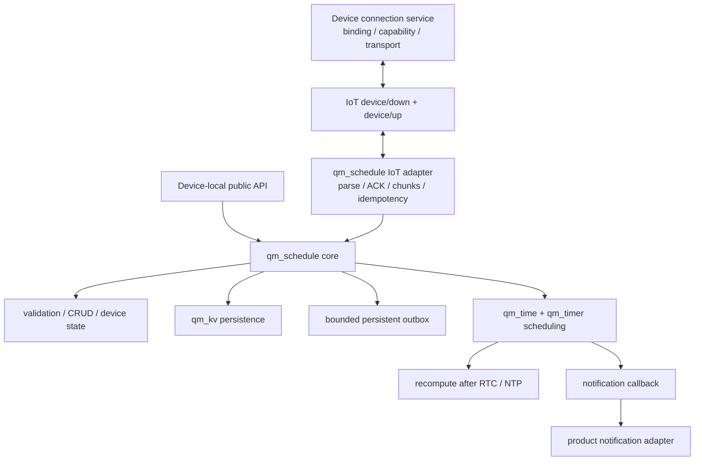
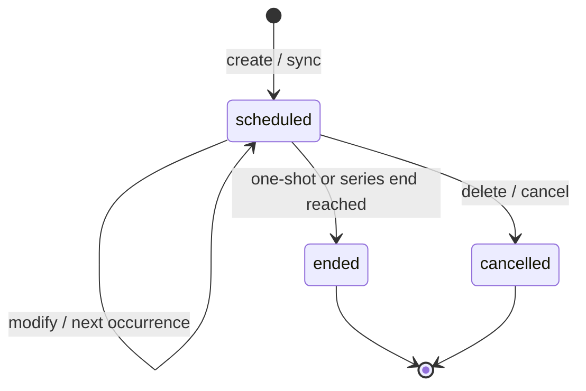
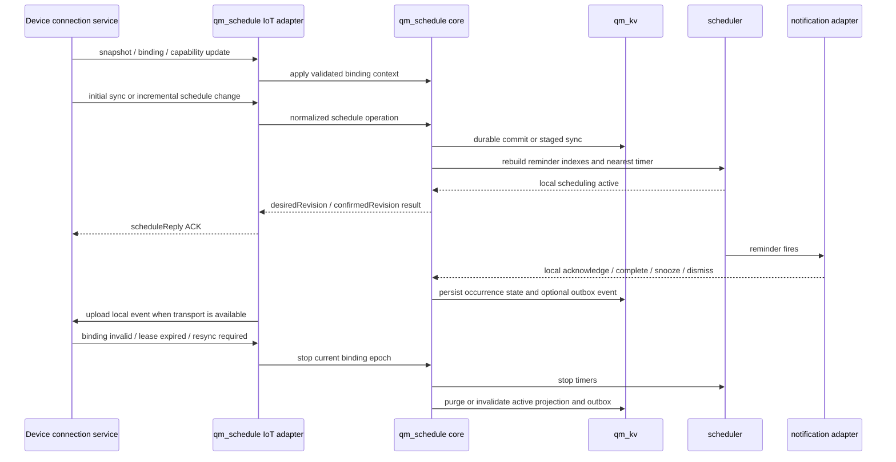
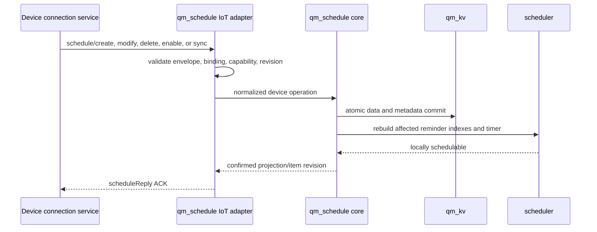
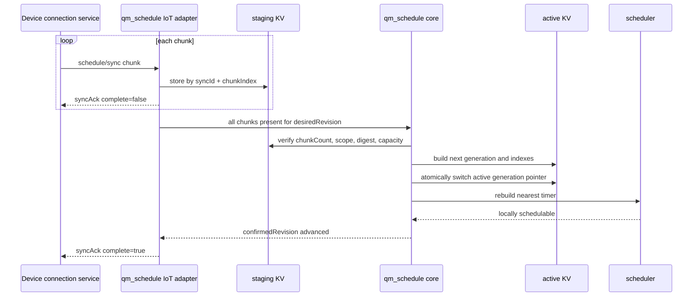
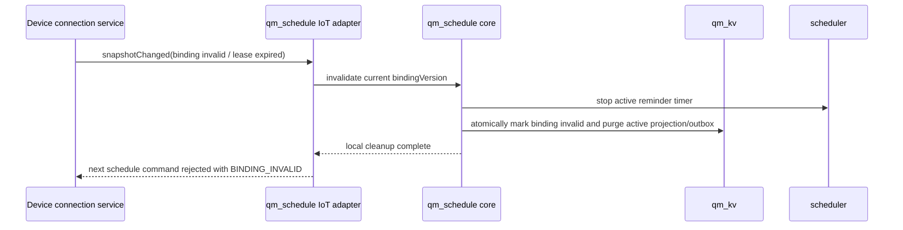

# qm_schedule

For the Chinese version, see [README_CN.md](README_CN.md).

Product PRD (Chinese): [PRD_CN.md](PRD_CN.md).

> Status: `V0.1` device contract implemented. The public headers, source, Kconfig,
> build wiring, example, canonical `schedule`/`scheduleReply` envelope, JCS sync
> digest, atomic group/full-projection staging, binding/revision checks, and ACK-
> driven durable outbox are the implementation baseline. This build explicitly
> reports fixed-offset timezone support and no IANA/DST or paged KV support;
> callers must reject those capabilities instead of silently changing semantics.
> Production sign-off still requires verification evidence, but no protocol field
> remains a “to be decided” item.

## Overview

`qm_schedule` is a generic device-side schedule and reminder component. It
receives canonical schedule objects through the device
connection protocol and owns device persistence, next-trigger selection,
offline scheduling, restart recovery, notification events, and durable
reporting of device-local actions.

The component stores a durable device replica and triggers it locally; it must
not rely only on a just-in-time remote notification. Every downlink is subject
to final device capability, binding, revision, and capacity validation before
it becomes locally schedulable.

## Goals

- Use one canonical device model for different schedule types.
- Support create, modify, delete, enable, and grouped full synchronization.
- Use `id + revision` for idempotency and out-of-order protection.
- Continue triggering while offline and after restart.
- Support multiple advance reminders for one schedule.
- Stage, validate, and atomically replace large batch imports.
- Keep the core responsible for when to trigger and delegate presentation or
  hardware actions through a notification callback.
- Use QUMI abstractions for OS, time, storage, and synchronization.

## P0 Scope

The first implementation baseline covers device behavior and the device
interaction protocol:

- one-shot schedules plus daily and weekly recurrence with inclusive start and
  end dates;
- an explicit schedule timezone, UTC instants for one-shot events, and local
  wall-clock evaluation for recurrence using UTC/GMT or fixed numeric offsets;
- IANA/DST zones are rejected with `INVALID_TIMEZONE` until a timezone database
  capability is added; the device never silently treats an unknown zone as UTC;
- up to three advance reminders, confirmation, occurrence completion, snooze,
  and closing a reminder as distinct actions;
- a 30-minute missed-reminder window, one catch-up occurrence at most for a
  recurring series, and a 15-minute recovery window after snooze;
- offline and restart-safe device triggering while the authenticated binding
  lease is valid, bounded persistent event outbox, and eventual reporting of
  device-local actions;
- final device capability and capacity checks before committing a downlink.

Monthly, yearly, fixed-interval, complex exception, multi-device, and local
device creation are outside the P0 baseline unless the PRD is explicitly
revised.

## Non-Goals

`qm_schedule` does not define product entry flows, intent parsing, business
confirmation, upstream CRUD/query contracts, account authorization, or
multi-device aggregation. It also does not create the generic IoT session or
directly control audio, display, LED, vibration, buzzer, or other hardware.

## Architecture



## Responsibility Boundaries

### Device Connection Service Boundary

The connection service is the protocol peer of the device adapter. It supplies
authenticated binding context, capability and online snapshots, transports
downlinks and uplinks, retries delivery, and records the latest confirmed
device projection. Its upstream business APIs and source-record semantics are
outside this README.

### Core

The core owns:

- the public schedule model and field validation
- local CRUD, queries, enable state, and status changes
- KV persistence, format migration, and startup recovery
- occurrence/reminder materialization, next-trigger selection, and timer
  rebuilding
- recomputation after time correction, timezone configuration changes, binding
  changes, or restart
- final device capability/capacity validation before a schedule becomes active
- persistent series, occurrence, reminder, and local-report state, plus the
  durable device confirmation consumed by the connection service
- triggered, acknowledged, completed, snoozed, closed, and changed events

### IoT Adapter

The optional IoT adapter owns:

- registration of the `schedule` downlink method
- JSON parsing, schema validation, and conversion into core operations
- message `id`, item revision, duplicate, and out-of-order handling
- staging of batch chunks and commit after complete validation
- ACK and detailed error replies through `scheduleReply`
- persistent outbox, retry, and event deduplication for device-originated
  reports
- connection restoration observation without creating the `qm_iot` session

### Notification Callback Boundary

Product code maps core notification events to device presentation or hardware
actions. Action failures must neither delete a schedule nor block the
scheduler.

The adapter must honor device privacy policy. It may present a generic prompt
when identity is not confirmed and must not log or expose sensitive title,
location, or description fields by default.

## QUMI Dependencies

Direct dependencies:

- `QM_TIME_SUPPORT` for UTC wall time and time corrected by RTC/NTP
- the QUMI time abstraction plus the component's fixed-offset timezone parser;
  generic core must not depend directly on libc, a vendor SDK, or an implicit
  full IANA database
- `QM_KV_SUPPORT` for metadata, items, sync staging, and stored versions
- `QM_OS_MUTEX_SUPPORT` for instance and storage-state protection
- `QM_OS_TIMER_SUPPORT` for the nearest runtime reminder
- `QM_WORK_SUPPORT` for trigger and recompute work outside timer callbacks
- `qm_utils_timer` for monotonic staging timeouts, not calendar arithmetic
- `cJSON` for protocol objects and `extensions` object validation

Optional dependencies:

- `qm_cloud/qm_iot` only when the IoT adapter is enabled
- `backoff` for bounded retry of unacknowledged device events in the IoT
  adapter; reconnect remains owned by the connection/session layer

Explicit non-dependencies:

- `qm_agent`
- `qm_player`, `qm_audio`, and concrete hardware drivers

## Common Data Model

The device wire JSON and device C structure carry the same semantics.
JSON field names are frozen as lowerCamelCase for `V0.1`:

| Field | Type | Required | Meaning |
| --- | --- | --- | --- |
| `id` | string | yes | Stable logical schedule ID; never reused as a transport message ID |
| `revision` | uint32 | yes | Item revision; only newer revisions may update it |
| `type` | string | yes | P0 enum: `event`, `meeting`, `task`, `birthday`, `medication`, `maintenance`, or `other` |
| `source` | string | yes | Opaque origin tag carried by the sender; the device stores it but does not route on it |
| `groupId` | string | no | Batch import or calendar group |
| `title` | string | yes | User-visible title |
| `description` | string | no | Short description |
| `location` | string | no | Location |
| `priority` | string | no | `low`, `normal`, `high`, or `critical`; defaults to `normal` |
| `category` | string | no | P0 enum: `general`, `work`, `health`, `education`, `home`, or `other`; used for filtering, neutral prompts, and metrics |
| `sensitivity` | string | no | `normal` or `sensitive`; the device never infers it from body text |
| `startAt` | int64 | yes | UTC timestamp in seconds |
| `endAt` | int64 | no | UTC timestamp not earlier than `startAt` |
| `timezone` | string | yes | Explicit schedule timezone; unsupported zones are rejected |
| `allDay` | bool | no | Reserved for later work; P0 omits it or requires `false` |
| `recurrence` | object/null | no | `null` for one-shot, or the P0 daily/weekly wall-clock rule |
| `reminders` | array | no | Advance reminder definitions |
| `enabled` | bool | yes | Whether the schedule participates in scheduling |
| `status` | string | no | Series lifecycle state; defaults to `scheduled` on create |
| `missedPolicy` | string | no | Reserved for compatibility; P0 omits it or uses `windowed` and always applies the fixed 30-minute policy |
| `projectionKey` | string | no | Internal stable key used only for device projection sync |
| `extensions` | object | no | Namespaced business extensions; defaults to `{}` |

The sender must normalize unsupported labels to declared enum values before
downlink. The device rejects unknown enums and never derives them from title or
description text.

The following identifiers and versions are device-protocol fields. They are not
interchangeable. Their wire spelling and semantics are frozen for `V0.1`:

| Field | Type | Required | Scope and meaning |
| --- | --- | --- | --- |
| `id` | string | yes on a schedule | Stable logical schedule ID. It survives device re-binding and is never a transport message ID |
| `revision` | uint32 | yes on a schedule | Monotonic revision of the schedule content; stale revisions are rejected |
| `operationId` | string | required for every device command/action | Stable idempotency/correlation key for one logical operation; retries reuse it |
| `bindingVersion` | string | required for a device target/event | Opaque connection-service version for the current user-device binding. A stale value returns `BINDING_INVALID` |
| `eventId` | string | required for a device-originated event | Durable ID of one local event in the outbox. It is distinct from `id` and `operationId` and is reused on retry |
| `desiredRevision` | uint32 or null | in device-state/snapshot | Monotonic generation of the complete desired device projection for the current binding; it is not any item's `schedule.revision` |
| `confirmedRevision` | uint32 or null | in device-state/snapshot | Latest complete projection generation durably stored and locally schedulable on the device; `null` before the first confirmation |
| `effectiveOccurrence` | object | required for occurrence scope | Stable target containing `occurrenceAt`, optional `occurrenceId`, and timezone context |

`id` correlates only a transport envelope and is echoed by `scheduleReply`.
`operationId` correlates one logical device mutation across the connection service
and transport retries. `eventId` correlates one device-originated outbox record. A
schedule's `id` plus `revision` protects the item itself. A receiver must not
deduplicate one identity type using another. `desiredRevision` selects an atomic
device-projection generation and `confirmedRevision` observes its durable
application; neither advances or replaces an item revision. The
connection service increments the device-projection generation whenever the
desired set changes; individual items continue to use `schedule.revision`, and
groups continue to use `groupRevision`.

For P0, `category` and `sensitivity` are optional device-wire fields. Missing
`sensitivity` is not permission to expose content: the notification adapter uses
neutral presentation until an explicit value is available. The device wire
accepts only canonical `endAt`; any duration-form input must be normalized before
downlink.

When a recurrence scope is projected into device segments, the adapter may use
an internal `projectionKey` in KV and persist its mapping to the logical `id`.
Device public queries aggregate those segments by logical ID; protocol replies
must never expose a segment key as the external target.

Example:

```json
{
  "id": "meeting-001",
  "revision": 3,
  "type": "meeting",
  "source": "remote",
  "title": "Project review",
  "description": "Quarterly plan review",
  "location": "Room A301",
  "priority": "normal",
  "category": "work",
  "sensitivity": "normal",
  "startAt": 1785826800,
  "endAt": 1785830400,
  "timezone": "GMT+08:00",
  "allDay": false,
  "recurrence": {
    "frequency": "weekly",
    "byWeekday": ["TU", "TH"],
    "startDate": "2026-08-01",
    "endDate": "2026-12-31"
  },
  "reminders": [
    {
      "id": "primary",
      "offsetMin": 10,
      "action": "notify",
      "channels": ["audio", "display"],
      "requiresAck": false,
      "snooze": {
        "enabled": true,
        "intervalMin": 5,
        "maxCount": 3
      }
    }
  ],
  "enabled": true,
  "status": "scheduled",
  "missedPolicy": "windowed",
  "extensions": {}
}
```

### Time And Recurrence

- `startAt` and `endAt` use 64-bit UTC timestamps in seconds.
- A one-shot schedule stores an absolute instant. Changing the user's or
  device's display timezone changes only presentation, never that instant.
- A daily or weekly schedule stores local wall-clock time, its explicit
  `timezone`, and inclusive series start/end dates. Existing series do not
  automatically follow a later device or user timezone change.

The P0 `recurrence` object is:

| Field | Required | P0 rule |
| --- | --- | --- |
| `frequency` | yes | `daily` or `weekly` |
| `byWeekday` | weekly only | Non-empty unique array from `MO` through `SU`; omitted for daily |
| `startDate` | yes | Inclusive `YYYY-MM-DD` interpreted in the schedule timezone |
| `endDate` | no | Inclusive `YYYY-MM-DD` not earlier than `startDate` |
| `interval` | no | Omitted or fixed at `1` in P0; other intervals are later work |

For recurrence, `startAt` is the first valid occurrence instant inside the
`startDate` boundary. Its local wall-clock value in `timezone` is fixed for
later occurrences. The device validates `startAt`, `frequency`, `byWeekday`,
and the date boundaries together; it must not generate future instances by
repeatedly adding UTC seconds instead of evaluating local calendar time.
When `endAt` exists, `endAt - startAt` is the duration reused for each
occurrence; without it, the occurrence is instantaneous. Fixed-offset V0.1
devices do not apply DST transitions; a zone requiring DST is rejected.

- The sender resolves the schedule timezone before downlink. This V0.1 device
  accepts only UTC/GMT or fixed numeric offsets and returns `INVALID_TIMEZONE`
  for IANA/DST zones; it never silently changes the requested semantics.
- P0 missed handling uses a 30-minute window. Trigger one catch-up reminder
  when the planned time is no more than 30 minutes late and the event has not
  ended. A recurring series catches up at most its most recent eligible
  occurrence; it never replays a backlog of old occurrences.
- A device with invalid time pauses local reminders. After restart, time
  correction, or a forward jump, the same missed-window rules apply; a
  backward jump must not fire the same occurrence twice.
- Later work may add monthly, yearly, fixed-interval, bounded-range, and
  exception-date rules, but those are not P0 device requirements.
- Any field that affects device scheduling belongs in the common model, not in
  `extensions`.

### Reminders

- `id` must be unique and stable within one schedule so a reminder occurrence
  can be addressed precisely.
- `offsetMin=0` means trigger at `startAt`.
- A positive value means that many minutes before `startAt`.
- One schedule may contain at most three reminders in P0; duplicate trigger
  times are deduplicated without losing the individual reminder IDs.
- P0 requires only `action=notify`.
- `channels` is a device-hardware hint for the notification adapter; the core
  does not control hardware or interpret it as a remote routing decision.
- `requiresAck=true` means the reminder occurrence requires user confirmation.
  The acknowledgement changes `reminderState` to `acknowledged`; it leaves the
  occurrence uncompleted and does not change the source schedule lifecycle.
- Confirmation, occurrence completion, snooze, and closing a reminder are
  distinct actions. Closing does not mark the underlying occurrence complete.
- P0 offers 5, 10, and 30 minute snooze options, with at most three snoozes per
  reminder. A snooze trigger has an additional 15-minute recovery window.
- `snooze` defines whether snooze is allowed, its default interval, and its
  maximum count. A missing object disables snooze.

### Extensions

`extensions` must be a JSON object. Its first-level keys are business
namespaces, and every namespace owns a `schemaVersion`. After capacity
validation, the core copies, persists, and forwards the object without
interpreting unknown fields.

Rules:

- missing or `NULL` input is treated as `{}`
- unknown fields must be retained
- `modify` and `sync` replace the complete object instead of deep-merging it
- secrets, tokens, certificates, and other credentials are forbidden
- serialized size is bounded by the IoT envelope limit `CONFIG_QM_SCHEDULE_IOT_MAX_PAYLOAD_LEN`

The current device model retains every field in the common schedule object. The
fixed-size persistence record limits one value to 512 bytes for `description`,
128 bytes for `location`, 1,023 bytes for the compact `extensions` object, and
127 bytes for each reminder `channels` array. Values exceeding those limits are
rejected before persistence; they are never silently dropped. The recurrence
`startDate`, `endDate`, and `interval`, reminder `action`/`channels`, and all
series metadata are copied into the KV record and returned by `get`/`list`.

## Schedule State

`status` on the schedule record describes the series only. Runtime state must
not collapse a series, an occurrence, a reminder, and device delivery into one
field.

Series state transitions:



The six state dimensions are:

| Dimension | P0 states and meaning |
| --- | --- |
| Series | `scheduled`, `ended`, `cancelled`; controls whether future occurrences may be generated |
| Occurrence | `pending`, `completed`, `ended`, `missed`, `cancelled`; completion applies only to this instance |
| Reminder | `pending`, `active`, `acknowledged`, `snoozed`, `closed`, `unhandled`, `cancelled` |
| Device sync | `not_required`, `pending`, `syncing`, `synced`, `failed` (P1 may add `partial`) |
| Device online | `online`, `offline`, `unknown`; online changes never erase a prior `synced` result |
| Local report | `none`, `pending`, `failed`; describes whether device-local actions reached the protocol peer |

The core persists series, occurrence, reminder, and local-report state and emits
the durable device confirmation. The device connection service owns aggregate
sync and online observations. These dimensions must not be collapsed into one
success/failure flag.

`enabled` is a scheduling switch orthogonal to series state. An item with
`enabled=false` may remain `status=scheduled`, but it produces no active reminders
and does not participate in nearest-trigger selection.

When a user marks an occurrence complete, the occurrence becomes `completed`
and the active reminder becomes `closed` with `closeReason=occurrence_completed`.
Any other not-yet-triggered reminders for that occurrence become `cancelled`.
When a user only closes one reminder, it becomes `closed` with
`closeReason=user_closed`; the occurrence remains pending or ended and other
reminders remain scheduled. A recurring series remains `scheduled` after either
action and computes its next occurrence.

The device-sync and device-online dimensions are intentionally independent. For
example, an already synchronized schedule may be represented as
`sync=synced, online=offline`; a newer remote revision while offline is
`sync=pending, online=offline`.

Snooze is temporary state for the active reminder occurrence and does not
change the original `startAt` or recurrence rule. Component-owned fields and
timestamps must survive restart when they affect deduplication or connection-service
reporting; online and aggregate sync states are refreshed by the connection
service.

## Detailed IoT Protocol Design

> Status: `V0.1` frozen. The fields and behavior are implemented by the device
> adapter and are versioned by `schemaVersion=1`; later changes require an
> explicit compatibility review and a new schema version.

The protocol follows the current `qm_iot` JSON envelope. The top-level message
identifier is `id`, not `msgId`. Both the connection service and device send commands or events
with `method=schedule`; the receiver responds with `method=scheduleReply`.

### Protocol Directions

| Direction | method | subMethod |
| --- | --- | --- |
| Service-to-device commands | `schedule` | `create`, `modify`, `delete`, `enable`, `sync`, `acknowledge`, `complete`, `snooze`, `dismiss` |
| Device-to-service events | `schedule` | `triggered`, `acknowledged`, `completed`, `snoozed`, `dismissed`, `syncRequest` |
| Receiver reply | `scheduleReply` | Original subMethod plus `Ack`, such as `createAck` or `triggeredAck` |

P0 does not define remote `get/list` commands. The connection service supplies
truth, while device queries use the local public API. If device data is lost or
a revision conflict is detected, the device sends `syncRequest`.

### Common Request Envelope

```json
{
  "method": "schedule",
  "subMethod": "create",
  "id": 1001,
  "params": {
    "schemaVersion": 1,
    "operationId": "op-2026-0001",
    "bindingVersion": "bind-42",
    "desiredRevision": 12
  }
}
```

Common field rules:

| Field | Type | Rule |
| --- | --- | --- |
| `method` | string | Must be case-sensitive `schedule` |
| `subMethod` | string | Must be a declared operation or event and is case-sensitive |
| `id` | uint32 | Non-zero message ID echoed by the reply; only correlates messages |
| `params` | object | Required; its members depend on subMethod |
| `params.schemaVersion` | uint32 | Must be `1` for the first version |

### Device Protocol Metadata

The following metadata is carried in `params` for schedule commands, replies,
and device events. Requiredness is defined per subMethod in the summary below;
`R` means required, `O` optional, and `C` conditionally required. These names
are frozen for `V0.1`; implementation and release testing must preserve them.

| Field | Type | Requiredness | Contract |
| --- | --- | --- | --- |
| `operationId` | string | `R` for every device mutation/action; `O` for `triggered` | Stable device-operation key across retries and all ACKs; same logical action must reuse it |
| `bindingVersion` | string | `C` for a device target or device event | Current connection-service binding version; stale or missing values return `BINDING_INVALID` |
| `eventId` | string | `R` for device-originated events | Durable outbox record ID; reused unchanged on retry and deduplicated by device identity plus binding version |
| `contentDigest` | string | `R` for each `sync` chunk; otherwise `O` | `sha256:` digest of the canonicalized sync semantic payload; excludes transport `id`, `operationId`, and binding credentials |
| `scheduleId` | string | `R` for item/occurrence commands and events | Logical schedule ID, never a projection segment ID |
| `revision` | uint32 | `R` for item commands/events when known | Schedule content revision; it does not advance because a transport message is retried |
| `desiredRevision` | uint32 or null | `R` in projection-mutation commands/ACKs and snapshots; otherwise `O` | Latest complete device-projection generation expected by the connection service for this binding; distinct from item/group revisions |
| `confirmedRevision` | uint32 or null | `R` in projection-mutation ACKs and snapshots; otherwise `O` | Latest complete device-projection generation durably stored and locally schedulable by the device |

`id` is the transport correlation value and is echoed by `scheduleReply`; it
may change when a sender republishes a message. `operationId` is the business
idempotency value and must not change for that retry. `eventId` identifies one
device-originated outbox record and is independent of both. `scheduleId` and
`revision` protect the logical item. `desiredRevision` orders projection
transactions and `confirmedRevision` reports their durable application; neither
is schedule content or permission to overwrite an item revision. Every authenticated device command carries the current `bindingVersion`.

The connection service assigns one new `desiredRevision` to each atomic device
projection transaction. A single `create`, `modify`, `delete`, or `enable` is
one transaction; every chunk of one `sync` transaction carries the same value.
The device accepts the next generation, treats an identical already-confirmed
generation as an idempotent replay, and rejects a gap with
`REVISION_CONFLICT` plus `syncRequest(reason=revisionConflict)`. It advances
`confirmedRevision` only after durable commit, reminder-index rebuild, and timer
rebuild succeed; a chunk ACK before final sync commit cannot advance it. User
actions and reminder events do not advance the projection generation. A new
`bindingVersion` starts a new generation sequence. The exception is an
authorized `syncScope=fullProjection`: after bind/bootstrap or `syncRequest`, it
atomically replaces the entire binding projection and may advance from null or
an older generation directly to the supplied current `desiredRevision`.

Unknown envelope fields may be ignored. An unknown `schemaVersion` returns
`UNSUPPORTED_SCHEMA`; the receiver must not guess how to parse it.

For readability, later command examples may omit `operationId`,
`bindingVersion`, `desiredRevision`, or `eventId` already defined by the common
envelope. Actual P0 messages must still include every field required by their
subMethod.

### Field Layering And Redundancy Rules

To keep the wire contract stable, fields are split into five layers and each
layer has one canonical placement:

| Layer | Canonical fields | Rule |
| --- | --- | --- |
| Transport correlation | top-level `method`, `subMethod`, `id` | Used only to route one message and its ACK; never used as a durable business key |
| Binding and schema context | `params.schemaVersion`, `params.bindingVersion` | Declares how to parse the payload and which authenticated binding owns it |
| Operation or event identity | `params.operationId`, `params.eventId`, `params.syncId` | Used for idempotency and retry; one logical mutation or event keeps the same value across republishes |
| Schedule domain identity | `schedule.id`, `schedule.revision`, flat `scheduleId`, `revision`, `occurrenceAt`, `reminderId` | Identifies one schedule item or one reminder occurrence being changed |
| Projection and sync state | `desiredRevision`, `confirmedRevision`, `groupRevision`, `chunkIndex`, `chunkCount`, `contentDigest` | Orders multi-item projection updates and proves one staged payload is complete |

The following pairs look similar but are intentionally not redundant:

- `id` correlates one transport request and reply; `operationId` deduplicates one service-issued mutation; `eventId` deduplicates one device-originated outbox record.
- `revision` is one schedule item's content version; `desiredRevision` and `confirmedRevision` are whole-device projection generations.
- `schedule.id` appears inside the embedded object for full create/modify payloads; flat `scheduleId` is used when only a target reference is required.
- `occurrenceAt` is the canonical occurrence identity; an optional implementation-only `occurrenceId` may exist locally but is not required on the P0 wire.
- `syncId` groups one staged transfer; `contentDigest` proves one chunk's semantic payload; neither replaces `desiredRevision`.

The following duplication is not allowed in P0:

- `deviceId` must not appear inside `schedule` commands or events. The receiver derives device identity from the authenticated connection context. Only the connection-service snapshot resource carries `deviceId`.
- `capabilityVersion`, `snapshotRevision`, `online.state`, and `availableCapacity` must not be copied into per-schedule commands. They belong to the snapshot resource, not to the schedule mutation envelope.
- ACK payloads must not echo a full `schedule` object unless the subMethod explicitly returns one. Normal command ACKs return correlation, target identity, revision, projection state, and error/result flags only.
- `schemaVersion` appears once in `params`. Nested `schedule` objects must not repeat it.
- `timezone` belongs to the canonical schedule object. Action events may omit it because the occurrence is already identified by `scheduleId + occurrenceAt + reminderId`.

If a payload can be expressed either as a full object or as a flat target plus
state delta, P0 uses exactly one form per subMethod and rejects mixed forms as
`INVALID_REQUEST`. This keeps validation deterministic and avoids multiple
sources of truth for the same field.

### Common Reply Envelope

```json
{
  "method": "scheduleReply",
  "subMethod": "createAck",
  "id": 1001,
  "code": 0,
  "params": {
    "schemaVersion": 1,
    "operationId": "op-2026-0001",
    "bindingVersion": "bind-42",
    "scheduleId": "schedule-001",
    "revision": 1,
    "desiredRevision": 12,
    "confirmedRevision": 12,
    "syncState": "synced",
    "applied": true,
    "idempotent": false
  }
}
```

Reply rules:

- `id` matches the request.
- Success uses `code=0`; failure uses `code=1` with details in `params.error`.
- Every command ACK echoes `operationId` and `bindingVersion`; every device-event
  ACK echoes `eventId` and `bindingVersion`, including failure and idempotent
  replies. Item-specific ACKs also echo their logical target and revision when
  those values were valid enough to parse.
- A device-sync ACK reports `desiredRevision`, `confirmedRevision`, and
  `syncState`; receipt or publish success alone is never represented as
  `synced`.
- A mutating operation succeeds only after validation, durable storage, and
  scheduler rebuild all succeed. The sole exception is `syncAck` with
  `complete=false`: `code=0` means one validated chunk is durably staged,
  `syncState=syncing`, and `confirmedRevision` is unchanged. Only the final
  `complete=true` ACK proves atomic commit and scheduler rebuild; for a
  successful projection mutation it also requires
  `confirmedRevision == desiredRevision` and `syncState=synced`.
- The adapter passes the original `schedule` method to `qm_iot_down_reply()`;
  the lower layer appends `Reply`. The adapter explicitly supplies the ACK
  subMethod.

Failure example:

```json
{
  "method": "scheduleReply",
  "subMethod": "modifyAck",
  "id": 1003,
  "code": 1,
  "params": {
    "schemaVersion": 1,
    "operationId": "op-2026-modify-0001",
    "bindingVersion": "bind-42",
    "scheduleId": "schedule-001",
    "revision": 3,
    "desiredRevision": 12,
    "confirmedRevision": 11,
    "syncState": "failed",
    "error": {
      "name": "REVISION_CONFLICT",
      "message": "incoming revision is not newer",
      "retryable": false
    }
  }
}
```

Error names:

| error.name | Meaning | retryable |
| --- | --- | --- |
| `INVALID_REQUEST` | Invalid JSON, required field, type, or value | false |
| `UNSUPPORTED_SCHEMA` | Unsupported `schemaVersion` | false |
| `NOT_FOUND` | Schedule or reminder occurrence does not exist | false |
| `ALREADY_EXISTS` | Create ID exists with different content | false |
| `REVISION_CONFLICT` | Stale revision or different content at the same revision | false |
| `CAPACITY_EXCEEDED` | Item, reminder, chunk, or extension limit exceeded | false |
| `SYNC_CONFLICT` | Inconsistent metadata or chunk content in one sync/group | false |
| `SYNC_INCOMPLETE` | Required chunks have not all arrived | true |
| `STORAGE_ERROR` | KV read, write, or atomic switch failed | true |
| `SCHEDULER_ERROR` | Reminder index or timer rebuild failed | true |
| `BUSY` | Another mutually exclusive batch is committing | true |
| `UNSUPPORTED_OPERATION` | Unsupported subMethod or action | false |
| `OCCURRENCE_NOT_ACTIVE` | Target reminder occurrence cannot currently be acted on | false |
| `SNOOZE_NOT_ALLOWED` | Snooze is disabled or its limit was reached | false |
| `CAPABILITY_UNSUPPORTED` | Device cannot preserve a requested P0 rule or action | false |
| `BINDING_INVALID` | Device is unbound, belongs to another user, or binding changed | false |
| `OUTBOX_FULL` | A device-local report cannot be queued without dropping an action | true |
| `INVALID_TIMEZONE` | Missing or unsupported schedule timezone/DST semantics | false |

`message` is diagnostic only and must not drive connection service branches or contain
credentials, full paths, or user-private content.

### Idempotency, Revisions, And Delete Tombstones

- Top-level `id` correlates one message; logical-item idempotency uses
  `schedule.id + schedule.revision`, while a device segment uses its persisted
  `projectionKey + revision`. The two identities must not be mixed.
- Resending the same `schedule.id`, revision, and normalized content succeeds with
  `idempotent=true`.
- The same revision with different content, or a lower revision, returns
  `REVISION_CONFLICT`.
- `modify`, `enable`, and `delete` revisions must exceed the stored revision.
- Deletion retains a lightweight revision tombstone so stale create/modify
  messages cannot resurrect the item.
- Tombstone retention must exceed the connection service's maximum offline retry window; its
  cleanup policy is selected by Kconfig or product configuration.

### `create`

Purpose: create one complete schedule that does not already exist.

Request `params`:

| Field | Required | Meaning |
| --- | --- | --- |
| `schemaVersion` | yes | Fixed at `1` |
| `schedule` | yes | Complete common schedule object |

```json
{
  "method": "schedule",
  "subMethod": "create",
  "id": 1001,
  "params": {
    "schemaVersion": 1,
    "operationId": "op-2026-0001",
    "bindingVersion": "bind-42",
    "schedule": {
      "id": "schedule-001",
      "revision": 1,
      "type": "event",
      "source": "remote",
      "title": "Project meeting",
      "priority": "normal",
      "category": "work",
      "sensitivity": "normal",
      "startAt": 1784358000,
      "endAt": 1784361600,
      "timezone": "GMT+08:00",
      "recurrence": null,
      "reminders": [
        {
          "id": "primary",
          "offsetMin": 10,
          "action": "notify",
          "requiresAck": false
        }
      ],
      "enabled": true,
      "extensions": {}
    }
  }
}
```

Behavior:

- Create when the ID and its tombstone do not exist. A tombstoned ID can be
  legitimately recreated only with a newer revision.
- The same revision and normalized content is an idempotent replay.
- An active ID with a higher revision on `create` returns `ALREADY_EXISTS` and
  the caller must use `modify`; the same revision with different content, or a
  lower revision, returns `REVISION_CONFLICT`.
- `createAck.params` returns `scheduleId`, `revision`, `applied`, and
  `idempotent`.
- In P0, a sync-managed item with `groupId` cannot be created
  individually; the connection service updates the whole group.

### `modify`

Purpose: fully replace one existing schedule; this is not a field patch.

Request `params` matches `create` and contains `schemaVersion` plus a complete
`schedule`.

Behavior:

- A missing schedule returns `NOT_FOUND`.
- The incoming revision must be newer; the same revision and content is only an
  idempotent replay.
- Validated content atomically replaces the old record and reminder index.
- `modifyAck.params` matches `createAck.params`.
- In P0, sync-managed group items reject individual modify operations so
  they cannot bypass `groupRevision`.

### `delete`

Purpose: delete a schedule and write its revision tombstone.

```json
{
  "method": "schedule",
  "subMethod": "delete",
  "id": 1004,
  "params": {
    "schemaVersion": 1,
    "operationId": "op-2026-delete-0001",
    "bindingVersion": "bind-42",
    "scheduleId": "schedule-001",
    "revision": 4
  }
}
```

Behavior:

- The revision must exceed the current item or tombstone revision.
- Remove the item, extension, and reminder indexes, write the tombstone, and
  rebuild the nearest timer.
- Repeating the same tombstone revision is idempotent.
- If neither an item nor tombstone exists, write a new tombstone and succeed
  with `deleted=false`.
- `deleteAck.params` returns `scheduleId`, `revision`, `deleted`, and
  `idempotent`.

### `enable`

Purpose: update only the scheduling switch without sending the full item.

```json
{
  "method": "schedule",
  "subMethod": "enable",
  "id": 1005,
  "params": {
    "schemaVersion": 1,
    "operationId": "op-2026-enable-0001",
    "bindingVersion": "bind-42",
    "scheduleId": "schedule-001",
    "revision": 5,
    "enabled": false
  }
}
```

Behavior:

- The schedule must exist and the revision must be newer.
- `enabled=false` removes runtime reminder indexes while retaining item content
  and lifecycle state.
- `enableAck.params` returns `scheduleId`, `revision`, `enabled`, and
  `idempotent`.
- In P0, a sync-managed group's enable states are changed by a new group
  sync.

### `sync`

Purpose: synchronize one group or the complete binding projection in chunks.
This is the common protocol for large imports, recurrence projections, and
authoritative recovery after a revision gap or storage reset.

Request fields:

| Field | Required | Rule |
| --- | --- | --- |
| `schemaVersion` | yes | Fixed at `1` |
| `desiredRevision` | yes | Binding-level projection generation assigned to this atomic sync transaction |
| `syncId` | yes | Stable batch ID retained across retries |
| `syncScope` | yes | `group` or `fullProjection` |
| `groupId` | group only | Scope of the atomic group replacement or merge; omitted for `fullProjection` |
| `groupRevision` | group only | Must exceed committed group state; omitted for `fullProjection` |
| `groups` | fullProjection only | Array of `{groupId, groupRevision}` for every grouped item; use `[]` when all items are ungrouped |
| `replace` | yes | For group, true replaces and false merges; `fullProjection` requires true |
| `chunkIndex` | yes | Zero-based and less than `chunkCount` |
| `chunkCount` | yes | Fixed for the batch and at least 1 |
| `totalItems` | yes | Number of schedules across all chunks; zero is valid |
| `schedules` | yes | Common schedule object array for this chunk |
| `contentDigest` | yes | SHA-256 digest of the canonical sync semantic payload; retries must reuse it |

Every `schedules` element is identical to the `schedule` object used by
`create/modify`. In `syncScope=group`, an item may omit `groupId` and inherit the
outer value; if both are present they must match. In `fullProjection`, each item
carries its own optional `groupId`, the `groups` array declares the revision of
every grouped value, and the transaction includes grouped and ungrouped items.
For `fullProjection`, `groups` is identical in every chunk, sorted by
`groupId`, and contains no duplicates. Every schedule with a `groupId` must
reference exactly one entry; ungrouped schedules omit `groupId`. Any mismatch
rejects the entire full-projection transaction.
For a recurrence-scope projection, one logical `id` may have multiple stable
`projectionKey` segments. The keys remain stable across retries and revisions,
while the selected sync scope still commits as one generation.

For P0, canonicalize the sync semantic object with RFC 8785 JSON
Canonicalization Scheme (JCS), then encode its SHA-256 result as lowercase
`sha256:<hex>`. The object contains `desiredRevision`, `syncId`, `syncScope`,
the applicable group metadata (`groupId`/`groupRevision` or `groups`),
`replace`, `chunkIndex`, `chunkCount`, `totalItems`, and `schedules`;
`contentDigest` itself is excluded. JCS fixes UTF-8 string escaping, IEEE-754
number rendering, sorted object keys, and preserved array order. The parser
rejects duplicate keys, non-finite numbers, and invalid UTF-8 before
canonicalization. The connection service orders each `schedules` array by `projectionKey`
then logical `id` before hashing. A receiver recomputes the digest before
staging; the same `syncId + chunkIndex` with a different digest is
`SYNC_CONFLICT`.

Normative JCS test vectors (the text below is the exact UTF-8 canonical byte
sequence, without a trailing newline):

| Vector | Canonical bytes | SHA-256 |
| --- | --- | --- |
| Group clear | `{"chunkCount":1,"chunkIndex":0,"desiredRevision":12,"groupId":"g-1","groupRevision":3,"replace":true,"schedules":[],"syncId":"sync-1","syncScope":"group","totalItems":0}` | `sha256:93791e3461198afb95c310710e60f2d98aba20f6b7374188aa70f93ef7669898` |
| Full projection with Unicode/escaped text | `{"chunkCount":1,"chunkIndex":0,"desiredRevision":21,"groups":[],"replace":true,"schedules":[{"enabled":true,"extensions":{"demo":{"label":"服药 \"A\" \\ 晚","schemaVersion":1}},"id":"med-1","recurrence":null,"reminders":[],"revision":2,"source":"remote","startAt":1785826800,"timezone":"GMT+08:00","title":"晚间服药","type":"medication"}],"syncId":"sync-2","syncScope":"fullProjection","totalItems":1}` | `sha256:2efb17662673437da107b1874c8754da001fffd697258b0c83b6f64660c7ae99` |

```json
{
  "method": "schedule",
  "subMethod": "sync",
  "id": 1010,
  "params": {
    "schemaVersion": 1,
    "operationId": "op-2026-sync-0001",
    "bindingVersion": "bind-42",
    "desiredRevision": 12,
    "syncId": "sync-1",
    "syncScope": "group",
    "groupId": "g-1",
    "groupRevision": 3,
    "replace": true,
    "chunkIndex": 0,
    "chunkCount": 1,
    "totalItems": 0,
    "contentDigest": "sha256:93791e3461198afb95c310710e60f2d98aba20f6b7374188aa70f93ef7669898",
    "schedules": []
  }
}
```

Behavior:

- Chunks may arrive out of order.
- Repeating identical content for `syncId + chunkIndex` is idempotent; different
  content returns `SYNC_CONFLICT`.
- Each staged chunk receives `syncAck` with `complete=false`.
- Once all chunks arrive and `totalItems` matches, atomically commit and return
  `complete=true`.
- `replace=true` with `totalItems=0` atomically clears the group.
- A batch older than the active group revision returns `REVISION_CONFLICT`.
- `fullProjection` is accepted only for the current binding after bootstrap or
  a `syncRequest`. It atomically replaces grouped and ungrouped schedules and
  may jump from null/an older `confirmedRevision` to `desiredRevision`; failure
  leaves the previous projection active.
- P0 treats sync items with `groupId` as group-managed data. Later
  content and enable changes continue through a sync with a newer
  `groupRevision`, rather than mixing in single-item commands.

Chunk ACK parameters:

```json
{
  "schemaVersion": 1,
  "operationId": "op-2026-sync-0001",
  "bindingVersion": "bind-42",
  "syncId": "sync-2026-001",
  "syncScope": "group",
  "groupId": "batch-2026-08",
  "groupRevision": 3,
  "chunkIndex": 0,
  "receivedChunks": 1,
  "chunkCount": 2,
  "complete": false,
  "appliedItems": 0,
  "deletedItems": 0,
  "desiredRevision": 12,
  "confirmedRevision": 11,
  "syncState": "syncing"
}
```

Every `syncAck` echoes `syncScope`. `groupId` and `groupRevision` are present
only for `syncScope=group`; a `fullProjection` ACK omits both.

### `acknowledge`, `complete`, `snooze`, And `dismiss`

All commands address an occurrence with
`scheduleId + occurrenceAt + reminderId`:

| subMethod | Extra field | Behavior |
| --- | --- | --- |
| `acknowledge` | `actionAt` | Record that the user saw/heard this reminder; the reminder becomes `acknowledged` and the occurrence is not completed |
| `complete` | `actionAt` | Mark this occurrence complete and close its active reminder with `closeReason=occurrence_completed` |
| `dismiss` | `actionAt`, optional `closeReason` | Close the reminder without completing the occurrence; default reason is `user_closed` |
| `snooze` | `actionAt`, optional `durationMin` | Create a temporary snooze trigger without changing source time |

```json
{
  "method": "schedule",
  "subMethod": "snooze",
  "id": 1020,
  "params": {
    "schemaVersion": 1,
    "operationId": "op-2026-snooze-0001",
    "bindingVersion": "bind-42",
    "scheduleId": "medicine-001",
    "occurrenceAt": 1784358000,
    "reminderId": "primary",
    "actionAt": 1784358060,
    "durationMin": 5
  }
}
```

Behavior:

- `complete` targets a still-`pending` occurrence even if its reminder is
  already `acknowledged`; `snooze` and `dismiss` require an actionable reminder.
  Repeated actions are deduplicated using the occurrence action record.
- `actionAt` is the UTC second when the user actually acted. Every P0 action
  command carries it; the device persists it and echoes it in the ACK.
- `complete` applies only to the addressed occurrence. It must not end a
  recurring series or mark future occurrences complete.
- `dismiss` is the wire-compatible name for closing a reminder. Accepted
  `closeReason` values are `user_closed`, `expired`, and `cancelled`; the
  default is `user_closed`. Only `complete`/`completed` may use
  `occurrence_completed`. Any other action/reason combination returns
  `INVALID_REQUEST`; the device must not infer completion from a generic close.
- A missing `durationMin` uses the reminder's `snooze.intervalMin`.
- P0 accepts only 5, 10, or 30 minutes and at most three snoozes for one
  reminder. A missed snooze trigger uses the separate 15-minute recovery window.
- Exceeding `snooze.maxCount` or disabling snooze returns
  `SNOOZE_NOT_ALLOWED`.
- ACKs return `scheduleId`, `occurrenceAt`, `reminderId`, affected dimension
  states, and `actionAt`; `closeReason` is returned only when the reminder enters
  `closed`. `completeAck` additionally returns `occurrenceState=completed` and
  the close reason; `snoozeAck` also returns `snoozeUntil` and `snoozeCount`.

### Device-Originated Events

Local triggers and device-side user actions are reported with
`method=schedule`:

| subMethod | Trigger | Important additional fields |
| --- | --- | --- |
| `triggered` | Reminder actually fires | `triggeredAt` |
| `acknowledged` | User confirms on the device | `actionAt` |
| `completed` | User marks the addressed occurrence complete on the device | `actionAt`, `closeReason=occurrence_completed` |
| `snoozed` | User snoozes on the device | `actionAt`, `snoozeUntil`, `snoozeCount` |
| `dismissed` | User closes the reminder on the device | `actionAt`, `closeReason` |
| `syncRequest` | Startup, storage rebuild, or revision conflict needs reconciliation | `reason`, `groups` |

Common reminder event `params`:

The event base is `schemaVersion`, `bindingVersion`, `eventId`, `scheduleId`,
`revision`, `occurrenceAt`, optional `occurrenceId`, `reminderId`, `eventAt`,
and the three state snapshots. `triggeredAt` is required only for a
`triggered` event; `actionAt` is required only for a user-action event. In the
summary table, “event fields” means this base and never implies a fabricated
`triggeredAt` on an action event.

```json
{
  "schemaVersion": 1,
  "bindingVersion": "bind-42",
  "eventId": "evt-2026-000001",
  "scheduleId": "schedule-001",
  "revision": 5,
  "occurrenceAt": 1784358000,
  "reminderId": "primary",
  "eventAt": 1784357400,
  "triggeredAt": 1784357400,
  "seriesState": "scheduled",
  "occurrenceState": "pending",
  "reminderState": "active"
}
```

Event reliability rules:

- `eventId` is unique and persistent within the current binding version. The
  connection service deduplicates by authenticated device identity, binding version, and
  `eventId`; restart must not reset the ID sequence for that binding.
- Until `<event>Ack` arrives, the adapter retries with the same `eventId` and a
  bounded backoff.
- Pending reports use a bounded persistent outbox; network failure never blocks
  local reminder scheduling.
- A successful connection service ACK removes the outbox record.
- The connection service responds to `syncRequest` with `syncRequestAck`, then sends one or
  more `sync` commands.
- If a user action originated from a connection service command, that command's ACK already
  reports the result; only device-local actions emit `acknowledged`,
  `completed`, `snoozed`, or `dismissed` events. Every local action retains its
  actual `actionAt`; retries may transmit it more than once, while `eventId`
  guarantees one idempotent connection service effect.
- `dismissed` always includes `closeReason`; a generic close must never be
  interpreted as occurrence completion by another client.
- Device item commands enforce the current schedule revision. Device-originated
  events use `bindingVersion + eventId` for replay protection: an older observed
  schedule revision is accepted when the target occurrence still exists, so an
  offline completion, snooze, or dismiss is not lost. If the target was deleted
  or aged out, the connection service returns a stable `NOT_FOUND`/tombstone result and clears
  the outbox without resurrecting the schedule.

Complete `syncRequest` message:

```json
{
  "method": "schedule",
  "subMethod": "syncRequest",
  "id": 2001,
  "params": {
    "schemaVersion": 1,
    "bindingVersion": "bind-42",
    "eventId": "evt-sync-000001",
    "reason": "startup",
    "confirmedRevision": 11,
    "groups": [
      {
        "groupId": "batch-2026-08",
        "groupRevision": 3
      }
    ]
  }
}
```

Supported `reason` values are `startup`, `storageReset`, `revisionConflict`, and
`manual`. An empty `groups` array requests `syncScope=fullProjection`, including
all grouped and ungrouped schedules. A non-empty array may request only the
listed groups. `confirmedRevision` is null after storage reset.

### Per-SubMethod Contract Summary

The following table is the implementation-facing field contract for each
declared subMethod. `R` means required, `O` optional, and `C` conditionally
required. Types are wire types, not C implementation types. Occurrence targets use the
flat fields `occurrenceAt:int64` (UTC seconds) and optional `occurrenceId:string`.
The stored schedule supplies timezone context; a sender may echo
`timezone:string`, but it is not part of occurrence identity. Names and
limits are frozen for `V0.1`; implementation and release testing must preserve them.

| Direction / subMethod | Required params (type) | ACK or response | Idempotency key | State effect |
| --- | --- | --- | --- | --- |
| Connection service `create` | `schemaVersion:uint32[R]`, `operationId:string[R]`, `bindingVersion:string[R]`, `desiredRevision:uint32[R]`, `schedule:object[R]` | `createAck`: `scheduleId`, `revision`, `desiredRevision`, `confirmedRevision`, `syncState`, `applied`, `idempotent` | `schedule.id + revision`; operation ID and desired generation must match a retry | Connection service remains `pending` in flight; a successful durable ACK may advance the device state to `synced` |
| Connection service `modify` | Same as `create`; schedule is a complete replacement | `modifyAck` with the same fields as `createAck` | `schedule.id + revision` and operation ID | Replace series, occurrence projection, and reminder indexes atomically |
| Connection service `delete` | `schemaVersion:uint32[R]`, `operationId:string[R]`, `bindingVersion:string[R]`, `desiredRevision:uint32[R]`, `scheduleId:string[R]`, `revision:uint32[R]` | `deleteAck`: `scheduleId`, `revision`, `desiredRevision`, `confirmedRevision`, `syncState`, `deleted`, `idempotent` | `scheduleId + tombstone revision` and operation ID | Remove active data/indexes; write tombstone; cancel future reminders |
| Connection service `enable` | `schemaVersion:uint32[R]`, `operationId:string[R]`, `bindingVersion:string[R]`, `desiredRevision:uint32[R]`, `scheduleId:string[R]`, `revision:uint32[R]`, `enabled:bool[R]` | `enableAck`: `scheduleId`, `revision`, `desiredRevision`, `confirmedRevision`, `syncState`, `enabled`, `idempotent` | `scheduleId + revision` and operation ID | Add/remove runtime reminder indexes without deleting content |
| Connection service `sync` | `schemaVersion:uint32[R]`, `operationId:string[R]`, `bindingVersion:string[R]`, `desiredRevision:uint32[R]`, `syncId:string[R]`, `syncScope:enum[R]`, `groupId:string[C]`, `groupRevision:uint32[C]`, `groups:array[C]`, `replace:bool[R]`, `chunkIndex:uint16[R]`, `chunkCount:uint16[R]`, `totalItems:uint32[R]`, `contentDigest:string[R]`, `schedules:array[R]` | `syncAck`: `operationId`, `bindingVersion`, scope/chunk counters, `complete`, `desiredRevision`, `confirmedRevision`, and `syncState` on every ACK; only the final ACK may advance confirmation | `syncId + chunkIndex + content digest`; selected scope commits once | Stage chunks, then atomically replace/merge a group or the full binding projection and rebuild timers |
| Connection service `acknowledge` | `schemaVersion:uint32[R]`, `operationId:string[R]`, `bindingVersion:string[R]`, `scheduleId:string[R]`, `occurrenceAt:int64[R]`, `occurrenceId:string[O]`, `reminderId:string[R]`, `actionAt:int64[R]` | `acknowledgeAck`: target, `occurrenceState`, `reminderState`, `actionAt`, `idempotent` | Persisted occurrence-action key plus operation ID | Reminder becomes `acknowledged`; occurrence stays uncompleted |
| Connection service `complete` | Same target fields as `acknowledge` | `completeAck`: target, `occurrenceState=completed`, `reminderState=closed`, `closeReason`, `actionAt`, `idempotent` | Persisted occurrence-action key plus operation ID | Complete this occurrence only; close its active reminder |
| Connection service `snooze` | Same target fields; `durationMin:uint16[O]` | `snoozeAck`: target, `snoozeUntil`, `snoozeCount`, states, `idempotent` | Persisted snooze action key plus operation ID | Move only this reminder occurrence to a temporary trigger |
| Connection service `dismiss` | Same target fields; `closeReason:string[O]` | `dismissAck`: target, `reminderState=closed`, `closeReason`, `idempotent` | Persisted close-action key plus operation ID | Close reminder; never infer occurrence completion |
| Device `triggered` event | `schemaVersion:uint32[R]`, `bindingVersion:string[R]`, `eventId:string[R]`, `scheduleId:string[R]`, `revision:uint32[R]`, `occurrenceAt:int64[R]`, `occurrenceId:string[O]`, `reminderId:string[R]`, `eventAt:int64[R]`, `triggeredAt:int64[R]` | `triggeredAck`: `eventId`, `accepted`, `idempotent`, state observations | `eventId`; operation ID is optional for a timer-only event | Mark reminder `active`; connection service records one event effect |
| Device `acknowledged` event | Event fields plus `actionAt:int64[R]` | `acknowledgedAck`: target, `accepted`, `idempotent` | `eventId` plus persisted action record | Report local acknowledge; local report becomes `pending` until ACK |
| Device `completed` event | Event fields plus `actionAt:int64[R]`, `closeReason:string[R]` | `completedAck`: completed/closed states, `accepted`, `idempotent` | `eventId` plus persisted action record | Report local occurrence completion; recurring series remains scheduled |
| Device `snoozed` event | Event fields plus `actionAt:int64[R]`, `snoozeUntil:int64[R]`, `snoozeCount:uint8[R]` | `snoozedAck`: snooze state, `accepted`, `idempotent` | `eventId` plus persisted action record | Report local snooze and preserve original schedule time |
| Device `dismissed` event | Event fields plus `actionAt:int64[R]`, `closeReason:string[R]` (`user_closed`, `expired`, or `cancelled`) | `dismissedAck`: closed state, `accepted`, `idempotent` | `eventId` plus persisted action record | Report local close; does not complete the occurrence |
| Device `syncRequest` event | `schemaVersion:uint32[R]`, `bindingVersion:string[R]`, `eventId:string[R]`, `reason:string[R]`, `confirmedRevision:uint32/null[R]`, `groups:array[R]` | `syncRequestAck`: acceptance, idempotency, desired projection/group revisions, and `nextSyncRequired` | `eventId`; same request may be retried after reconnect | Connection service schedules group or full-projection `sync`; request itself does not mutate the device |
| Connection service reply `syncRequestAck` | `eventId:string[R]`, `bindingVersion:string[R]`, `accepted:bool[R]`, `idempotent:bool[R]`, `nextSyncRequired:bool[R]`, `groups:array[R]`, `retryAfterSec:uint32[O]` | No second ACK | Echoed `eventId`; duplicate replies create no new sync task | Keep/update `sync=pending` while waiting for full sync; rejection preserves the committed replica and reports the reason |

#### Requiredness And ACK Details

- `delete` does not accept a partial schedule object. `scheduleId` is a
  non-empty logical ID, `revision` is a positive `uint32`, and a device-bound
  request carries the current `bindingVersion`. A missing item can still
  succeed with `deleted=false` when a tombstone is written.
- `enable` requires a JSON boolean `enabled`; `false` is valid and is not
  equivalent to delete. Its ACK reports the resulting value, not only a
  generic `applied` flag.
- `acknowledge` and `dismiss` require an exact occurrence target and an
  `actionAt` UTC `int64`; they cannot target a whole recurring series. A
  `dismiss` ACK carries a declared `closeReason`, and a generic close never
  means completion.
- Device events always require a durable `eventId`, current
  `bindingVersion`, target schedule/revision, occurrence target, and event or
  action timestamps. Event ACKs may return `idempotent=true` with `code=0`; the
  sender then removes the outbox record because the connection service already applied the
  same business effect.
- `syncRequestAck` is a reply to the device event, not a new `schedule`
  command. Its `params` contain `schemaVersion:uint32`,
  `operationId:string[O]`, `eventId:string[R]`, `accepted:bool[R]`,
  `idempotent:bool[R]`, `bindingVersion:string[R]`,
  `nextSyncRequired:bool[R]`, `groups:array[R]`, and each group's
  `desiredGroupRevision:uint32`. It may include `retryAfterSec:uint32`; it must not
  claim `confirmedRevision` advanced before a later `syncAck`.

Example `syncRequestAck`:

```json
{
  "method": "scheduleReply",
  "subMethod": "syncRequestAck",
  "id": 2001,
  "code": 0,
  "params": {
    "schemaVersion": 1,
    "operationId": "reconcile-2026-0001",
    "eventId": "evt-sync-000001",
    "bindingVersion": "bind-42",
    "accepted": true,
    "idempotent": false,
    "nextSyncRequired": true,
    "groups": [
      {"groupId": "batch-2026-08", "desiredGroupRevision": 3}
    ],
    "retryAfterSec": 0
  }
}
```

### Field Presence Matrices

The summary table above defines semantic ownership. The following matrices make
wire placement explicit: if a field is not listed for that message family, P0
senders should not include it except for forward-compatible unknown-field tests.

#### `sync` Chunk Versus ACK Matrix

`R` means required, `O` optional, and `N` not allowed for that message shape.

| Field | `schedule/sync` chunk | `syncAck` (`complete=false`) | `syncAck` (`complete=true`) |
| --- | --- | --- | --- |
| `schemaVersion` | R | R | R |
| `operationId` | R | R | R |
| `bindingVersion` | R | R | R |
| `desiredRevision` | R | R | R |
| `confirmedRevision` | N | R | R |
| `syncId` | R | R | R |
| `syncScope` | R | R | R |
| `groupId` | C | C | C |
| `groupRevision` | C | C | C |
| `groups` | C | C | C |
| `replace` | R | O | O |
| `chunkIndex` | R | R | R |
| `chunkCount` | R | R | R |
| `totalItems` | R | O | O |
| `contentDigest` | R | O | O |
| `schedules` | R | N | N |
| `complete` | N | R (`false`) | R (`true`) |
| `syncState` | N | R (`syncing`) | R (`synced` or `failed`) |
| `applied` | N | O | O |
| `idempotent` | N | R | R |
| `error` | N | O | O |

Rules:

- A chunk carries payload authority, so `schedules` and `contentDigest` exist
  only on the request side.
- Every `syncAck` echoes scope and generation context so the sender can match a
  reply without inspecting staged data.
- `confirmedRevision` is echoed on every ACK, but an intermediate ACK must keep
  the previous value.
- `complete=true` is the only ACK that can prove active-generation switch and
  timer rebuild.

#### Reminder Action Command/Event/ACK Matrix

Common occurrence target fields:

| Field | Downlink action command | Command ACK | Device event | Event ACK |
| --- | --- | --- | --- | --- |
| `schemaVersion` | R | R | R | R |
| `operationId` | R | R | N | O |
| `eventId` | N | N | R | R |
| `bindingVersion` | R | R | R | R |
| `scheduleId` | R | R | R | O |
| `revision` | N | O | R | O |
| `occurrenceAt` | R | R | R | O |
| `occurrenceId` | O | O | O | O |
| `reminderId` | R | R | R | O |
| `eventAt` | N | N | R | N |
| `actionAt` | R | R | R | O |
| `seriesState` | N | O | R | O |
| `occurrenceState` | N | R | R | O |
| `reminderState` | N | R | R | O |
| `idempotent` | N | R | N | R |
| `accepted` | N | N | N | R |
| `error` | N | O | N | O |

Per-action deltas:

| Action family | Command extra fields | Command ACK extra fields | Device event extra fields | Event ACK extra fields |
| --- | --- | --- | --- | --- |
| `acknowledge` / `acknowledged` | none | none | none | none |
| `complete` / `completed` | none | `closeReason=occurrence_completed` | `closeReason=occurrence_completed` | `occurrenceState`, optional `closeReason` |
| `snooze` / `snoozed` | `durationMin[O]` | `snoozeUntil[R]`, `snoozeCount[R]` | `snoozeUntil[R]`, `snoozeCount[R]` | optional `snoozeUntil`, optional `snoozeCount` |
| `dismiss` / `dismissed` | `closeReason[O]` | `closeReason[R]` when closed | `closeReason[R]` | optional `closeReason` |

Rules:

- Command ACKs are device-state confirmations, so they may echo resulting
  occurrence/reminder states but do not need `eventAt`.
- Device events are connection-service inputs, so they must carry the observed
  schedule `revision`, `eventAt`, and state snapshot seen by the device.
- Event ACKs confirm acceptance and idempotent handling. They should stay
  compact and must not mirror the full event body.
- `scheduleId + occurrenceAt + reminderId` is the canonical target key on the
  wire. `occurrenceId` is an optional optimization only.

### Schedule Object Validation

- `schedule.id` is non-empty and within its configured limit; `revision` is
  greater than zero.
- `title` is required; every string is valid UTF-8 and within its capacity.
- The 64/512/128 limits are UTF-8 byte limits of the device buffers. Inputs must
  be valid UTF-8 and no layer may truncate in the middle of a code point.
- `startAt` is valid; an optional `endAt` satisfies `endAt >= startAt`.
- When present, `projectionKey` is non-empty and unique within a group; retries
  and revisions of the same logical segment retain it.
- Reminder IDs are unique within an item; `offsetMin` is a non-negative integer,
  channel count and snooze values remain within configured limits, and P0 snooze
  intervals are only 5, 10, or 30 minutes.
- `extensions` is a JSON object within its serialized-size limit.
- `status`, `type`, `priority`, `category`, `sensitivity`, and recurrence enums are declared values. P0
  `missedPolicy` is omitted or `windowed`; it cannot override the common missed rule.
- Any item failure rejects a single-item command; any item failure in sync
  prevents the entire batch from committing.

### Transport, Capacity, And Security

- The adapter uses length-bounded JSON parsing and never assumes that an MQTT
  payload is NUL-terminated.
- Array, string, chunk, item, and JSON limits are checked before allocation.
- Logs contain method, subMethod, message ID, business ID, revision, lengths,
  and errors, but not full extensions or user content.
- Current `qm_iot` device/up uses QoS 0, so ACK, idempotency, staging, and retries
  provide protocol reliability; a successful publish does not prove that the
  connection service processed the message.
- TLS, device identity, and permission checks belong to the device connection
  service. The adapter accepts only authenticated messages in the current
  binding context and uses binding, revision, and event IDs for replay
  protection. Schedule payloads contain no credentials, tokens, or certificates.

## Device Capability, Binding, And Desired State

The device adapter consumes the authenticated capability and binding snapshot
maintained by the connection service. The snapshot supplies protocol context;
the device component remains the final authority for each received schedule.

### Connection-Service Resource Boundary

Capability, binding, online, and aggregate desired/confirmed state are
connection-service resources, not `schedule` subMethods. They use the
connection-service API/event contract and do not receive `scheduleReply` ACKs.
The schedule adapter consumes a validated snapshot and reports only the device
confirmation needed by that service. This separation prevents an online ping or
message publish from being mistaken for a schedule sync.

The following combined snapshot is a normative `V0.1` shape, including field
names and the `unknown` timeout:

```json
{
  "resource": "scheduleDeviceSnapshot",
  "schemaVersion": 1,
  "snapshotRevision": 42,
  "deviceId": "speaker-living-room",
  "binding": {
    "state": "bound",
    "userId": "user-001",
    "bindingVersion": "bind-42",
    "boundAt": 1784300000,
    "leaseExpiresAt": 1784386400
  },
  "capability": {
    "capabilityVersion": "cap-7",
    "scheduleSupport": true,
    "offlineReminder": true,
    "recurrence": ["once", "daily", "weekly"],
    "reminderActions": ["acknowledge", "complete", "snooze", "dismiss"],
    "reminderChannels": ["audio", "display"],
    "privacyDisplay": "generic_until_authenticated",
    "maxItems": 100,
    "maxRemindersPerItem": 3,
    "maxSchedulePayloadBytes": 8192,
    "maxSyncItemsPerChunk": 20,
    "maxEventOutbox": 32,
    "timezoneSupport": ["UTC", "GMT+08:00"],
    "dstSupport": false,
    "availableCapacity": 87,
    "updatedAt": 1784300010,
    "expiresAt": 1784386410
  },
  "online": {
    "state": "offline",
    "observedAt": 1784300100,
    "expiresAt": 1784300400
  },
  "scheduleState": {
    "syncState": "pending",
    "desiredRevision": 12,
    "confirmedRevision": 11,
    "updatedAt": 1784300100
  },
  "updatedAt": 1784300100
}
```

Resource field contract:

| Field | Type | Requiredness | Owner and meaning |
| --- | --- | --- | --- |
| `resource` | string | R | Must be `scheduleDeviceSnapshot`; selects the out-of-band resource, not a schedule subMethod |
| `schemaVersion` | uint32 | R | Snapshot schema version; independent from the IoT envelope schema version |
| `snapshotRevision` | uint64 | R | Per-device resource revision; strictly increases for every replacement snapshot and never resets on rebind |
| `deviceId` | string | R | Connection-service device identity |
| `binding.state` | enum | R | `unbound`, `binding`, `bound`, `unbinding`, or `resetPending` |
| `binding.userId` | string or null | C | Required while bound; null while unbound |
| `binding.bindingVersion` | string or null | C | Required while bound; changes on bind, unbind, user change, or reset |
| `binding.boundAt` | int64 | C | UTC binding time; required while bound |
| `binding.leaseExpiresAt` | int64 | C | Required while bound; authenticated offline-reminder authorization expires no later than this UTC second |
| `capability` | object or null | C | Fresh capability object while bound; null means no usable capability snapshot |
| `capability.capabilityVersion` | string | R when object is present | Version used for compatibility checks |
| `capability.scheduleSupport` | bool | R when object is present | Whether the device can persist and schedule this component |
| `capability.offlineReminder` | bool | R when object is present | Whether a durably synchronized schedule can trigger without connectivity |
| `capability.recurrence` | string array | R when object is present | Explicit supported rule set; P0 requires separate `daily` and `weekly` entries |
| `capability.reminderActions` | string array | R when object is present | Supported `acknowledge`, `complete`, `snooze`, and `dismiss` actions |
| `capability.reminderChannels` | string array | R when object is present | Device presentation capabilities such as audio, display, or vibration |
| `capability.privacyDisplay` | enum string | R when object is present | `none`, `generic_only`, or `generic_until_authenticated`; `none` is incompatible with a sensitive schedule |
| `capability.maxItems` | uint32 | R when object is present | Stable maximum number of active device schedule records |
| `capability.maxRemindersPerItem` | uint32 | R when object is present | Stable per-item reminder limit; P0 requires at least 3 |
| `capability.maxSchedulePayloadBytes` | uint32 | R when object is present | Maximum UTF-8 bytes accepted for one complete schedule IoT envelope; P0 baseline is 8192 |
| `capability.maxSyncItemsPerChunk` | uint32 | R when object is present | Maximum schedules in one sync chunk before the byte ceiling is applied; P0 baseline is 20 |
| `capability.maxEventOutbox` | uint32 | R when object is present | Capacity of the non-user device-event outbox; P0 baseline is 32 and is separate from user actions |
| `capability.timezoneSupport` | string array | R when object is present | Supported schedule zones or a declared reduced-zone policy |
| `capability.dstSupport` | bool | R when object is present | Whether required local wall-clock/DST semantics are preserved; richer policy is future schema |
| `capability.availableCapacity` | uint32 | R when object is present | Last observed free item capacity; advisory only |
| `capability.updatedAt` | int64 | R when object is present | Last trusted capability observation |
| `capability.expiresAt` | int64 | R when object is present | Capability TTL boundary; after it the adapter treats the snapshot as unknown |
| `online.state` | enum | R | `online`, `offline`, or `unknown`; stale data becomes `unknown` |
| `online.observedAt` | int64 or null | C | Observation time when state is known; null when no observation exists |
| `online.expiresAt` | int64 or null | C | TTL boundary; after it the connection service must expose `unknown` |
| `scheduleState` | object or null | C | Aggregate desired/confirmed state while a device projection exists; null for unbound/no-device delivery |
| `scheduleState.desiredRevision` | uint32 or null | R when object is present | Latest complete desired-projection generation for this binding, not an item revision |
| `scheduleState.confirmedRevision` | uint32 or null | R when object is present | Latest complete device-durable and locally schedulable projection generation |
| `scheduleState.syncState` | enum | R when object is present | `not_required`, `pending`, `syncing`, `synced`, or `failed` |
| `scheduleState.updatedAt` | int64 | R when object is present | Time the aggregate schedule state last changed |
| `updatedAt` | int64 | R | Snapshot generation time; stale snapshots are treated as unknown |

The connection service may publish capability or online changes independently
of a schedule message. The device adapter re-checks `bindingVersion`, capability
TTL, and `capabilityVersion` before accepting a command. Unsupported timezone,
recurrence, action, privacy, or capacity requirements return a stable protocol
error; the device never drops fields to force acceptance.

P0 snapshot timing is explicit:

P0 snapshot timing is explicit: `capability.expiresAt` is normally
`capability.updatedAt + 86400s` (24 hours), and the connection service uses a
60-second online-state TTL unless it supplies a shorter expiry. An expired or
missing capability is encoded as `capability=null`; an expired online
observation is encoded as `online.state=unknown` with nullable observation
timestamps. These are test inputs, not implementation guesses.

### Connection-Service Snapshot API And Events

The connection service exposes the snapshot through a resource API, not through
the schedule IoT method:

| Operation | Owner | Contract |
| --- | --- | --- |
| `getScheduleDeviceSnapshot(deviceId, ifNoneMatch?)` | Device connection service | Authenticated caller receives the current snapshot, opaque `etag`, `snapshotRevision`, and `updatedAt`; `notModified` is returned when the ETag still matches |
| `scheduleDeviceSnapshotChanged` | Device connection service | Push/event notification containing the full replacement snapshot, new `etag`, `snapshotRevision`, `updatedAt`, and `changeReasons` such as `binding`, `lease`, `capability`, `online`, or `scheduleState` |

The device adapter consumes the authenticated binding context through the
connection-service SDK. The service emits a replacement event when

The service emits a replacement event when
`bindingVersion`, `leaseExpiresAt`, `capabilityVersion`, capability expiry,
online expiry/state, or desired/confirmed projection state changes. Consumers
order events only by `snapshotRevision` and discard a revision less than or
equal to the stored value. The opaque ETag is only an equality/cache validator;
`updatedAt` is diagnostic and neither value is an ordering key. Service errors are
`DEVICE_NOT_FOUND`, `FORBIDDEN`, and `SNAPSHOT_UNAVAILABLE`; none receives a
`scheduleReply` ACK. A missing or expired capability is returned as
`capability=null`, not as a permissive default.

### Capability Snapshot

At minimum, the registered snapshot contains:

| Capability | Required meaning |
| --- | --- |
| `scheduleSupport` | Whether the device can receive and persist schedules |
| `offlineReminder` | Whether an already-synced schedule can trigger without network while the binding lease remains valid |
| `recurrence` | Supported rule set; P0 must declare daily and weekly separately |
| `reminderActions` | Supported `acknowledge`, `complete`, `snooze`, and `dismiss` actions |
| `reminderChannels` | Audio, display, vibration, or other device-side channels |
| `privacyDisplay` | `none`, `generic_only`, or `generic_until_authenticated`; sensitive schedules require a mode that preserves the selected presentation policy |
| `maxItems` / `maxRemindersPerItem` | Stable capacity limits exposed to pre-checks |
| `maxSchedulePayloadBytes` / `maxSyncItemsPerChunk` | Negotiated byte and item ceilings used to construct device messages |
| `maxEventOutbox` | Separate capacity for non-user device events |
| `timezoneSupport` / `dstSupport` | Supported zones and local wall-clock semantics |
| `capabilityVersion` | Version used to compare platform and device contracts |
| `updatedAt` | Last reliable capability update time |
| `availableCapacity` | Last known free capacity, used only as a warning/pre-check |

An absent, expired, or incompatible snapshot cannot authorize a schedule
command. The adapter returns `CAPABILITY_UNSUPPORTED` or a more specific stable
error. A stale capacity value is advisory; the device makes the final capacity
decision while applying the command.

For `sensitivity=sensitive`

For `sensitivity=sensitive`, the device must expose `privacyDisplay` or an
identity-confirmation capability. A device that can only show generic prompts
must never put sensitive body text on lock screens, public audio, or logs.

### Binding Lifecycle

- A schedule's device target must belong to the current user at create/modify
  time. The connection service supplies the binding identity; the component
  does not infer ownership from a schedule title or message.
- On bind, the device receives only the current user's valid desired state and
  reports a fresh capability snapshot before P0 device pre-checks are accepted.
- A local unbind, local user change, factory reset, or storage reset invalidates
  the old binding immediately, cancels reminders, and clears the old user's
  schedule content and report outbox. Only a non-content binding tombstone may
  remain for replay protection.
- A remote unbind cannot reach a fully offline device immediately. P0 therefore
  uses an authenticated binding lease: `leaseExpiresAt` is persisted and may be
  renewed only by the connection service while the same binding is valid. The
  V0.1 maximum lease is 24 hours. At expiry, or when trusted time is unavailable
  after restart, the device fails closed: it stops reminders and purges the old
  user's content/outbox before accepting another binding. Reconnect may resync
  the content only if the connection service still confirms the same binding.
- A remote schedule modify or delete while the device is offline remains
  eventually consistent and takes effect on reconnect; the binding lease bounds
  binding-level revocation, not the delivery time of each schedule change.
- A capability upgrade or downgrade triggers re-evaluation of affected
  schedules. Capacity or rule failure changes device-sync state only; it leaves the prior device replica active and returns a stable error.

### Desired Versus Confirmed State

The connection service keeps the latest desired device projection and assigns one monotonic
projection generation per binding. The device reports the last complete
generation it durably stored and can locally schedule; individual schedule and
group revisions remain separate. Device sync is `synced` only when those
projection generations match and the device has confirmed P0 capability. A
message publish, connection-established callback, or server-side task creation
alone is not a sync confirmation.

## Device Interaction Sequences

### Sequence Coverage

The component needs sequence diagrams only where correctness depends on
cross-module ordering, durable commit boundaries, or cleanup on failure:

| Flow | Diagram required | Reason |
| --- | --- | --- |
| Single `create/modify/delete/enable` apply | Yes | Must show validate -> durable commit -> index/timer rebuild -> ACK ordering |
| Device-local `acknowledge/complete/snooze/dismiss` while offline | Yes | Must show local state, outbox durability, retry, and dequeue rules |
| Multi-chunk `sync` | Yes | Must show staging, completeness validation, atomic generation switch, and final ACK boundary |
| Binding expiry, unbind, or lease invalidation | Yes | Must show when timers stop, content is purged, and outbox is dropped or retained |
| Capability snapshot read / local query API | No | A field table is enough; there is no critical asynchronous race |
| Pure in-memory validation inside one module | No | Ordering is local code, not a cross-boundary contract |

### Overall Device Flow

This high-level sequence shows when the component becomes schedulable and how
downlink updates, local reminder actions, and binding invalidation close the
device-side loop:



The component is considered locally schedulable only after storage commit,
index rebuild, and timer rebuild all succeed. A later binding invalidation or
storage-reset resync request stops that schedulable state before any stale
reminder may fire again.

### Downlink Apply And Confirmation



An ACK reports `synced` only after durable commit and timer rebuild. Parse, binding,
capability, capacity, persistence, or scheduling failure leaves the previous
committed replica active and returns a stable error.

### Offline Device Event And Retry

```mermaid
sequenceDiagram
    participant C as qm_schedule core
    participant N as notification adapter
    participant O as persistent outbox
    participant A as qm_schedule IoT adapter
    participant X as Device connection service
    C->>N: reminder triggered
    N-->>C: acknowledge / complete / snooze / dismiss
    C->>O: persist eventId and state transition
    Note over O,A: connection unavailable; event remains pending
    A->>X: schedule event with same eventId after reconnect
    X-->>A: scheduleReply event ACK
    A->>O: remove acknowledged record
```

Retries reuse `eventId`; queue removal occurs only after an accepted or stable
idempotent ACK. Binding expiry purges content and outbox according to the
binding rules below.

### Atomic Batch Sync



Chunk ACKs prove only that one chunk is durably staged. They must not advance
`confirmedRevision`. The final ACK is the only success signal that proves the
new projection is active.

### Binding Expiry And Cleanup



Cleanup must remove locally schedulable content before the device accepts any
new binding epoch. If storage cleanup fails, the component remains stopped and
requests a full resync instead of reviving stale reminders.

## Persistence Design

The current QUMI KV API is a simple `get/set/del` store. The component therefore
uses logical layering inside a small number of physical keys instead of mapping
every schedule, occurrence, reminder, and outbox event to its own KV key. The
current backend stores a complete snapshot in two alternating banks; generation
pages remain a future backend extension. The goal is to keep recovery deterministic,
reduce write amplification, and avoid depending on range scans or multi-key transactions.

### KV Layered Model

Logical layers:

| Layer | Responsibility | Physical storage shape |
| --- | --- | --- |
| `meta` | Storage format, binding epoch, active generation pointer, `desiredRevision`, `confirmedRevision`, sync state, recovery marker | 1-3 fixed keys |
| `projection` | Current or next schedule replica, compact item records, reminder trigger index | Generation-scoped page blobs |
| `runtime` | Occurrence state, action dedupe, outbox, tombstones, local cleanup marks | Mutable page blobs separated by category |
| `staging/txn` | Incomplete sync chunks and copy-on-write commit journal | Temporary sync chunk keys plus one current transaction key |

The layer names are stable design concepts. They are not a requirement to
create a physical KV key for every row in the table.

### Recommended Physical Keys

Baseline key budget for P0:

| Key pattern | Count target | Value content |
| --- | ---: | --- |
| `qs/meta/core` | 1 | `formatVersion`, migration state, component flags |
| `qs/meta/binding` | 1 | `bindingVersion`, `leaseExpiresAt`, `capabilityVersion` |
| `qs/meta/proj` | 1 | active generation, previous generation, `desiredRevision`, `confirmedRevision`, `syncState`, page counts |
| `qs/gen/<gen>/items/<page>` | bounded by item count and page size | Multiple compact schedule records plus optional small extensions |
| `qs/gen/<gen>/idx/<bucket>` | bounded by time bucket count | Sorted reminder index entries for fast nearest-trigger lookup |
| `qs/run/occ/<page>` | bounded by active/recent occurrence count | Occurrence state, action dedupe, snooze counters, close reasons |
| `qs/run/outbox/user/<page>` | bounded by local-report capacity | Pending acknowledge/complete/snooze/dismiss reports |
| `qs/run/outbox/system/<page>` | bounded by system-event capacity | Pending `triggered` and `syncRequest` reports |
| `qs/run/tomb/<page>` | bounded by retention window | Delete tombstones and binding-invalidation marks |
| `qs/stage/<syncId>/meta` | temporary | Sync scope, digest summary, chunk count, staging state |
| `qs/stage/<syncId>/chunk/<index>` | temporary, bounded by chunk count | Raw canonical chunk payload |
| `qs/txn/current` | 0 or 1 | Copy-on-write commit step and recovery target |

Page/blob rules:

- A page contains a small header (`recordVersion`, `generation`, count, CRC or
  digest) plus sorted entries. The exact binary encoding is implementation
  detail, but it must be length-bounded and versioned.
- Page size is capped by Kconfig and the platform KV value limit. A safe initial
  target is 1-4 KB per value; implementation must lower it if a target KV
  backend has a smaller limit.
- Item pages are sorted by `scheduleId`; index buckets are sorted by
  `triggerAt + scheduleId + reminderId`; outbox pages are sorted by enqueue
  order and `eventId`.
- Large `extensions` stay in the item page only while they fit the page budget.
  If an extension would force excessive page rewrites, it moves to an extension
  page referenced by item offset, not to one key per schedule by default.
- `deviceId` is not part of keys because one component instance already runs
  under one authenticated device context.

Physical key control:

- P0 should keep the steady-state key count proportional to pages, not to
  reminders or events. A 100-item / 3-reminder device should normally use tens
  of keys, not hundreds.
- The scheduler must use `qs/gen/<gen>/idx/<bucket>` pages to find due
  reminders. It must not discover timers by scanning full item pages.
- There is no dependency on lexical KV range scans. Bucket and page names are
  listed in `qs/meta/proj`, so boot can load the exact keys it owns.
- Temporary `qs/stage/*` keys may be more numerous during sync, but they are
  bounded by `chunkCount` and deleted after commit or timeout.

### Atomic Write Boundaries

The component needs four durable commit patterns:

| Flow | Atomic boundary | Must succeed before ACK |
| --- | --- | --- |
| Single create/modify/delete/enable | Write affected next-generation item/index pages, then switch `qs/meta/proj` | Yes |
| Device-local action | Update one occurrence page and one outbox page, guarded by `qs/txn/current` when both pages change | Yes |
| Final sync commit | Validate staged chunks, write all next-generation item/index pages, then switch active generation and `confirmedRevision` in `qs/meta/proj` | Yes, only on final `complete=true` ACK |
| Binding invalidation | Write stopped/invalid marker in meta, stop timers, then invalidate active generation and runtime pages | Yes |

The default design assumes only per-key atomic `qm_kv_set()`. Multi-key
atomicity is implemented by copy-on-write and `qs/txn/current`: write new pages
first, write or update the transaction marker, switch the small meta pointer
last, and clean old pages after boot-safe confirmation. If a platform later
offers real multi-key transactions, the storage adapter may collapse the journal
without changing the logical model.

### Recovery And Cleanup Rules

- Boot reads `qs/meta/core`, `qs/meta/binding`, and `qs/meta/proj` first, then
  loads only the page keys listed by the active generation metadata.
- Abandoned `qs/stage/*` data is ignored until explicit timeout cleanup. It
  never participates in scheduling.
- If `qs/txn/current` exists, recovery either completes the pointer switch or
  returns to the last confirmed generation before arming any timer.
- Migration follows copy-on-write: write a new generation, validate page
  headers and indexes, then swap the active pointer. Failure keeps the old
  generation authoritative.
- Old generations and old runtime pages are deleted only after the new pointer,
  indexes, and timer rebuild succeed.
- If recovery finds inconsistent active metadata or a missing required page, the
  component stops local scheduling and emits `syncRequest(reason=storageReset)`
  instead of guessing.

### Outbox And Retention Rules

- Keep up to 100 pending device-local user-action reports per device as the
  V0.1 baseline; warn at 80% and never silently discard an existing user action.
- `triggered`, `syncRequest`, and other non-user events use a separate queue or
  reserved slots so they cannot evict queued user actions.
- Repeated desired-state imports may coalesce to the newest projection
  generation, but distinct `acknowledge`, `complete`, `snooze`, and `dismiss`
  actions never merge.
- Persist the outbox event before transport, reuse the same `eventId` on
  retry, and remove it only after the matching ACK is durable.
- If the user-action queue is full, return `OUTBOX_FULL` before changing the
  visible occurrence state.
- Tombstones and binding-invalid markers must outlive the maximum offline retry
  window so an old replay cannot resurrect deleted or unauthorized data.

## Scheduling Design

- Use one OS timer for the nearest valid reminder.
- Recompute it after create, modify, delete, enable, sync, acknowledge,
  complete, snooze, dismiss, or time correction.
- Timer callbacks only post work; KV access, state changes, and user callbacks
  run in work context.
- Each work pass drains every due reminder and emits them individually in stable
  trigger-time, `scheduleId`, and `reminderId` order. Simultaneous reminders
  must not overwrite one another or be lost when the single timer is rearmed.
- Items and strings delivered to `notify_cb` are read-only borrowed data valid
  only during the callback.
- Load persisted data but do not arm reminders while device time is invalid;
  schedule everything after RTC/NTP becomes valid.
- Evaluate daily/weekly recurrence in the schedule timezone, not in the
  device's current display timezone. Preserve the local wall-clock fields and
  the resolved UTC occurrence so a restart can deduplicate it.
- A forward time jump, restart, long offline interval, or time recovery applies
  the 30-minute missed window. Do not catch up an occurrence whose end time has
  passed; a recurring series catches up at most one recent occurrence.
- A backward jump must not trigger the same schedule/reminder occurrence twice.
  Snooze recovery uses a separate 15-minute window.
- On modify, delete, disable, or binding invalidation, cancel stale reminder
  indexes before installing the new generation; never let an old timer fire
  after a newer revision is active.
- Completed, ended, and cancelled records follow the retention policy below;
  they remain queryable for the retention period but never participate in
  scheduling.

## Concurrency And Ownership

- Public APIs may be called from application tasks; a mutex protects instance state.
- Never invoke user callbacks, IoT replies, or player APIs while holding the mutex.
- Create/modify strings, `extensions_json`, and reminder `channels_json` are
  borrowed inputs copied before return.
- List/get fill caller-owned fixed snapshots; no returned string points into
  component storage.
- Destruction stops timers/work and unregisters IoT handlers before freeing state.

## P0 Device Capacity, Performance, And Privacy Baseline

These `V0.1` values apply only to the device component and its connection
protocol. They must be measured on the lowest supported target and a mainstream
target before production release; the values and over-limit behavior are already
frozen, and the measurements are release evidence.

### Capacity

| Limit | P0 baseline | Device behavior when exceeded |
| --- | ---: | --- |
| Effective schedules | 100 | Reject with `CAPACITY_EXCEEDED`; keep the committed replica unchanged |
| Reminders per schedule | 3 | Reject the whole create/modify; never truncate |
| Title / description / location | 64 / 512 / 128 UTF-8 bytes | Reject the whole object with a field error |
| Complete schedule envelope | 8,192 UTF-8 bytes | Reject before allocation or persistence |
| Sync items per chunk | 20 | Reject the chunk; sender must split it |
| Pending user-action reports | 100 | Reject a new state-changing action with `OUTBOX_FULL`; never merge distinct actions |
| Non-user event outbox | 32 | Drop only explicitly coalescible diagnostics; never drop user actions |

Emit an internal high-watermark event at 80%. Full capacity never authorizes
deleting old schedules, truncating fields, or changing recurrence semantics.

### Performance

| Operation | P50 | P95 | Test maximum | Measurement boundary |
| --- | ---: | ---: | ---: | --- |
| Single-command apply | 100 ms | 300 ms | 1 s | Adapter receipt to durable ACK, excluding network |
| Final sync-chunk commit | 500 ms | 2 s | 5 s | Final chunk receipt to atomic commit, index rebuild, and ACK |
| Startup recovery | 500 ms | 2 s | 5 s | Valid time/storage ready to nearest timer armed at 100 items |
| Local reminder error | 1 s | 2 s | 5 s | Scheduled trigger to callback dispatch |
| Local action acceptance | 100 ms | 300 ms | 1 s | Callback action to durable state/outbox result |

Record target, firmware version, item count, payload size, storage condition,
sample count, P50/P95/maximum, failures, heap peak, and stack high-water mark.
A passing target retains at least 20% heap and task-stack headroom.

### Device Privacy And Retention

- Logs, metrics, ACK diagnostics, and outbox diagnostics never contain title,
  description, location, or extension body text.
- `sensitivity=sensitive` uses neutral presentation until local identity policy
  authorizes details.
- Delete removes the item from queries, indexes, and timers atomically; retained
  tombstones contain no body text and outlive the maximum offline retry window.
- Unbind or lease expiry stops reminders and purges schedule bodies and outbox
  before another binding is accepted.
- Completed/cancelled local occurrence history is retained for at most 30 days
  unless a shorter configured policy applies.

## Verification Matrix

The toolchain-independent protocol contract checks can be run with:

```sh
python3 qumi/components/qm_schedule/tests/test_protocol_contract.py
```

They verify both normative JCS vectors and the source-level envelope/retry
contract. The target OpenCPU build remains the release gate for architecture-
specific validation.

The component is not implementation-complete until the following device-level
cases have automated or target evidence:

| Area | Minimum verification |
| --- | --- |
| Core CRUD | Create, modify, delete, enable/disable, duplicate retry, stale revision, atomic rollback |
| Recurrence/time | Daily/weekly boundaries, fixed-offset conversion, IANA/DST rejection, forward/backward jumps, invalid-time recovery |
| Reminder actions | Acknowledge/complete/dismiss separation, close reason, three snoozes, 15-minute recovery |
| Missed/restart | 30-minute catch-up, ended item skip, one recurring catch-up, timer rebuild |
| Binding/capability | Missing/expired/incompatible snapshot, lease renewal/expiry, stale binding, final capacity rejection |
| Protocol | Every subMethod, malformed fields, duplicate/out-of-order messages, ACK loss, reconnect, tombstones |
| Atomic sync | Chunk reorder/duplicate/timeout, digest mismatch, power loss before commit, generation cleanup |
| Outbox | Power loss around enqueue, 80%/full queues, stable event ID, retry and ACK removal |
| Persistence | KV corruption/migration, restart in every state, no stale timer after modify/delete |
| Privacy | Sensitive presentation, diagnostic-body inspection, unbind/lease-expiry purge |
| Non-functional | Capacity limits, latency distribution, heap/stack headroom, weak network, long offline period |

Each record includes target, firmware, protocol/schema version, binding version,
input payload or digest, expected ACK/error, persisted state, timer state, and
measured timestamps.

## Implemented Public Capabilities

The current public headers provide:

- create/destroy instance lifecycle
- start/stop scheduling lifecycle
- create/modify/delete/enable schedule operations
- apply-sync for one validated sync batch or staged IoT projection
- list/get item snapshots
- acknowledge/complete/snooze/dismiss for an addressed reminder occurrence
- get status and capability snapshots
- apply/invalidate binding context
- request sync and cleanup expired runtime state
- IoT register/unregister, downlink handling, outbox flushing, and event ACK handling
- notification callback for triggered and local action state changes

Query snapshots include the series, occurrence, reminder, last device-confirmed
revision, and local-report state. The connection service adds
online and remote-sync aggregation; the core must not guess online status locally.

P0 local CRUD is a transport-neutral way to apply authenticated desired state
for the IoT adapter and tests. It does not authorize device-local creation;
that requires a separate ownership and conflict protocol.

Schedule writes are idempotent by `scheduleId + revision`. Device-local
reminder actions use the persisted occurrence-action record and `eventId`, so a
retry cannot create a second occurrence result or a second user-action record.

The IoT adapter binds an existing `iot_handle` through a separate public config
or header. The core local API does not require an IoT handle.

## Kconfig

- `CONFIG_QM_SCHEDULE_SUPPORT`
- `CONFIG_QM_SCHEDULE_DEFAULT_MAX_ITEMS`
- `CONFIG_QM_SCHEDULE_MAX_REMINDERS_PER_ITEM`
- `CONFIG_QM_SCHEDULE_ID_MAX_LEN`
- `CONFIG_QM_SCHEDULE_TITLE_MAX_LEN`
- `CONFIG_QM_SCHEDULE_MAX_QUERY_PAGE`
- `CONFIG_QM_SCHEDULE_SYNC_MAX_CHUNKS`
- `CONFIG_QM_SCHEDULE_SYNC_MAX_ITEMS_PER_CHUNK`
- `CONFIG_QM_SCHEDULE_SYNC_STAGING_TIMEOUT_SEC`
- `CONFIG_QM_SCHEDULE_TOMBSTONE_RETENTION_SEC`
- `CONFIG_QM_SCHEDULE_MISSED_WINDOW_SEC`
- `CONFIG_QM_SCHEDULE_SNOOZE_MAX_COUNT`
- `CONFIG_QM_SCHEDULE_SNOOZE_RECOVERY_WINDOW_SEC`
- `CONFIG_QM_SCHEDULE_IOT_MAX_PAYLOAD_LEN`
- `CONFIG_QM_SCHEDULE_IOT_EVENT_OUTBOX_SIZE`
- `CONFIG_QM_SCHEDULE_LOCAL_REPORT_OUTBOX_SIZE`
- `CONFIG_QM_SCHEDULE_OCCURRENCE_RETENTION_SEC`
- `CONFIG_QM_SCHEDULE_BINDING_LEASE_SEC`
- `CONFIG_QM_SCHEDULE_OUTBOX_MAX_RETRIES`
- `CONFIG_QM_SCHEDULE_OUTBOX_ACK_TIMEOUT_SEC`

The P0 defaults are 100 device items, 3 reminders per item, a 64-byte UTF-8
title limit, 100 records per page, 32 sync chunks, 20 items per chunk, a 30-minute
missed window, a 15-minute snooze recovery window, and 100 pending local reports.
A target may use lower limits only when its capability snapshot exposes them
and the adapter returns the corresponding stable error. All capacities and timeouts need bounded ranges instead of unexplained
source constants.

`CONFIG_QM_SCHEDULE_LOCAL_REPORT_OUTBOX_SIZE` reserves the 100 user-action
records. `CONFIG_QM_SCHEDULE_IOT_EVENT_OUTBOX_SIZE` bounds non-user events and
must not be configured in a way that lets those events evict user actions.
The P0 defaults are `CAPABILITY_SNAPSHOT_TTL_SEC=86400`,
`ONLINE_STATE_TTL_SEC=60`, and `BINDING_LEASE_SEC=86400`; a shorter configured
lease is allowed, but a device must never extend it locally.

## Component Layout

```text
qumi/components/qm_schedule/
|-- include/
|   |-- qm_schedule.h
|   `-- qm_schedule_iot.h
|-- priv_include/
|   `-- qm_schedule_internal.h
|-- src/
|   |-- qm_schedule_core.c
|   |-- qm_schedule_store.c
|   |-- qm_schedule_scheduler.c
|   |-- qm_schedule_recurrence.c
|   `-- qm_schedule_iot.c
|-- qm_kconfig
|-- README.md
`-- README_CN.md
```

## Implementation Phases

### Phase One: P0 Device Contract

- canonical one-shot, daily, and weekly schedules with explicit timezone and fixed-offset behavior;
- local CRUD/query, KV recovery, nearest-reminder scheduling, missed handling, and duplicate protection;
- all `schedule`/`scheduleReply` subMethods, atomic chunked sync, binding/capability validation, and tombstones;
- bounded persistent outbox and device-local action reporting;
- target evidence for the capacity, performance, privacy, and verification baselines above.

### Phase Two: Device Extensions

- monthly, yearly, fixed-interval, exception-date, and richer timezone support;
- storage migration, capacity optimization, runtime metrics, and optional partial-sync protocol versioning;
- local device creation only after a separate conflict and ownership protocol is defined.

## Frozen V0.1 Baseline

The wire names, error enum, fixed-offset timezone capability, 100-item/3-reminder
limits, 8 KiB envelope, 32 sync chunks, 100 user-action and 32 system-event
outbox slots, 30-second event ACK timeout, bounded backoff, 30-minute missed
window, 24-hour default binding lease, 30-day occurrence retention, neutral
sensitive presentation, JCS digest vectors, and atomic group/full-projection
rules are frozen in this README and `PRD_CN.md`. Changes require a schema version
or an explicit compatibility review; they must not be introduced as undocumented
fallbacks.
