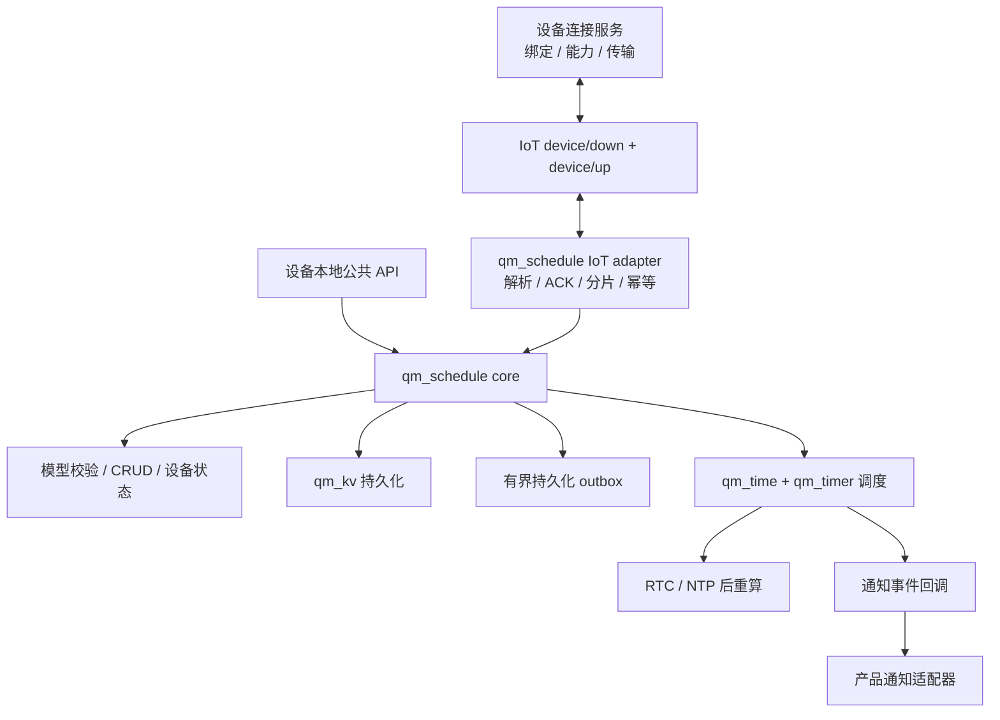
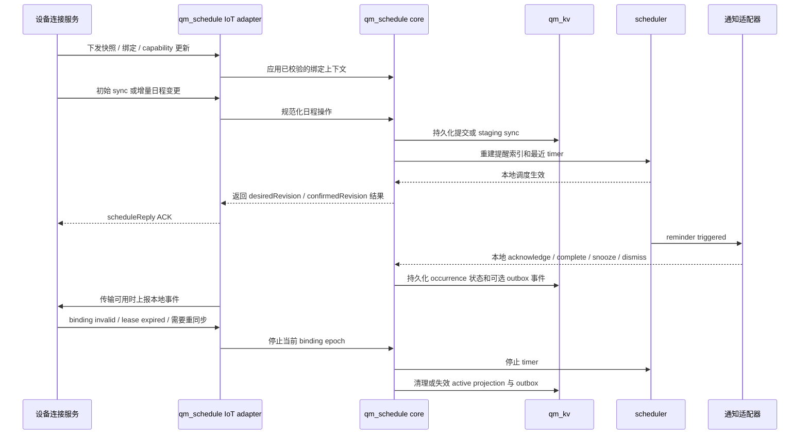
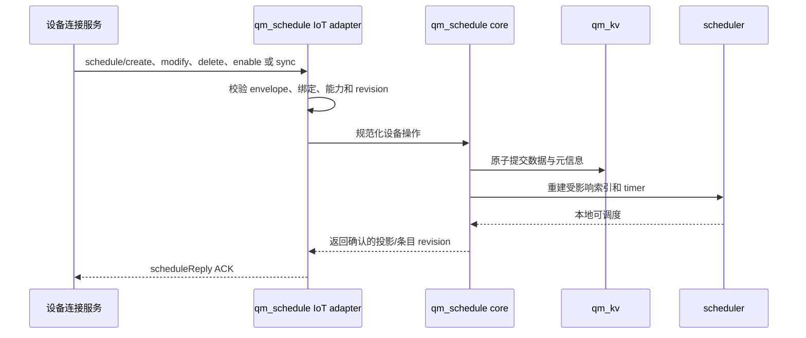
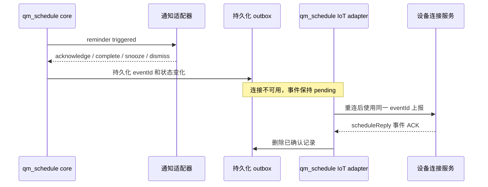
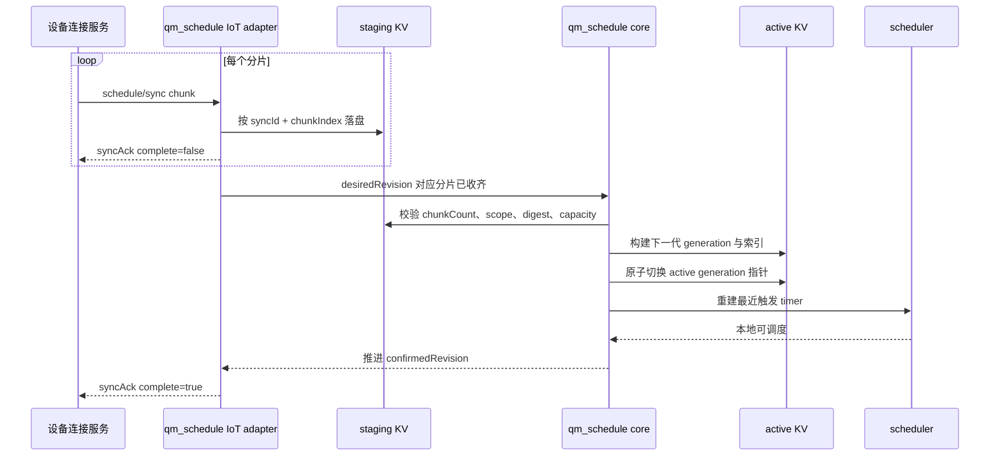
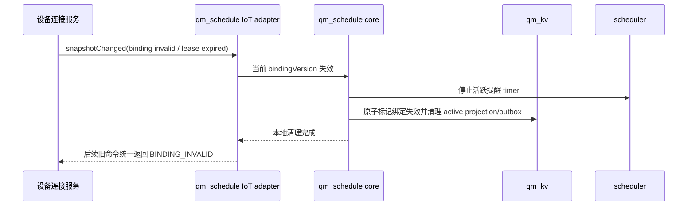

# qm_schedule

英文文档：[README.md](README.md)

产品需求文档：[PRD_CN.md](PRD_CN.md)

> 状态：`V0.1` 设备合同已实现。公共头文件、源码、Kconfig、构建接入、示例、规范的
> `schedule`/`scheduleReply` 封装、JCS 同步摘要、分组/全量投影原子暂存、绑定与 revision
> 校验以及 ACK 驱动的持久化 outbox 均已落地。本构建的 capability 明确报告只支持固定偏移
> 时区，不支持 IANA/DST 和分页 KV；调用方必须根据能力拒绝，不得静默改变日程语义。
> 生产发布仍需完成验证矩阵中的证据，但协议字段不再存在“待决定”项。

## 概述

`qm_schedule` 是设备侧通用日程与提醒组件。它通过设备连接协议接收规范化日程，负责设备副本
持久化、下一触发点计算、本地离线调度、重启恢复、提醒事件通知和设备本地操作的可靠回传。

组件保存可靠设备副本并在本地触发，不能只依赖到点时的远端即时推送。每条下行数据只有通过设备端
能力、绑定、revision 和容量终检后，才能进入本地可调度状态。

## 设计目标

- 使用一个规范化设备模型承载不同类型的日程。
- 支持单条创建、修改、删除、启停和分组全量同步。
- 以 `id + revision` 实现幂等和乱序保护。
- 日程持久化后即使断网或重启也能继续触发。
- 同一日程支持多个提前提醒。
- 支持大批量数据的分片、暂存、校验和原子替换。
- P0 支持一次性、每日和每周日程；周期规则使用 UTC/GMT 或固定数值偏移时区，IANA/DST 能力缺失时拒绝设备同步。
- P0 支持确认知晓、标记本次实例完成、稍后提醒和关闭提醒，并区分 occurrence 与提醒状态。
- P0 支持设备能力快照、绑定生命周期、离线 outbox 和设备状态的独立表达。
- 核心只负责“何时触发”，通过回调把“触发后做什么”交给产品适配器。
- 所有 OS、时间、存储和同步原语通过 QUMI 能力访问。

## P0 范围

第一阶段只定义设备行为和设备交互协议：

- 一次性、每日和每周日程；周期起止日期包含当天，日程时区必须明确保存。
- 一次性日程固定绝对时刻；周期日程按 UTC/GMT 或固定数值偏移时区的当地钟表时间计算。
- IANA/DST 时区在当前 capability 下返回 `INVALID_TIMEZONE`；设备不能把未知时区静默当作 UTC。
- 每条日程最多 3 个提前提醒，支持确认、标记当前 occurrence 完成、稍后提醒和关闭提醒。
- 使用 30 分钟错过提醒窗口；周期日程最多补最近一个实例；稍后触发点额外使用 15 分钟恢复窗口。
- 在认证绑定租约有效期内支持离线/重启本地提醒，并支持有界持久化 outbox 和设备最终能力/容量确认。

月、年、固定间隔、复杂例外、多设备聚合和设备本地创建不属于 P0，除非 PRD 明确修订。

## 非目标

`qm_schedule` 不定义产品入口、意图解析、业务确认、上层 CRUD/查询合同、账号权限或多设备聚合；也不
创建通用 IoT 会话，不直接控制音频、屏幕、LED、振动、蜂鸣器或其它硬件。

## 整体架构



## 责任边界

### 核心组件

`qm_schedule` core 负责：

- 公共日程模型和字段校验。
- 本地 CRUD、查询、启停和状态变更。
- KV 持久化、版本迁移和启动恢复。
- 提醒实例生成、下一触发点选择和定时器重建。
- 时间校准、固定偏移日程时区计算和重启后的统一重算；设备不支持对应能力时拒绝调度。
- occurrence 和 reminder 的触发、确认、完成、关闭、稍后提醒及错过处理。
- 设备持久化/可调度确认、设备本地操作 outbox，以及本地状态事件；设备同步和在线状态由连接服务维护。

### IoT 适配器

可选 IoT adapter 负责：

- 注册 `schedule` 下行 method。
- 解析 JSON、校验协议版本并转换为 core 操作。
- 处理 `id`、`revision`、重复消息和乱序消息。
- 暂存批量同步分片并在完整校验后提交。
- 通过 `scheduleReply` 发送 ACK 和具体错误。
- 监听连接恢复事件，但不创建 `qm_iot` 会话。
- 接收或转发设备连接服务提供的已认证能力、绑定和在线上下文，但不拥有或定义这些资源，也不通过
  `scheduleReply` ACK 它们；本地提醒/用户操作结果才由 adapter 按本协议上报。不得把“消息已发送”当作
  “设备已同步”。

### 通知回调边界

产品代码负责把 core 的通知事件映射为设备呈现或硬件动作。动作失败不能删除日程，也不能阻塞调度任务；
适配器默认不得记录或暴露敏感标题、地点和说明。

### 设备连接服务边界

设备连接服务是 adapter 的协议对端，负责提供已认证绑定上下文、能力和在线快照，传递上下行消息、
执行传输重试并记录设备最近确认的投影状态。其上层业务 API 和主数据语义不属于本 README。

绑定、解绑、换绑、恢复出厂、升级或降级必须产生新的绑定版本或能力版本；`qm_schedule` 只接受当前绑定
内容。解绑或换绑时，设备先停止提醒并标记清理，随后删除旧副本、outbox 和未结束提醒，不依赖再次下发
逐条删除命令。

## QUMI 依赖

直接依赖：

- `QM_TIME_SUPPORT`：UTC 时间、RTC/NTP 校时后的墙上时间。
- QUMI 时间抽象和组件内固定偏移时区解析；generic core 不直接依赖 libc、厂商 SDK 或隐式完整 IANA 数据库。
- `QM_KV_SUPPORT`：元信息、日程内容、同步暂存和版本持久化。
- `QM_OS_MUTEX_SUPPORT`：实例和存储状态保护。
- `QM_OS_TIMER_SUPPORT`：最近一次提醒的运行时定时器。
- `QM_WORK_SUPPORT`：在 work context 中执行触发和重算，避免 timer callback 做重活。
- `qm_utils_timer`：同步暂存超时等单调时间比较，不用于计算日历日期。
- `cJSON`：协议对象和 `extensions` JSON object 校验。

可选依赖：

- `qm_cloud/qm_iot`：仅 IoT adapter 启用连接服务同步时使用。
- `backoff`：IoT adapter 对未收到 ACK 的设备事件执行受控重试；连接重建仍由连接/会话层负责。

明确不依赖：

- `qm_agent`
- `qm_player`、`qm_audio` 或具体硬件驱动

## 通用数据模型

设备 wire JSON 和设备 C 结构应表达同一组语义。`V0.1` 字段名冻结为 lowerCamelCase：

| 字段 | 类型 | 必选 | 说明 |
| --- | --- | --- | --- |
| `id` | string | 是 | 逻辑日程稳定 ID，不得复用为 transport 消息 ID |
| `revision` | uint32 | 是 | 单条日程版本，只接受更高版本的更新 |
| `type` | string | 是 | P0 枚举：`event`、`meeting`、`task`、`birthday`、`medication`、`maintenance` 或 `other` |
| `source` | string | 是 | 发送方携带的不透明来源标签；设备只存储，不据此路由 |
| `groupId` | string | 否 | 批量导入或日历分组 |
| `title` | string | 是 | 用户可见标题 |
| `description` | string | 否 | 简短说明 |
| `location` | string | 否 | 地点 |
| `priority` | string | 否 | `low`、`normal`、`high` 或 `critical`，默认 `normal` |
| `category` | string | 否（P0） | P0 枚举：`general`、`work`、`health`、`education`、`home` 或 `other`；用于展示、筛选和指标 |
| `sensitivity` | string | 否（P0） | `normal` 或 `sensitive`；设备不得从正文推断 |
| `startAt` | int64 | 是 | UTC 秒级时间戳 |
| `endAt` | int64 | 否 | UTC 秒级时间戳，必须不早于 `startAt` |
| `timezone` | string | 是（P0） | 日程时区；一次性日程用于展示，周期日程用于当地钟表计算 |
| `allDay` | bool | 否 | 后续能力预留；P0 必须为 `false` 或省略 |
| `recurrence` | object/null | 否 | `null` 表示一次性；P0 支持 daily/weekly，规则按 `timezone` 解释 |
| `reminders` | array | 否 | 提前提醒列表 |
| `enabled` | bool | 是 | 是否参与调度 |
| `status` | string | 否 | 日程系列状态：`scheduled`、`ended`、`cancelled` |
| `missedPolicy` | string | 否 | 兼容预留；P0 省略或固定为 `windowed`，统一执行 30 分钟规则 |
| `projectionKey` | string | 否 | 仅设备投影 sync 使用的内部稳定 key |
| `extensions` | object | 否 | 业务命名空间扩展，默认 `{}` |

发送方必须在下行前把标签规范化为协议声明的枚举值。设备拒绝未知枚举，不从标题或描述推导新值。
周期作用范围投影为设备分段时，adapter 可以在 KV 中保存 `projectionKey` 与逻辑 `id` 的映射；
设备公共查询按逻辑 ID 聚合，协议响应不得把内部分段 key 暴露为外部目标。

### 标识、操作和版本语义

以下标识直接参与设备交互协议，彼此不可互换；名称和语义在 `V0.1` 已冻结：

| 标识/版本 | 类型 | 必选性 | 作用和边界 |
| --- | --- | --- | --- |
| transport `id` | uint32 | 每条 IoT 报文必选 | 传输层请求/回复关联；只保证该报文相关，不代表业务操作，也不能跨重试作为业务去重键 |
| `operationId` | string | 设备命令/动作必选 | 一次逻辑设备变更的稳定幂等键；传输重试必须复用 |
| `eventId` | string | 设备主动事件必选 | 本地事件和 outbox 的幂等键；在 `bindingVersion` 内唯一，ACK 丢失时重试必须复用 |
| `schedule.id` | string | 日程对象必选 | 逻辑日程身份，不等同 transport `id` |
| `schedule.revision` | uint32 | 日程对象必选 | 日程内容版本；只接受更高版本，不能用 transport `id` 推导 |
| `bindingVersion` | string | 设备目标命令、设备事件和连接快照必选 | 绑定/用户关系的 epoch；解绑、换绑、恢复出厂后递增，旧上下文返回 `BINDING_INVALID` |
| `desiredRevision` | uint32/null | 设备投影状态必选 | 当前绑定整份期望投影的单调代次，不是单条 revision |
| `confirmedRevision` | uint32/null | 设备投影状态必选 | 设备完整持久化且可本地调度的最新投影代次 |
| `groupRevision` | uint32 | 分组 sync 必选 | 分组原子替换版本；不能与单条 `schedule.revision` 混用 |

`category` 与 `sensitivity` 是设备展示和隐私策略的 wire 字段；缺少 `sensitivity` 时必须采用中性展示，
不得把缺失值解释为可公开正文。设备 wire 只接受规范化 `endAt`，持续时长形式必须在下行前换算。
`desiredRevision`、`confirmedRevision`、`schedule.revision` 和 `groupRevision` 分属不同版本维度，
不能互相覆盖。

示例：

示例：

```json
{
  "id": "meeting-001",
  "revision": 3,
  "type": "meeting",
  "source": "remote",
  "title": "项目评审会议",
  "description": "季度计划评审",
  "location": "A301",
  "priority": "normal",
  "category": "work",
  "sensitivity": "normal",
  "startAt": 1785826800,
  "endAt": 1785830400,
  "timezone": "GMT+08:00",
  "allDay": false,
  "recurrence": {
    "frequency": "weekly",
    "byWeekday": ["TU", "TH"],
    "startDate": "2026-08-01",
    "endDate": "2026-12-31"
  },
  "reminders": [
    {
      "id": "primary",
      "offsetMin": 10,
      "action": "notify",
      "channels": ["audio", "display"],
      "requiresAck": false,
      "snooze": {
        "enabled": true,
        "intervalMin": 5,
        "maxCount": 3
      }
    }
  ],
  "enabled": true,
  "status": "scheduled",
  "missedPolicy": "windowed",
  "extensions": {}
}
```

### 时间和重复规则

- `startAt` 和 `endAt` 统一使用 64 位 UTC 秒级时间戳。
- 一次性日程保存绝对时刻；用户或设备切换时区只改变展示，不改变实际发生时刻。
- P0 支持 `daily` 和 `weekly`。周期规则保存当地钟表时间、`startDate`、可选 `endDate`，并始终按
  日程自身 `timezone` 计算；开始和结束日期均包含当天。

P0 `recurrence` 对象结构：

| 字段 | 必选 | P0 规则 |
| --- | --- | --- |
| `frequency` | 是 | `daily` 或 `weekly` |
| `byWeekday` | weekly 必选 | `MO` 到 `SU` 的非空去重数组；daily 必须省略 |
| `startDate` | 是 | `YYYY-MM-DD`，按日程 `timezone` 解释，包含当天 |
| `endDate` | 否 | `YYYY-MM-DD`，不得早于 `startDate`，包含当天 |
| `interval` | 否 | P0 省略或固定为 `1`；其它间隔属于后续能力 |

周期日程的 `startAt` 是在 `startDate` 边界内按规则计算出的第一个有效 occurrence UTC 时刻；由其在
`timezone` 下的当地钟表时间作为后续 occurrence 的固定时间。设备必须校验 `startAt`、`frequency`、
`byWeekday` 和日期边界一致；未来实例以 recurrence 为准，不能逐次累加 UTC 秒数代替当地日历计算。
存在 `endAt` 时，`endAt - startAt` 是每个 occurrence 的持续时长；缺失时按瞬时事项处理。当前固定偏移
设备不应用 DST 跳变，要求 DST 的时区直接拒绝。

- P0 的 `timezone` 必须明确下发；当前设备只接受 UTC/GMT 或固定数值偏移，IANA/DST 语义不满足时返回
  `INVALID_TIMEZONE`，不能自行换算或降级。
- P0 设备时间无效时暂停本地调度，恢复可信时间后按错过提醒规则重算。用户给出的时间已经过去时，
  不自动顺延到下一周期。
- `monthly`、`yearly`、固定间隔、边界范围和例外日期属于后续能力；批量来源可以在连接服务展开为多个
  一次性日程，但不能用展开规避设备声明的 P0 周期能力。
- 任何影响设备调度的字段必须进入公共模型，不能藏在 `extensions` 中。

### 提醒规则

- `id` 在同一日程内必须唯一且保持稳定，用于定位具体提醒实例。
- `offsetMin=0` 表示在 `startAt` 时提醒。
- 正数表示提前多少分钟提醒。
- 同一日程可以有多个提醒；组件应去重相同触发点。
- P0 只要求 `action=notify`，其它 action 由后续版本扩展；每条日程最多 3 个提醒。
- `channels` 是给设备通知适配器的硬件提示，core 不直接控制硬件，也不把它解释为远端路由选择。
- `requiresAck=true` 表示该提醒实例需要用户确认；确认后 `reminderState=acknowledged`，occurrence 仍未完成，
  也不直接修改系列状态。
- P0 的稍后选项为 5、10、30 分钟；同一提醒最多稍后 3 次。稍后只修改本次提醒的临时时间，不修改
  原日程时间或周期规则。
- 计划提醒时间过去不超过 30 分钟时补提醒一次；超过则标记本次实例已错过。周期日程最多补最近一个
  实例，日程结束时间已过时不补；稍后触发点额外只有 15 分钟恢复窗口。

### 扩展字段

`extensions` 必须是 JSON object。第一层 key 是业务命名空间，每个命名空间独立维护
`schemaVersion`。core 校验容量后复制、持久化并透传，不解释未知字段。

规则：

- `NULL` 或缺失按 `{}` 处理。
- 未识别字段必须保留。
- `modify` 和 `sync` 对 `extensions` 使用整体替换语义，不做深度合并。
- 不得保存密码、Token、证书或其它敏感信息。
- 序列化长度受 `CONFIG_QM_SCHEDULE_IOT_MAX_PAYLOAD_LEN` 的 IoT 信封上限约束。

当前设备模型会保留标准日程对象中的全部字段。固定长度持久化记录对单个
`description`、`location`、`extensions` 紧凑 JSON 和 reminder `channels` 数组的
上限分别为 512、128、1023 和 127 字节；超过上限会在持久化前拒绝，绝不会静默
丢弃。周期的 `startDate`、`endDate`、`interval`，提醒的 `action`/`channels` 以及
所有系列元数据都会写入 KV，并由 `get`/`list` 原样返回。

## 日程状态

状态分为日程系列、当前 occurrence、reminder、设备同步、设备在线和本地操作回传六类。
六类状态分别持久化或由对应模块维护，不能用“提醒已确认”代替“事项已完成”，也不能用“消息已发送”
代替“设备已同步”。

core 持久化系列、occurrence、reminder 和本地回传状态，并产出设备确认信息；设备连接服务维护聚合
同步和在线观测。任何模块都不能把这些维度压缩成单一成功/失败状态。

### 日程系列状态

| 状态 | 进入条件 | 后续行为 |
| --- | --- | --- |
| `scheduled` | 创建成功且日程仍有效 | 生成一次性或周期 occurrence，并安排提醒 |
| `ended` | 一次性日程到达结束条件，或周期系列达到结束日期 | 不再生成新 occurrence |
| `cancelled` | 用户取消整个系列或连接服务删除 | 取消未触发提醒，不再生成 occurrence |

`enabled` 是独立开关。停用保留系列和历史实例但不生成提醒；重新启用时从下一次有效时间继续。

### occurrence 状态

| 状态 | 进入条件 | 对周期系列的影响 |
| --- | --- | --- |
| `pending` | 本次实例已生成，尚未结束或完成 | 无 |
| `completed` | 用户明确标记本次任务、服药或维护事项完成 | 不结束周期系列 |
| `ended` | 本次实例到达结束条件但未完成 | 不结束周期系列 |
| `missed` | 超过 30 分钟补提醒窗口且未处理 | 不结束周期系列 |
| `cancelled` | 仅取消本次实例，或系列被取消 | 仅取消本次时不影响其它实例 |

### reminder 状态

| 状态 | 说明 |
| --- | --- |
| `pending` | 已安排，尚未到触发时间 |
| `active` | 已触达，等待用户操作 |
| `acknowledged` | 用户确认知晓；不代表事项完成 |
| `snoozed` | 用户选择临时延后，达到延后时间后再次进入 `active` |
| `closed` | 用户关闭，或实例完成后关闭；必须记录 `closeReason` |
| `unhandled` | 到期时没有用户操作，按错过规则处理 |
| `cancelled` | 日程被修改、停用、取消或删除，原提醒失效 |

标记本次实例完成时，occurrence 进入 `completed`，当前 reminder 进入 `closed` 且
`closeReason=occurrence_completed`，同一 occurrence 尚未触发的其它 reminders 全部进入 `cancelled`。
只关闭单个提醒时使用 `closeReason=user_closed`，occurrence 不变，其它提醒仍按原计划处理。

### 设备同步状态

| 状态 | 说明 |
| --- | --- |
| `not_required` | 主要渠道不是设备 |
| `pending` | 连接服务已有新期望状态，设备尚未确认 |
| `syncing` | 正在处理最新期望状态 |
| `synced` | 设备已保存最新内容并确认可本地调度 |
| `failed` | 达到重试停止条件仍未成功；不回退连接服务结果 |

### 设备在线状态

`online`、`offline`、`unknown` 三种状态由设备连接服务维护。设备已同步后断网时组合为
`sync=synced + online=offline`；连接服务产生新版本后才将同步状态变为 `pending`。过期的在线信息不能推断为在线。

### 本地操作回传状态

| 状态 | 说明 |
| --- | --- |
| `none` | 当前没有本地操作记录待发送；不等价于设备同步状态 |
| `pending` | 设备已本地受理确认、完成、稍后或关闭，但连接服务尚未确认；必须保留 outbox 记录 |
| `failed` | 达到回传停止条件仍未成功；保留本地结果并允许人工重试 |

`pending` 专用于本地操作回传，不能与设备同步的 `pending` 混淆；实现上应分别携带在不同状态维度中。outbox 必须保留实际 `actionAt`，
同一事件重试不得产生重复实例结果。

### 状态转换约束

- 修改时间、重复或提醒设置后，失效提醒先进入 `cancelled`，再按最新内容生成提醒。
- 删除系列后，系列和未结束 occurrence 进入 `cancelled`，相关提醒全部取消。
- `completeOccurrence` 只完成当前 occurrence；周期系列继续保持 `scheduled`，直到结束日期。
- `snooze` 只调整当前 reminder 的临时时间，不改变原始日程时间和周期规则。
- 设备同步、在线和本地回传状态不改变连接服务系列状态；连接服务期望状态与设备确认状态一致且可本地提醒时，
  才能标记 `synced`。

## 设备能力快照与绑定生命周期

设备 adapter 消费连接服务维护的已认证能力与绑定快照。快照提供协议上下文；每条下行仍由
`qm_schedule` 执行最终能力和容量校验。

### 能力快照

| 字段 | 说明 |
| --- | --- |
| `capabilityVersion` | 能力协议或产品版本；版本不兼容时不能选为设备渠道 |
| `scheduleSupport` | 是否支持日程副本和本地调度 |
| `offlineReminder` | 断网后是否仍可在绑定租约有效期内按已同步内容提醒 |
| `recurrence` | 支持的 `once`、`daily`、`weekly` 等重复类型 |
| `reminderActions` | 支持 `acknowledge`、`complete`、`snooze`、`dismiss` 的集合 |
| `reminderChannels` | `audio`、`display`、`vibration` 等设备侧能力 |
| `privacyDisplay` | `none`、`generic_only` 或 `generic_until_authenticated`；敏感日程要求所选模式满足展示策略 |
| `maxItems` / `maxRemindersPerItem` | 设备可保存的日程和每条提醒上限 |
| `timezoneSupport` / `dstSupport` | 支持的时区、当地钟表时间和 DST 能力 |
| `availableCapacity` | 最近一次已知容量，仅用于预检查和提示 |
| `updatedAt` | 快照最近更新时间；过期快照不能作为已确认渠道 |

能力判断规则：

- adapter 在接受命令前校验重复类型、时区/DST、提醒动作、通道、容量、快照 TTL 和能力版本。
- 能力缺失、版本不兼容或快照过期时返回稳定错误，不能删除字段或静默降级。
- `sensitivity=sensitive` 时，设备必须按 `privacyDisplay` 执行中性展示或身份确认策略。
- 最终容量不足返回 `CAPACITY_EXCEEDED`，保持原设备副本不变。
- 设备升级、降级、恢复出厂或能力变化后，连接服务更新快照，adapter 重新评估后续命令。

### 绑定状态机

```text
unbound -> binding -> bound -> unbinding -> unbound
                    \
                     -> resetPending -> bound (重新绑定后)
```

- `binding` 时只建立用户与设备关系，不立即声称已有日程已同步；能力快照有效后才允许创建同步任务。
- 设备本地发起解绑、换用户、恢复出厂或存储重建时，立即停止原用户提醒并清除日程正文、reminder
  index 和本地操作 outbox；只允许保留不含正文的绑定 tombstone 用于重放保护。
- 远程解绑无法立即送达完全离线的设备。P0 使用认证绑定租约：设备持久化 `leaseExpiresAt`，只有
  设备连接服务在同一有效绑定下才能续租；V0.1 最长租期为 24 小时。租约到期，或设备重启后无法获得
  可信时间时，必须 fail closed：停止提醒并清理旧用户正文/outbox，再接受其它绑定。若连接服务仍确认同一
  绑定，重新连接后可以重新同步。
- 设备离线期间的修改/删除只能在重连后生效；绑定租约约束绑定级撤销，不代表每条命令实时送达。
- 恢复出厂和数据存储重建后，设备发送 `syncRequest(reason=storageReset)`，只恢复连接服务仍声明有效且属于当前
  绑定用户的日程。
- 绑定版本、用户标识和能力版本必须参与同步上下文；旧绑定的下行和上行事件返回
  `BINDING_INVALID`，不能写入当前副本。

### 连接服务状态快照 JSON 合同（`V0.1` 已冻结）

以下对象由设备连接服务提供给 `qm_schedule` adapter。它是连接服务 API/事件的
状态快照，不是 `method=schedule` 的 subMethod，也不能通过伪造日程命令更新：

```json
{
  "resource": "scheduleDeviceSnapshot",
  "schemaVersion": 1,
  "snapshotRevision": 42,
  "deviceId": "device-001",
  "binding": {
    "state": "bound",
    "userId": "user-opaque-001",
    "bindingVersion": "bind-42",
    "boundAt": 1784300000,
    "leaseExpiresAt": 1784386400
  },
  "capability": {
    "capabilityVersion": "cap-2026-08",
    "scheduleSupport": true,
    "offlineReminder": true,
    "recurrence": ["once", "daily", "weekly"],
    "reminderActions": ["acknowledge", "complete", "snooze", "dismiss"],
    "reminderChannels": ["audio", "display"],
    "privacyDisplay": "generic_until_authenticated",
    "maxItems": 100,
    "maxRemindersPerItem": 3,
    "maxSchedulePayloadBytes": 8192,
    "maxSyncItemsPerChunk": 20,
    "maxEventOutbox": 32,
    "timezoneSupport": ["UTC", "GMT+08:00"],
    "dstSupport": false,
    "availableCapacity": 96,
    "updatedAt": 1784300010,
    "expiresAt": 1784386410
  },
  "online": {
    "state": "offline",
    "observedAt": 1784300100,
    "expiresAt": 1784300400
  },
  "scheduleState": {
    "syncState": "pending",
    "desiredRevision": 4,
    "confirmedRevision": 3,
    "updatedAt": 1784300100
  },
  "updatedAt": 1784300100
}
```

| 路径 | 类型 | 必选性 | 说明 |
| --- | --- | --- | --- |
| `resource` | string | 是 | 必须为 `scheduleDeviceSnapshot`，表示连接服务资源而非 schedule subMethod |
| `schemaVersion` | uint32 | 是 | 快照结构版本，不等同 IoT `schemaVersion` |
| `snapshotRevision` | uint64 | 是 | 单设备资源修订号；每次替换快照严格递增，换绑后也不归零 |
| `deviceId` | string | 是 | 连接服务认证的设备标识 |
| `binding.state` | enum | 是 | `unbound`、`binding`、`bound`、`unbinding` 或 `resetPending` |
| `binding.userId` | string/null | 已绑定时是 | 只传不透明标识；解绑后必须为 null |
| `binding.bindingVersion` | string/null | 已绑定时是 | 当前绑定 epoch；解绑、换绑、恢复出厂递增 |
| `binding.boundAt` | int64 | 已绑定时是 | 当前绑定建立的 UTC 秒 |
| `binding.leaseExpiresAt` | int64 | 已绑定时是 | 认证离线提醒授权的到期 UTC 秒；设备不得越过该时间继续提醒 |
| `capability` | object/null | 已绑定时条件必选 | 有效能力快照；为 null 表示没有可用快照，adapter 不得接受日程命令 |
| `capability.capabilityVersion` | string | capability 非 null 时是 | 能力快照版本；未知或过期时不得作为设备渠道依据 |
| `capability.scheduleSupport` / `offlineReminder` | bool | 已取得快照时是 | 是否支持持久化调度，以及已同步日程能否离线提醒 |
| `capability.recurrence` | string array | 已取得快照时是 | 明确列出 `once`、`daily`、`weekly` 等支持项 |
| `capability.reminderActions` / `reminderChannels` | string array | 已取得快照时是 | 支持的用户动作和设备展示通道 |
| `capability.privacyDisplay` | enum string | 已取得快照时是 | `none`、`generic_only` 或 `generic_until_authenticated` |
| `capability.maxItems` / `maxRemindersPerItem` | uint32 | 已取得快照时是 | 稳定容量上限；P0 每条至少支持 3 个提醒 |
| `capability.maxSchedulePayloadBytes` | uint32 | capability 非 null 时是 | 单个完整 schedule IoT envelope 可接收的 UTF-8 字节上限；P0 基线 8192 |
| `capability.maxSyncItemsPerChunk` | uint32 | capability 非 null 时是 | 应用字节上限前，单个 sync 分片最多包含的日程数；P0 基线 20 |
| `capability.maxEventOutbox` | uint32 | capability 非 null 时是 | 非用户设备事件 outbox 容量；P0 基线 32，与用户动作队列隔离 |
| `capability.timezoneSupport` / `dstSupport` | array/bool | capability 非 null 时是 | 支持的日程时区和当地钟表/DST 语义；P0 `dstSupport` 为 bool |
| `capability.availableCapacity` | uint32 | capability 非 null 时是 | 最近一次空余条目数，只用于预检查 |
| `capability.updatedAt` | int64 | capability 非 null 时是 | 能力最近可信更新时间 |
| `capability.expiresAt` | int64 | capability 非 null 时是 | 能力 TTL 到期时间，超过后按未知处理 |
| `online.state` | enum | 是 | `online`、`offline` 或 `unknown`；由连接服务确认，不由 `qm_schedule` 猜测 |
| `online.observedAt` / `expiresAt` | int64/null | state 已知时条件必选 | UTC 秒；超过 `expiresAt` 必须转为 `unknown`，无观测时可为 null |
| `scheduleState` | object/null | 有设备投影时条件必选 | 无设备渠道或未绑定时为 null |
| `scheduleState.syncState` | enum | scheduleState 非 null 时是 | `not_required`、`pending`、`syncing`、`synced` 或 `failed` |
| `scheduleState.desiredRevision` | uint32/null | scheduleState 非 null 时是 | 当前绑定整份期望投影的最新代次，不是单条日程 revision |
| `scheduleState.confirmedRevision` | uint32/null | scheduleState 非 null 时是 | 设备完整持久化和调度重建后确认的投影代次 |
| `scheduleState.updatedAt` | int64 | scheduleState 非 null 时是 | 聚合日程状态最近变化的 UTC 秒 |
| `updatedAt` | int64 | 是 | 快照生成时间；字段缺失或过期时按未知处理 |

连接服务提供快照、绑定、在线、传输和确认状态；设备负责最终能力/容量校验。`capabilityVersion`、`bindingVersion`、`desiredRevision` 和 `confirmedRevision` 必须在状态
变更事件中一起携带，避免把旧快照误显示为当前结果。

P0 时间基线固定为：`capability.expiresAt` 默认等于 `capability.updatedAt + 86400s`（24 小时），在线状态
默认使用 60 秒 TTL，连接服务也可以下发更短的明确到期时间。能力过期或缺失时编码为 `capability=null`；
在线观测过期时编码为 `online.state=unknown`，观测时间字段允许为 null。这些是联调测试输入，不是实现
自行猜测的默认值。

### 连接服务快照 API 与事件

连接服务通过独立资源提供快照，不使用日程 IoT subMethod：

| 操作 | owner | 合同 |
| --- | --- | --- |
| `getScheduleDeviceSnapshot(deviceId, ifNoneMatch?)` | 设备连接服务 | 在认证调用上下文中返回当前快照、不透明 `etag`、`snapshotRevision` 和 `updatedAt`；ETag 未变化时返回 `notModified` |
| `scheduleDeviceSnapshotChanged` | 设备连接服务 | 推送完整替换快照、新 `etag`、`snapshotRevision`、`updatedAt` 和 `changeReasons`，如 `binding`、`lease`、`capability`、`online`、`scheduleState` |

设备 adapter 通过连接服务 SDK 读取同一认证绑定上下文。
当 `bindingVersion`

当 `bindingVersion`、`leaseExpiresAt`、`capabilityVersion`、能力过期、在线状态/过期时间或 desired/confirmed
投影状态变化时，连接服务发送替换事件；消费者只按 `snapshotRevision` 排序，并丢弃小于等于已保存
revision 的事件。不透明 ETag 仅用于相等比较和缓存，`updatedAt` 仅用于诊断，两者都不是排序键。资源错误使用
`DEVICE_NOT_FOUND`、`FORBIDDEN`、`SNAPSHOT_UNAVAILABLE`，不通过 `scheduleReply` ACK。能力缺失或过期时返回
`capability=null`，不得套用宽松默认值。

### 期望状态与设备确认状态

连接服务保存设备最新期望投影，并为当前绑定的整份设备投影分配单调递增代次；设备
上报最后一个完整持久化、具备本地调度条件的投影代次。只有两者一致且设备能力快照仍满足 P0 时，设备
同步状态才是 `synced`。单条 `schedule.revision` 和分组 `groupRevision` 仍独立校验。消息发送、
连接建立回调或连接服务创建同步任务都不能单独证明设备已同步。

## IoT 协议详细设计

> 状态：草案。字段名和行为可用于端云联调前评审，但必须在首个正式版本发布前冻结。

协议沿用当前 `qm_iot` JSON envelope：顶层消息标识字段使用 `id`，不是 `msgId`。
连接服务和设备都使用 `method=schedule` 发送命令或事件，接收方使用
`method=scheduleReply` 回复对应消息。

### 协议方向

| 方向 | method | subMethod |
| --- | --- | --- |
| 连接服务到设备命令 | `schedule` | `create`、`modify`、`delete`、`enable`、`sync`、`acknowledge`、`complete`、`snooze`、`dismiss` |
| 设备到连接服务事件 | `schedule` | `triggered`、`acknowledged`、`completed`、`snoozed`、`dismissed`、`syncRequest` |
| 接收方回复 | `scheduleReply` | 原 subMethod 加 `Ack`，例如 `createAck`、`triggeredAck` |

P0 不设计远端 `get/list` 命令，设备查询通过本地 public API；设备丢失数据或发现版本冲突时使用
`syncRequest` 请求连接服务重新同步。

### 公共请求报文

```json
{
  "method": "schedule",
  "subMethod": "create",
  "id": 1001,
  "params": {
    "schemaVersion": 1,
    "operationId": "op-2026-0001",
    "bindingVersion": "bind-42",
    "desiredRevision": 12
  }
}
```

公共字段规则：

| 字段 | 类型 | 必选性 | 规则 |
| --- | --- | --- | --- |
| `method` | string | R | 必须为 `schedule`，区分大小写 |
| `subMethod` | string | R | 必须是本协议声明的操作或事件，区分大小写 |
| `id` | uint32 | R | 非 0 消息 ID；回复必须原样回传，仅用于报文关联 |
| `params` | object | R | 必须存在；具体字段由 subMethod 定义 |
| `params.schemaVersion` | uint32 | R | 第一版必须为 `1` |
| `params.operationId` | string | C | 连接服务到设备写命令必选；设备事件可回显。业务操作幂等键，不替代顶层 transport `id` |
| `params.bindingVersion` | string | C | 设备目标命令、设备事件必选；当前绑定 epoch，缺失、过期或不匹配返回 `BINDING_INVALID` |
| `params.eventId` | string | C | 设备主动事件必选；outbox 事件幂等键，ACK 重试保持不变 |
| `params.desiredRevision` | uint32 | C | create/modify/delete/enable/sync 必选；当前绑定整份期望投影的目标代次 |
| `params.confirmedRevision` | uint32/null | C | 投影变更最终 ACK 必选；设备已完整提交并可本地调度的代次 |
| `params.contentDigest` | string | C | 每个 sync 分片必选；对规范化后的分片语义内容做 `sha256:<hex>`，不含 transport id、operationId 或绑定凭据 |

连接服务为每次原子设备投影变更分配一个新的 `desiredRevision`。单条 create/modify/delete/enable 是一次
变更；同一 sync 的所有分片携带相同代次。设备只接受紧邻当前确认代次的下一代；已确认的同代重放按
幂等成功处理，出现代次缺口时返回 `REVISION_CONFLICT` 并发送
`syncRequest(reason=revisionConflict)`。只有持久化、提醒索引和 timer 重建全部成功后，设备才推进
`confirmedRevision`；sync 最终提交前的分片 ACK 不得推进。提醒动作和设备事件不改变投影代次，新的
`bindingVersion` 启动新的代次序列。唯一跨代例外是经授权的 `syncScope=fullProjection`：绑定初始化或
`syncRequest` 后，它原子替换当前绑定的整份设备投影，可以从 null/旧代次直接推进到下发的当前
`desiredRevision`。

未知 envelope 字段可以忽略。未知 `schemaVersion` 必须返回
`UNSUPPORTED_SCHEMA`，不能按当前版本猜测解析。

为便于阅读，后续单条命令示例可能省略已经在公共 envelope 定义的 `operationId`、`bindingVersion`、
`desiredRevision` 或 `eventId`；真实 P0 报文仍必须按 subMethod 的必选性携带这些字段。

### 字段分层与去重规则

为了让协议结构稳定，字段按五层拆分，每层只保留一个规范落点：

| 层次 | 规范字段 | 规则 |
| --- | --- | --- |
| 传输关联层 | 顶层 `method`、`subMethod`、`id` | 只负责一次消息路由和 ACK 关联，不能作为持久业务键 |
| 绑定与版本层 | `params.schemaVersion`、`params.bindingVersion` | 说明如何解析 payload，以及当前认证绑定是谁 |
| 操作/事件标识层 | `params.operationId`、`params.eventId`、`params.syncId` | 负责幂等和重试；同一逻辑操作跨重发保持不变 |
| 日程领域标识层 | `schedule.id`、`schedule.revision`、平铺 `scheduleId`、`revision`、`occurrenceAt`、`reminderId` | 标识被修改的是哪条日程、哪次提醒实例 |
| 投影与同步层 | `desiredRevision`、`confirmedRevision`、`groupRevision`、`chunkIndex`、`chunkCount`、`contentDigest` | 排序多条目投影更新，并证明一个分片集合是否完整 |

下面这些名字相近，但职责不同，不能视为冗余：

- `id` 只关联一次传输请求与回复；`operationId` 去重一条连接服务下发的逻辑变更；`eventId` 去重一条设备侧 outbox 事件。
- `revision` 是单条日程内容版本；`desiredRevision` / `confirmedRevision` 是整份设备投影代次。
- `schedule.id` 用在完整 create/modify 对象里；平铺 `scheduleId` 用在只需要目标引用的命令或事件里。
- `occurrenceAt` 是实例身份的规范字段；本地实现可以有 `occurrenceId`，但 P0 wire 不要求它。
- `syncId` 标识一次分批传输；`contentDigest` 校验一个分片的语义内容；两者都不能替代 `desiredRevision`。

P0 明确禁止以下重复：

- `deviceId` 不得出现在 `schedule` 命令或事件中。设备身份来自当前认证连接上下文，只有连接服务快照资源携带 `deviceId`。
- `capabilityVersion`、`snapshotRevision`、`online.state`、`availableCapacity` 不得复制到每条 schedule 命令里。这些属于快照资源，不属于日程变更 envelope。
- ACK 不得回显完整 `schedule` 对象，除非该 subMethod 明确定义返回对象。普通 ACK 只返回关联字段、目标标识、版本、投影状态和结果/错误。
- `schemaVersion` 只在 `params` 出现一次，嵌套 `schedule` 不得重复携带。
- `timezone` 属于规范日程对象；提醒动作事件已经由 `scheduleId + occurrenceAt + reminderId` 唯一定位时，不再重复传它。

如果一个 subMethod 既能写成“完整对象”，又能写成“平铺目标 + 增量状态”，P0 只允许一种表达。混用两种
来源时按 `INVALID_REQUEST` 处理，避免同一语义出现多份真值来源。

### 公共回复报文

```json
{
  "method": "scheduleReply",
  "subMethod": "createAck",
  "id": 1001,
  "code": 0,
  "params": {
    "schemaVersion": 1,
    "operationId": "op-2026-0001",
    "bindingVersion": "bind-42",
    "scheduleId": "schedule-001",
    "revision": 1,
    "desiredRevision": 12,
    "confirmedRevision": 12,
    "syncState": "synced",
    "applied": true,
    "idempotent": false
  }
}
```

回复规则：

- `id` 与请求一致。
- 成功时 `code=0`；失败时 `code=1`，详细原因放在 `params.error`。
- ACK 必须回显当前 `bindingVersion`，以及对应的 `operationId`（命令）或 `eventId`（设备事件），包括
  失败和重复回复；设备同步 ACK 还应返回 `desiredRevision`、`confirmedRevision` 和 `syncState`，不能只
  返回“已收到”。
- 设备必须完成参数校验、持久化和调度重建后，才能对变更操作回复成功。唯一例外是
  `syncAck complete=false`：`code=0` 只表示一个分片已校验并持久化到 staging，`syncState=syncing` 且
  `confirmedRevision` 不变；只有最终 `complete=true` 才证明原子提交和调度重建成功。成功的投影变更还必须
  满足 `confirmedRevision == desiredRevision` 且 `syncState=synced`。
- adapter 调用 `qm_iot_down_reply()` 时传入原 method `schedule`；底层自动生成
  `scheduleReply`。ACK subMethod 由 adapter 显式传入。

失败示例：

```json
{
  "method": "scheduleReply",
  "subMethod": "modifyAck",
  "id": 1003,
  "code": 1,
  "params": {
    "schemaVersion": 1,
    "operationId": "op-2026-modify-0001",
    "bindingVersion": "bind-42",
    "scheduleId": "schedule-001",
    "revision": 3,
    "desiredRevision": 12,
    "confirmedRevision": 11,
    "syncState": "failed",
    "error": {
      "name": "REVISION_CONFLICT",
      "message": "incoming revision is not newer",
      "retryable": false
    }
  }
}
```

错误名称：

| error.name | 说明 | retryable |
| --- | --- | --- |
| `INVALID_REQUEST` | JSON、必选字段、类型或取值非法 | false |
| `UNSUPPORTED_SCHEMA` | 不支持 `schemaVersion` | false |
| `NOT_FOUND` | 日程或提醒实例不存在 | false |
| `ALREADY_EXISTS` | create 的 ID 已存在且内容不同 | false |
| `REVISION_CONFLICT` | 日程 revision 过旧或同版本内容不同 | false |
| `CAPACITY_EXCEEDED` | 日程、提醒、分片或扩展容量超限 | false |
| `SYNC_CONFLICT` | 同一 sync/group 具有不一致的元信息或分片 | false |
| `SYNC_INCOMPLETE` | 批次缺少分片，尚未提交 | true |
| `STORAGE_ERROR` | KV 写入、读取或原子切换失败 | true |
| `SCHEDULER_ERROR` | 提醒索引或 timer 重建失败 | true |
| `BUSY` | 正在提交其它互斥批次 | true |
| `UNSUPPORTED_OPERATION` | subMethod 或 action 不支持 | false |
| `OCCURRENCE_NOT_ACTIVE` | 指定提醒实例当前不可操作 | false |
| `SNOOZE_NOT_ALLOWED` | 未启用 snooze 或达到次数上限 | false |
| `CAPABILITY_UNSUPPORTED` | 设备无法保持请求的 P0 规则或提醒操作 | false |
| `BINDING_INVALID` | 设备未绑定、属于其它用户或绑定版本已变化 | false |
| `OUTBOX_FULL` | 本地操作无法入队且不能丢弃已有动作 | true |
| `INVALID_TIMEZONE` | 日程时区缺失，或设备不支持相应时区/DST 语义 | false |

`message` 只用于诊断，不作为连接服务分支依据，也不能包含凭据、完整路径或用户隐私。

### 幂等、版本和删除墓碑

- 顶层 `id` 只关联一次消息；逻辑日程幂等由 `schedule.id + schedule.revision` 决定，设备分段使用持久化
  的 `projectionKey + revision`，两者映射不可混用。
- 同 `schedule.id`、同 revision、标准化内容相同的重发返回成功，并设置 `idempotent=true`。
- 同 `schedule.id`、同 revision 但内容不同，或更低 revision，返回 `REVISION_CONFLICT`。
- `modify`、`enable` 和 `delete` 的 revision 必须高于当前已保存 revision。
- `delete` 后保留带 revision 的轻量 tombstone，防止旧 create/modify 令已删除日程复活。
- tombstone 保留周期必须长于连接服务最大离线重试窗口；过期清理策略由 Kconfig 或产品配置确定。

### `create`

用途：创建一条不存在的完整日程。

请求 `params`：

| 字段 | 必选 | 说明 |
| --- | --- | --- |
| `schemaVersion` | 是 | 固定为 `1` |
| `schedule` | 是 | 完整通用日程对象 |

```json
{
  "method": "schedule",
  "subMethod": "create",
  "id": 1001,
  "params": {
    "schemaVersion": 1,
    "schedule": {
      "id": "schedule-001",
      "revision": 1,
      "type": "event",
      "source": "remote",
      "title": "项目会议",
      "priority": "normal",
      "sensitivity": "normal",
      "startAt": 1784358000,
      "endAt": 1784361600,
    "timezone": "GMT+08:00",
      "recurrence": null,
      "reminders": [
        {
          "id": "primary",
          "offsetMin": 10,
          "action": "notify",
          "requiresAck": false
        }
      ],
      "enabled": true,
      "extensions": {}
    }
  }
}
```

行为：

- ID 不存在且未命中 tombstone 时创建；命中 tombstone 时，只有更高 revision 才允许合法重建。
- ID 已存在且同 revision、同内容时作为幂等重放成功。
- active ID 在 `create` 中带更高 revision 时返回 `ALREADY_EXISTS`，调用方必须改用 `modify`；同 revision
  内容不同或 revision 更低时返回 `REVISION_CONFLICT`。
- `createAck.params` 返回 `scheduleId`、`revision`、`desiredRevision`、`confirmedRevision`、`syncState`、
  `applied` 和 `idempotent`。
- P0 中，带 `groupId` 且由 sync 管理的日程不接受单条 create；连接服务必须更新整个 group。

### `modify`

用途：完整替换一条已有日程，不采用字段级 patch。

请求 `params` 与 `create` 相同，包含 `schemaVersion` 和完整 `schedule`。

行为：

- 日程不存在时返回 `NOT_FOUND`。
- incoming revision 必须高于当前 revision；同版本同内容仅作为幂等重放成功。
- 新内容通过完整校验后一次性替换旧记录和提醒索引。
- `modifyAck.params` 与 `createAck.params` 相同。
- P0 中，sync 管理的分组日程不接受单条 modify，避免绕过 `groupRevision`。

### `delete`

用途：删除日程并写入 revision tombstone。

```json
{
  "method": "schedule",
  "subMethod": "delete",
  "id": 1004,
  "params": {
    "schemaVersion": 1,
    "operationId": "op-2026-delete-0001",
    "bindingVersion": "bind-42",
    "desiredRevision": 12,
    "scheduleId": "schedule-001",
    "revision": 4
  }
}
```

行为：

- revision 必须高于当前日程或 tombstone revision。
- 删除日程、扩展数据和提醒索引后写入 tombstone，再重建最近 timer。
- 相同 tombstone revision 的重发幂等成功。
- 日程和 tombstone 都不存在时，写入新 tombstone 并返回成功，`deleted=false`。
- `deleteAck.params` 返回 `scheduleId`、`revision`、`desiredRevision`、`confirmedRevision`、`syncState`、
  `deleted` 和 `idempotent`。

### `enable`

用途：只改变调度开关，不传输完整日程。

```json
{
  "method": "schedule",
  "subMethod": "enable",
  "id": 1005,
  "params": {
    "schemaVersion": 1,
    "operationId": "op-2026-enable-0001",
    "bindingVersion": "bind-42",
    "desiredRevision": 13,
    "scheduleId": "schedule-001",
    "revision": 5,
    "enabled": false
  }
}
```

行为：

- 日程必须存在，revision 必须更新。
- `enabled=false` 移除运行时提醒索引，但保留日程内容和生命周期状态。
- `enableAck.params` 返回 `scheduleId`、`revision`、`desiredRevision`、`confirmedRevision`、`syncState`、
  `enabled` 和 `idempotent`。
- P0 中，sync 管理的分组日程通过新的 group sync 修改启停状态。

### `sync`

用途：分片同步一个 group 或当前绑定的整份设备投影。它用于大批量导入、周期投影，以及 revision 缺口/
存储重建后的权威恢复。

请求字段：

| 字段 | 必选 | 规则 |
| --- | --- | --- |
| `schemaVersion` | 是 | 固定为 `1` |
| `desiredRevision` | 是 | 当前绑定整份设备投影的目标代次；本批次所有分片相同 |
| `syncId` | 是 | 本批次稳定 ID，重试时保持不变 |
| `syncScope` | 是 | `group` 或 `fullProjection` |
| `groupId` | group 必选 | 原子替换/合并范围；`fullProjection` 必须省略 |
| `groupRevision` | group 必选 | 必须高于已提交 group 版本；`fullProjection` 必须省略 |
| `groups` | fullProjection 必选 | 每个分组项的 `{groupId, groupRevision}`；全部为无 group 日程时传 `[]` |
| `replace` | 是 | group 可替换/合并；`fullProjection` 必须为 true |
| `chunkIndex` | 是 | 从 0 开始，小于 `chunkCount` |
| `chunkCount` | 是 | 整批固定，总数至少为 1 |
| `totalItems` | 是 | 所有分片日程总数；空组允许为 0 |
| `schedules` | 是 | 当前分片的标准日程对象数组 |
| `contentDigest` | 是 | 对当前分片语义内容做 canonical JSON + SHA-256；重试必须复用 |

`schedules` 中每个元素与 `create/modify` 的 `schedule` 完全相同。`syncScope=group` 时对象可省略
`groupId` 并继承外层值；如果同时存在则必须一致。`fullProjection` 中每条记录携带自身可选 `groupId`，
`groups` 声明每个分组的 revision，整批同时覆盖 group 内外日程。
`fullProjection` 的 `groups` 在每个分片中完全一致，按 `groupId` 排序且不得重复；带 `groupId` 的每条
schedule 必须命中唯一条目，无 group 日程省略 `groupId`。任一不一致都拒绝整份投影事务。
周期作用范围投影时，同一逻辑 `id` 可以有多个 `projectionKey` 分段；key 必须在重试和 revision 更新中稳定，
所选 sync scope 仍按一次原子 generation 提交。

P0 固定使用 RFC 8785 JSON Canonicalization Scheme（JCS）规范化后计算 SHA-256，并编码为小写
`sha256:<hex>`。语义对象包含 `desiredRevision`、`syncId`、`syncScope`、适用的 group 元数据
（`groupId/groupRevision` 或 `groups`）、`replace`、`chunkIndex`、`chunkCount`、`totalItems` 和
`schedules`，不包含 `contentDigest` 自身、transport `id`、`operationId`、`bindingVersion`。JCS 固定
UTF-8 转义、IEEE-754 数字、对象 key 排序和数组顺序；解析阶段拒绝重复 key、非有限数字和非法 UTF-8。
连接服务按 `projectionKey` 再按逻辑 `id` 排序 schedules 后计算；设备入 staging 前必须重算，`syncId + chunkIndex`
相同但 digest 不同返回 `SYNC_CONFLICT`。

规范 JCS 测试向量（下列文本就是不带末尾换行的 UTF-8 canonical bytes）：

| 向量 | Canonical bytes | SHA-256 |
| --- | --- | --- |
| Group 清空 | `{"chunkCount":1,"chunkIndex":0,"desiredRevision":12,"groupId":"g-1","groupRevision":3,"replace":true,"schedules":[],"syncId":"sync-1","syncScope":"group","totalItems":0}` | `sha256:93791e3461198afb95c310710e60f2d98aba20f6b7374188aa70f93ef7669898` |
| 全量投影（Unicode/转义文本） | `{"chunkCount":1,"chunkIndex":0,"desiredRevision":21,"groups":[],"replace":true,"schedules":[{"enabled":true,"extensions":{"demo":{"label":"服药 \"A\" \\ 晚","schemaVersion":1}},"id":"med-1","recurrence":null,"reminders":[],"revision":2,"source":"remote","startAt":1785826800,"timezone":"GMT+08:00","title":"晚间服药","type":"medication"}],"syncId":"sync-2","syncScope":"fullProjection","totalItems":1}` | `sha256:2efb17662673437da107b1874c8754da001fffd697258b0c83b6f64660c7ae99` |

```json
{
  "method": "schedule",
  "subMethod": "sync",
  "id": 1010,
  "params": {
    "schemaVersion": 1,
    "operationId": "op-2026-sync-0001",
    "bindingVersion": "bind-42",
    "desiredRevision": 12,
    "syncId": "sync-1",
    "syncScope": "group",
    "groupId": "g-1",
    "groupRevision": 3,
    "replace": true,
    "chunkIndex": 0,
    "chunkCount": 1,
    "totalItems": 0,
    "contentDigest": "sha256:93791e3461198afb95c310710e60f2d98aba20f6b7374188aa70f93ef7669898",
    "schedules": []
  }
}
```

行为：

- 分片允许乱序到达。
- 同 `syncId + chunkIndex` 的相同内容重发幂等成功；内容不同返回 `SYNC_CONFLICT`。
- 每个分片持久化到 staging 后回复 `syncAck`，`complete=false`。
- 收齐所有分片且 `totalItems` 匹配后执行原子提交；最终回复 `complete=true`。
- `replace=true` 且 `totalItems=0` 表示原子清空该 group。
- 低于 active group revision 的批次返回 `REVISION_CONFLICT`。
- `fullProjection` 仅允许在当前绑定初始化或收到 `syncRequest` 后执行；它原子替换 group 内外全部日程，
  可从 null/旧 `confirmedRevision` 直接推进到 `desiredRevision`，失败时继续使用原完整投影。
- P0 将带 `groupId` 的 sync 日程视为组内托管数据，后续内容和启停变更继续通过
  更高 `groupRevision` 的 sync 完成，不与单条命令混用。

分片 ACK 参数：

```json
{
  "schemaVersion": 1,
  "operationId": "op-2026-sync-0001",
  "bindingVersion": "bind-42",
  "syncId": "sync-2026-001",
  "syncScope": "group",
  "groupId": "batch-2026-08",
  "groupRevision": 3,
  "chunkIndex": 0,
  "receivedChunks": 1,
  "chunkCount": 2,
  "complete": false,
  "appliedItems": 0,
  "deletedItems": 0,
  "desiredRevision": 12,
  "confirmedRevision": 11,
  "syncState": "syncing"
}
```

每个 `syncAck` 必须回显 `syncScope`；只有 `syncScope=group` 时携带 `groupId` 和 `groupRevision`，
`fullProjection` ACK 必须省略二者。

### `acknowledge`、`complete`、`snooze` 和 `dismiss`

四个命令都使用 `scheduleId + occurrenceAt + reminderId` 定位当前提醒实例：

| subMethod | 额外字段 | 行为 |
| --- | --- | --- |
| `acknowledge` | `actionAt` | 记录用户正向确认，当前提醒进入 `acknowledged`，occurrence 不因此完成 |
| `complete` | `actionAt` | 将本次 occurrence 标记为完成，并以 `occurrence_completed` 原因关闭当前提醒 |
| `snooze` | `actionAt`、可选 `durationMin` | 创建临时 snooze 触发点，不修改原日程时间 |
| `dismiss` | `actionAt`、可选 `closeReason` | 关闭当前提醒，但不标记 occurrence 完成；默认原因为 `user_closed` |

```json
{
  "method": "schedule",
  "subMethod": "snooze",
  "id": 1020,
  "params": {
    "schemaVersion": 1,
    "scheduleId": "medicine-001",
    "occurrenceAt": 1784358000,
    "reminderId": "primary",
    "actionAt": 1784358060,
    "durationMin": 5
  }
}
```

行为：

- `complete` 的目标必须是仍为 `pending` 的 occurrence，即使其提醒已经 `acknowledged`；`snooze` 和
  `dismiss` 需要当前 reminder 处于可操作状态。重复操作按 occurrence action 记录幂等处理。
- `actionAt` 是用户实际操作的 UTC 秒级时间，P0 action 命令必须携带；设备保存并在 ACK 中原样返回。
- `durationMin` 缺失时使用 reminder 的 `snooze.intervalMin`。
- 超过 `snooze.maxCount` 或 reminder 未启用 snooze 时返回 `SNOOZE_NOT_ALLOWED`。
- `complete` 只影响当前 occurrence，不结束周期系列；`dismiss` 只关闭 reminder。
- P0 `durationMin` 只能为 5、10 或 30，且每个 reminder 最多 3 次；超过 15 分钟恢复窗口按未处理结束。
- ACK 返回 `scheduleId`、`occurrenceAt`、`reminderId`、受影响的维度状态和 `actionAt`；只有提醒进入
  `closed` 时才返回 `closeReason`。`completeAck` 额外返回 `occurrenceState=completed` 和关闭原因，
  `snoozeAck` 额外返回 `snoozeUntil` 和 `snoozeCount`。

`complete` 请求示例：

```json
{
  "method": "schedule",
  "subMethod": "complete",
  "id": 1021,
  "params": {
    "schemaVersion": 1,
    "scheduleId": "medicine-001",
    "occurrenceAt": 1784358000,
    "reminderId": "primary",
    "actionAt": 1784358060
  }
}
```

`dismiss`/`dismissed` 的 `closeReason` 只能是 `user_closed`、`expired` 或 `cancelled`，缺省为
`user_closed`；只有 `complete`/`completed` 可以使用 `occurrence_completed`。其它动作/原因组合返回
`INVALID_REQUEST`，连接服务不得仅依据 `dismissed` 推断 occurrence 已完成。

### 设备主动事件

设备本地触发或用户在设备上操作时，通过 `method=schedule` 主动上报：

| subMethod | 触发条件 | 关键附加字段 |
| --- | --- | --- |
| `triggered` | 提醒实际触发 | `triggeredAt` |
| `acknowledged` | 用户在设备上确认 | `actionAt` |
| `snoozed` | 用户在设备上稍后提醒 | `actionAt`、`snoozeUntil`、`snoozeCount` |
| `dismissed` | 用户在设备上关闭当前提醒 | `actionAt`、`closeReason` |
| `completed` | 用户在设备上标记本次 occurrence 完成 | `actionAt`、`closeReason=occurrence_completed` |
| `syncRequest` | 启动、存储重建或版本冲突后请求对账 | `reason`、`groups` |

提醒事件公共 `params`：

所有提醒事件的公共基线是 `schemaVersion`、`bindingVersion`、`eventId`、`scheduleId`、`revision`、
`occurrenceAt`、可选 `occurrenceId`、`reminderId`、`eventAt` 和三个状态快照。只有 `triggered` 必须携带
`triggeredAt`；只有用户动作事件必须携带实际 `actionAt`。下表“事件公共字段”指这组基线，不要求完成/稍后/
关闭事件伪造 `triggeredAt`。

```json
{
  "schemaVersion": 1,
  "eventId": "evt-2026-000001",
  "bindingVersion": "bind-42",
  "scheduleId": "schedule-001",
  "revision": 5,
  "occurrenceAt": 1784358000,
  "reminderId": "primary",
  "eventAt": 1784357400,
  "triggeredAt": 1784357400,
  "seriesState": "scheduled",
  "occurrenceState": "pending",
  "reminderState": "active"
}
```

事件可靠性规则：

- `eventId` 在当前绑定版本内唯一并持久化；连接服务使用“认证设备标识 + 绑定版本 + `eventId`”去重，
  设备重启不能重置该绑定内的 ID 序列。
- 未收到 `<event>Ack` 时，adapter 使用相同 `eventId` 和受控 backoff 重试。
- 待上报事件保存在有界 outbox 中；网络失败不能阻塞本地提醒调度。
- 连接服务 ACK 成功后删除 outbox 记录。
- `acknowledged`、`completed`、`snoozed` 和 `dismissed` 必须携带实际 `actionAt`；`dismissed` 和
  `completed` 必须携带 `closeReason`，连接服务按 `eventId` 幂等处理。
- 连接服务对 `syncRequest` 回复 `syncRequestAck`，随后使用一个或多个 `sync` 命令下发数据。
- 如果用户动作来自连接服务下行命令，对应命令 ACK 已表示结果，不重复上报同名本地事件；
  只有设备本地动作才产生 `acknowledged`、`completed`、`snoozed` 或 `dismissed` 事件。
- 连接服务下行 item 命令按当前日程 revision 校验；设备主动事件按当前
  `bindingVersion + eventId` 去重。设备离线期间产生的旧 revision 完成、稍后或关闭，只要目标 occurrence
  仍存在就允许按历史实例记录；若目标已删除或已超过保留期，返回稳定的 `NOT_FOUND`/tombstone 结果并
  清理 outbox，不得复活日程。

`syncRequest` 完整报文：

```json
{
  "method": "schedule",
  "subMethod": "syncRequest",
  "id": 2001,
  "params": {
    "schemaVersion": 1,
    "eventId": "evt-sync-000001",
    "bindingVersion": "bind-42",
    "reason": "startup",
    "confirmedRevision": 11,
    "groups": [
      {
        "groupId": "batch-2026-08",
        "groupRevision": 3
      }
    ]
  }
}
```

`reason` 支持 `startup`、`storageReset`、`revisionConflict` 和 `manual`。`groups` 为空表示请求
`syncScope=fullProjection`，覆盖当前绑定的全部 group 和无 group 日程；非空数组只请求列出的 group。
存储重建后 `confirmedRevision` 传 null。

`syncRequestAck` 完整回复：

```json
{
  "method": "scheduleReply",
  "subMethod": "syncRequestAck",
  "id": 2001,
  "code": 0,
  "params": {
    "schemaVersion": 1,
    "eventId": "evt-sync-000001",
    "bindingVersion": "bind-42",
    "accepted": true,
    "idempotent": false,
    "nextSyncRequired": true,
    "groups": [
      {
        "groupId": "batch-2026-08",
        "desiredGroupRevision": 3
      }
    ],
    "retryAfterSec": 0
  }
}
```

### subMethod 协议字段、ACK、幂等与状态总表（`V0.1` 已冻结）

下表列出每个 P0 subMethod 的最小字段合同。`R` 表示必选，`O` 表示可选，`N` 表示不适用；
所有行还隐含公共 envelope 的 `method`、`subMethod`、传输 `id:uint32` 和 `params.schemaVersion:uint32`。
表中的 `operationId` 是业务操作标识，`eventId` 是设备事件标识，二者都不能替代传输 `id`。
IoT wire 使用扁平的 `occurrenceAt:int64` 和可选 `occurrenceId:string` 定位 occurrence；时区上下文取自
已保存日程，可选回显但不参与 occurrence 身份判断。

| 方向 / subMethod | `params` 关键字段（类型/必选性） | ACK / 回复字段（类型/必选性） | 幂等键 | 状态影响 |
| --- | --- | --- | --- | --- |
| 连接服务→设备 `create` | `operationId:string R`、`bindingVersion:string R`、`desiredRevision:uint32 R`、`schedule:object R` | `createAck`：`code:uint8 R`、`operationId:string R`、`scheduleId:string R`、`revision:uint32 R`、`desiredRevision:uint32 R`、`confirmedRevision:uint32/null R`、`syncState:enum R`、`applied:bool R`、`idempotent:bool R` | `schedule.id + revision`；同内容重放 | 传输中为 `pending`；最终持久化 ACK 后才可变为 `synced` |
| 连接服务→设备 `modify` | `operationId:string R`、`bindingVersion:string R`、`desiredRevision:uint32 R`、完整 `schedule:object R` | `modifyAck`：同 `createAck`；失败含 `error:object R` | `schedule.id + revision` | 替换内容，旧提醒取消并重建；失败不改变旧副本 |
| 连接服务→设备 `delete` | `operationId:string R`、`bindingVersion:string R`、`desiredRevision:uint32 R`、`scheduleId:string R`、`revision:uint32 R` | `deleteAck`：`code`、`operationId`、`scheduleId`、`revision`、`desiredRevision`、`confirmedRevision:uint32/null`、`syncState`、`deleted:bool`、`idempotent` 均 R | `scheduleId + tombstone revision` | 系列/未结束实例取消，写 tombstone，最终确认投影代次 |
| 连接服务→设备 `enable` | `operationId:string R`、`bindingVersion:string R`、`desiredRevision:uint32 R`、`scheduleId:string R`、`revision:uint32 R`、`enabled:bool R` | `enableAck`：`code`、`operationId`、`scheduleId`、`revision`、`desiredRevision`、`confirmedRevision:uint32/null`、`syncState`、`enabled`、`idempotent` 均 R | `scheduleId + revision` | 仅改变启停和提醒索引，不改变历史实例 |
| 连接服务→设备 `sync` | `operationId:string R`、`bindingVersion:string R`、`desiredRevision:uint32 R`、`syncId:string R`、`syncScope:enum R`、`groupId:string C`、`groupRevision:uint32 C`、`groups:array C`、`replace:bool R`、`chunkIndex:uint16 R`、`chunkCount:uint16 R`、`totalItems:uint32 R`、`contentDigest:string R`、`schedules:array R` | `syncAck`：`operationId`、`bindingVersion`、作用域/分片字段、`complete`、`desiredRevision`、`confirmedRevision:uint32/null`、`syncState` 每个 ACK 都返回；中间 ACK 不推进确认 | `syncId + chunkIndex + contentDigest` | 分片 staging；最终原子替换 group 或整份绑定投影并确认投影代次 |
| 连接服务→设备 `acknowledge` | `operationId:string R`、`bindingVersion:string R`、`scheduleId:string R`、`occurrenceAt:int64 R`、`reminderId:string R`、`actionAt:int64 R` | `acknowledgeAck`：目标字段、`actionAt`、`reminderState`、`idempotent`、`code` 均 R | occurrence 动作记录或 `operationId` | reminder→`acknowledged`；occurrence 不完成 |
| 连接服务→设备 `complete` | 上述定位字段均 R，`actionAt:int64 R` | `completeAck`：目标字段、`actionAt`、`occurrenceState`、`reminderState`、`closeReason`、`idempotent`、`code` 均 R | occurrence 动作记录或 `operationId` | occurrence→`completed`，当前 reminder→`closed` |
| 连接服务→设备 `snooze` | 上述定位字段均 R，`actionAt:int64 R`、`durationMin:uint16 O` | `snoozeAck`：目标字段、`actionAt`、`snoozeUntil:int64`、`snoozeCount:uint8`、`idempotent`、`code` 均 R | occurrence/reminder 动作记录或 `operationId` | reminder→`snoozed`，生成临时触发点 |
| 连接服务→设备 `dismiss` | 上述定位字段均 R，`actionAt:int64 R`、`closeReason:string O` | `dismissAck`：目标字段、`actionAt`、`reminderState`、`closeReason`、`idempotent`、`code` 均 R | occurrence/reminder 动作记录或 `operationId` | reminder→`closed`；occurrence 不完成 |
| 设备→连接服务 `triggered` | `eventId:string R`、`bindingVersion:string R`、`scheduleId:string R`、`revision:uint32 R`、`occurrenceAt:int64 R`、`reminderId:string R`、`eventAt:int64 R`、`triggeredAt:int64 R`、状态快照 R | `triggeredAck`：`code:uint8 R`、`eventId:string R`、`accepted:bool R`、`idempotent:bool R` | `deviceId + bindingVersion + eventId` | 连接服务记录提醒已触发；不改变 occurrence 完成状态 |
| 设备→连接服务 `acknowledged` | 事件公共字段 R，`actionAt:int64 R` | `acknowledgedAck`：`code`、`eventId`、`accepted`、`idempotent` 均 R | 同上 | 连接服务更新 reminder→`acknowledged`，localReport 变更 |
| 设备→连接服务 `completed` | 事件公共字段 R，`actionAt:int64 R`、`closeReason:string R` | `completedAck`：`code`、`eventId`、`accepted`、`idempotent`、`occurrenceState` 均 R | 同上 | 连接服务更新 occurrence→`completed`，reminder→`closed` |
| 设备→连接服务 `snoozed` | 事件公共字段 R，`actionAt:int64 R`、`snoozeUntil:int64 R`、`snoozeCount:uint8 R` | `snoozedAck`：`code`、`eventId`、`accepted`、`idempotent` 均 R | 同上 | 连接服务更新临时提醒和 localReport |
| 设备→连接服务 `dismissed` | 事件公共字段 R，`actionAt:int64 R`、`closeReason:string R`（`user_closed`/`expired`/`cancelled`） | `dismissedAck`：`code`、`eventId`、`accepted`、`idempotent` 均 R | 同上 | 连接服务更新 reminder→`closed`，occurrence 保持原状态 |
| 设备→连接服务 `syncRequest` | `eventId:string R`、`bindingVersion:string R`、`reason:enum R`、`groups:array R` | `syncRequestAck`：`code:uint8 R`、`eventId:string R`、`bindingVersion:string R`、`accepted:bool R`、`idempotent:bool R`、`nextSyncRequired:bool R`、`groups:array R`、`retryAfterSec:uint32 O` | `deviceId + bindingVersion + eventId` | 连接服务建立对账任务；随后由连接服务下发 `sync` |
| 连接服务→设备回复 `syncRequestAck` | `eventId:string R`、`bindingVersion:string R`、`accepted:bool R`、`idempotent:bool R`、`nextSyncRequired:bool R`、`groups:array R`、`retryAfterSec:uint32 O` | 无二次 ACK（传输层已关联） | 回显 `eventId`；重复回复不产生新同步任务 | 设备保留/更新 `sync=pending`，等待完整 sync；拒绝时保持旧副本并报告原因 |

提醒类设备事件的公共字段必须包含 `eventAt:int64`、`seriesState`、`occurrenceState` 和 `reminderState`；需要同步聚合时再
携带 `desiredRevision`、`confirmedRevision`。ACK 的 `accepted=true` 只表示接收方已接受并按幂等规则记录，
不代表设备已在线或连接服务已完成所有后续动作。

### 字段出现矩阵

上面的总表定义了语义归属；下面两张矩阵把字段“该出现在哪类报文里”再写死一层。某个字段如果没有列在该
消息族里，P0 发送方就不应携带，除非是专门做前向兼容的未知字段测试。

#### `sync` 分片与 ACK 字段矩阵

`R` 为必选，`O` 为可选，`N` 为该报文形态下不允许出现。

| 字段 | `schedule/sync` 分片 | `syncAck`（`complete=false`） | `syncAck`（`complete=true`） |
| --- | --- | --- | --- |
| `schemaVersion` | R | R | R |
| `operationId` | R | R | R |
| `bindingVersion` | R | R | R |
| `desiredRevision` | R | R | R |
| `confirmedRevision` | N | R | R |
| `syncId` | R | R | R |
| `syncScope` | R | R | R |
| `groupId` | C | C | C |
| `groupRevision` | C | C | C |
| `groups` | C | C | C |
| `replace` | R | O | O |
| `chunkIndex` | R | R | R |
| `chunkCount` | R | R | R |
| `totalItems` | R | O | O |
| `contentDigest` | R | O | O |
| `schedules` | R | N | N |
| `complete` | N | R（`false`） | R（`true`） |
| `syncState` | N | R（`syncing`） | R（`synced` 或 `failed`） |
| `applied` | N | O | O |
| `idempotent` | N | R | R |
| `error` | N | O | O |

规则：

- 分片承担 payload 真值来源，因此 `schedules` 和 `contentDigest` 只出现在请求侧。
- 每个 `syncAck` 都必须回显作用域与代次上下文，发送方才能不读取 staging 内容就完成关联。
- `confirmedRevision` 在每个 ACK 都要回显，但中间 ACK 只能保持旧值，不能提前推进。
- 只有 `complete=true` 的最终 ACK 才能证明 active generation 切换和 timer 重建已经完成。

#### 提醒动作的命令 / 事件 / ACK 字段矩阵

公共 occurrence 目标字段：

| 字段 | 下行动作命令 | 命令 ACK | 设备事件 | 事件 ACK |
| --- | --- | --- | --- | --- |
| `schemaVersion` | R | R | R | R |
| `operationId` | R | R | N | O |
| `eventId` | N | N | R | R |
| `bindingVersion` | R | R | R | R |
| `scheduleId` | R | R | R | O |
| `revision` | N | O | R | O |
| `occurrenceAt` | R | R | R | O |
| `occurrenceId` | O | O | O | O |
| `reminderId` | R | R | R | O |
| `eventAt` | N | N | R | N |
| `actionAt` | R | R | R | O |
| `seriesState` | N | O | R | O |
| `occurrenceState` | N | R | R | O |
| `reminderState` | N | R | R | O |
| `idempotent` | N | R | N | R |
| `accepted` | N | N | N | R |
| `error` | N | O | N | O |

各动作的差异字段：

| 动作族 | 命令额外字段 | 命令 ACK 额外字段 | 设备事件额外字段 | 事件 ACK 额外字段 |
| --- | --- | --- | --- | --- |
| `acknowledge` / `acknowledged` | 无 | 无 | 无 | 无 |
| `complete` / `completed` | 无 | `closeReason=occurrence_completed` | `closeReason=occurrence_completed` | `occurrenceState`，可选 `closeReason` |
| `snooze` / `snoozed` | `durationMin[O]` | `snoozeUntil[R]`、`snoozeCount[R]` | `snoozeUntil[R]`、`snoozeCount[R]` | 可选 `snoozeUntil`、可选 `snoozeCount` |
| `dismiss` / `dismissed` | `closeReason[O]` | 关闭后 `closeReason[R]` | `closeReason[R]` | 可选 `closeReason` |

规则：

- 命令 ACK 是设备状态确认，因此可以回显结果状态，但不需要 `eventAt`。
- 设备事件是连接服务的输入，因此必须带上设备观测到的 `revision`、`eventAt` 和状态快照。
- 事件 ACK 只确认“已接受并按幂等处理”，应保持紧凑，不能镜像整个事件体。
- wire 上的规范目标键是 `scheduleId + occurrenceAt + reminderId`；`occurrenceId` 只是可选优化字段。

### 离线 outbox 与重试

设备本地提醒和用户操作不能依赖网络。outbox 至少保存 `eventId`、绑定版本、日程 `id`、
`revision`、`occurrenceAt`、`reminderId`、动作类型、实际 `actionAt`、重试次数和下一次重试时间。

- P0 每台设备最多保留 100 条待回传操作；达到 80% 产生内部预警，写满后不得静默丢弃已有操作。
- 确认、完成、稍后和关闭使用容量为 100 的本地操作队列；`triggered`、`syncRequest` 等非用户动作使用
  独立队列或预留槽位，不能占满用户动作配额或淘汰已有用户动作。
- 同一日程的多次待同步内容可以合并为最新期望状态，删除状态优先于更早的创建/修改；确认、完成、
  稍后和关闭是不同用户动作，不得相互合并或覆盖。
- outbox 写入必须与本地状态变化在同一提交边界内完成；断电恢复时，宁可重复发送同一 `eventId`，
  也不能出现本地已完成但没有待回传记录的状态。
- 本地操作队列已满时，在改变 occurrence/reminder 状态前返回 `OUTBOX_FULL`，保留当前状态并明确提示
  用户联网或重试；不能先显示操作成功再丢失回传记录。
- 通知适配器仍可立即停止声音、振动或屏幕动画，但这只结束硬件表现，不能伪造“已确认/已完成/已关闭”
  的业务结果。
- 使用有界 backoff 重试；网络失败、连接服务 ACK 丢失或连接重建不能阻塞 timer、work 或本地提醒。
- 达到重试停止条件后保留记录并将回传状态置为 `failed`，提供诊断和人工重试入口；不得把失败改写为
  已成功。
- 解绑、换绑、恢复出厂或账号删除会停止旧用户提醒并清理旧 outbox；清理确认事件也必须幂等。

### 日程对象校验

- `schedule.id` 非空且长度不超过配置上限；`revision` 必须大于 0。
- `title` 必须存在；所有字符串必须是有效 UTF-8 并满足容量限制。
- 64/512/128 上限是设备固定缓冲区的 UTF-8 字节上限；输入必须是完整有效 UTF-8，任何层都不能截断
  code point。
- `startAt` 必须有效；存在 `endAt` 时必须满足 `endAt >= startAt`。
- `projectionKey` 存在时必须非空且在 group 内唯一；重试和同一逻辑分段的 revision 更新必须保持不变。
- P0 `timezone` 必须是下行明确提供且设备支持的时区标识；`recurrence` 为 `null` 或合法的 daily/weekly 规则，
  周期规则必须包含可解释的当地时间和日期范围。
- reminder `id` 在日程内唯一；`offsetMin` 必须为不小于 0 的整数，channels 数量和 snooze 参数必须在配置
  范围内，P0 snooze interval 只能为 5、10 或 30 分钟。
- `extensions` 必须是 JSON object，序列化长度不得超过配置上限。
- `status`、`type`、`priority`、`sensitivity` 和 recurrence 枚举必须是已声明值；P0 `missedPolicy` 只能省略或为
  `windowed`，不能覆盖统一错过规则。
- 任一 item 失败时，单条命令整体失败；同一 sync 批次任一 item 失败时整批不得提交。

### 传输、容量和安全

- adapter 必须使用带长度的 JSON 解析，不能假设 MQTT payload 以 NUL 结尾。
- 所有数组、字符串、分片数、日程数和 JSON 大小在分配内存前先检查上限。
- 日志只记录 method、subMethod、消息 ID、业务 ID、revision、长度和错误码，
  不打印完整 `extensions` 或用户内容。
- 当前 `qm_iot` device/up 使用 QoS 0，因此协议可靠性依赖 ACK、幂等、staging 和重试，
  不能把一次 publish 成功视为连接服务已经处理。
- TLS、设备身份认证和权限校验由设备连接服务负责；adapter 只接受当前绑定上下文的已认证消息，并用
  binding/revision/eventId 做重放保护。日程 payload 不携带凭据、Token 或证书。

## 设备交互时序

### 时序覆盖矩阵

只有在正确性依赖跨模块顺序、持久化边界或失败清理时，README 才需要时序图：

| 流程 | 是否必须有图 | 原因 |
| --- | --- | --- |
| 单条 `create/modify/delete/enable` 应用 | 是 | 必须明确校验 -> 持久化提交 -> 索引/timer 重建 -> ACK 顺序 |
| 设备本地 `acknowledge/complete/snooze/dismiss` 且设备离线 | 是 | 必须明确本地状态、outbox 落盘、重试与出队条件 |
| 多分片 `sync` | 是 | 必须明确 staging、完整性校验、原子切换和最终 ACK 边界 |
| 绑定过期、解绑、lease 失效 | 是 | 必须明确何时停 timer、何时清数据、何时拒绝旧绑定 |
| capability snapshot 读取、本地查询 API | 否 | 表结构足够，没有关键异步竞态 |
| 纯模块内内存校验 | 否 | 顺序属于代码实现，不是跨边界协议 |

### 整体主流程

这张高层时序只回答三个问题：组件何时进入“可调度”、本地提醒动作如何闭环、以及绑定失效后何时停止旧状态。



组件只有在存储提交、索引重建和 timer 重建全部成功后，才算真正进入“本地可调度”状态。后续若发生绑定失效
或 `storageReset` 重同步请求，必须先退出该状态，再决定清理或重建，不能让旧提醒继续触发。

### 下行应用与确认



只有持久化提交和 timer 重建都成功，ACK 才能报告 `synced`。解析、绑定、能力、容量、持久化或调度
失败时保留上一个已提交副本，并返回稳定错误。

### 离线设备事件与重试



重试必须复用 `eventId`；只有收到 accepted 或稳定幂等 ACK 后才能出队。绑定到期时按绑定规则清理正文
和 outbox。

### 批量同步与原子提交



分片 ACK 只证明该分片已稳定写入 staging，不得推进 `confirmedRevision`。只有最终 ACK 才表示新投影已经
生效。

### 绑定失效与清理



清理必须先让本地不可再调度，再接受新的绑定 epoch。若存储清理失败，组件保持停止状态并请求全量重同步，
不能让旧提醒重新恢复。

## 持久化设计

当前 QUMI KV API 是简单的 `get/set/del` 存储，不具备数据库式范围扫描、多表事务或二级索引能力。因此
`qm_schedule` 采用“逻辑分层、物理合并”的设计：不要把每条日程、每次 occurrence、每个提醒和每条 outbox
都映射成独立 KV key。当前实现使用少量固定 key 和双 Bank 整体 blob；分页 page 是后续存储后端扩展点。

### KV 分层模型

逻辑分层：

| 层次 | 职责 | 物理存储形态 |
| --- | --- | --- |
| `meta` | 存储格式、绑定 epoch、active generation 指针、`desiredRevision`、`confirmedRevision`、同步状态、恢复标记 | 1-3 个固定 key |
| `projection` | 当前或下一代日程投影、紧凑 item 记录、提醒触发索引 | 按 generation 管理的 page blob |
| `runtime` | occurrence 状态、动作去重、outbox、tombstone、本地清理标记 | 按类别拆分的可变 page blob |
| `staging/txn` | 未完成 sync 分片、copy-on-write 提交日志 | 临时 sync 分片 key + 一个当前事务 key |

这些层名是稳定设计概念，不等于每一行都必须创建一个物理 KV key。

### 推荐物理 key

P0 基线 key 数量控制：

| Key pattern | 数量目标 | Value 内容 |
| --- | ---: | --- |
| `qs/meta/core` | 1 | `formatVersion`、迁移状态、组件标志 |
| `qs/meta/binding` | 1 | `bindingVersion`、`leaseExpiresAt`、`capabilityVersion` |
| `qs/meta/proj` | 1 | active generation、previous generation、`desiredRevision`、`confirmedRevision`、`syncState`、page 数量 |
| `qs/gen/<gen>/items/<page>` | 受 item 数量和 page 大小约束 | 多条紧凑 schedule 记录和可选小扩展 |
| `qs/gen/<gen>/idx/<bucket>` | 受时间 bucket 数量约束 | 按最近触发点排序的提醒索引 |
| `qs/run/occ/<page>` | 受活跃/近期 occurrence 数量约束 | occurrence 状态、动作去重、snooze 次数、关闭原因 |
| `qs/run/outbox/user/<page>` | 受本地操作队列容量约束 | 待上报 acknowledge/complete/snooze/dismiss |
| `qs/run/outbox/system/<page>` | 受系统事件容量约束 | 待上报 `triggered` 和 `syncRequest` |
| `qs/run/tomb/<page>` | 受保留窗口约束 | delete tombstone 和绑定失效标记 |
| `qs/stage/<syncId>/meta` | 临时 | sync 作用域、digest 摘要、分片数量、staging 状态 |
| `qs/stage/<syncId>/chunk/<index>` | 临时，受 chunkCount 约束 | 原始规范分片 payload |
| `qs/txn/current` | 0 或 1 | copy-on-write 提交步骤和恢复目标 |

Page/blob 规则：

- 每个 page 包含小 header：`recordVersion`、`generation`、记录数、CRC 或 digest。具体二进制编码是实现细节，
  但必须有长度上限和版本号。
- Page 大小由 Kconfig 和平台 KV value 上限共同约束。初始目标可设为每个 value 1-4 KB；若目标平台 KV
  value 更小，实现必须下调。
- item page 按 `scheduleId` 排序；index bucket 按 `triggerAt + scheduleId + reminderId` 排序；
  outbox page 按入队顺序和 `eventId` 排序。
- 大体积 `extensions` 只有在 page 预算允许时才跟随 item page；如果会导致 page 频繁大改，则放入扩展
  page 并由 item offset 引用，默认不为每条日程创建独立 key。
- 单实例组件运行在单设备认证上下文下，key 中不重复写 `deviceId`。

物理 key 控制：

- P0 稳态 key 数量应与 page 数量成正比，不与提醒数、事件数逐条成正比。100 条日程、每条 3 个提醒时，
  正常应是几十个 key，而不是几百个 key。
- scheduler 查找最近提醒时读取 `qs/gen/<gen>/idx/<bucket>` page，不能遍历完整 item page 或完整 JSON。
- 不依赖 KV 字典序范围扫描。`qs/meta/proj` 保存当前 generation 拥有哪些 page/bucket，启动时按清单加载。
- 临时 `qs/stage/*` 在 sync 过程中可以较多，但受 `chunkCount` 限制，并在提交成功或超时后清理。

### 原子提交边界

组件至少需要四类持久化提交模式：

| 流程 | 原子边界 | ACK 前必须完成 |
| --- | --- | --- |
| 单条 create/modify/delete/enable | 写受影响的下一代 item/index page，最后切 `qs/meta/proj` | 是 |
| 设备本地动作 | 更新一个 occurrence page 和一个 outbox page；跨 page 时用 `qs/txn/current` 保护 | 是 |
| sync 最终提交 | 校验 staging 分片，写完整下一代 item/index page，最后在 `qs/meta/proj` 切 active generation 并推进 `confirmedRevision` | 是，仅最终 `complete=true` ACK |
| 绑定失效 | 在 meta 写 stopped/invalid 标记，停止 timer，再失效 active generation 与 runtime page | 是 |

默认方案只假设单 key `qm_kv_set()` 原子。跨 key 一致性通过 copy-on-write 和 `qs/txn/current` 实现：先写新
page，再写或更新事务标记，最后切小型 meta 指针；旧 page 在启动可恢复确认后再清理。如果某个平台后续提供
真正的多 key 事务，storage adapter 可以收敛 journal，但不改变逻辑模型。

### 恢复与清理规则

- 启动时先读 `qs/meta/core`、`qs/meta/binding` 和 `qs/meta/proj`，再按 active generation 元数据列出的 page key
  精确加载，不扫描未知前缀。
- 遗留 `qs/stage/*` 只作为超时清理候选，不参与调度。
- 若发现 `qs/txn/current`，恢复逻辑必须先完成指针切换或回退到上一个 confirmed generation，再启动任何 timer。
- 迁移遵循 copy-on-write：先写新 generation，校验 page header 和 index，通过后再切 active 指针；失败时旧
  generation 仍然生效。
- 旧 generation 和旧 runtime page 只有在新指针、索引和 timer 重建全部成功后才能删除。
- 若恢复发现 active 元数据不一致或必需 page 缺失，组件停止本地调度并发送
  `syncRequest(reason=storageReset)`，不能自行猜测哪份数据有效。

### Outbox 与保留规则

- 设备本地用户动作 outbox 基线为每设备最多 100 条；达到 80% 必须告警，不能静默丢弃已有用户动作。
- `triggered`、`syncRequest` 等非用户事件使用独立队列或保留槽位，不能挤占用户动作额度。
- 重复的期望状态导入可按最新 projection generation 合并，但不同的 `acknowledge`、`complete`、`snooze`、`dismiss` 动作绝不能互相覆盖。
- 必须先落盘 outbox 事件，再尝试传输；重试复用原 `eventId`；只有匹配 ACK 已稳定后才能删除。
- 若用户动作队列已满，必须先返回 `OUTBOX_FULL`，不能先改变用户可见的 occurrence 最终状态。
- tombstone 和绑定失效标记的保留时间必须长于最大离线重试窗口，避免旧报文复活已删或无权数据。

## 调度设计

- 只使用一个 OS timer 指向最近的有效提醒。
- create、modify、delete、enable、sync、acknowledge、complete、snooze、dismiss 和时间校准后统一重算最近提醒。
- timer callback 只投递 work；KV 读取、状态变更和用户回调在 work context 执行。
- work handler 一次取出所有已到期提醒，按触发时间、`scheduleId`、`reminderId` 稳定排序后逐条通知；
  同时到达的提醒不能互相覆盖或因只重设一个 timer 而丢失。
- `notify_cb` 收到的 item 和字符串为只读借用数据，只在回调期间有效。
- 设备时间无效时加载数据但不启动日程，待 RTC/NTP 有效后统一调度。
- 时间向前跳、设备重启、可信时间恢复或长期离线后校时时，统一使用 30 分钟错过窗口；周期日程最多
  补最近一个实例，结束时间已过不补。时间向后跳时按 `scheduleId + occurrenceAt + reminderId`
  去重，避免同一提醒重复触发。
- 稍后触发点额外只有 15 分钟恢复窗口；补提醒事件必须标明原计划时间和“补提醒”原因。
- 一次性日程自然结束进入系列 `ended`；本次用户 `complete` 不等价于系列结束。历史记录按 P0 保留规则
  清理，不由设备随意删除。

## 并发与所有权

- public API 可从应用任务调用，内部使用 mutex 保护实例状态。
- 不在持锁状态调用用户 callback、IoT reply 或播放器接口。
- create/modify 输入字符串、`extensions_json` 和 reminder `channels_json` 为借用数据，
  API 返回前由组件复制。
- list/get 填充调用方持有的定长 snapshot，返回字符串不指向组件内部存储。
- 销毁顺序必须停止 timer/work、注销 IoT handler，再释放 storage/runtime。

## 已实现的公共能力

当前 public header 已提供：

- create / destroy 实例生命周期。
- start / stop 调度生命周期。
- create / modify / delete / enable 日程。
- apply sync，用于一次已校验 sync 批次或分片设备投影。
- list / get 日程快照查询。
- acknowledge / complete / snooze / dismiss 当前提醒实例。
- get status 和 capability snapshot。
- apply / invalidate binding 当前设备上下文。
- request sync 和 cleanup 运行时状态。
- IoT register / unregister、下行处理、outbox flush 和事件 ACK 处理。
- triggered 与本地动作状态的 notification callback。

查询快照至少返回系列、occurrence、reminder、设备最后确认 revision 和本地回传状态；在线状态与远端
同步聚合由设备连接服务补充，core 不在本地猜测在线。

P0 的本地 CRUD 是应用已认证期望状态的传输无关接口，供 IoT adapter 和测试调用；它不等于允许
设备本地创建。设备本地创建需要独立的所有权和冲突协议。

IoT adapter 应通过独立的公开配置或 header 绑定已有 `iot_handle`，core 的本地 API
不要求 IoT 句柄。

公共 API 的输入字符串、JSON 扩展和 capability snapshot 均由组件复制；查询结果要么返回只读快照，
要么由调用方通过明确的 clone/free API 释放。日程写入按 `scheduleId + revision` 幂等；本地提醒操作
按 occurrence 动作记录和持久化 `eventId` 幂等，不能让重复提交产生第二个 occurrence 或第二条操作记录。

## Kconfig

- `CONFIG_QM_SCHEDULE_SUPPORT`
- `CONFIG_QM_SCHEDULE_DEFAULT_MAX_ITEMS`
- `CONFIG_QM_SCHEDULE_MAX_REMINDERS_PER_ITEM`
- `CONFIG_QM_SCHEDULE_ID_MAX_LEN`
- `CONFIG_QM_SCHEDULE_TITLE_MAX_LEN`
- `CONFIG_QM_SCHEDULE_MAX_QUERY_PAGE`
- `CONFIG_QM_SCHEDULE_SYNC_MAX_CHUNKS`
- `CONFIG_QM_SCHEDULE_SYNC_MAX_ITEMS_PER_CHUNK`
- `CONFIG_QM_SCHEDULE_SYNC_STAGING_TIMEOUT_SEC`
- `CONFIG_QM_SCHEDULE_TOMBSTONE_RETENTION_SEC`
- `CONFIG_QM_SCHEDULE_MISSED_WINDOW_SEC`
- `CONFIG_QM_SCHEDULE_SNOOZE_MAX_COUNT`
- `CONFIG_QM_SCHEDULE_SNOOZE_RECOVERY_WINDOW_SEC`
- `CONFIG_QM_SCHEDULE_IOT_MAX_PAYLOAD_LEN`
- `CONFIG_QM_SCHEDULE_IOT_EVENT_OUTBOX_SIZE`
- `CONFIG_QM_SCHEDULE_LOCAL_REPORT_OUTBOX_SIZE`
- `CONFIG_QM_SCHEDULE_OCCURRENCE_RETENTION_SEC`
- `CONFIG_QM_SCHEDULE_BINDING_LEASE_SEC`
- `CONFIG_QM_SCHEDULE_OUTBOX_MAX_RETRIES`
- `CONFIG_QM_SCHEDULE_OUTBOX_ACK_TIMEOUT_SEC`

所有容量和超时必须有范围限制，不能在源码中散落无语义常量。

P0 默认基线已冻结；测试评审只补充发布证据：

| 配置 | 默认值 | 约束 |
| --- | ---: | --- |
| `DEFAULT_MAX_ITEMS` | 100 | 单设备有效日程上限，设备至少保留 20% 资源余量 |
| `MAX_REMINDERS_PER_ITEM` | 3 | core 不得静默截断 |
| `ID_MAX_LEN` | 64 UTF-8 字节 | 超出时拒绝整条对象 |
| `TITLE_MAX_LEN` | 64 UTF-8 字节 | 超出时由 core 拒绝整条对象 |
| `DESCRIPTION_MAX_LEN` | 512 UTF-8 字节 | 超出时由 core 拒绝整条对象 |
| `LOCATION_MAX_LEN` | 128 UTF-8 字节 | 超出时由 core 拒绝整条对象 |
| `MAX_QUERY_PAGE` | 100 条 | 超出时分页，不返回无提示的部分结果 |
| `SYNC_MAX_CHUNKS` | 32 | 使用 32 位接收位图，超出时拒绝整次 sync |
| `SYNC_MAX_ITEMS_PER_CHUNK` | 20 条 | 超出时拒绝分片，由发送方重新切分 |
| `IOT_MAX_PAYLOAD_LEN` | 8192 字节 | 解析和分配前拒绝超长 envelope |
| `MISSED_WINDOW_SEC` | 1800 | 统一 30 分钟补提醒窗口 |
| `SNOOZE_MAX_COUNT` | 3 | 超出后返回 `SNOOZE_NOT_ALLOWED` |
| `SNOOZE_RECOVERY_WINDOW_SEC` | 900 | 稍后触发点额外 15 分钟恢复窗口 |
| `LOCAL_REPORT_OUTBOX_SIZE` | 100 | 不合并不同用户动作，满时告警 |
| `IOT_EVENT_OUTBOX_SIZE` | 32 | 非用户动作事件队列，不能挤占本地操作配额 |
| `OUTBOX_MAX_RETRIES` | 10 | 达到上限后保留记录并进入可诊断失败状态 |
| `OUTBOX_ACK_TIMEOUT_SEC` | 30 | 超时后按有界 backoff 重发相同 eventId |
| `TOMBSTONE_RETENTION_SEC` | 604800 | 防止旧版本在 7 天重试窗口内复活已删除日程 |
| `OCCURRENCE_RETENTION_SEC` | 2592000 | 已关闭 occurrence 保留 30 天 |
| `BINDING_LEASE_SEC` | 86400 | 认证绑定离线租约最长 24 小时，设备不得自行延长 |

配置值不能改变协议语义：设备容量不足、规则不支持或 outbox 满时，必须返回可诊断错误，不能降级为
删除字段、丢弃旧日程或覆盖不同用户动作。

## P0 设备性能、容量和隐私基线

以下 `V0.1` 数值只约束设备组件和设备连接协议。数值和超限行为已冻结；最低配置和主流配置目标上的
基线、满容量、弱网和断电恢复测试属于发布证据。

### 容量与超限行为

| 限制项 | P0 基线 | 设备超限行为 |
| --- | ---: | --- |
| 有效日程 | 100 条 | 返回 `CAPACITY_EXCEEDED`，保持已提交副本不变 |
| 每条提醒 | 3 个 | 拒绝整条 create/modify，不截断 |
| 标题/说明/地点 | 64/512/128 UTF-8 字节 | 返回字段错误，不迁移到其它字段 |
| 单条完整 schedule envelope | 8192 UTF-8 字节 | 分配或持久化前拒绝 |
| 单个 sync 分片 | 20 条 | 拒绝分片，由发送方重新切分 |
| 待回传用户动作 | 100 条 | 返回 `OUTBOX_FULL`，不同动作不得合并 |
| 非用户事件 outbox | 32 条 | 只允许合并明确可合并的诊断事件，不得丢用户动作 |

达到 80% 时产生内部高水位事件。满容量不能成为删除旧日程、截断字段或改变周期语义的理由。

### 性能目标

| 操作 | P50 | P95 | 测试最大值 | 计时边界 |
| --- | ---: | ---: | ---: | --- |
| 单命令应用 | 100 ms | 300 ms | 1 s | adapter 收到报文到持久化 ACK，不含网络 |
| 最终 sync 分片提交 | 500 ms | 2 s | 5 s | 收到最后分片到原子提交、索引重建和 ACK |
| 启动恢复 | 500 ms | 2 s | 5 s | 时间/存储可用到 100 条日程最近 timer 建立 |
| 本地提醒误差 | 1 s | 2 s | 5 s | 计划触发点到 callback 派发 |
| 本地动作受理 | 100 ms | 300 ms | 1 s | callback 动作到状态/outbox 持久化结果 |

测试记录目标型号、固件版本、条目数、payload 大小、存储条件、样本量、P50/P95/最大值、失败率、
heap 峰值和任务栈高水位；通过目标至少保留 20% heap 和任务栈余量。

### 设备隐私与保留

- 日志、指标、ACK 和 outbox 诊断不得记录标题、说明、地点或 extensions 正文。
- `sensitivity=sensitive` 在本地身份策略授权详情前只使用中性展示。
- delete 必须原子移出查询、索引和 timer；tombstone 不含正文，保留时间长于最大离线重试窗口。
- 解绑或租约到期时先停止提醒并清理正文/outbox，再接受其它绑定。
- 完成/取消的本地 occurrence 历史最多保留 30 天；配置更短周期时采用更短值。

## 验证矩阵

不依赖 ESP-IDF 工具链的协议合同检查可以运行：

```sh
python3 qumi/components/qm_schedule/tests/test_protocol_contract.py
```

该检查覆盖规范 JCS 向量以及源码中的 envelope、ACK 和重试合同；OpenCPU
目标构建仍是架构相关验证的发布门槛。

以下设备级用例具备自动化或真机证据前，不视为组件开发完成：

| 领域 | 最低验证内容 |
| --- | --- |
| 核心 CRUD | 创建、修改、删除、启停、重复提交、旧 revision、原子回滚 |
| 重复与时间 | 每日/每周边界、固定偏移换算、IANA/DST 拒绝、前后跳时钟、无效时间恢复 |
| 提醒动作 | 确认/完成/关闭区分、closeReason、最多 3 次稍后、15 分钟恢复 |
| 错过与重启 | 30 分钟补提醒、结束事项不补、周期最多补一次、timer 重建 |
| 绑定与能力 | 快照缺失/过期/不兼容、租约续期/到期、旧绑定、最终容量拒绝 |
| 协议 | 每个 subMethod、字段畸形、重复/乱序、ACK 丢失、重连、tombstone |
| 原子同步 | 分片乱序/重复/超时、digest 不符、提交前断电、旧 generation 清理 |
| outbox | 入队前后断电、80%/满队列、eventId 稳定、重试和 ACK 出队 |
| 持久化 | KV 损坏/迁移、各状态重启、修改/删除后无旧 timer |
| 隐私 | 敏感展示、诊断正文检查、解绑/租约到期清理 |
| 非功能 | 容量、延迟分布、heap/栈余量、弱网和长期离线 |

每条记录包含目标型号、固件、协议/schema 版本、bindingVersion、输入 payload 或 digest、预期 ACK/错误、
持久化状态、timer 状态和时间戳。

## 组件目录

```text
qumi/components/qm_schedule/
├── include/
│   ├── qm_schedule.h
│   └── qm_schedule_iot.h
├── priv_include/
│   └── qm_schedule_internal.h
├── src/
│   ├── qm_schedule_core.c
│   ├── qm_schedule_store.c
│   ├── qm_schedule_scheduler.c
│   ├── qm_schedule_recurrence.c
│   └── qm_schedule_iot.c
├── qm_kconfig
├── README.md
└── README_CN.md
```

## 分阶段实现

### 第一阶段：P0 设备协议与端侧能力

- 一次性、每日和每周日程，明确 timezone、当地钟表语义和固定偏移能力；
- 本地 CRUD/查询、KV 恢复、最近提醒调度、错过处理和回拨去重；
- 全部 `schedule`/`scheduleReply` subMethod、分片原子同步、绑定/能力校验和 tombstone；
- 有界持久化 outbox 与设备本地动作回传；
- 完成本文容量、性能、隐私和验证矩阵的目标证据。

### 第二阶段：设备能力扩展

- 月、年、固定间隔、例外日期和更丰富的时区支持；
- 存储迁移、容量优化、运行指标和可选的部分同步协议版本；
- 设备本地创建必须先定义独立的所有权和冲突协议。

## 已冻结的 V0.1 基线

wire 名称、错误枚举、固定偏移时区能力、100 条日程/每条 3 个提醒、8 KiB envelope、32 个同步分片、
100 个用户动作和 32 个系统事件 outbox、30 秒事件 ACK 超时、有界退避、30 分钟错过窗口、默认 24 小时
绑定租约、30 天 occurrence 保留、中性敏感展示、JCS 摘要向量以及分组/全量投影原子规则，均已在本文和
`PRD_CN.md` 冻结。后续变更必须提升 schema 版本或完成兼容性评审，不能以未记录的静默降级方式引入。
